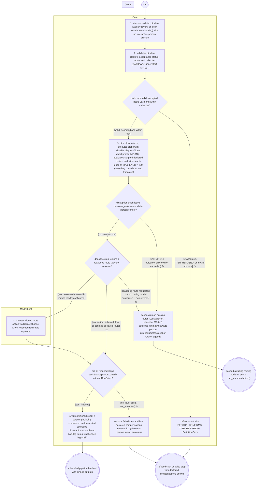

<!-- generated by render_pack.py from scheduled-pipeline.spec.yaml sha256=1f1077a1838fdba4495d4a48d6ab15352487cd27fee835c38f0322620c543450; edit the spec, not this file -->
# Run a scheduled pipeline, as it runs today

**UC16 · as-is · `IMPLEMENTED_VERIFIED`** · spec [scheduled-pipeline.spec.yaml](../scheduled-pipeline.spec.yaml)

## Written use case

| Field | Content |
|---|---|
| **Use case name** | Run a scheduled pipeline |
| **Brief description** | Runs shipped pipelines (weekly-review, clear-enrichment-backlog) via workflows.Runner with closure pinning (MF-017), dispatch/done checkpoints (MF-018) and MAX_EACH = 200. |
| **Primary actor** | Core |
| **Supporting actors** | Owner, Model host |
| **Preconditions** | Pipeline and all reachable workflows accepted (or standard set) and caller holds required tier |
| **Trigger** | A scheduled invocation starts a standard pipeline without a person present |
| **Success guarantee** | Every step runs once through REGISTRY.call and writes outputs to .librarian/runs/<id>.jsonl |
| **Minimal guarantee** | A missing routing model or crash before done (outcome_unknown) pauses at the step; failed steps show compensations newest-first without auto-running them |
| **Open questions** | Where do high-risk holds or paused steps go when no interactive caller or tier 0 is present? |

**Main success scenario** (generated: the guard-true path, in step order)

1. The Core starts scheduled pipeline (weekly-review or clear-enrichment-backlog) with no interactive person present.
2. The Core validates pipeline closure, acceptance status, inputs and caller tier (workflows.Runner.start; MF-017).
3. The Core pins closure texts, executes steps with durable dispatch/done checkpoints (MF-018), evaluates scripted declared routes, and slices each-loops at MAX_EACH = 200 (recording considered and truncated).
4. The Model host chooses closed route option via Router.choose when reasoned routing is requested.
5. The Core writes finished event + outputs (including considered and truncated counts) to .librarian/runs/<id>.jsonl (and backlog item if unattended high-risk).

**Extensions** (generated: one per non-happy guard; numbered by the step it leaves)

- **2a** (from: is closure valid, accepted, inputs valid and within caller tier?) *anticipated*
  - `2a1` Unaccepted, TIER_REFUSED, or invalid closure.
  - `2a2` The Core refuses start with PERSON_CONFIRMS, TIER_REFUSED or DefinitionError.
  - `2a3` The use case ends: refused start or failed step with declared compensations shown.
- **3a** (from: did a prior crash leave outcome_unknown or did a person cancel?) *anticipated*
  - `3a1` Yes: MF-018 outcome_unknown or cancelled.
  - `3a2` The Core pauses run on missing router (LookupError), cancel or MF-018 outcome_unknown; awaits person run_resume(choices) or Owner agenda.
  - `3a3` The use case ends: paused awaiting routing model or person run_resume(choices).
- **4a** (from: does the step require a reasoned route (decide: reason)?) *anticipated*
  - `4a1` No: action, sub-workflow, or scripted declared route.
  - `4a2` The Core decides: did all required steps satisfy acceptance_criteria without RunFailed?
  - `4a2a` If no: RunFailed / not_accepted: records failed step and lists declared compensations newest-first (shown to person, never auto-run).
  - `4a3` If yes: finished:
  - `4a4` Rejoin at 5.
- **4b** (from: does the step require a reasoned route (decide: reason)?) *anticipated*
  - `4b1` Reasoned route requested but no routing model configured (LookupError).
  - `4b2` The Core pauses run on missing router (LookupError), cancel or MF-018 outcome_unknown; awaits person run_resume(choices) or Owner agenda.
  - `4b3` The use case ends: paused awaiting routing model or person run_resume(choices).
- **4c** (from: did all required steps satisfy acceptance_criteria without RunFailed?) *anticipated*
  - `4c1` No: RunFailed / not_accepted.
  - `4c2` The Core records failed step and lists declared compensations newest-first (shown to person, never auto-run).
  - `4c3` The use case ends: refused start or failed step with declared compensations shown.

## Activity diagram



## Lane load

| Lane | On the main success scenario | Anywhere in the diagram |
|---|---|---|
| Owner | 0 | 0 |
| Core | 8 | 11 |
| Model host | 1 | 1 |

Paths by how they end: **escalated** 2, **paused** 2, **success** 1. Every *escalated* path is a failure of this use case: the work went back to tier 0.

## Decision tree

```text
start: Run a scheduled pipeline, as it runs today
        └─ T1: valid, accepted and within tier / no: ready to run / yes: reasoned route with routing model configured / yes: finished  ⇒ scheduled pipeline finished with pinned outputs
  └─ T2: unaccepted, TIER_REFUSED, or invalid closure  ⇒ refused start or failed step with declared compensations shown
    └─ T3: valid, accepted and within tier / yes: MF-018 outcome_unknown or cancelled  ⇒ paused awaiting routing model or person run_resume(choices)
      └─ T4: valid, accepted and within tier / no: ready to run / no: action, sub-workflow, or scripted declared route  ⇒ rejoins at 'did all required steps satisfy acceptance_criteria without RunFailed?' (before step 5)
      └─ T5: valid, accepted and within tier / no: ready to run / reasoned route requested but no routing model configured (LookupError)  ⇒ paused awaiting routing model or person run_resume(choices)
        └─ T6: valid, accepted and within tier / no: ready to run / yes: reasoned route with routing model configured / no: RunFailed / not_accepted  ⇒ refused start or failed step with declared compensations shown
```

## Test cases

One test per path: the main success scenario, then each extension.

| Test | Path (guards taken) | Extension | Expected outcome |
|---|---|---|---|
| T1 | is closure valid, accepted, inputs valid and within caller tier? → valid, accepted and within tier; did a prior crash leave outcome_unknown or did a person cancel? → no: ready to run; does the step require a reasoned route (decide: reason)? → yes: reasoned route with routing model configured; did all required steps satisfy acceptance_criteria without RunFailed? → yes: finished | MSS | scheduled pipeline finished with pinned outputs |
| T2 | is closure valid, accepted, inputs valid and within caller tier? → unaccepted, TIER_REFUSED, or invalid closure | 2a | refused start or failed step with declared compensations shown |
| T3 | is closure valid, accepted, inputs valid and within caller tier? → valid, accepted and within tier; did a prior crash leave outcome_unknown or did a person cancel? → yes: MF-018 outcome_unknown or cancelled | 3a | paused awaiting routing model or person run_resume(choices) |
| T4 | is closure valid, accepted, inputs valid and within caller tier? → valid, accepted and within tier; did a prior crash leave outcome_unknown or did a person cancel? → no: ready to run; does the step require a reasoned route (decide: reason)? → no: action, sub-workflow, or scripted declared route | 4a | rejoins at 'did all required steps satisfy acceptance_criteria without RunFailed?' (before step 5) |
| T5 | is closure valid, accepted, inputs valid and within caller tier? → valid, accepted and within tier; did a prior crash leave outcome_unknown or did a person cancel? → no: ready to run; does the step require a reasoned route (decide: reason)? → reasoned route requested but no routing model configured (LookupError) | 4b | paused awaiting routing model or person run_resume(choices) |
| T6 | is closure valid, accepted, inputs valid and within caller tier? → valid, accepted and within tier; did a prior crash leave outcome_unknown or did a person cancel? → no: ready to run; does the step require a reasoned route (decide: reason)? → yes: reasoned route with routing model configured; did all required steps satisfy acceptance_criteria without RunFailed? → no: RunFailed / not_accepted | 4c | refused start or failed step with declared compensations shown |

### Boundary values

| Decision | Values to test | Expected |
|---|---|---|
| pins closure texts, executes steps with durable dispatch/done checkpoints (MF-018), evaluates scripted declared routes, and slices each-loops at MAX_EACH = 200 (recording considered and truncated) | 200 items in each-list; 201 items in each-list; closure altered mid-run | 200 runs all 200 with truncated=false; 201 slices to first 200 with considered=200, truncated=true (never refused at admission); altered closure refuses run/resume |

## Weaknesses and gaps

_None recorded._

## Evidence

- src/resource_librarian/standard/pipelines/{weekly-review,clear-enrichment-backlog}.yaml.
- src/resource_librarian/workflows.py:116,282-300,864-1194 (MAX_EACH=200 slices at loop in _steps/_route, MF-017 Pinned, MF-018 outcome_unknown in Core, Router.choose in Model host, compensations).

## Checks

Errors: none

Warnings: none
