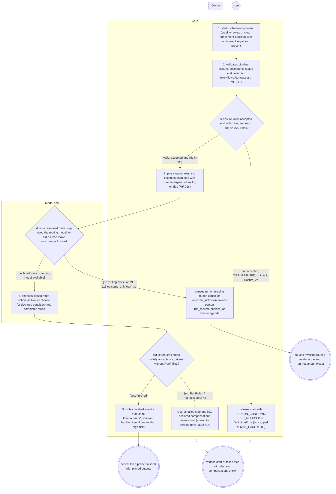

<!-- generated by render_pack.py from scheduled-pipeline.spec.yaml sha256=92828575862e3cccb0c7809a46b6e2f53e3c9d82a71c78bcbb363a82e126c5bf; edit the spec, not this file -->
# Run a scheduled pipeline, as it runs today

**UC16 · as-is · `IMPLEMENTED_VERIFIED`** · spec [scheduled-pipeline.spec.yaml](../scheduled-pipeline.spec.yaml)

## Written use case

| Field | Content |
|---|---|
| **Use case name** | Run a scheduled pipeline |
| **Brief description** | Runs shipped pipelines (weekly-review, clear-enrichment-backlog) via workflows.Runner with closure pinning (MF-017), dispatch/done checkpoints (MF-018) and MAX_EACH = 200. |
| **Primary actor** | Core |
| **Supporting actors** | Owner, Model host |
| **Preconditions** | Pipeline and all reachable workflows accepted (or standard set) and caller holds required tier |
| **Trigger** | A scheduled invocation starts a standard pipeline without a person present |
| **Success guarantee** | Every step runs once through REGISTRY.call and writes outputs to .librarian/runs/<id>.jsonl |
| **Minimal guarantee** | A missing routing model or crash before done (outcome_unknown) pauses at the step; failed steps show compensations newest-first without auto-running them |
| **Open questions** | Where do high-risk holds or paused steps go when no interactive caller or tier 0 is present? |

**Main success scenario** (generated: the guard-true path, in step order)

1. The Core starts scheduled pipeline (weekly-review or clear-enrichment-backlog) with no interactive person present.
2. The Core validates pipeline closure, acceptance status and caller tier (workflows.Runner.start; MF-017).
3. The Core pins closure texts and executes each step with durable dispatch/done log entries (MF-018).
4. The Model host chooses closed route option via Router.choose (or declared condition) and completes steps.
5. The Core writes finished event + outputs to .librarian/runs/<id>.jsonl (and backlog item if unattended high-risk).

**Extensions** (generated: one per non-happy guard; numbered by the step it leaves)

- **2a** (from: is closure valid, accepted and within tier, and each loop <= 200 items?) *anticipated*
  - `2a1` Unaccepted, TIER_REFUSED, or invalid closure.
  - `2a2` The Core refuses start with PERSON_CONFIRMS, TIER_REFUSED or DefinitionError (list capped at MAX_EACH = 200).
  - `2a3` The use case ends: refused start or failed step with declared compensations shown.
- **3a** (from: does a reasoned route step need the routing model, or did a crash leave outcome_unknown?) *anticipated*
  - `3a1` No routing model or MF-018 outcome_unknown.
  - `3a2` The Core pauses run on missing router, cancel or outcome_unknown; awaits person run_resume(choices) or Owner agenda.
  - `3a3` The use case ends: paused awaiting routing model or person run_resume(choices).
- **4a** (from: did all required steps satisfy acceptance_criteria without RunFailed?) *anticipated*
  - `4a1` No: RunFailed / not_accepted.
  - `4a2` The Core records failed step and lists declared compensations newest-first (shown to person, never auto-run).
  - `4a3` The use case ends: refused start or failed step with declared compensations shown.

## Activity diagram



## Lane load

| Lane | On the main success scenario | Anywhere in the diagram |
|---|---|---|
| Owner | 0 | 0 |
| Core | 6 | 9 |
| Model host | 2 | 2 |

Paths by how they end: **escalated** 2, **paused** 1, **success** 1. Every *escalated* path is a failure of this use case: the work went back to tier 0.

## Decision tree

```text
start: Run a scheduled pipeline, as it runs today
      └─ T1: valid, accepted and within tier / declared route or routing model available / yes: finished  ⇒ scheduled pipeline finished with pinned outputs
  └─ T2: unaccepted, TIER_REFUSED, or invalid closure  ⇒ refused start or failed step with declared compensations shown
    └─ T3: valid, accepted and within tier / no routing model or MF-018 outcome_unknown  ⇒ paused awaiting routing model or person run_resume(choices)
      └─ T4: valid, accepted and within tier / declared route or routing model available / no: RunFailed / not_accepted  ⇒ refused start or failed step with declared compensations shown
```

## Test cases

One test per path: the main success scenario, then each extension.

| Test | Path (guards taken) | Extension | Expected outcome |
|---|---|---|---|
| T1 | is closure valid, accepted and within tier, and each loop <= 200 items? → valid, accepted and within tier; does a reasoned route step need the routing model, or did a crash leave outcome_unknown? → declared route or routing model available; did all required steps satisfy acceptance_criteria without RunFailed? → yes: finished | MSS | scheduled pipeline finished with pinned outputs |
| T2 | is closure valid, accepted and within tier, and each loop <= 200 items? → unaccepted, TIER_REFUSED, or invalid closure | 2a | refused start or failed step with declared compensations shown |
| T3 | is closure valid, accepted and within tier, and each loop <= 200 items? → valid, accepted and within tier; does a reasoned route step need the routing model, or did a crash leave outcome_unknown? → no routing model or MF-018 outcome_unknown | 3a | paused awaiting routing model or person run_resume(choices) |
| T4 | is closure valid, accepted and within tier, and each loop <= 200 items? → valid, accepted and within tier; does a reasoned route step need the routing model, or did a crash leave outcome_unknown? → declared route or routing model available; did all required steps satisfy acceptance_criteria without RunFailed? → no: RunFailed / not_accepted | 4a | refused start or failed step with declared compensations shown |

### Boundary values

| Decision | Values to test | Expected |
|---|---|---|
| is closure valid, accepted and within tier, and each loop <= 200 items? | list = 200 items; 201 items; closure altered mid-run | loops truncate at MAX_EACH = 200; altered closure or unaccepted workflow refuses run/resume |

## Weaknesses and gaps

_None recorded._

## Evidence

- src/resource_librarian/standard/pipelines/{weekly-review,clear-enrichment-backlog}.yaml.
- src/resource_librarian/workflows.py:116,282-300,864-1194 (MAX_EACH=200, MF-017 Pinned, MF-018 outcome_unknown, Router, compensations).

## Checks

Errors: none

Warnings: none
