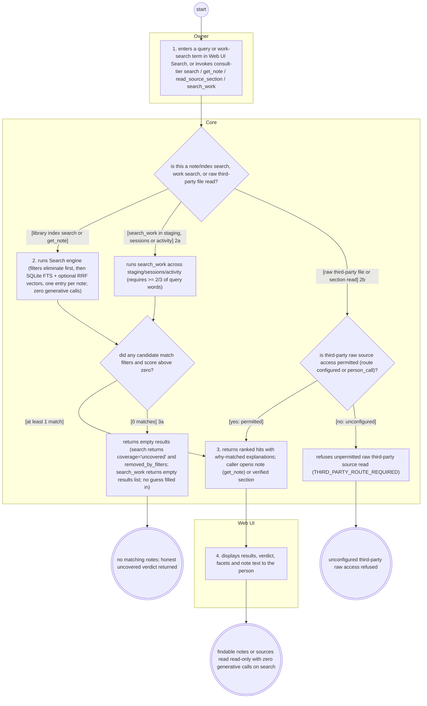

<!-- generated by render_pack.py from search-and-read.spec.yaml sha256=309a54434edb7d1663263e513cceaa3956cbadfa0af4999310fb96b898e7dad2; edit the spec, not this file -->
# Search and read the library, as it runs today

**UC10 · as-is · `IMPLEMENTED_VERIFIED`** · spec [search-and-read.spec.yaml](../search-and-read.spec.yaml)

## Written use case

| Field | Content |
|---|---|
| **Use case name** | Search and read the library |
| **Brief description** | Read-only search and retrieval via Web UI Search or MCP search / get_note / read_source_section / search_work, with zero generative model calls on search. |
| **Primary actor** | Owner |
| **Supporting actors** | Web UI, Core |
| **Preconditions** | A Core is running with the SQLite FTS index (and optional vectors) |
| **Trigger** | The person submits a query or opens a note or work item |
| **Success guarantee** | Ranked hits with why-matched explanations or source text returned read-only |
| **Minimal guarantee** | Invalid filters or unpermitted third-party raw reads are refused cleanly; zero-hit queries return uncovered with removed_by_filters |
| **Open questions** | Should broken index/unreadable local notes route to a ticketed repair instead of failing ad hoc? |

**Main success scenario** (generated: the guard-true path, in step order)

1. The Owner enters a query or work-search term in Web UI Search, or invokes consult-tier search / get_note / read_source_section / search_work.
2. The Core runs Search engine (filters eliminate first, then SQLite FTS + optional RRF vectors, one entry per note; zero generative calls).
3. The Core returns ranked hits with why-matched explanations; caller opens note (get_note) or verified section.
4. The Web UI displays results, verdict, facets and note text to the person.

**Extensions** (generated: one per non-happy guard; numbered by the step it leaves)

- **2a** (from: is this a note/index search, work search, or raw third-party file read?) *anticipated*
  - `2a1` Search_work in staging, sessions or activity.
  - `2a2` The Core runs search_work across staging/sessions/activity (requires >= 2/3 of query words).
  - `2a3` The Core decides: did any candidate match filters and score above zero?
  - `2a3a` If 0 matches: returns empty results (search returns coverage='uncovered' and removed_by_filters; search_work returns empty results list; no guess filled in).
  - `2a4` If at least 1 match:
  - `2a5` Rejoin at 3.
- **2b** (from: is this a note/index search, work search, or raw third-party file read?) *anticipated*
  - `2b1` Raw third-party file or section read.
  - `2b2` The Core decides: is third-party raw source access permitted (route configured or person_call)?
  - `2b2a` If no: unconfigured: refuses unpermitted raw third-party source read (THIRD_PARTY_ROUTE_REQUIRED).
  - `2b3` If yes: permitted:
  - `2b4` Rejoin at 3.
- **3a** (from: did any candidate match filters and score above zero?) *anticipated*
  - `3a1` 0 matches.
  - `3a2` The Core returns empty results (search returns coverage='uncovered' and removed_by_filters; search_work returns empty results list; no guess filled in).
  - `3a3` The use case ends: no matching notes; honest uncovered verdict returned.

## Activity diagram



## Lane load

| Lane | On the main success scenario | Anywhere in the diagram |
|---|---|---|
| Owner | 1 | 1 |
| Web UI | 1 | 1 |
| Core | 4 | 8 |

Paths by how they end: **partial** 1, **refused** 1, **success** 1.

## Decision tree

```text
start: Search and read the library, as it runs today
    └─ T1: library index search or get_note / at least 1 match  ⇒ findable notes or sources read read-only with zero generative calls on search
  └─ T2: search_work in staging, sessions or activity  ⇒ rejoins at 'did any candidate match filters and score above zero?' (before step 3)
    └─ T3: raw third-party file or section read / no: unconfigured  ⇒ unconfigured third-party raw access refused
    └─ T4: raw third-party file or section read / yes: permitted  ⇒ rejoins at step 3
    └─ T5: library index search or get_note / 0 matches  ⇒ no matching notes; honest uncovered verdict returned
```

## Test cases

One test per path: the main success scenario, then each extension.

| Test | Path (guards taken) | Extension | Expected outcome |
|---|---|---|---|
| T1 | is this a note/index search, work search, or raw third-party file read? → library index search or get_note; did any candidate match filters and score above zero? → at least 1 match | MSS | findable notes or sources read read-only with zero generative calls on search |
| T2 | is this a note/index search, work search, or raw third-party file read? → search_work in staging, sessions or activity | 2a | rejoins at 'did any candidate match filters and score above zero?' (before step 3) |
| T3 | is this a note/index search, work search, or raw third-party file read? → raw third-party file or section read; is third-party raw source access permitted (route configured or person_call)? → no: unconfigured | 2b | unconfigured third-party raw access refused |
| T4 | is this a note/index search, work search, or raw third-party file read? → raw third-party file or section read; is third-party raw source access permitted (route configured or person_call)? → yes: permitted | 2b | rejoins at step 3 |
| T5 | is this a note/index search, work search, or raw third-party file read? → library index search or get_note; did any candidate match filters and score above zero? → 0 matches | 3a | no matching notes; honest uncovered verdict returned |

### Boundary values

| Decision | Values to test | Expected |
|---|---|---|
| did any candidate match filters and score above zero? | 0 matching notes; 1 match; multiple matches | 0 returns uncovered with removed_by_filters; 1 or more returns ranked results |

## Weaknesses and gaps

_None recorded._

## Evidence

- src/resource_librarian/search.py:11-28 (CONSTRAINTS_ELIMINATE, READS_NEVER_CALL_A_GENERATIVE_MODEL, EVERY_RESULT_SAYS_WHY).
- src/resource_librarian/tools/work_search.py:23-27 (_matched 2/3-word floor); src/resource_librarian/read_access.py (THIRD_PARTY_ROUTE_REQUIRED).

## Checks

Errors: none

Warnings: none
