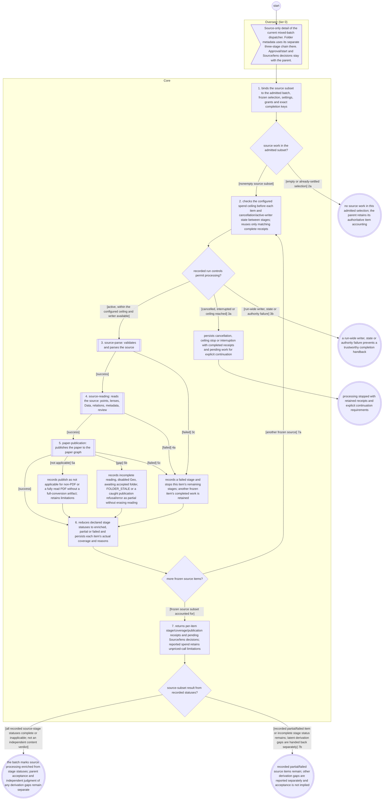

<!-- generated by render_pack.py from source-enrichment.spec.yaml sha256=a017c2e7efdfab646807aa7a1ecc25dfd57924b7fed9aac5a39e72433aa8b7e3; edit the spec, not this file -->
# Current source enrichment: scripted stages and legacy model tasks

**UC1c · as-is · `IMPLEMENTED_VERIFIED`** · spec [source-enrichment.spec.yaml](../source-enrichment.spec.yaml)
Supersedes: `reports/2026-11-21-enrichment-baseline/source-enrichment-current.spec.yaml`

| Problem | |
|---|---|
| symptom | An ingestion summary can hide processing-start, per-item publication, partial outputs and later acceptance. |
| why | A finished batch can contain partial or failed items, and model-call completion does not mean a valid task answer.; The current batch has scripted services and legacy model tasks, without the proposed autonomous Lead/Clerk/Scribe and Oracle/Doctor loop. |
| root | The parent needs the actual nine-stage child contract and per-item outcomes, separate from proposed coordination. |

## Written use case

| Field | Content |
|---|---|
| **Use case name** | Enrich one source |
| **Brief description** | For each frozen source: parse, read, publish, then reduce the stage statuses to the item's status. |
| **Primary actor** | Core |
| **Supporting actors** | Model worker, model host, Geo-Grapher |
| **Preconditions** | The source is in the frozen selection |
| **Trigger** | The batch reaches the item |
| **Success guarantee** | enriched, with full coverage recorded |
| **Minimal guarantee** | partial or failed, with what was not examined |
| **Open questions** | Model-call completion is not a valid answer: who judges the answers? |

**Main success scenario** (generated: the guard-true path, in step order)

1. The Core binds the source subset to the admitted batch, frozen selection, settings, grants and exact completion keys.
2. The Core checks the configured spend ceiling before each item and cancellation/active-writer state between stages; reuses only matching complete receipts.
3. The Core validates and parses the source.
4. The Core reads the source: points, lenses, Data, relations, metadata, review.
5. The Core publishes the paper to the paper graph.
6. The Core reduces declared stage statuses to enriched, partial or failed and persists each item's actual coverage and reasons.
7. The Core returns per-item stage/coverage/publication receipts and pending Source/lens decisions; reported spend retains unpriced-call limitations.

**Extensions** (generated: one per non-happy guard; numbered by the step it leaves)

- **2a** (from: source work in the admitted subset?) *anticipated*
  - `2a1` Empty or already-settled selection.
  - `2a2` The use case ends: no source work in this admitted selection; the parent retains its authoritative item accounting.
- **3a** (from: recorded run controls permit processing?) *observed: eight cancellations and no ceiling stop in the cross-library audit*
  - `3a1` Cancelled, interrupted or ceiling reached.
  - `3a2` The Core persists cancellation, ceiling stop or interruption with completed receipts and pending work for explicit continuation.
  - `3a3` The use case ends: processing stopped with retained receipts and explicit continuation requirements.
- **3b** (from: recorded run controls permit processing?) *anticipated*
  - `3b1` Run-wide writer, state or authority failure.
  - `3b2` The use case ends: a run-wide writer, state or authority failure prevents a trustworthy completion handback.
- **7a** (from: more frozen source items?) *anticipated*
  - `7a1` Another frozen source.
  - `7a2` Rejoin at 2.
- **7b** (from: source-subset result from recorded statuses?) *anticipated*
  - `7b1` Recorded partial/failed item or incomplete stage status remains; latent derivation gaps are handed back separately.
  - `7b2` The use case ends: recorded partial/failed source items remain; other derivation gaps are reported separately and acceptance is not implied.
- **3c** (from: validates and parses the source) *anticipated*
  - `3c1` Failed.
  - `3c2` The Core records a failed stage and stops this item's remaining stages; another frozen item's completed work is retained.
  - `3c3` Rejoin at 6.
- **4a** (from: reads the source: points, lenses, Data, relations, metadata, review) *anticipated*
  - `4a1` Failed.
  - `4a2` The Core records a failed stage and stops this item's remaining stages; another frozen item's completed work is retained.
  - `4a3` Rejoin at 6.
- **5a** (from: publishes the paper to the paper graph) *anticipated*
  - `5a1` Not applicable.
  - `5a2` The Core records publish as not applicable for non-PDF or a fully read PDF without a full-conversion artifact; retains limitations.
  - `5a3` Rejoin at 6.
- **5b** (from: publishes the paper to the paper graph) *anticipated*
  - `5b1` Gap.
  - `5b2` The Core records incomplete reading, disabled Geo, awaiting accepted folder, FOLDER_STALE or a caught publication refusal/error as partial without erasing reading.
  - `5b3` Rejoin at 6.
- **5c** (from: publishes the paper to the paper graph) *anticipated*
  - `5c1` Failed.
  - `5c2` The Core records a failed stage and stops this item's remaining stages; another frozen item's completed work is retained.
  - `5c3` Rejoin at 6.

## Activity diagram



## Lane load

| Lane | On the main success scenario | Anywhere in the diagram |
|---|---|---|
| Overseer (tier 0) | 0 | 0 |
| Core | 11 | 15 |

**Tier-0 turns** (each return of control to tier 0; owner's scale: 2 ideal, 3 expected, 4 rusty, 5–10 bad, more: might as well have done it themselves). Main success scenario: **1 (ideal)**. Worst path: T11, **1 (ideal)**. Paths by grade: ideal 10; escalated 1 (failures, not graded).

Paths by how they end: **escalated** 1, **partial** 1, **paused** 1, **reused** 1, **success** 1. Every *escalated* path is a failure of this use case: the work went back to tier 0.

## Decision tree

```text
start: Current source enrichment: scripted stages and legacy model tasks
              └─ T1: nonempty source subset / active, within the configured ceiling and writer available / success / success / success / frozen source subset accounted for / all recorded source-stage statuses complete or inapplicable; not an independent content verdict  ⇒ the batch marks source processing enriched from stage statuses; parent acceptance and independent judgment of any derivation gaps remain separate
  └─ T2: empty or already-settled selection  ⇒ no source work in this admitted selection; the parent retains its authoritative item accounting
    └─ T3: nonempty source subset / cancelled, interrupted or ceiling reached  ⇒ processing stopped with retained receipts and explicit continuation requirements
    └─ T4: nonempty source subset / run-wide writer, state or authority failure  ⇒ a run-wide writer, state or authority failure prevents a trustworthy completion handback
      └─ T5: nonempty source subset / active, within the configured ceiling and writer available / failed  ⇒ rejoins at step 6
        └─ T6: nonempty source subset / active, within the configured ceiling and writer available / success / failed  ⇒ rejoins at step 6
          └─ T7: nonempty source subset / active, within the configured ceiling and writer available / success / success / not applicable  ⇒ rejoins at step 6
          └─ T8: nonempty source subset / active, within the configured ceiling and writer available / success / success / gap  ⇒ rejoins at step 6
          └─ T9: nonempty source subset / active, within the configured ceiling and writer available / success / success / failed  ⇒ rejoins at step 6
            └─ T10: nonempty source subset / active, within the configured ceiling and writer available / success / success / success / another frozen source  ⇒ rejoins at step 2
              └─ T11: nonempty source subset / active, within the configured ceiling and writer available / success / success / success / frozen source subset accounted for / recorded partial/failed item or incomplete stage status remains; latent derivation gaps are handed back separately  ⇒ recorded partial/failed source items remain; other derivation gaps are reported separately and acceptance is not implied
```

## Test cases

One test per path: the main success scenario, then each extension.

| Test | Path (guards taken) | Extension | Expected outcome | Tier-0 turns |
|---|---|---|---|---|
| T1 | source work in the admitted subset? → nonempty source subset; recorded run controls permit processing? → active, within the configured ceiling and writer available; validates and parses the source → success; reads the source: points, lenses, Data, relations, metadata, review → success; publishes the paper to the paper graph → success; more frozen source items? → frozen source subset accounted for; source-subset result from recorded statuses? → all recorded source-stage statuses complete or inapplicable; not an independent content verdict | MSS | the batch marks source processing enriched from stage statuses; parent acceptance and independent judgment of any derivation gaps remain separate | 1 (ideal) |
| T2 | source work in the admitted subset? → empty or already-settled selection | 2a | no source work in this admitted selection; the parent retains its authoritative item accounting | 1 (ideal) |
| T3 | source work in the admitted subset? → nonempty source subset; recorded run controls permit processing? → cancelled, interrupted or ceiling reached | 3a | processing stopped with retained receipts and explicit continuation requirements | 1 (ideal) |
| T4 | source work in the admitted subset? → nonempty source subset; recorded run controls permit processing? → run-wide writer, state or authority failure | 3b | a run-wide writer, state or authority failure prevents a trustworthy completion handback | 1 (escalated: a failure) |
| T5 | source work in the admitted subset? → nonempty source subset; recorded run controls permit processing? → active, within the configured ceiling and writer available; validates and parses the source → failed | 3c | rejoins at step 6 | 1 (ideal) |
| T6 | source work in the admitted subset? → nonempty source subset; recorded run controls permit processing? → active, within the configured ceiling and writer available; validates and parses the source → success; reads the source: points, lenses, Data, relations, metadata, review → failed | 4a | rejoins at step 6 | 1 (ideal) |
| T7 | source work in the admitted subset? → nonempty source subset; recorded run controls permit processing? → active, within the configured ceiling and writer available; validates and parses the source → success; reads the source: points, lenses, Data, relations, metadata, review → success; publishes the paper to the paper graph → not applicable | 5a | rejoins at step 6 | 1 (ideal) |
| T8 | source work in the admitted subset? → nonempty source subset; recorded run controls permit processing? → active, within the configured ceiling and writer available; validates and parses the source → success; reads the source: points, lenses, Data, relations, metadata, review → success; publishes the paper to the paper graph → gap | 5b | rejoins at step 6 | 1 (ideal) |
| T9 | source work in the admitted subset? → nonempty source subset; recorded run controls permit processing? → active, within the configured ceiling and writer available; validates and parses the source → success; reads the source: points, lenses, Data, relations, metadata, review → success; publishes the paper to the paper graph → failed | 5c | rejoins at step 6 | 1 (ideal) |
| T10 | source work in the admitted subset? → nonempty source subset; recorded run controls permit processing? → active, within the configured ceiling and writer available; validates and parses the source → success; reads the source: points, lenses, Data, relations, metadata, review → success; publishes the paper to the paper graph → success; more frozen source items? → another frozen source | 7a | rejoins at step 2 | 1 (ideal) |
| T11 | source work in the admitted subset? → nonempty source subset; recorded run controls permit processing? → active, within the configured ceiling and writer available; validates and parses the source → success; reads the source: points, lenses, Data, relations, metadata, review → success; publishes the paper to the paper graph → success; more frozen source items? → frozen source subset accounted for; source-subset result from recorded statuses? → recorded partial/failed item or incomplete stage status remains; latent derivation gaps are handed back separately | 7b | recorded partial/failed source items remain; other derivation gaps are reported separately and acceptance is not implied | 1 (ideal) |

### Boundary values

| Decision | Values to test | Expected |
|---|---|---|
| recorded run controls permit processing? | spend below the ceiling; equal to it; the next item would pass it; cancelled between stages | the run stops before the item that would pass the ceiling |

## Weaknesses and gaps

| Id | Kind | Where | Weakness | Evidence | Handled in the to-be by |
|---|---|---|---|---|---|
| W-SRC-01 | unverified | summary | A completed model call is counted as a stage done; nothing judges whether the answer is a valid answer to the task. | source-enrichment problem.why | `source-enrichment` |

## Checks

Errors: none

Warnings: none
