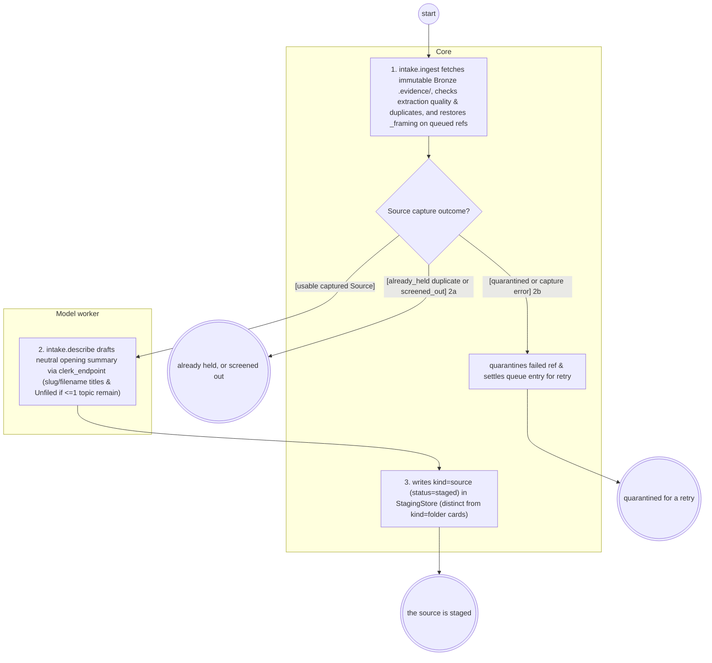

<!-- generated by render_pack.py from source-intake.spec.yaml sha256=2c4805a3ad7305e522999f25a149f8d26faf38b53d8c719c5a913d16955487bc; edit the spec, not this file -->
# Capture, describe and stage a source, as it runs today

**UC1.2 · as-is · `IMPLEMENTED_VERIFIED`** · spec [source-intake.spec.yaml](../source-intake.spec.yaml)

## Written use case

| Field | Content |
|---|---|
| **Use case name** | Capture, describe and stage a source |
| **Brief description** | Intake fetches immutable evidence, drafts a neutral description and stages the source. |
| **Primary actor** | Core |
| **Supporting actors** | Model worker (describe) |
| **Preconditions** | A reference was ingested or queued |
| **Trigger** | ingest, intake_run or run-queue |
| **Success guarantee** | A staged source with its evidence and description |
| **Minimal guarantee** | A duplicate is linked, not staged; a failure is quarantined for retry |
| **Open questions** | Titles fall back to the file name, and topics to Unfiled: who fixes them, when? |

**Main success scenario** (generated: the guard-true path, in step order)

1. The Core intake.ingest fetches immutable Bronze .evidence/, checks extraction quality & duplicates, and restores _framing on queued refs.
2. The Model worker intake.describe drafts neutral opening summary via clerk_endpoint (slug/filename titles & Unfiled if <=1 topic remain).
3. The Core writes kind=source (status=staged) in StagingStore (distinct from kind=folder cards).

**Extensions** (generated: one per non-happy guard; numbered by the step it leaves)

- **2a** (from: Source capture outcome?) *anticipated*
  - `2a1` Already_held duplicate or screened_out.
  - `2a2` The use case ends: already held, or screened out.
- **2b** (from: Source capture outcome?) *anticipated*
  - `2b1` Quarantined or capture error.
  - `2b2` The Core quarantines failed ref & settles queue entry for retry.
  - `2b3` The use case ends: quarantined for a retry.

## Activity diagram



## Lane load

| Lane | On the main success scenario | Anywhere in the diagram |
|---|---|---|
| Core | 3 | 4 |
| Model worker | 1 | 1 |

Paths by how they end: **paused** 1, **reused** 1, **success** 1.

## Decision tree

```text
start: Capture, describe and stage a source, as it runs today
  └─ T1: usable captured Source  ⇒ the source is staged
  └─ T2: already_held duplicate or screened_out  ⇒ already held, or screened out
  └─ T3: quarantined or capture error  ⇒ quarantined for a retry
```

## Test cases

One test per path: the main success scenario, then each extension.

| Test | Path (guards taken) | Extension | Expected outcome |
|---|---|---|---|
| T1 | Source capture outcome? → usable captured Source | MSS | the source is staged |
| T2 | Source capture outcome? → already_held duplicate or screened_out | 2a | already held, or screened out |
| T3 | Source capture outcome? → quarantined or capture error | 2b | quarantined for a retry |

### Boundary values

_None declared._

## Weaknesses and gaps

| Id | Kind | Where | Weakness | Evidence | Handled in the to-be by |
|---|---|---|---|---|---|
| W-INT-01 | gap | clerk_draft | Titles fall back to slugs or file names, and the topic to Unfiled; nothing schedules the fix. | clerk_draft label | `source-intake` |
| W-INT-02 | gap | quar_curr | A quarantined capture waits for someone to retry it, and nobody is told. | quar_curr label | open: The to-be capture quarantines a failed sibling and carries on, but opens no ticket for it. |

## Checks

Errors: none

Warnings: none
