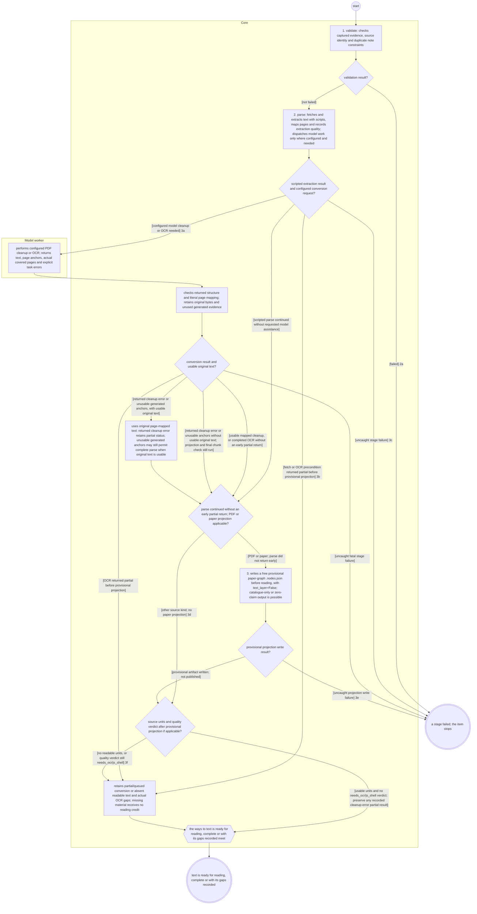

<!-- generated by render_pack.py from source-parse.spec.yaml sha256=8a9849fb5046623ff9f0f6af916e5aa27ac729e33be37eefcfff662294733b69; edit the spec, not this file -->
# Validate and parse one source (stages 1–2), as it runs today

**UC1c.1 · as-is · `IMPLEMENTED_VERIFIED`** · spec [source-parse.spec.yaml](../source-parse.spec.yaml)

## Written use case

| Field | Content |
|---|---|
| **Use case name** | Validate and parse a source |
| **Brief description** | Validate the evidence; extract text by script; convert or OCR where configured; write the provisional paper projection. |
| **Primary actor** | Core |
| **Supporting actors** | Model worker (cleanup, OCR) |
| **Preconditions** | Captured evidence |
| **Trigger** | The item's first stage |
| **Success guarantee** | Text ready to read, with page anchors |
| **Minimal guarantee** | Missing text earns no reading credit |
| **Open questions** | The provisional projection is written before reading: what if reading never happens? |

**Main success scenario** (generated: the guard-true path, in step order)

1. The Core validate: checks captured evidence, source identity and duplicate note constraints.
2. The Core parse: fetches and extracts text with scripts, maps pages and records extraction quality; dispatches model work only where configured and needed.
3. The Core writes a free provisional paper-graph .nodes.json before reading, with text_layer=False; catalogue-only or zero-claim output is possible.

**Extensions** (generated: one per non-happy guard; numbered by the step it leaves)

- **2a** (from: validation result?) *anticipated*
  - `2a1` Failed.
  - `2a2` The use case ends: a stage failed; the item stops.
- **3a** (from: scripted extraction result and configured conversion request?) *anticipated*
  - `3a1` Configured model cleanup or OCR needed.
  - `3a2` The Model worker performs configured PDF cleanup or OCR; returns text, page anchors, actual covered pages and explicit task errors.
  - `3a3` The Core checks returned structure and literal page mapping; retains original bytes and unused generated evidence.
  - `3a4` The Core decides: conversion result and usable original text?
  - `3a4a` If returned cleanup error or unusable generated anchors, with usable original text: uses original page-mapped text: returned cleanup error retains partial status; unusable generated anchors may still permit complete parse when original text is usable.
  - `3a4a` If returned cleanup error or unusable anchors without usable original text; projection and final chunk check still run: parse continued without an early partial return; PDF or paper projection applicable?.
  - `3a4a` If OCR returned partial before provisional projection: retains partial/queued conversion or absent readable text and actual OCR gaps; missing material receives no reading credit.
  - `3a4a` If uncaught fatal stage failure: the use case ends: a stage failed; the item stops.
  - `3a5` If usable mapped cleanup, or completed OCR without an early partial return:
  - `3a6` The Core decides: parse continued without an early partial return; PDF or paper projection applicable?
  - `3a6a` If other source kind; no paper projection: source units and quality verdict after provisional projection if applicable?.
  - `3a7` If PDF or paper; parse did not return early:
  - `3a8` Rejoin at 3.
- **3b** (from: scripted extraction result and configured conversion request?) *anticipated*
  - `3b1` Fetch or OCR precondition returned partial before provisional projection.
  - `3b2` The Core retains partial/queued conversion or absent readable text and actual OCR gaps; missing material receives no reading credit.
  - `3b3` Rejoin at 'the ways to text is ready for reading, complete or with its gaps recorded meet'.
- **3c** (from: scripted extraction result and configured conversion request?) *anticipated*
  - `3c1` Uncaught stage failure.
  - `3c2` The use case ends: a stage failed; the item stops.
- **3d** (from: parse continued without an early partial return; PDF or paper projection applicable?) *anticipated*
  - `3d1` Other source kind; no paper projection.
  - `3d2` The Core decides: source units and quality verdict after provisional projection if applicable?
  - `3d2a` If no readable units, or quality verdict still needs_ocr/js_shell: retains partial/queued conversion or absent readable text and actual OCR gaps; missing material receives no reading credit.
  - `3d3` If usable units and no needs_ocr/js_shell verdict; preserve any recorded cleanup-error partial result:
  - `3d4` Rejoin at 'the ways to text is ready for reading, complete or with its gaps recorded meet'.
- **3e** (from: provisional projection write result?) *anticipated*
  - `3e1` Uncaught projection write failure.
  - `3e2` The use case ends: a stage failed; the item stops.
- **3f** (from: source units and quality verdict after provisional projection if applicable?) *anticipated*
  - `3f1` No readable units, or quality verdict still needs_ocr/js_shell.
  - `3f2` The Core retains partial/queued conversion or absent readable text and actual OCR gaps; missing material receives no reading credit.
  - `3f3` Rejoin at 'the ways to text is ready for reading, complete or with its gaps recorded meet'.

## Activity diagram



## Lane load

| Lane | On the main success scenario | Anywhere in the diagram |
|---|---|---|
| Model worker | 0 | 1 |
| Core | 8 | 12 |

Paths by how they end: **failed** 4, **success** 1.

## Decision tree

```text
start: Validate and parse one source (stages 1–2), as it runs today
          └─ T1: not failed / scripted parse continued without requested model assistance / PDF or paper; parse did not return early / provisional artifact written; not published / usable units and no needs_ocr/js_shell verdict; preserve any recorded cleanup-error partial result  ⇒ text is ready for reading, complete or with its gaps recorded
  └─ T2: failed  ⇒ a stage failed; the item stops
      └─ T3: not failed / configured model cleanup or OCR needed / returned cleanup error or unusable generated anchors, with usable original text  ⇒ rejoins at 'parse continued without an early partial return; PDF or paper projection applicable?' (before step 3)
      └─ T4: not failed / configured model cleanup or OCR needed / returned cleanup error or unusable anchors without usable original text; projection and final chunk check still run  ⇒ rejoins at 'parse continued without an early partial return; PDF or paper projection applicable?' (before step 3)
      └─ T5: not failed / configured model cleanup or OCR needed / OCR returned partial before provisional projection  ⇒ rejoins at 'the ways to text is ready for reading, complete or with its gaps recorded meet' (before step None)
      └─ T6: not failed / configured model cleanup or OCR needed / uncaught fatal stage failure  ⇒ a stage failed; the item stops
      └─ T7: not failed / configured model cleanup or OCR needed / usable mapped cleanup, or completed OCR without an early partial return  ⇒ rejoins at 'parse continued without an early partial return; PDF or paper projection applicable?' (before step 3)
    └─ T8: not failed / fetch or OCR precondition returned partial before provisional projection  ⇒ rejoins at 'the ways to text is ready for reading, complete or with its gaps recorded meet' (before step None)
    └─ T9: not failed / uncaught stage failure  ⇒ a stage failed; the item stops
      └─ T10: not failed / scripted parse continued without requested model assistance / other source kind; no paper projection  ⇒ rejoins at 'source units and quality verdict after provisional projection if applicable?' (before step None)
        └─ T11: not failed / scripted parse continued without requested model assistance / PDF or paper; parse did not return early / uncaught projection write failure  ⇒ a stage failed; the item stops
          └─ T12: not failed / scripted parse continued without requested model assistance / PDF or paper; parse did not return early / provisional artifact written; not published / no readable units, or quality verdict still needs_ocr/js_shell  ⇒ rejoins at 'the ways to text is ready for reading, complete or with its gaps recorded meet' (before step None)
```

## Test cases

One test per path: the main success scenario, then each extension.

| Test | Path (guards taken) | Extension | Expected outcome |
|---|---|---|---|
| T1 | validation result? → not failed; scripted extraction result and configured conversion request? → scripted parse continued without requested model assistance; parse continued without an early partial return; PDF or paper projection applicable? → PDF or paper; parse did not return early; provisional projection write result? → provisional artifact written; not published; source units and quality verdict after provisional projection if applicable? → usable units and no needs_ocr/js_shell verdict; preserve any recorded cleanup-error partial result | MSS | text is ready for reading, complete or with its gaps recorded |
| T2 | validation result? → failed | 2a | a stage failed; the item stops |
| T3 | validation result? → not failed; scripted extraction result and configured conversion request? → configured model cleanup or OCR needed; conversion result and usable original text? → returned cleanup error or unusable generated anchors, with usable original text | 3a | rejoins at 'parse continued without an early partial return; PDF or paper projection applicable?' (before step 3) |
| T4 | validation result? → not failed; scripted extraction result and configured conversion request? → configured model cleanup or OCR needed; conversion result and usable original text? → returned cleanup error or unusable anchors without usable original text; projection and final chunk check still run | 3a | rejoins at 'parse continued without an early partial return; PDF or paper projection applicable?' (before step 3) |
| T5 | validation result? → not failed; scripted extraction result and configured conversion request? → configured model cleanup or OCR needed; conversion result and usable original text? → OCR returned partial before provisional projection | 3a | rejoins at 'the ways to text is ready for reading, complete or with its gaps recorded meet' (before step None) |
| T6 | validation result? → not failed; scripted extraction result and configured conversion request? → configured model cleanup or OCR needed; conversion result and usable original text? → uncaught fatal stage failure | 3a | a stage failed; the item stops |
| T7 | validation result? → not failed; scripted extraction result and configured conversion request? → configured model cleanup or OCR needed; conversion result and usable original text? → usable mapped cleanup, or completed OCR without an early partial return | 3a | rejoins at 'parse continued without an early partial return; PDF or paper projection applicable?' (before step 3) |
| T8 | validation result? → not failed; scripted extraction result and configured conversion request? → fetch or OCR precondition returned partial before provisional projection | 3b | rejoins at 'the ways to text is ready for reading, complete or with its gaps recorded meet' (before step None) |
| T9 | validation result? → not failed; scripted extraction result and configured conversion request? → uncaught stage failure | 3c | a stage failed; the item stops |
| T10 | validation result? → not failed; scripted extraction result and configured conversion request? → scripted parse continued without requested model assistance; parse continued without an early partial return; PDF or paper projection applicable? → other source kind; no paper projection | 3d | rejoins at 'source units and quality verdict after provisional projection if applicable?' (before step None) |
| T11 | validation result? → not failed; scripted extraction result and configured conversion request? → scripted parse continued without requested model assistance; parse continued without an early partial return; PDF or paper projection applicable? → PDF or paper; parse did not return early; provisional projection write result? → uncaught projection write failure | 3e | a stage failed; the item stops |
| T12 | validation result? → not failed; scripted extraction result and configured conversion request? → scripted parse continued without requested model assistance; parse continued without an early partial return; PDF or paper projection applicable? → PDF or paper; parse did not return early; provisional projection write result? → provisional artifact written; not published; source units and quality verdict after provisional projection if applicable? → no readable units, or quality verdict still needs_ocr/js_shell | 3f | rejoins at 'the ways to text is ready for reading, complete or with its gaps recorded meet' (before step None) |

### Boundary values

_None declared._

## Weaknesses and gaps

| Id | Kind | Where | Weakness | Evidence | Handled in the to-be by |
|---|---|---|---|---|---|
| W-PAR-01 | risk | preproject | A provisional paper projection is written before reading; if reading then fails, a catalogue-only projection remains. | preproject label (text_layer=False) | **not yet** |

## Checks

Errors: none

Warnings: none
