<!-- generated by render_pack.py from source-reading.spec.yaml sha256=f0698b79e7f8b6aff73327c011f61a5d6e10184c397c1cc6da932c352de85a66; edit the spec, not this file -->
# Read one source (stages 3–8), as it runs today

**UC1c.2 · as-is · `IMPLEMENTED_VERIFIED`** · spec [source-reading.spec.yaml](../source-reading.spec.yaml)

## Written use case

| Field | Content |
|---|---|
| **Use case name** | Read a source |
| **Brief description** | Bounded model tasks read points, limits, terms and lenses; scripts assemble Data, relations and metadata; the review drafts the Bottom Line. |
| **Primary actor** | Model worker |
| **Supporting actors** | Model host, Core |
| **Preconditions** | Parsed text |
| **Trigger** | Stage 3 |
| **Success guarantee** | Each stage's status and its derivations recorded |
| **Minimal guarantee** | A usable draft does not override incomplete reading |
| **Open questions** | Read completion follows remaining-part counts, not whether the answers are valid |

**Main success scenario** (generated: the guard-true path, in step order)

1. The Model worker read: performs bounded points, limits, terms and grounded lens tasks; source-wide derivations retain their own outcomes.
2. The Model host answers bounded calls through configured legacy routes and their existing task pool; reports transport completion or failure.
3. The Core checks schemas, literal support, keys and part counters; preserves task/derivation records, although batch read completion currently follows remaining-part counts.
4. The Core lenses: records proposals already derived during reading; zero candidates or nothing read can be valid; no lens is accepted here.
5. The Core Data: assembles kind-specific records from scripted structure and existing current-text readings; preserves partial or inapplicable coverage.
6. The Model worker relate: proposes relations between eligible fully read document components; zero added relations can be valid.
7. The Core metadata: copies limited literal Data facts where available and lists required unknown fields; this script is not a general semantic metadata model.
8. The Model worker review: drafts the kind-specific Bottom Line and sensitivity findings from source evidence, retaining no answer, refusal and low confidence.
9. The Core checks returned draft structure, literal grounding and reading counters; a usable draft does not override incomplete reading.

**Extensions** (generated: one per non-happy guard; numbered by the step it leaves)

- **4a** (from: read stage result?) *anticipated*
  - `4a1` Failed.
  - `4a2` The use case ends: a stage failed; the item stops.
- **5a** (from: lenses stage result?) *anticipated*
  - `5a1` Failed.
  - `5a2` The use case ends: a stage failed; the item stops.
- **6a** (from: Data stage result and document relation applicability?) *anticipated*
  - `6a1` Not failed; static or inapplicable relations.
  - `6a2` The Core retains existing static relations or records relations as not applicable; does not invent a model call.
  - `6a3` The Core decides: relate stage result?
  - `6a3a` If failed: the use case ends: a stage failed; the item stops.
  - `6a4` If not failed; retain queued, partial or inapplicable results:
  - `6a5` Rejoin at 7.
- **6b** (from: Data stage result and document relation applicability?) *anticipated*
  - `6b1` Failed.
  - `6b2` The use case ends: a stage failed; the item stops.
- **7a** (from: relate stage result?) *anticipated*
  - `7a1` Failed.
  - `7a2` The use case ends: a stage failed; the item stops.
- **8a** (from: metadata stage result?) *anticipated*
  - `8a1` Failed.
  - `8a2` The use case ends: a stage failed; the item stops.
- **9a** (from: review stage result?) *anticipated*
  - `9a1` Failed or refused stage.
  - `9a2` The use case ends: a stage failed; the item stops.

## Activity diagram

```mermaid
flowchart TD
  subgraph Model_worker["Model worker"]
    read["1. read: performs bounded points, limits, terms and grounded lens tasks; source-wide derivations retain their own outcomes"]
    relate["6. relate: proposes relations between eligible fully read document components; zero added relations can be valid"]
    review["8. review: drafts the kind-specific Bottom Line and sensitivity findings from source evidence, retaining no answer, refusal and low confidence"]
  end
  subgraph Core["Core"]
    readcheck["3. checks schemas, literal support, keys and part counters; preserves task/derivation records, although batch read completion currently follows remaining-part counts"]
    dread{"read stage result?"}
    lenses["4. lenses: records proposals already derived during reading; zero candidates or nothing read can be valid; no lens is accepted here"]
    dlenses{"lenses stage result?"}
    data["5. Data: assembles kind-specific records from scripted structure and existing current-text readings; preserves partial or inapplicable coverage"]
    ddata{"Data stage result and document relation applicability?"}
    relatestatic["retains existing static relations or records relations as not applicable; does not invent a model call"]
    drelate{"relate stage result?"}
    metadata["7. metadata: copies limited literal Data facts where available and lists required unknown fields; this script is not a general semantic metadata model"]
    dmetadata{"metadata stage result?"}
    reviewcheck["9. checks returned draft structure, literal grounding and reading counters; a usable draft does not override incomplete reading"]
    dreview{"review stage result?"}
  end
  subgraph Model_host["Model host"]
    host["2. answers bounded calls through configured legacy routes and their existing task pool; reports transport completion or failure"]
  end
  s(("start"))
  e_success((("read, with each stage's status recorded")))
  e_failed((("a stage failed; the item stops")))
  s --> read
  read --> host
  host --> readcheck
  readcheck --> dread
  dread -->|"[not failed; keep queued/partial tasks and derivations visible]"| lenses
  dread -->|"[failed] 4a"| e_failed
  lenses --> dlenses
  dlenses -->|"[not failed; none found or inapplicable is valid]"| data
  dlenses -->|"[failed] 5a"| e_failed
  data --> ddata
  ddata -->|"[not failed; eligible document components for model relation work]"| relate
  ddata -->|"[not failed; static or inapplicable relations] 6a"| relatestatic
  ddata -->|"[failed] 6b"| e_failed
  relate --> drelate
  relatestatic --> drelate
  drelate -->|"[not failed; retain queued, partial or inapplicable results]"| metadata
  drelate -->|"[failed] 7a"| e_failed
  metadata --> dmetadata
  dmetadata -->|"[not failed; Unknown is explicit]"| review
  dmetadata -->|"[failed] 8a"| e_failed
  review --> reviewcheck
  reviewcheck --> dreview
  dreview -->|"[not failed; keep queued/partial review and actual coverage]"| e_success
  dreview -->|"[failed or refused stage] 9a"| e_failed
  classDef ext stroke:#d9534f,stroke-width:2px
```



## Lane load

| Lane | On the main success scenario | Anywhere in the diagram |
|---|---|---|
| Model worker | 3 | 3 |
| Core | 11 | 12 |
| Model host | 1 | 1 |

Paths by how they end: **failed** 6, **success** 1.

## Decision tree

```text
start: Read one source (stages 3–8), as it runs today
            └─ T1: not failed; keep queued/partial tasks and derivations visible / not failed; none found or inapplicable is valid / not failed; eligible document components for model relation work / not failed; retain queued, partial or inapplicable results / not failed; Unknown is explicit / not failed; keep queued/partial review and actual coverage  ⇒ read, with each stage's status recorded
  └─ T2: failed  ⇒ a stage failed; the item stops
    └─ T3: not failed; keep queued/partial tasks and derivations visible / failed  ⇒ a stage failed; the item stops
      └─ T4: not failed; keep queued/partial tasks and derivations visible / not failed; none found or inapplicable is valid / not failed; static or inapplicable relations  ⇒ rejoins at 'relate stage result?' (before step 7)
      └─ T5: not failed; keep queued/partial tasks and derivations visible / not failed; none found or inapplicable is valid / failed  ⇒ a stage failed; the item stops
        └─ T6: not failed; keep queued/partial tasks and derivations visible / not failed; none found or inapplicable is valid / not failed; eligible document components for model relation work / failed  ⇒ a stage failed; the item stops
          └─ T7: not failed; keep queued/partial tasks and derivations visible / not failed; none found or inapplicable is valid / not failed; eligible document components for model relation work / not failed; retain queued, partial or inapplicable results / failed  ⇒ a stage failed; the item stops
            └─ T8: not failed; keep queued/partial tasks and derivations visible / not failed; none found or inapplicable is valid / not failed; eligible document components for model relation work / not failed; retain queued, partial or inapplicable results / not failed; Unknown is explicit / failed or refused stage  ⇒ a stage failed; the item stops
```

## Test cases

One test per path: the main success scenario, then each extension.

| Test | Path (guards taken) | Extension | Expected outcome |
|---|---|---|---|
| T1 | read stage result? → not failed; keep queued/partial tasks and derivations visible; lenses stage result? → not failed; none found or inapplicable is valid; Data stage result and document relation applicability? → not failed; eligible document components for model relation work; relate stage result? → not failed; retain queued, partial or inapplicable results; metadata stage result? → not failed; Unknown is explicit; review stage result? → not failed; keep queued/partial review and actual coverage | MSS | read, with each stage's status recorded |
| T2 | read stage result? → failed | 4a | a stage failed; the item stops |
| T3 | read stage result? → not failed; keep queued/partial tasks and derivations visible; lenses stage result? → failed | 5a | a stage failed; the item stops |
| T4 | read stage result? → not failed; keep queued/partial tasks and derivations visible; lenses stage result? → not failed; none found or inapplicable is valid; Data stage result and document relation applicability? → not failed; static or inapplicable relations | 6a | rejoins at 'relate stage result?' (before step 7) |
| T5 | read stage result? → not failed; keep queued/partial tasks and derivations visible; lenses stage result? → not failed; none found or inapplicable is valid; Data stage result and document relation applicability? → failed | 6b | a stage failed; the item stops |
| T6 | read stage result? → not failed; keep queued/partial tasks and derivations visible; lenses stage result? → not failed; none found or inapplicable is valid; Data stage result and document relation applicability? → not failed; eligible document components for model relation work; relate stage result? → failed | 7a | a stage failed; the item stops |
| T7 | read stage result? → not failed; keep queued/partial tasks and derivations visible; lenses stage result? → not failed; none found or inapplicable is valid; Data stage result and document relation applicability? → not failed; eligible document components for model relation work; relate stage result? → not failed; retain queued, partial or inapplicable results; metadata stage result? → failed | 8a | a stage failed; the item stops |
| T8 | read stage result? → not failed; keep queued/partial tasks and derivations visible; lenses stage result? → not failed; none found or inapplicable is valid; Data stage result and document relation applicability? → not failed; eligible document components for model relation work; relate stage result? → not failed; retain queued, partial or inapplicable results; metadata stage result? → not failed; Unknown is explicit; review stage result? → failed or refused stage | 9a | a stage failed; the item stops |

### Boundary values

_None declared._

## Weaknesses and gaps

| Id | Kind | Where | Weakness | Evidence | Handled in the to-be by |
|---|---|---|---|---|---|
| W-REA-01 | fault | readcheck | Read completion follows the remaining-part counts, not the validity of each part's answer. | readcheck label | **not yet** |
| W-REA-02 | gap | metadata | The metadata stage copies a few literal Data facts and lists the unknown fields; there is no semantic metadata step. | metadata label | **not yet** |

## Checks

Errors: none

Warnings: none
