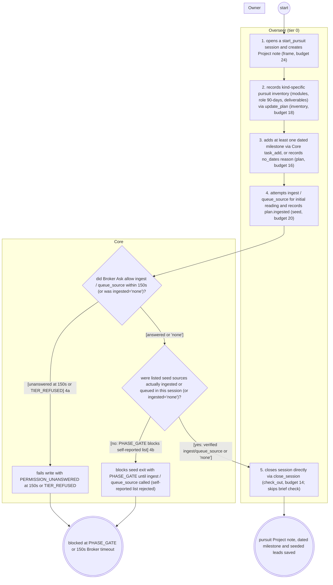

<!-- generated by render_pack.py from start-pursuit.spec.yaml sha256=3eb71829a5473e620258bc9665a1fbc7a05bd2b99fb912d0ebd5c01b606461b1; edit the spec, not this file -->
# Start a pursuit (a course, a role or a project), as it runs today

**UC13 · as-is · `IMPLEMENTED_VERIFIED`** · spec [start-pursuit.spec.yaml](../start-pursuit.spec.yaml)

## Written use case

| Field | Content |
|---|---|
| **Use case name** | Start a pursuit (a course, a role or a project) |
| **Brief description** | Tier 0 guides frame, kind-specific inventory, dated milestones (task_add), verified in-session seed ingest/queueing and checkout. |
| **Primary actor** | Overseer (tier 0) |
| **Supporting actors** | Core, Owner |
| **Preconditions** | MCP connected at contribute tier |
| **Trigger** | The Owner starts a course, role or project pursuit |
| **Success guarantee** | Project note, pursuit inventory, dated milestone and seeded leads recorded |
| **Minimal guarantee** | Self-reported ingested lists are refused by _gate_seed unless ingest or queue_source actually ran |
| **Open questions** | Should seeded sources flow through one commissioned ingestion pipeline instead of 150s Broker prompts? |

**Main success scenario** (generated: the guard-true path, in step order)

1. The Overseer (tier 0) opens a start_pursuit session and creates Project note (frame, budget 24).
2. The Overseer (tier 0) records kind-specific pursuit inventory (modules, role 90-days, deliverables) via update_plan (inventory, budget 18).
3. The Overseer (tier 0) adds at least one dated milestone via Core task_add, or records no_dates reason (plan, budget 16).
4. The Overseer (tier 0) attempts ingest / queue_source for initial reading and records plan.ingested (seed, budget 20).
5. The Overseer (tier 0) closes session directly via close_session (check_out, budget 14; skips brief check).

**Extensions** (generated: one per non-happy guard; numbered by the step it leaves)

- **4a** (from: did Broker Ask allow ingest / queue_source within 150s (or was ingested='none')?) *anticipated*
  - `4a1` Unanswered at 150s or TIER_REFUSED.
  - `4a2` The Core fails write with PERMISSION_UNANSWERED at 150s or TIER_REFUSED.
  - `4a3` The use case ends: blocked at PHASE_GATE or 150s Broker timeout.
- **4b** (from: were listed seed sources actually ingested or queued in this session (or ingested='none')?) *anticipated*
  - `4b1` No: PHASE_GATE blocks self-reported list.
  - `4b2` The Core blocks seed exit with PHASE_GATE until ingest / queue_source called (self-reported list rejected).
  - `4b3` The use case ends: blocked at PHASE_GATE or 150s Broker timeout.

## Activity diagram



## Lane load

| Lane | On the main success scenario | Anywhere in the diagram |
|---|---|---|
| Owner | 0 | 0 |
| Overseer (tier 0) | 5 | 5 |
| Core | 2 | 4 |

**Tier-0 turns** (each return of control to tier 0; owner's scale: 2 ideal, 3 expected, 4 rusty, 5–10 bad, more: might as well have done it themselves). Main success scenario: **2 (ideal)**. Worst path: T1, **2 (ideal)**. Paths by grade: ideal 3.

Paths by how they end: **paused** 2, **success** 1.

## Decision tree

```text
start: Start a pursuit (a course, a role or a project), as it runs today
    └─ T1: answered or 'none' / yes: verified ingest/queue_source or 'none'  ⇒ pursuit Project note, dated milestone and seeded leads saved
  └─ T2: unanswered at 150s or TIER_REFUSED  ⇒ blocked at PHASE_GATE or 150s Broker timeout
    └─ T3: answered or 'none' / no: PHASE_GATE blocks self-reported list  ⇒ blocked at PHASE_GATE or 150s Broker timeout
```

## Test cases

One test per path: the main success scenario, then each extension.

| Test | Path (guards taken) | Extension | Expected outcome | Tier-0 turns |
|---|---|---|---|---|
| T1 | did Broker Ask allow ingest / queue_source within 150s (or was ingested='none')? → answered or 'none'; were listed seed sources actually ingested or queued in this session (or ingested='none')? → yes: verified ingest/queue_source or 'none' | MSS | pursuit Project note, dated milestone and seeded leads saved | 2 (ideal) |
| T2 | did Broker Ask allow ingest / queue_source within 150s (or was ingested='none')? → unanswered at 150s or TIER_REFUSED | 4a | blocked at PHASE_GATE or 150s Broker timeout | 1 (ideal) |
| T3 | did Broker Ask allow ingest / queue_source within 150s (or was ingested='none')? → answered or 'none'; were listed seed sources actually ingested or queued in this session (or ingested='none')? → no: PHASE_GATE blocks self-reported list | 4b | blocked at PHASE_GATE or 150s Broker timeout | 1 (ideal) |

### Boundary values

| Decision | Values to test | Expected |
|---|---|---|
| did Broker Ask allow ingest / queue_source within 150s (or was ingested='none')? | answered at 149 s; at 150 s; unanswered at 151 s | Broker Ask times out at 150 s with PERMISSION_UNANSWERED |

## Weaknesses and gaps

_None recorded._

## Evidence

- src/resource_librarian/standard/phases.yaml:51-53,168-195 (start_pursuit = frame, inventory, plan, seed, check_out).
- src/resource_librarian/session.py:1124,1132-1162 (_gate_inventory, _gate_plan, _gate_seed, _gate_check_out exemption).

## Checks

Errors: none

Warnings: none
