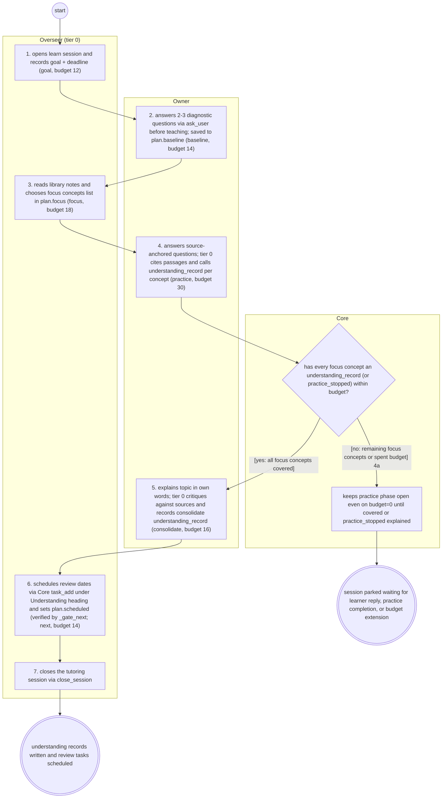

<!-- generated by render_pack.py from study-topic.spec.yaml sha256=10cc995c8336157b827ab960901983e9cd9d1098becdb935629b156c6622cdde; edit the spec, not this file -->
# Study a topic with the library, as it runs today

**UC14 · as-is · `IMPLEMENTED_VERIFIED`** · spec [study-topic.spec.yaml](../study-topic.spec.yaml)

## Written use case

| Field | Content |
|---|---|
| **Use case name** | Study a topic with the library |
| **Brief description** | Tier 0 tutors the person through goal, 2-3 diagnostic baseline questions, library-backed focus concepts, source-anchored practice, consolidation and spaced review scheduling. |
| **Primary actor** | Overseer (tier 0) |
| **Supporting actors** | Owner, Core |
| **Preconditions** | Library contains notes covering the study topic |
| **Trigger** | The Owner opens a learn tutoring session |
| **Success guarantee** | Every focus concept practised and consolidated with understanding_record and scheduled review tasks |
| **Minimal guarantee** | Practice phase stays open at budget=0 until every focus concept is recorded or practice_stopped is stated |
| **Open questions** | How should factual accuracy of tutor explanations against cited sources be checked independently? |

**Main success scenario** (generated: the guard-true path, in step order)

1. The Overseer (tier 0) opens learn session and records goal + deadline (goal, budget 12).
2. The Owner answers 2-3 diagnostic questions via ask_user before teaching; saved to plan.baseline (baseline, budget 14).
3. The Overseer (tier 0) reads library notes and chooses focus concepts list in plan.focus (focus, budget 18).
4. The Owner answers source-anchored questions; tier 0 cites passages and calls understanding_record per concept (practice, budget 30).
5. The Owner explains topic in own words; tier 0 critiques against sources and records consolidate understanding_record (consolidate, budget 16).
6. The Overseer (tier 0) schedules review dates via Core task_add under Understanding heading and sets plan.scheduled (verified by _gate_next; next, budget 14).
7. The Overseer (tier 0) closes the tutoring session via close_session.

**Extensions** (generated: one per non-happy guard; numbered by the step it leaves)

- **4a** (from: has every focus concept an understanding_record (or practice_stopped) within budget?) *anticipated*
  - `4a1` No: remaining focus concepts or spent budget.
  - `4a2` The Core keeps practice phase open even on budget=0 until covered or practice_stopped explained.
  - `4a3` The use case ends: session parked waiting for learner reply, practice completion, or budget extension.

## Activity diagram



## Lane load

| Lane | On the main success scenario | Anywhere in the diagram |
|---|---|---|
| Owner | 3 | 3 |
| Overseer (tier 0) | 4 | 4 |
| Core | 1 | 2 |

**Tier-0 turns** (each return of control to tier 0; owner's scale: 2 ideal, 3 expected, 4 rusty, 5–10 bad, more: might as well have done it themselves). Main success scenario: **3 (expected)**. Worst path: T1, **3 (expected)**. Paths by grade: expected 1, ideal 1.

Paths by how they end: **paused** 1, **success** 1.

## Decision tree

```text
start: Study a topic with the library, as it runs today
  └─ T1: yes: all focus concepts covered  ⇒ understanding records written and review tasks scheduled
  └─ T2: no: remaining focus concepts or spent budget  ⇒ session parked waiting for learner reply, practice completion, or budget extension
```

## Test cases

One test per path: the main success scenario, then each extension.

| Test | Path (guards taken) | Extension | Expected outcome | Tier-0 turns |
|---|---|---|---|---|
| T1 | has every focus concept an understanding_record (or practice_stopped) within budget? → yes: all focus concepts covered | MSS | understanding records written and review tasks scheduled | 3 (expected) |
| T2 | has every focus concept an understanding_record (or practice_stopped) within budget? → no: remaining focus concepts or spent budget | 4a | session parked waiting for learner reply, practice completion, or budget extension | 2 (ideal) |

### Boundary values

| Decision | Values to test | Expected |
|---|---|---|
| has every focus concept an understanding_record (or practice_stopped) within budget? | all focus concepts covered; 1+ remaining with budget = 0 | spent budget does not clear practice; phase stays open until covered or practice_stopped set |

## Weaknesses and gaps

_None recorded._

## Evidence

- src/resource_librarian/standard/phases.yaml:56,196-250 (learn = goal, baseline, focus, practice, consolidate, next).
- src/resource_librarian/session.py:1166-1270 (_gate_goal, _gate_baseline, _gate_focus, _gate_practice, _gate_consolidate, _gate_next).

## Checks

Errors: none

Warnings: none
