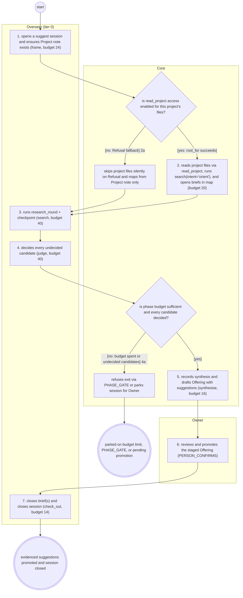

<!-- generated by render_pack.py from suggest.spec.yaml sha256=edc8357770759c950386a828ccb099f048b525e6662365c235a82b94ae1fc9fd; edit the spec, not this file -->
# Suggest work for the vault, as it runs today

**UC12 · as-is · `IMPLEMENTED_VERIFIED`** · spec [suggest.spec.yaml](../suggest.spec.yaml)

## Written use case

| Field | Content |
|---|---|
| **Use case name** | Suggest work for the vault |
| **Brief description** | Tier 0 runs a suggest session to orient in the project (reading project files when permitted), search and judge evidence, and draft a suggestion Offering. |
| **Primary actor** | Overseer (tier 0) |
| **Supporting actors** | Core, Owner |
| **Preconditions** | Project note exists (or is created in frame) |
| **Trigger** | The Owner asks for suggested next work for a project |
| **Success guarantee** | Evidenced suggestions promoted and session closed |
| **Minimal guarantee** | If read_project is refused, mapping falls back to the Project note only |
| **Open questions** | Should read_project refusal be recorded explicitly in the output rather than skipped silently? |

**Main success scenario** (generated: the guard-true path, in step order)

1. The Overseer (tier 0) opens a suggest session and ensures Project note exists (frame, budget 24).
2. The Core reads project files via read_project, runs search(intent='orient'), and opens briefs in map (budget 20).
3. The Overseer (tier 0) runs research_round + checkpoint (search, budget 40).
4. The Overseer (tier 0) decides every undecided candidate (judge, budget 40).
5. The Core records synthesis and drafts Offering with suggestions (synthesise, budget 16).
6. The Owner reviews and promotes the staged Offering (PERSON_CONFIRMS).
7. The Overseer (tier 0) closes brief(s) and closes session (check_out, budget 14).

**Extensions** (generated: one per non-happy guard; numbered by the step it leaves)

- **2a** (from: is read_project access enabled for this project's files?) *anticipated*
  - `2a1` No: Refusal fallback.
  - `2a2` The Core skips project files silently on Refusal and maps from Project note only.
  - `2a3` Rejoin at 3.
- **4a** (from: is phase budget sufficient and every candidate decided?) *anticipated*
  - `4a1` No: budget spent or undecided candidates.
  - `4a2` The Core refuses exit via PHASE_GATE or parks session for Owner.
  - `4a3` The use case ends: parked on budget limit, PHASE_GATE, or pending promotion.

## Activity diagram



## Lane load

| Lane | On the main success scenario | Anywhere in the diagram |
|---|---|---|
| Owner | 1 | 1 |
| Overseer (tier 0) | 4 | 4 |
| Core | 4 | 6 |

**Tier-0 turns** (each return of control to tier 0; owner's scale: 2 ideal, 3 expected, 4 rusty, 5–10 bad, more: might as well have done it themselves). Main success scenario: **3 (expected)**. Worst path: T2, **3 (expected)**. Paths by grade: expected 2, ideal 1.

Paths by how they end: **paused** 1, **success** 1.

## Decision tree

```text
start: Suggest work for the vault, as it runs today
    └─ T1: yes: root_for succeeds / yes  ⇒ evidenced suggestions promoted and session closed
  └─ T2: no: Refusal fallback  ⇒ rejoins at step 3
    └─ T3: yes: root_for succeeds / no: budget spent or undecided candidates  ⇒ parked on budget limit, PHASE_GATE, or pending promotion
```

## Test cases

One test per path: the main success scenario, then each extension.

| Test | Path (guards taken) | Extension | Expected outcome | Tier-0 turns |
|---|---|---|---|---|
| T1 | is read_project access enabled for this project's files? → yes: root_for succeeds; is phase budget sufficient and every candidate decided? → yes | MSS | evidenced suggestions promoted and session closed | 3 (expected) |
| T2 | is read_project access enabled for this project's files? → no: Refusal fallback | 2a | rejoins at step 3 | 3 (expected) |
| T3 | is read_project access enabled for this project's files? → yes: root_for succeeds; is phase budget sufficient and every candidate decided? → no: budget spent or undecided candidates | 4a | parked on budget limit, PHASE_GATE, or pending promotion | 2 (ideal) |

### Boundary values

| Decision | Values to test | Expected |
|---|---|---|
| is phase budget sufficient and every candidate decided? | budget_left > 0 and 0 undecided candidates; budget_left = 0 or >= 1 undecided | undecided candidates or exhausted budget block exit via PHASE_GATE |

## Weaknesses and gaps

_None recorded._

## Evidence

- src/resource_librarian/standard/phases.yaml:49,88-93 (suggest = frame, map, search, judge, synthesise, check_out; extras open_brief, read_project).
- src/resource_librarian/session.py:1001-1041 (_gate_frame, _gate_map suggest branch).

## Checks

Errors: none

Warnings: none
