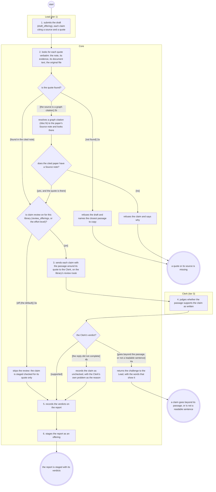

<!-- generated by render_pack.py from verify-claims.spec.yaml sha256=961e20c03e58bf4e1930e1d39b25191487707436b0b81d4b82f7118eb3477460; edit the spec, not this file -->
# Verify a report's claims, as it runs today

**UC3 · as-is · `IMPLEMENTED_OBSERVED`** · spec [verify-claims.spec.yaml](../verify-claims.spec.yaml)

| Problem | |
|---|---|
| symptom | With review off, a garbled claim was staged; with review on, three reviews of full-PDF quotes did not complete. |
| root | Claim review is opt-in per library, and an incomplete review records the claim as unchecked rather than holding it. |

## Written use case

| Field | Content |
|---|---|
| **Use case name** | Verify a report's claims |
| **Brief description** | Each claim's quote is found verbatim in its source; with review on, the Clerk judges the claim against its passage. |
| **Primary actor** | Core, on the Owner's behalf |
| **Supporting actors** | Clerk, Lead |
| **Preconditions** | A synthesis is recorded |
| **Trigger** | draft_offering |
| **Success guarantee** | Every staged claim's quote exists verbatim in a named source, with a verdict |
| **Minimal guarantee** | A missing quote refuses the draft and names the closest passage |
| **Open questions** | OP7 review on by default; OP9 why reviews did not complete |

**Main success scenario** (generated: the guard-true path, in step order)

1. The Lead (tier 1) submits the draft (draft_offering), each claim citing a source and a quote.
2. The Core looks for each quote verbatim: the note, its evidence, its document text, the original file.
3. The Core sends each claim with the passage around its quote to the Clerk, on the library's review route.
4. The Clerk (tier 3) judges whether the passage supports the claim as written.
5. The Core records the verdicts on the report.
6. The Core stages the report as an offering.

**Extensions** (generated: one per non-happy guard; numbered by the step it leaves)

- **2a** (from: is the quote found?) *anticipated*
  - `2a1` Not found.
  - `2a2` The Core refuses the draft and names the closest passage to copy.
  - `2a3` The use case ends: a quote or its source is missing.
- **2b** (from: is the quote found?) *anticipated*
  - `2b1` The source is a graph citation.
  - `2b2` The Core resolves a graph citation (<graph>/doc:N) to the paper's Source note and looks there.
  - `2b3` The Core decides: does the cited paper have a Source note?
  - `2b3a` If no: refuses the claim and says why.
  - `2b4` If yes, and the quote is there:
  - `2b5` The Core decides: is claim review on for this library (review_offerings, or the effort level)?
  - `2b5a` If off (the default): skips the review: the claim is staged checked for its quote only.
  - `2b6` If on:
  - `2b7` Rejoin at 3.
- **3a** (from: is claim review on for this library (review_offerings, or the effort level)?) *anticipated*
  - `3a1` Off (the default).
  - `3a2` The Core skips the review: the claim is staged checked for its quote only.
  - `3a3` Rejoin at 5.
- **4a** (from: the Clerk's verdict?) *anticipated*
  - `4a1` Goes beyond the passage, or not a readable sentence.
  - `4a2` The Core returns the challenge to the Lead, with the words that show it.
  - `4a3` The use case ends: a claim goes beyond its passage, or is not a readable sentence.
- **4b** (from: the Clerk's verdict?) *anticipated*
  - `4b1` The reply did not complete.
  - `4b2` The Core records the claim as unchecked, with the Clerk's own problem as the reason.
  - `4b3` Rejoin at 5.

## Activity diagram



## Lane load

| Lane | On the main success scenario | Anywhere in the diagram |
|---|---|---|
| Lead (tier 1) | 1 | 1 |
| Core | 7 | 14 |
| Clerk (tier 3) | 1 | 1 |

Paths by how they end: **challenged** 1, **refused** 2, **success** 1.

## Decision tree

```text
start: Verify a report's claims, as it runs today
      └─ T1: found in the cited note / on / supported  ⇒ the report is staged with its verdicts
  └─ T2: not found  ⇒ a quote or its source is missing
    └─ T3: the source is a graph citation / no  ⇒ a quote or its source is missing
    └─ T4: the source is a graph citation / yes, and the quote is there  ⇒ rejoins at 'is claim review on for this library (review_offerings, or the effort level)?' (before step 3)
    └─ T5: found in the cited note / off (the default)  ⇒ rejoins at step 5
      └─ T6: found in the cited note / on / goes beyond the passage, or not a readable sentence  ⇒ a claim goes beyond its passage, or is not a readable sentence
      └─ T7: found in the cited note / on / the reply did not complete  ⇒ rejoins at step 5
```

## Test cases

One test per path: the main success scenario, then each extension.

| Test | Path (guards taken) | Extension | Expected outcome |
|---|---|---|---|
| T1 | is the quote found? → found in the cited note; is claim review on for this library (review_offerings, or the effort level)? → on; the Clerk's verdict? → supported | MSS | the report is staged with its verdicts |
| T2 | is the quote found? → not found | 2a | a quote or its source is missing |
| T3 | is the quote found? → the source is a graph citation; does the cited paper have a Source note? → no | 2b | a quote or its source is missing |
| T4 | is the quote found? → the source is a graph citation; does the cited paper have a Source note? → yes, and the quote is there | 2b | rejoins at 'is claim review on for this library (review_offerings, or the effort level)?' (before step 3) |
| T5 | is the quote found? → found in the cited note; is claim review on for this library (review_offerings, or the effort level)? → off (the default) | 3a | rejoins at step 5 |
| T6 | is the quote found? → found in the cited note; is claim review on for this library (review_offerings, or the effort level)? → on; the Clerk's verdict? → goes beyond the passage, or not a readable sentence | 4a | a claim goes beyond its passage, or is not a readable sentence |
| T7 | is the quote found? → found in the cited note; is claim review on for this library (review_offerings, or the effort level)? → on; the Clerk's verdict? → the reply did not complete | 4b | rejoins at step 5 |

### Boundary values

_None declared._

## Weaknesses and gaps

| Id | Kind | Where | Weakness | Evidence | Handled in the to-be by |
|---|---|---|---|---|---|
| W-VER-01 | gap | 3a | Claim review is off by default, so a garbled claim was staged checked only for its quote (OP7). | tools/sessions.py lines 1719-1723 | `verify-claims` |
| W-VER-02 | fault | 4b | A review that does not complete marks the claim unchecked and stages it anyway; three full-PDF quotes went this way (OP9). | 81914de; USE-CASES.md UC3 4c | `verify-claims` |

## Evidence

- src/resource_librarian/tools/sessions.py: draft_offering; review opt-in at lines 1719-1723 (`review_offerings` under [clerk], or effort).
- Review route inside the Core: clerk_endpoint wraps the Clerk in the library's task routes (8489387).
- Unchecked with a reason: 81914de. Graph citations as evidence: 1064cf0. USE-CASES.md UC3.

## Checks

Errors: none

Warnings: none
