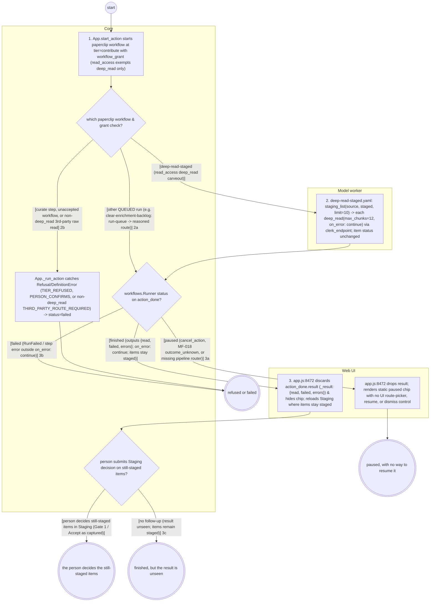

<!-- generated by render_pack.py from workflow-run.spec.yaml sha256=0ab88aa7d431a5ef42d8375f24e21c7f7863d1235d75f2631e99a426752e6ac4; edit the spec, not this file -->
# Run a saved workflow from the Web UI, as it runs today

**UC8.1 · as-is · `IMPLEMENTED_VERIFIED`** · spec [workflow-run.spec.yaml](../workflow-run.spec.yaml)

## Written use case

| Field | Content |
|---|---|
| **Use case name** | Run a saved workflow from the Web UI |
| **Brief description** | The paperclip menu starts a workflow at contribute with a workflow grant; the result comes back on the run's chip. |
| **Primary actor** | Owner |
| **Supporting actors** | Web UI, Core, model worker |
| **Preconditions** | An accepted workflow |
| **Trigger** | Run a workflow from the paperclip menu |
| **Success guarantee** | The result is shown and its items move on |
| **Minimal guarantee** | A refusal ends the run as failed |
| **Open questions** | The Web UI drops the result (app.js:8472): what should the person see? |

**Main success scenario** (generated: the guard-true path, in step order)

1. The Core App.start_action starts paperclip workflow at tier=contribute with workflow_grant (read_access exempts deep_read only).
2. The Model worker deep-read-staged.yaml: staging_list(source, staged, limit=10) -> each deep_read(max_chunks=12, on_error: continue) via clerk_endpoint; item status unchanged.
3. The Web UI app.js:8472 discards action_done.result (_result: {read, failed, errors}) & hides chip; reloads Staging where items stay staged.

**Extensions** (generated: one per non-happy guard; numbered by the step it leaves)

- **2a** (from: which paperclip workflow & grant check?) *anticipated*
  - `2a1` Other QUEUED run (e.g. clear-enrichment-backlog: run-queue -> reasoned route).
  - `2a2` The Core decides: workflows.Runner status on action_done?
  - `2a2a` If paused (cancel_action, MF-018 outcome_unknown, or missing pipeline router): app.js:8472 drops result; renders static paused chip with no UI route-picker, resume, or dismiss control.
  - `2a2a` If failed (RunFailed / step error outside on_error: continue): the use case ends: refused or failed.
  - `2a3` If finished (outputs {read, failed, errors}; on_error: continue; items stay staged):
  - `2a4` Rejoin at 3.
- **2b** (from: which paperclip workflow & grant check?) *anticipated*
  - `2b1` Curate step, unaccepted workflow, or non-deep_read 3rd-party raw read.
  - `2b2` The Core App._run_action catches Refusal/DefinitionError (TIER_REFUSED, PERSON_CONFIRMS, or non-deep_read THIRD_PARTY_ROUTE_REQUIRED) -> status=failed.
  - `2b3` The use case ends: refused or failed.
- **3a** (from: workflows.Runner status on action_done?) *anticipated*
  - `3a1` Paused (cancel_action, MF-018 outcome_unknown, or missing pipeline router).
  - `3a2` The Web UI app.js:8472 drops result; renders static paused chip with no UI route-picker, resume, or dismiss control.
  - `3a3` The use case ends: paused, with no way to resume it.
- **3b** (from: workflows.Runner status on action_done?) *anticipated*
  - `3b1` Failed (RunFailed / step error outside on_error: continue).
  - `3b2` The use case ends: refused or failed.
- **3c** (from: person submits Staging decision on still-staged items?) *anticipated*
  - `3c1` No follow-up (result unseen; items remain staged).
  - `3c2` The use case ends: finished, but the result is unseen.

## Activity diagram



## Lane load

| Lane | On the main success scenario | Anywhere in the diagram |
|---|---|---|
| Core | 4 | 5 |
| Web UI | 1 | 2 |
| Model worker | 1 | 1 |

Paths by how they end: **escalated** 2, **partial** 1, **paused** 1, **success** 1. Every *escalated* path is a failure of this use case: the work went back to tier 0.

## Decision tree

```text
start: Run a saved workflow from the Web UI, as it runs today
      └─ T1: deep-read-staged (read_access deep_read carveout) / finished (outputs {read, failed, errors}; on_error: continue; items stay staged) / person decides still-staged items in Staging (Gate 1 / Accept as captured)  ⇒ the person decides the still-staged items
  └─ T2: other QUEUED run (e.g. clear-enrichment-backlog: run-queue -> reasoned route)  ⇒ rejoins at 'workflows.Runner status on action_done?' (before step 3)
  └─ T3: curate step, unaccepted workflow, or non-deep_read 3rd-party raw read  ⇒ refused or failed
    └─ T4: deep-read-staged (read_access deep_read carveout) / paused (cancel_action, MF-018 outcome_unknown, or missing pipeline router)  ⇒ paused, with no way to resume it
    └─ T5: deep-read-staged (read_access deep_read carveout) / failed (RunFailed / step error outside on_error: continue)  ⇒ refused or failed
      └─ T6: deep-read-staged (read_access deep_read carveout) / finished (outputs {read, failed, errors}; on_error: continue; items stay staged) / no follow-up (result unseen; items remain staged)  ⇒ finished, but the result is unseen
```

## Test cases

One test per path: the main success scenario, then each extension.

| Test | Path (guards taken) | Extension | Expected outcome |
|---|---|---|---|
| T1 | which paperclip workflow & grant check? → deep-read-staged (read_access deep_read carveout); workflows.Runner status on action_done? → finished (outputs {read, failed, errors}; on_error: continue; items stay staged); person submits Staging decision on still-staged items? → person decides still-staged items in Staging (Gate 1 / Accept as captured) | MSS | the person decides the still-staged items |
| T2 | which paperclip workflow & grant check? → other QUEUED run (e.g. clear-enrichment-backlog: run-queue -> reasoned route) | 2a | rejoins at 'workflows.Runner status on action_done?' (before step 3) |
| T3 | which paperclip workflow & grant check? → curate step, unaccepted workflow, or non-deep_read 3rd-party raw read | 2b | refused or failed |
| T4 | which paperclip workflow & grant check? → deep-read-staged (read_access deep_read carveout); workflows.Runner status on action_done? → paused (cancel_action, MF-018 outcome_unknown, or missing pipeline router) | 3a | paused, with no way to resume it |
| T5 | which paperclip workflow & grant check? → deep-read-staged (read_access deep_read carveout); workflows.Runner status on action_done? → failed (RunFailed / step error outside on_error: continue) | 3b | refused or failed |
| T6 | which paperclip workflow & grant check? → deep-read-staged (read_access deep_read carveout); workflows.Runner status on action_done? → finished (outputs {read, failed, errors}; on_error: continue; items stay staged); person submits Staging decision on still-staged items? → no follow-up (result unseen; items remain staged) | 3c | finished, but the result is unseen |

### Boundary values

| Decision | Values to test | Expected |
|---|---|---|
| deep-read-staged.yaml: staging_list(source, staged, limit=10) -> each deep_read(max_chunks=12, on_error: continue) via clerk_endpoint; item status unchanged | 0 staged sources; 10; 11; a source of 12 chunks; of 13 | 10 items per run, 12 chunks per item |

## Weaknesses and gaps

| Id | Kind | Where | Weakness | Evidence | Handled in the to-be by |
|---|---|---|---|---|---|
| W-WFR-01 | fault | ui_drop_result | The Web UI discards a run's result (app.js:8472): the person never sees what was read, what failed or why. | ui_drop_result label | **not yet** |
| W-WFR-02 | gap | wf_paused_chip | A paused run shows a static chip, with no route picker, resume or dismiss. | wf_paused_chip label | **not yet** |
| W-WFR-03 | fault | wf_deep_read | deep-read-staged reads each staged source but leaves its status unchanged, so nothing records that it was read. | wf_deep_read label; standard/workflows/deep-read-staged.yaml | **not yet** |

## Checks

Errors: none

Warnings: 
- decision dwf_route ('which paperclip workflow & grant check?') tests a quantity but declares no boundary values
