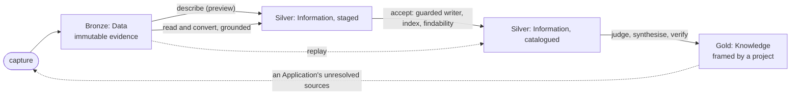

<!-- generated by render_pack.py from data-contract.table.yaml; edit that file -->
# Data contract (Medallion and DIK)

The three storage layers, what each may assert, and where each transition happens in the as-is and to-be packs. From reports/2026-11-24-librarian-reconstruction-and-offering/02-current-state-systems-analysis.md section 2.5 (which cites DOC-V1D-05, -08 and access-model.md). The storage layers measure refinement and framing; they are not Geo-Grapher's trust tiers (last section). The to-be checks are proposed and unaccepted.

## The layers

| Layer | DIK | What it holds | What it may assert | Its rule |
|---|---|---|---|---|
| Bronze | Data | `.evidence/`, the quarantine, the intake queue, folder surveys, raw DIK facts | Only what was fetched or observed, at a commit or a date | Immutable: never edited in place; an error is quarantined, not corrected |
| Silver | Information | conversions, staging records, Sources/ and Concepts/ notes, the rebuildable index, paper projections, Geo-Grapher's databases | Relations between data points, without project framing | Unframed (DATA_IS_UNFRAMED) and grounded in Bronze; rebuildable by replaying Bronze and its conversions; third-party text stays behind its conversion and access scope |
| Gold | Knowledge | sessions and briefs, Offerings/, Applications/ | Claims framed by a project, a need, its disqualifiers and lenses | Every claim's quote verified; an Application records what was actually done |

## The transitions

| Transition | As-is | To-be | What holds it | To-be check (proposed) |
|---|---|---|---|---|
| capture: into Bronze | `as-is/source-intake:capture_source` | `source-intake:capture` | immutable evidence with its hash | `source-parse:validate` verifies the hash |
| Bronze to staged Silver: the preview | `as-is/source-intake:clerk_draft` | `source-intake:describe` | a neutral description, Unknown where unsupported | staged only: nothing enters the library yet |
| Bronze to staged Silver: full reading | `as-is/source-enrichment:ref_source_reading` | `source-reading:readchk` | each part grounded in the evidence | `source-enrichment:oracle` audits the fidelity of what was read |
| staged to catalogued Silver | `as-is/acceptance:promote_curr` | `acceptance:promote` | the guarded writer, the index, findability | `ingestion:oraclefinal` verifies findability and neutrality |
| Silver to Gold | `as-is/research:synth` | `research:synth` | framed by the brief; every quote verified | `verify-claims:quote` and `research:ref_oracle` |
| Gold back to Bronze: feedback | `as-is/activation-external-project:c2_record_app` | `activation-external-project:recordapp` | an Application's unresolved sources are queued for capture | none proposed |

## Invariants

- Replay runs from the layer below, never the reverse: a Silver record can be rebuilt from Bronze and its conversions; Gold is never a source for Silver.
- Silver is never framed by a project; Gold always is.
- One ingestion pathway means one governed airlock, not fewer grades: capture and the preview, then full reading, then acceptance.
- As-is, rebuild tools exist (dik_rebuild, the index rebuild), but nothing compares a rebuild with the record it replaces (unverified here). Proposed acceptance test: rebuild the Data records and the index from Bronze, and diff them.

## Not to be confused with Geo-Grapher's trust tiers

| Term | Measures | Example |
|---|---|---|
| Storage layer: Bronze, Silver, Gold | refinement and framing | a Source note is Silver, whoever wrote the source |
| Trust tier: bronze, silver, gold, on a Geo-Grapher graph or a checked relation | verification strength | a third-party code graph is trust tier bronze; that does not make it raw bytes |
