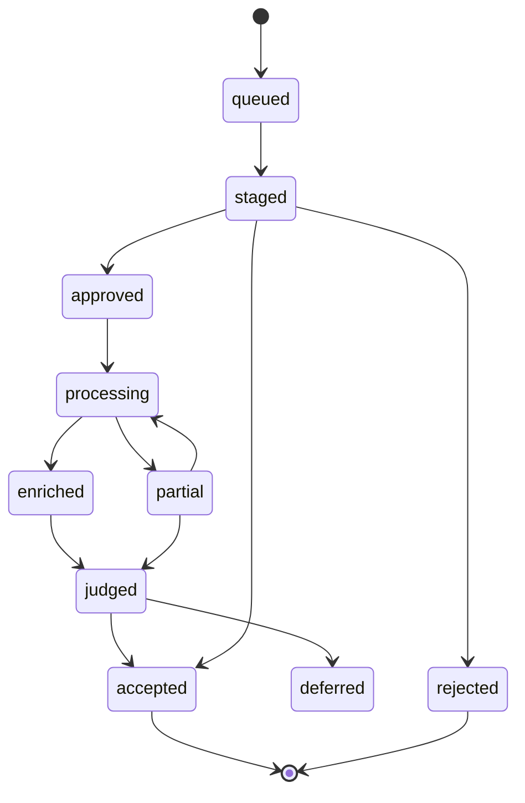
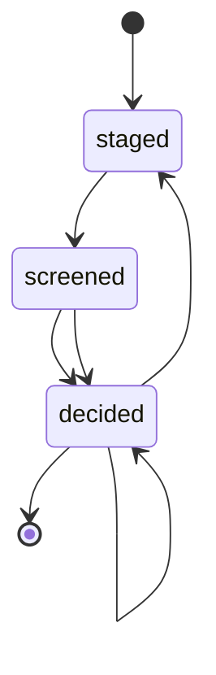
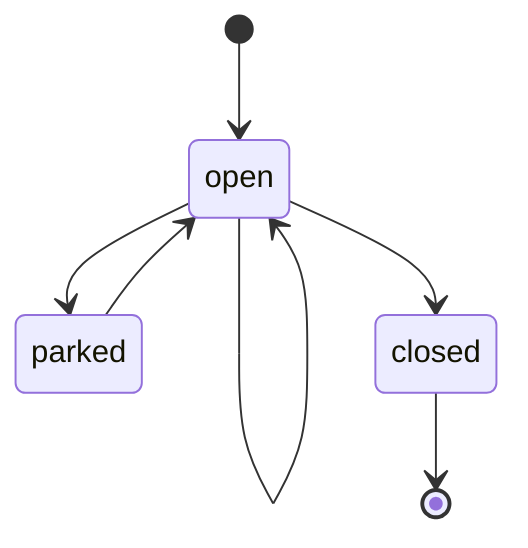
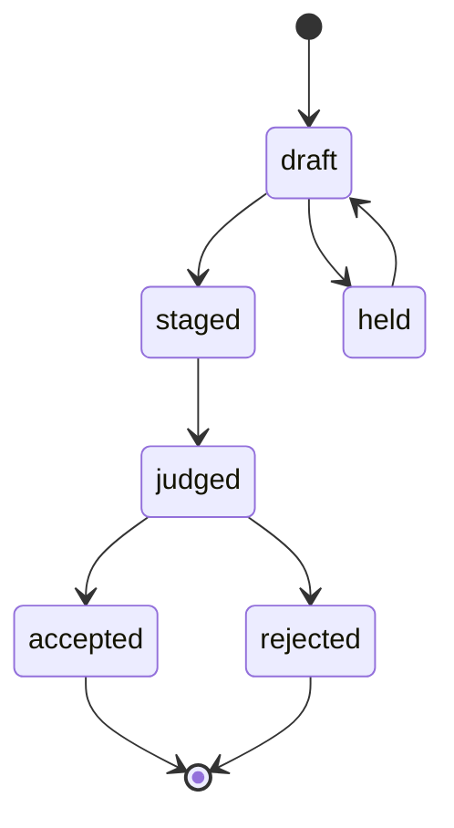
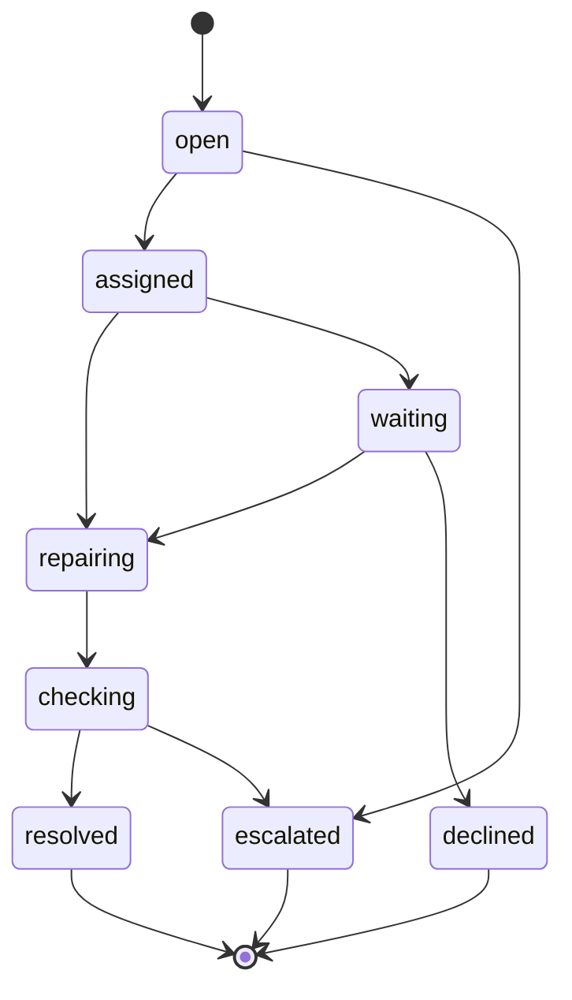

# State diagrams: librarian/to-be

## A staged item (a source)

As today, plus an owner and a deadline for every waiting decision, and an Oracle check before acceptance.

| From | To | On | By | Guard |
|---|---|---|---|---|
| queued | staged | — | Core | — |
| staged | approved | — | Lead (tier 1) | — |
| approved | processing | — | Core | — |
| processing | enriched | — | Core | — |
| processing | partial | — | Core | — |
| partial | processing | — | Doctor | — |
| enriched | judged | — | Oracle | — |
| partial | judged | — | Oracle | — |
| judged | accepted | — | Lead (tier 1) | — |
| staged | accepted | — | Owner | — |
| judged | deferred | — | Owner | — |
| staged | rejected | — | Owner | — |

Evidence: As-is states.yaml; AS-IS-FINDINGS T3, T5, T10

Handles:

- **W-STI-02**: An enriched or partial item has an assigned decider and a place on the agenda.
- **W-STI-01**: Accepting a captured source needs the person's explicit choice, and its coverage stays visible.

## A folder card

One meaning per state: a card is selected for the batch, or decided and applied as its own group.

| From | To | On | By | Guard |
|---|---|---|---|---|
| staged | screened | — | Clerk (tier 2) | — |
| screened | decided | — | Lead (tier 1) | — |
| screened | decided | — | Owner | — |
| decided | decided | — | Geo-Grapher | — |
| decided | staged | — | Doctor | — |

Evidence: As-is states.yaml; AS-IS-FINDINGS T7, T10

Handles:

- **W-FOL-05**: One meaning per state: a card is selected for the batch, or decided.

## A session

A brief's session: its budget comes from the envelope, and a park has an owner.

| From | To | On | By | Guard |
|---|---|---|---|---|
| open | open | — | Lead (tier 1) | — |
| open | open | — | Oracle | — |
| open | parked | — | Core | — |
| parked | open | — | Owner | — |
| open | closed | — | Lead (tier 1) | — |

Evidence: As-is states.yaml; AS-IS-FINDINGS T2, T9

## An offering (a drafted report)

Staged only with every claim found, reviewed and its verdict complete.

| From | To | On | By | Guard |
|---|---|---|---|---|
| draft | staged | — | Core | — |
| draft | held | — | Core | — |
| held | draft | — | Lead (tier 1) | — |
| staged | judged | — | Oracle | — |
| judged | accepted | — | Owner | — |
| judged | rejected | — | Owner | — |

Evidence: As-is states.yaml; to-be verify-claims

## A fault ticket (new)

One tracked failure, from its extension point to a checked repair or a recorded decision.

| From | To | On | By | Guard |
|---|---|---|---|---|
| open | assigned | — | Core | — |
| open | escalated | — | Core | — |
| assigned | repairing | — | Core | — |
| assigned | waiting | — | Core | — |
| waiting | repairing | — | Owner | — |
| waiting | declined | — | Owner | — |
| repairing | checking | — | Doctor | — |
| checking | resolved | — | Oracle | — |
| checking | escalated | — | Oracle | — |

Evidence: docs/terminology.md (fault register, fault ticket); to-be doctor
