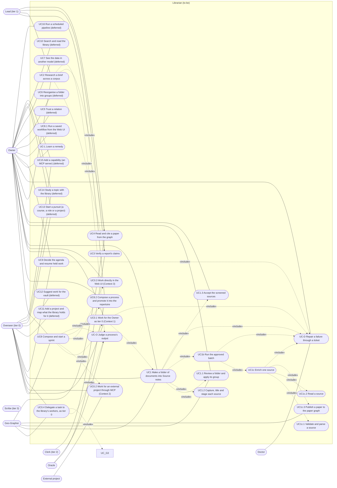

# Use case diagram: Librarian (to-be)

Actors outside the boundary; dashed arrows are «include» and «extend».

| Use case | Actors | Spec | Status |
|---|---|---|---|
| UC8 Compose and start a sprint | Owner, Overseer (tier 0) | [compose](views/compose.views.md) | PROPOSED_UNACCEPTED |
| UC8.2 Compose a process and promote it into the repertoire | Lead (tier 1), Owner, Oracle | [catalogue](views/catalogue.views.md) | PROPOSED_UNACCEPTED |
| UC0.1 Work for the Owner as tier 0 (Context 1) | Owner, Overseer (tier 0) | [activation-overseer](views/activation-overseer.views.md) | PROPOSED_UNACCEPTED |
| UC0.2 Work for an external project through MCP (Context 2) | Overseer (tier 0), External project | [activation-external-project](views/activation-external-project.views.md) | PROPOSED_UNACCEPTED |
| UC0.3 Work directly in the Web UI (Context 3) | Owner | [activation-web-ui](views/activation-web-ui.views.md) | PROPOSED_UNACCEPTED |
| UC0.4 Delegate a task to the library's workers, as tier 0 | Overseer (tier 0), Geo-Grapher | [delegate](views/delegate.views.md) | PROPOSED_UNACCEPTED |
| UC1 Make a folder of documents into Source notes | Owner, Overseer (tier 0), Geo-Grapher | [ingestion](views/ingestion.views.md) | PROPOSED_UNACCEPTED |
| UC1.1 Review a folder and apply its group | Owner, Geo-Grapher | [folder-review](views/folder-review.views.md) | PROPOSED_UNACCEPTED |
| UC1.2 Capture, title and stage each source |  | [source-intake](views/source-intake.views.md) | PROPOSED_UNACCEPTED |
| UC1b Run the approved batch |  | [batch-enrichment](views/batch-enrichment.views.md) | PROPOSED_UNACCEPTED |
| UC1c Enrich one source |  | [source-enrichment](views/source-enrichment.views.md) | PROPOSED_UNACCEPTED |
| UC1c.1 Validate and parse a source |  | [source-parse](views/source-parse.views.md) | PROPOSED_UNACCEPTED |
| UC1c.2 Read a source |  | [source-reading](views/source-reading.views.md) | PROPOSED_UNACCEPTED |
| UC1c.3 Publish a paper to the paper graph | Geo-Grapher | [paper-publication](views/paper-publication.views.md) | PROPOSED_UNACCEPTED |
| UC1.3 Accept the screened sources | Owner | [acceptance](views/acceptance.views.md) | PROPOSED_UNACCEPTED |
| UC2 Research a brief across a corpus | Owner, Lead (tier 1) | [research](views/research.views.md) | PROPOSED_UNACCEPTED |
| UC3 Verify a report's claims | Lead (tier 1), Clerk (tier 2) | [verify-claims](views/verify-claims.views.md) | PROPOSED_UNACCEPTED |
| UC4 Read and cite a paper from the graph | Lead (tier 1), Geo-Grapher | [cite-graph](views/cite-graph.views.md) | PROPOSED_UNACCEPTED |
| UC-O Judge a process's output | Oracle | [oracle](views/oracle.views.md) | PROPOSED_UNACCEPTED |
| UC-D Repair a failure through a ticket | Doctor, Owner | [doctor](views/doctor.views.md) | PROPOSED_UNACCEPTED |
| UC-L Learn a remedy | Owner | [learn](views/learn.views.md) | PROPOSED_UNACCEPTED |
| UC9 Decide the agenda and resume held work | Owner, Overseer (tier 0) | [agenda](views/agenda.views.md) | PROPOSED_UNACCEPTED |
| UC8.1 Run a saved workflow from the Web UI | Owner | — | deferred: no separate to-be spec: its steps are wgrant, uinotify and uiagenda in activation-web-ui, under compose (as-is W-WFR-01 to 03 are handled there) |
| UC5 Trust a relation | Owner | — | deferred: USE-CASES.md UC5; not yet drawn |
| UC6 Reorganise a folder into groups | Owner | — | deferred: PLAN.md 2.2 |
| UC7 See the data in another model | Owner | — | deferred: PLAN.md 2.2 |
| UC10 Search and read the library | Owner | — | deferred: the Web UI's Search and note view, and the search and get_note tools; it only reads |
| UC11 Add a project and map what the library holds for it | Overseer (tier 0) | — | deferred: the add_project session purpose; its sources go through UC1 |
| UC12 Suggest work for the vault | Overseer (tier 0) | — | deferred: the suggest session purpose |
| UC13 Start a pursuit (a course, a role or a project) | Overseer (tier 0), Owner | — | deferred: the start_pursuit session purpose |
| UC14 Study a topic with the library | Overseer (tier 0), Owner | — | deferred: the learn session purpose (tutoring); not UC-L, which learns a remedy |
| UC15 Add a capability (an MCP server) | Overseer (tier 0), Owner | — | deferred: the add_capability session purpose; the person decides the install |
| UC16 Run a scheduled pipeline | Owner | — | deferred: weekly-review and clear-enrichment-backlog; not overseen, so a high-risk decision holds for the Owner |
