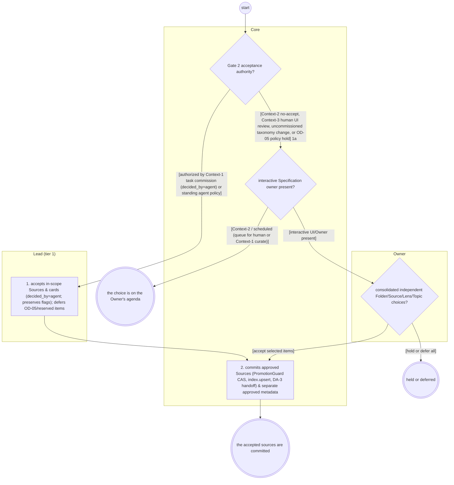

<!-- generated by render_pack.py from acceptance.spec.yaml sha256=584f84348ad20d457a00dca51a57be7199014a7913ef32c55adb11b1a5762cb8; edit the spec, not this file -->
# Accept the screened sources (proposed)

**UC1.3 · to-be · `PROPOSED_UNACCEPTED`** · spec [acceptance.spec.yaml](../acceptance.spec.yaml)

## Written use case

| Field | Content |
|---|---|
| **Use case name** | Accept the screened sources |
| **Brief description** | The Lead accepts within the mandate; reserved choices go to the Owner as one consolidated decision. |
| **Primary actor** | Lead |
| **Supporting actors** | Owner, Core |
| **Preconditions** | The Oracle has screened the batch |
| **Trigger** | The parent's acceptance step |
| **Success guarantee** | Committed notes, attested by who accepted them |
| **Minimal guarantee** | Reserved choices wait on the agenda |
| **Open questions** | — |

**Main success scenario** (generated: the guard-true path, in step order)

1. The Lead (tier 1) accepts in-scope Sources & cards (decided_by=agent; preserves flags); defers OD-05/reserved items.
2. The Core commits approved Sources (PromotionGuard CAS, index.upsert, DA-3 handoff) & separate approved metadata.

**Extensions** (generated: one per non-happy guard; numbered by the step it leaves)

- **1a** (from: Gate 2 acceptance authority?) *anticipated*
  - `1a1` Context-2 no-accept, Context-3 human UI review, uncommissioned taxonomy change, or OD-05 policy hold.
  - `1a2` The Core decides: interactive Specification owner present?
  - `1a2a` If Context-2 / scheduled (queue for human or Context-1 curate): the use case ends: the choice is on the Owner's agenda.
  - `1a3` If interactive UI/Owner present:
  - `1a4` The Owner decides: consolidated independent Folder/Source/Lens/Topic choices?
  - `1a4a` If hold or defer all: the use case ends: held or deferred.
  - `1a5` If accept selected items:
  - `1a6` Rejoin at 2.

## Activity diagram



## Lane load

| Lane | On the main success scenario | Anywhere in the diagram |
|---|---|---|
| Owner | 0 | 1 |
| Lead (tier 1) | 1 | 1 |
| Core | 2 | 3 |

Paths by how they end: **held for the Owner** 1, **paused** 1, **success** 1.

## Decision tree

```text
start: Accept the screened sources (proposed)
  └─ T1: authorized by Context-1 task commission (decided_by=agent) or standing agent policy  ⇒ the accepted sources are committed
    └─ T2: Context-2 no-accept, Context-3 human UI review, uncommissioned taxonomy change, or OD-05 policy hold / Context-2 / scheduled (queue for human or Context-1 curate)  ⇒ the choice is on the Owner's agenda
      └─ T3: Context-2 no-accept, Context-3 human UI review, uncommissioned taxonomy change, or OD-05 policy hold / interactive UI/Owner present / hold or defer all  ⇒ held or deferred
      └─ T4: Context-2 no-accept, Context-3 human UI review, uncommissioned taxonomy change, or OD-05 policy hold / interactive UI/Owner present / accept selected items  ⇒ rejoins at step 2
```

## Test cases

One test per path: the main success scenario, then each extension.

| Test | Path (guards taken) | Extension | Expected outcome |
|---|---|---|---|
| T1 | Gate 2 acceptance authority? → authorized by Context-1 task commission (decided_by=agent) or standing agent policy | MSS | the accepted sources are committed |
| T2 | Gate 2 acceptance authority? → Context-2 no-accept, Context-3 human UI review, uncommissioned taxonomy change, or OD-05 policy hold; interactive Specification owner present? → Context-2 / scheduled (queue for human or Context-1 curate) | 1a | the choice is on the Owner's agenda |
| T3 | Gate 2 acceptance authority? → Context-2 no-accept, Context-3 human UI review, uncommissioned taxonomy change, or OD-05 policy hold; interactive Specification owner present? → interactive UI/Owner present; consolidated independent Folder/Source/Lens/Topic choices? → hold or defer all | 1a | held or deferred |
| T4 | Gate 2 acceptance authority? → Context-2 no-accept, Context-3 human UI review, uncommissioned taxonomy change, or OD-05 policy hold; interactive Specification owner present? → interactive UI/Owner present; consolidated independent Folder/Source/Lens/Topic choices? → accept selected items | 1a | rejoins at step 2 |

### Boundary values

_None declared._

## As-is weaknesses this handles

_None recorded._

## Checks

Errors: none

Warnings: none
