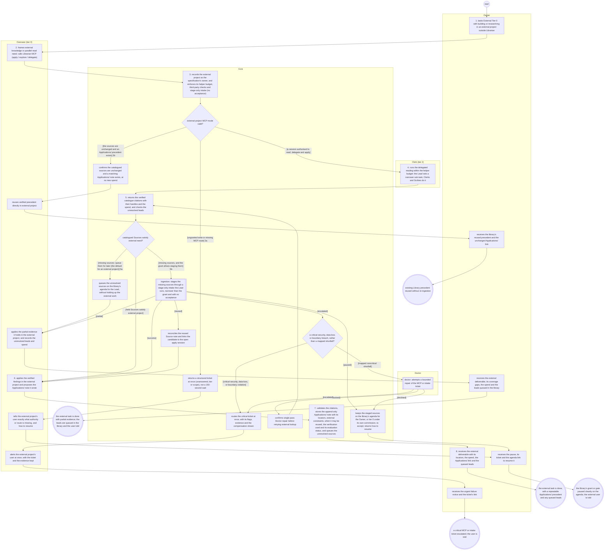

<!-- generated by render_pack.py from activation-external-project.spec.yaml sha256=29aa2b74e8b118fc10379be3f350cda76d92acb0814f7b1ca48af10d70c37160; edit the spec, not this file -->
# Work for an external project through MCP (proposed)

**UC0 · to-be · `PROPOSED_UNACCEPTED`** · spec [activation-external-project.spec.yaml](../activation-external-project.spec.yaml)
Supersedes: `reports/2026-11-24-librarian-reconstruction-and-offering/diagrams/librarian-context2-external-project-mcp.spec.yaml`

| Problem | |
|---|---|
| symptom | As-is: delegation refused at the external project's tier, permission asks timing out, acceptance authority confused with the other contexts, and Applications/ notes that record no authorship or locators. |
| root | An external project gets a scoped grant: a reading budget, checked third-party access, intake that only queues or stages, no acceptance, and Applications/ notes written by the agent and stored by the Core. |

## Written use case

| Field | Content |
|---|---|
| **Use case name** | Work for an external project through MCP (Context 2) |
| **Brief description** | Tier 0 in another project reads, delegates bounded reading and records what it applied, within a scoped grant. |
| **Primary actor** | Overseer (tier 0), in the external project |
| **Supporting actors** | Clerk, Scribe, Core, Doctor |
| **Preconditions** | MCP connected with a scoped grant |
| **Trigger** | The external task needs the library |
| **Success guarantee** | An Applications/ note with validated citations and locators |
| **Minimal guarantee** | A blocked call returns a ticket at once; leads are queued, not ingested |
| **Open questions** | What may an external project's grant include? |

**Main success scenario** (generated: the guard-true path, in step order)

1. The Owner tasks External Tier 0 with building or researching in an external project outside Librarian.
2. The Overseer (tier 0) frames external knowledge or parallel-read need; calls Librarian MCP (apply / explore / delegate).
3. The Core records the external project as the specification's owner, and enforces its helper budget, third-party checks and stage-only intake (no acceptance).
4. The Clerk (tier 2) runs the delegated reading within the helper budget: the Lead sets a narrower sub-task, Clerks and Scribes do it.
5. The Core returns the verified catalogue citations with their handles and the spend, and checks the unresolved leads.
6. The Overseer (tier 0) applies the verified findings in the external project and proposes the Applications/ note it wrote.
7. The Core validates the citations, stores the append-only Applications/ note with its locators, external constraints, when it may be reused, the verification used and its evaluation status, and queues the unresolved sources.
8. The Owner receives the external deliverable with its locators, the spend, the Applications/ link and the queued leads.

**Extensions** (generated: one per non-happy guard; numbered by the step it leaves)

- **3a** (from: external-project MCP mode valid?) *anticipated*
  - `3a1` Ungranted write or missing MCP route.
  - `3a2` The Core returns a structured ticket at once (unanswered, tier or scope), not a 150-second wait.
  - `3a3` The Overseer (tier 0) tells the external project's user exactly what authority or route is missing, and how to resume.
  - `3a4` The Owner receives the pause, its ticket and the agenda link to resume it.
  - `3a5` The use case ends: the library's grant or gate paused cleanly on the agenda; the external user is told.
- **3b** (from: external-project MCP mode valid?) *anticipated*
  - `3b1` The sources are unchanged and an Applications/ precedent exists.
  - `3b2` The Core confirms the catalogued sources are unchanged and a matching Applications/ note exists, at no new spend.
  - `3b3` The Overseer (tier 0) reuses verified precedent directly in external project.
  - `3b4` The Owner receives the library's reused precedent and the unchanged Applications/ link.
  - `3b5` The use case ends: existing Library precedent reused without re-ingestion.
- **5a** (from: catalogued Sources satisfy external need?) *anticipated*
  - `5a1` Missing sources: queue them for later (the default for an external project).
  - `5a2` The Core queues the unresolved sources on the library's agenda for the Lead, without holding up the external work.
  - `5a3` The Overseer (tier 0) applies the partial evidence it holds in the external project, and records the unresolved leads and spend.
  - `5a4` The Owner receives the external deliverable, its coverage gaps, the spend and the leads queued in the library.
  - `5a5` The use case ends: the external task is done with partial evidence; the leads are queued in the library and the user told.
- **5b** (from: catalogued Sources satisfy external need?) *anticipated*
  - `5b1` Missing sources, and the grant allows staging them.
  - `5b2` The Core stages the missing sources through a stage-only intake the Lead runs, narrower than the grant and with no acceptance (continues in ingestion).
  - `5b2a` If partial: applies the partial evidence it holds in the external project, and records the unresolved leads and spend.
  - `5b2a` If reused: reconciles the reused Source note and links the candidate to the open apply session.
  - `5b2a` If paused: keeps the staged sources on the library's agenda for the Owner, or tier 0 under its own commission, to accept; returns how to resume.
  - `5b2a` If escalated: a critical security, data-loss or boundary breach, rather than a mapped shortfall?.
  - `5b3` If success:
  - `5b4` Rejoin at 6.

## Activity diagram



## Lane load

| Lane | On the main success scenario | Anywhere in the diagram |
|---|---|---|
| Clerk (tier 2) | 1 | 1 |
| Doctor | 0 | 1 |
| Core | 5 | 14 |
| Overseer (tier 0) | 2 | 6 |
| Owner | 2 | 6 |

**Tier-0 turns** (each return of control to tier 0; owner's scale: 2 ideal, 3 expected, 4 rusty, 5–10 bad, more: might as well have done it themselves). Main success scenario: **2 (ideal)**. Worst path: T12, **2 (ideal)**. Paths by grade: ideal 10; escalated 2 (failures, not graded).

Paths by how they end: **escalated** 2, **partial** 2, **paused** 3, **reused** 1, **success** 1. Every *escalated* path is a failure of this use case: the work went back to tier 0.

## Decision tree

```text
start: Work for an external project through MCP (proposed)
    └─ T1: a session authorised to read, delegate and apply / held Sources satisfy external project  ⇒ the external task is done, with a repeatable Applications/ precedent and any queued leads
  └─ T2: ungranted write or missing MCP route  ⇒ the library's grant or gate paused cleanly on the agenda; the external user is told
  └─ T3: the sources are unchanged and an Applications/ precedent exists  ⇒ existing Library precedent reused without re-ingestion
    └─ T4: a session authorised to read, delegate and apply / missing sources: queue them for later (the default for an external project)  ⇒ the external task is done with partial evidence; the leads are queued in the library and the user told
      └─ T5: a session authorised to read, delegate and apply / missing sources, and the grant allows staging them / partial  ⇒ the external task is done with partial evidence; the leads are queued in the library and the user told
      └─ T6: a session authorised to read, delegate and apply / missing sources, and the grant allows staging them / reused  ⇒ rejoins at step 6
      └─ T7: a session authorised to read, delegate and apply / missing sources, and the grant allows staging them / paused  ⇒ the library's grant or gate paused cleanly on the agenda; the external user is told
          └─ T8: a session authorised to read, delegate and apply / missing sources, and the grant allows staging them / escalated / mapped noncritical shortfall / declined  ⇒ the library's grant or gate paused cleanly on the agenda; the external user is told
          └─ T9: a session authorised to read, delegate and apply / missing sources, and the grant allows staging them / escalated / mapped noncritical shortfall / escalated  ⇒ a critical MCP or intake ticket escalated; the user is told
          └─ T10: a session authorised to read, delegate and apply / missing sources, and the grant allows staging them / escalated / mapped noncritical shortfall / resolved  ⇒ rejoins at step 5
        └─ T11: a session authorised to read, delegate and apply / missing sources, and the grant allows staging them / escalated / critical security, data-loss, or boundary violation  ⇒ a critical MCP or intake ticket escalated; the user is told
      └─ T12: a session authorised to read, delegate and apply / missing sources, and the grant allows staging them / success  ⇒ rejoins at step 6
```

## Test cases

One test per path: the main success scenario, then each extension.

| Test | Path (guards taken) | Extension | Expected outcome | Tier-0 turns |
|---|---|---|---|---|
| T1 | external-project MCP mode valid? → a session authorised to read, delegate and apply; catalogued Sources satisfy external need? → held Sources satisfy external project | MSS | the external task is done, with a repeatable Applications/ precedent and any queued leads | 2 (ideal) |
| T2 | external-project MCP mode valid? → ungranted write or missing MCP route | 3a | the library's grant or gate paused cleanly on the agenda; the external user is told | 2 (ideal) |
| T3 | external-project MCP mode valid? → the sources are unchanged and an Applications/ precedent exists | 3b | existing Library precedent reused without re-ingestion | 2 (ideal) |
| T4 | external-project MCP mode valid? → a session authorised to read, delegate and apply; catalogued Sources satisfy external need? → missing sources: queue them for later (the default for an external project) | 5a | the external task is done with partial evidence; the leads are queued in the library and the user told | 2 (ideal) |
| T5 | external-project MCP mode valid? → a session authorised to read, delegate and apply; catalogued Sources satisfy external need? → missing sources, and the grant allows staging them; stages the missing sources through a stage-only intake the Lead runs, narrower than the grant and with no acceptance → partial | 5b | the external task is done with partial evidence; the leads are queued in the library and the user told | 2 (ideal) |
| T6 | external-project MCP mode valid? → a session authorised to read, delegate and apply; catalogued Sources satisfy external need? → missing sources, and the grant allows staging them; stages the missing sources through a stage-only intake the Lead runs, narrower than the grant and with no acceptance → reused | 5b | rejoins at step 6 | 2 (ideal) |
| T7 | external-project MCP mode valid? → a session authorised to read, delegate and apply; catalogued Sources satisfy external need? → missing sources, and the grant allows staging them; stages the missing sources through a stage-only intake the Lead runs, narrower than the grant and with no acceptance → paused | 5b | the library's grant or gate paused cleanly on the agenda; the external user is told | 1 (ideal) |
| T8 | external-project MCP mode valid? → a session authorised to read, delegate and apply; catalogued Sources satisfy external need? → missing sources, and the grant allows staging them; stages the missing sources through a stage-only intake the Lead runs, narrower than the grant and with no acceptance → escalated; a critical security, data-loss or boundary breach, rather than a mapped shortfall? → mapped noncritical shortfall; attempts a bounded repair of the MCP or intake ticket → declined | 5b | the library's grant or gate paused cleanly on the agenda; the external user is told | 1 (ideal) |
| T9 | external-project MCP mode valid? → a session authorised to read, delegate and apply; catalogued Sources satisfy external need? → missing sources, and the grant allows staging them; stages the missing sources through a stage-only intake the Lead runs, narrower than the grant and with no acceptance → escalated; a critical security, data-loss or boundary breach, rather than a mapped shortfall? → mapped noncritical shortfall; attempts a bounded repair of the MCP or intake ticket → escalated | 5b | a critical MCP or intake ticket escalated; the user is told | 2 (escalated: a failure) |
| T10 | external-project MCP mode valid? → a session authorised to read, delegate and apply; catalogued Sources satisfy external need? → missing sources, and the grant allows staging them; stages the missing sources through a stage-only intake the Lead runs, narrower than the grant and with no acceptance → escalated; a critical security, data-loss or boundary breach, rather than a mapped shortfall? → mapped noncritical shortfall; attempts a bounded repair of the MCP or intake ticket → resolved | 5b | rejoins at step 5 | 2 (ideal) |
| T11 | external-project MCP mode valid? → a session authorised to read, delegate and apply; catalogued Sources satisfy external need? → missing sources, and the grant allows staging them; stages the missing sources through a stage-only intake the Lead runs, narrower than the grant and with no acceptance → escalated; a critical security, data-loss or boundary breach, rather than a mapped shortfall? → critical security, data-loss, or boundary violation | 5b | a critical MCP or intake ticket escalated; the user is told | 2 (escalated: a failure) |
| T12 | external-project MCP mode valid? → a session authorised to read, delegate and apply; catalogued Sources satisfy external need? → missing sources, and the grant allows staging them; stages the missing sources through a stage-only intake the Lead runs, narrower than the grant and with no acceptance → success | 5b | rejoins at step 6 | 2 (ideal) |

### Boundary values

_None declared._

## As-is weaknesses this handles

| As-is weakness | Where here | How it is handled |
|---|---|---|
| W-ACT-02 (activation): A Broker Ask waits 150 s, then fails with PERMISSION_UNANSWERED; an unattended run stalls on each one. | mcpblocked | A blocked MCP call returns a structured ticket at once instead of a 150-second wait. |
| W-EXT-03 (activation-external-project): A consult-tier delegate is refused, and a session Ask times out at 150 s; either ends the external task's use of the library. | parallelhelpers | Delegated reading runs within the helper budget the context grants, not at a fixed consult tier. |
| W-EXT-02 (activation-external-project): An Applications/ note pins no snapshot hashes, locators or verification, so a later reader cannot tell exactly what was used. | recordapp | The Applications/ note validates its citations and records locators in an append-only sidecar. |
| W-EXT-01 (activation-external-project): Recording an application with no sources used raises a TypeError instead of a refusal. | recordapp | Citations are validated first; an application with none is refused with a reason. |

## Checks

Errors: none

Warnings: none
