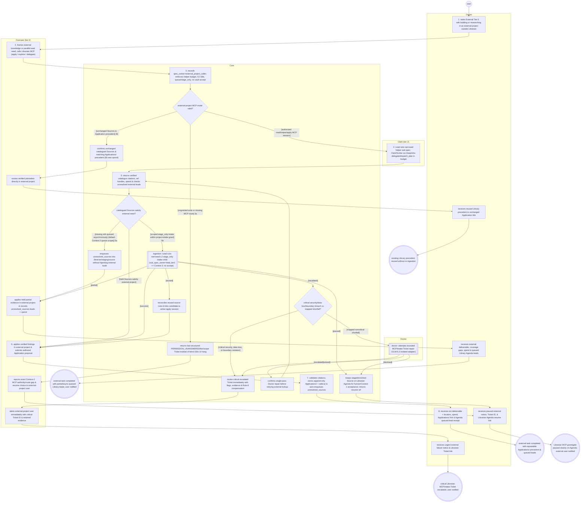

<!-- generated by render_pack.py from activation-external-project.spec.yaml sha256=1cd2c81b315b64aa6140ecc6fb46b5f8a8823f38615f6ce93a6d5159b442f424; edit the spec, not this file -->
# Context 2: External-Project Tier 0 Accesses Librarian via MCP (Proposed To-Be)

**UC0 · to-be · `PROPOSED_UNACCEPTED`** · spec [activation-external-project.spec.yaml](../activation-external-project.spec.yaml)
Supersedes: `reports/2026-11-24-librarian-reconstruction-and-offering/diagrams/librarian-context2-external-project-mcp.spec.yaml`

| Problem | |
|---|---|
| symptom | External project agents hit delegate contribute-tier blocks, Chat-tab Ask timeouts on MCP writes, conflated Context-1/3 acceptance authority, and Applications logs missing authorship/repeatability provenance. |
| root | Enforce explicit Context-2 authority boundaries (consult research delegation budget, S1-S6b source access, queue/stage_only intake, no vault acceptance, agent-authored & Core-stored Applications/) and dual project/Librarian notifications. |

## Written use case

| Field | Content |
|---|---|
| **Use case name** | Work for an external project through MCP (Context 2) |
| **Brief description** | Tier 0 in another project reads, delegates bounded reading and records what it applied, within a scoped grant. |
| **Primary actor** | Overseer (tier 0), in the external project |
| **Supporting actors** | Clerk, Scribe, Core, Doctor |
| **Preconditions** | MCP connected with a scoped grant |
| **Trigger** | The external task needs the library |
| **Success guarantee** | An Applications/ note with validated citations and locators |
| **Minimal guarantee** | A blocked call returns a ticket at once; leads are queued, not ingested |
| **Open questions** | What may an external project's grant include? |

**Main success scenario** (generated: the guard-true path, in step order)

1. The Owner tasks External Tier 0 with building or researching in an external project outside Librarian.
2. The Overseer (tier 0) frames external knowledge or parallel-read need; calls Librarian MCP (apply / explore / delegate).
3. The Core records spec_owner=external_project_caller; enforces helper budget, S1-S6b, queue/stage_only, no vault accept.
4. The Clerk (tier 2) Lead sets narrowed helper sub-spec; Clerk/Scribe run DeepInfra delegate/dispatch_plan in budget.
5. The Core returns verified catalogue citations, ref: handles, spend & checks unresolved external leads.
6. The Overseer (tier 0) applies verified findings in external project & submits authored Application proposal.
7. The Core validates citations, stores append-only Applications/ + sidecar & auto-enqueues unresolved_sources.
8. The Owner receives ext deliverable + locators, spend, Applications/ link & Agenda queued-lead receipt.

**Extensions** (generated: one per non-happy guard; numbered by the step it leaves)

- **3a** (from: external-project MCP mode valid?) *anticipated*
  - `3a1` Ungranted write or missing MCP route.
  - `3a2` The Core returns fast structured PERMISSION_UNANSWERED/tier/scope Ticket instead of blind 150s UI hang.
  - `3a3` The Overseer (tier 0) reports exact Context-2 MCP authority/route gap & resume choice to external-project user.
  - `3a4` The Owner receives paused external notice, Ticket ID, & Librarian Agenda resume link.
  - `3a5` The use case ends: Librarian MCP grant/gate paused cleanly on Agenda; external user notified.
- **3b** (from: external-project MCP mode valid?) *anticipated*
  - `3b1` Unchanged Sources & Application precedent.
  - `3b2` The Core confirms unchanged catalogued Sources & matching Applications/ precedent ($0 new spend).
  - `3b3` The Overseer (tier 0) reuses verified precedent directly in external project.
  - `3b4` The Owner receives reused Library precedent & unchanged Application link.
  - `3b5` The use case ends: existing Library precedent reused without re-ingestion.
- **5a** (from: catalogued Sources satisfy external need?) *anticipated*
  - `5a1` Missing refs queued asynchronously (default Context-2 queue scope).
  - `5a2` The Core enqueues unresolved_sources into .librarian/staging/source without hijacking external build.
  - `5a3` The Overseer (tier 0) applies held partial evidence in external project & records unresolved_sources leads + spend.
  - `5a4` The Owner receives external deliverable, coverage gaps, spend & queued Library Agenda leads.
  - `5a5` The use case ends: external task completed with partial/async-queued Library leads; user notified.
- **5b** (from: catalogued Sources satisfy external need?) *anticipated*
  - `5b1` Scoped stage_only intake within project-intake grant.
  - `5b2` The Core Lead runs narrowed L2 stage_only intake child (sub_spec_owner=lead_tier1 <= Context 2; no accept) (continues in ingestion).
  - `5b2a` If partial: applies held partial evidence in external project & records unresolved_sources leads + spend.
  - `5b2a` If reused: reconciles reused source note & links candidate to active apply session.
  - `5b2a` If paused: keeps staged/enriched Source on Librarian Agenda for human/Context-1 acceptance; returns resume ref.
  - `5b2a` If escalated: critical security/data-loss/boundary breach vs mapped shortfall?.
  - `5b3` If success:
  - `5b4` Rejoin at 6.

## Activity diagram



## Lane load

| Lane | On the main success scenario | Anywhere in the diagram |
|---|---|---|
| Clerk (tier 2) | 1 | 1 |
| Doctor | 0 | 1 |
| Core | 5 | 14 |
| Overseer (tier 0) | 2 | 6 |
| Owner | 2 | 6 |

**Tier-0 turns** (each return of control to tier 0; owner's scale: 2 ideal, 3 expected, 4 rusty, 5–10 bad, more: might as well have done it themselves). Main success scenario: **2 (ideal)**. Worst path: T12, **2 (ideal)**. Paths by grade: ideal 10; escalated 2 (failures, not graded).

Paths by how they end: **escalated** 2, **partial** 2, **paused** 3, **reused** 1, **success** 1. Every *escalated* path is a failure of this use case: the work went back to tier 0.

## Decision tree

```text
start: Context 2: External-Project Tier 0 Accesses Librarian via MCP (Proposed To-Be)
    └─ T1: authorized read/helper/apply MCP session / held Sources satisfy external project  ⇒ external task completed with repeatable Applications/ precedent & queued leads
  └─ T2: ungranted write or missing MCP route  ⇒ Librarian MCP grant/gate paused cleanly on Agenda; external user notified
  └─ T3: unchanged Sources & Application precedent  ⇒ existing Library precedent reused without re-ingestion
    └─ T4: authorized read/helper/apply MCP session / missing refs queued asynchronously (default Context-2 queue scope)  ⇒ external task completed with partial/async-queued Library leads; user notified
      └─ T5: authorized read/helper/apply MCP session / scoped stage_only intake within project-intake grant / partial  ⇒ external task completed with partial/async-queued Library leads; user notified
      └─ T6: authorized read/helper/apply MCP session / scoped stage_only intake within project-intake grant / reused  ⇒ rejoins at step 6
      └─ T7: authorized read/helper/apply MCP session / scoped stage_only intake within project-intake grant / paused  ⇒ Librarian MCP grant/gate paused cleanly on Agenda; external user notified
          └─ T8: authorized read/helper/apply MCP session / scoped stage_only intake within project-intake grant / escalated / mapped noncritical shortfall / declined  ⇒ Librarian MCP grant/gate paused cleanly on Agenda; external user notified
          └─ T9: authorized read/helper/apply MCP session / scoped stage_only intake within project-intake grant / escalated / mapped noncritical shortfall / escalated  ⇒ critical Librarian MCP/intake Ticket escalated; user notified
          └─ T10: authorized read/helper/apply MCP session / scoped stage_only intake within project-intake grant / escalated / mapped noncritical shortfall / resolved  ⇒ rejoins at step 5
        └─ T11: authorized read/helper/apply MCP session / scoped stage_only intake within project-intake grant / escalated / critical security, data-loss, or boundary violation  ⇒ critical Librarian MCP/intake Ticket escalated; user notified
      └─ T12: authorized read/helper/apply MCP session / scoped stage_only intake within project-intake grant / success  ⇒ rejoins at step 6
```

## Test cases

One test per path: the main success scenario, then each extension.

| Test | Path (guards taken) | Extension | Expected outcome | Tier-0 turns |
|---|---|---|---|---|
| T1 | external-project MCP mode valid? → authorized read/helper/apply MCP session; catalogued Sources satisfy external need? → held Sources satisfy external project | MSS | external task completed with repeatable Applications/ precedent & queued leads | 2 (ideal) |
| T2 | external-project MCP mode valid? → ungranted write or missing MCP route | 3a | Librarian MCP grant/gate paused cleanly on Agenda; external user notified | 2 (ideal) |
| T3 | external-project MCP mode valid? → unchanged Sources & Application precedent | 3b | existing Library precedent reused without re-ingestion | 2 (ideal) |
| T4 | external-project MCP mode valid? → authorized read/helper/apply MCP session; catalogued Sources satisfy external need? → missing refs queued asynchronously (default Context-2 queue scope) | 5a | external task completed with partial/async-queued Library leads; user notified | 2 (ideal) |
| T5 | external-project MCP mode valid? → authorized read/helper/apply MCP session; catalogued Sources satisfy external need? → scoped stage_only intake within project-intake grant; Lead runs narrowed L2 stage_only intake child (sub_spec_owner=lead_tier1 <= Context 2; no accept) → partial | 5b | external task completed with partial/async-queued Library leads; user notified | 2 (ideal) |
| T6 | external-project MCP mode valid? → authorized read/helper/apply MCP session; catalogued Sources satisfy external need? → scoped stage_only intake within project-intake grant; Lead runs narrowed L2 stage_only intake child (sub_spec_owner=lead_tier1 <= Context 2; no accept) → reused | 5b | rejoins at step 6 | 2 (ideal) |
| T7 | external-project MCP mode valid? → authorized read/helper/apply MCP session; catalogued Sources satisfy external need? → scoped stage_only intake within project-intake grant; Lead runs narrowed L2 stage_only intake child (sub_spec_owner=lead_tier1 <= Context 2; no accept) → paused | 5b | Librarian MCP grant/gate paused cleanly on Agenda; external user notified | 1 (ideal) |
| T8 | external-project MCP mode valid? → authorized read/helper/apply MCP session; catalogued Sources satisfy external need? → scoped stage_only intake within project-intake grant; Lead runs narrowed L2 stage_only intake child (sub_spec_owner=lead_tier1 <= Context 2; no accept) → escalated; critical security/data-loss/boundary breach vs mapped shortfall? → mapped noncritical shortfall; attempts bounded MCP/intake Ticket repair (GLM-5.3 isolated adapter) → declined | 5b | Librarian MCP grant/gate paused cleanly on Agenda; external user notified | 1 (ideal) |
| T9 | external-project MCP mode valid? → authorized read/helper/apply MCP session; catalogued Sources satisfy external need? → scoped stage_only intake within project-intake grant; Lead runs narrowed L2 stage_only intake child (sub_spec_owner=lead_tier1 <= Context 2; no accept) → escalated; critical security/data-loss/boundary breach vs mapped shortfall? → mapped noncritical shortfall; attempts bounded MCP/intake Ticket repair (GLM-5.3 isolated adapter) → escalated | 5b | critical Librarian MCP/intake Ticket escalated; user notified | 2 (escalated: a failure) |
| T10 | external-project MCP mode valid? → authorized read/helper/apply MCP session; catalogued Sources satisfy external need? → scoped stage_only intake within project-intake grant; Lead runs narrowed L2 stage_only intake child (sub_spec_owner=lead_tier1 <= Context 2; no accept) → escalated; critical security/data-loss/boundary breach vs mapped shortfall? → mapped noncritical shortfall; attempts bounded MCP/intake Ticket repair (GLM-5.3 isolated adapter) → resolved | 5b | rejoins at step 5 | 2 (ideal) |
| T11 | external-project MCP mode valid? → authorized read/helper/apply MCP session; catalogued Sources satisfy external need? → scoped stage_only intake within project-intake grant; Lead runs narrowed L2 stage_only intake child (sub_spec_owner=lead_tier1 <= Context 2; no accept) → escalated; critical security/data-loss/boundary breach vs mapped shortfall? → critical security, data-loss, or boundary violation | 5b | critical Librarian MCP/intake Ticket escalated; user notified | 2 (escalated: a failure) |
| T12 | external-project MCP mode valid? → authorized read/helper/apply MCP session; catalogued Sources satisfy external need? → scoped stage_only intake within project-intake grant; Lead runs narrowed L2 stage_only intake child (sub_spec_owner=lead_tier1 <= Context 2; no accept) → success | 5b | rejoins at step 6 | 2 (ideal) |

### Boundary values

_None declared._

## As-is weaknesses this handles

| As-is weakness | Where here | How it is handled |
|---|---|---|
| W-ACT-02 (activation): A Broker Ask waits 150 s, then fails with PERMISSION_UNANSWERED; an unattended run stalls on each one. | mcpblocked | A blocked MCP call returns a structured ticket at once instead of a 150-second wait. |
| W-EXT-03 (activation-external-project): A consult-tier delegate is refused, and a session Ask times out at 150 s; either ends the external task's use of the library. | parallelhelpers | Delegated reading runs within the helper budget the context grants, not at a fixed consult tier. |
| W-EXT-02 (activation-external-project): An Applications/ note pins no snapshot hashes, locators or verification, so a later reader cannot tell exactly what was used. | recordapp | The Applications/ note validates its citations and records locators in an append-only sidecar. |
| W-EXT-01 (activation-external-project): Recording an application with no sources used raises a TypeError instead of a refusal. | recordapp | Citations are validated first; an application with none is refused with a reason. |

## Checks

Errors: none

Warnings: 
- decision dmissing ('catalogued Sources satisfy external need?') tests a quantity but declares no boundary values
