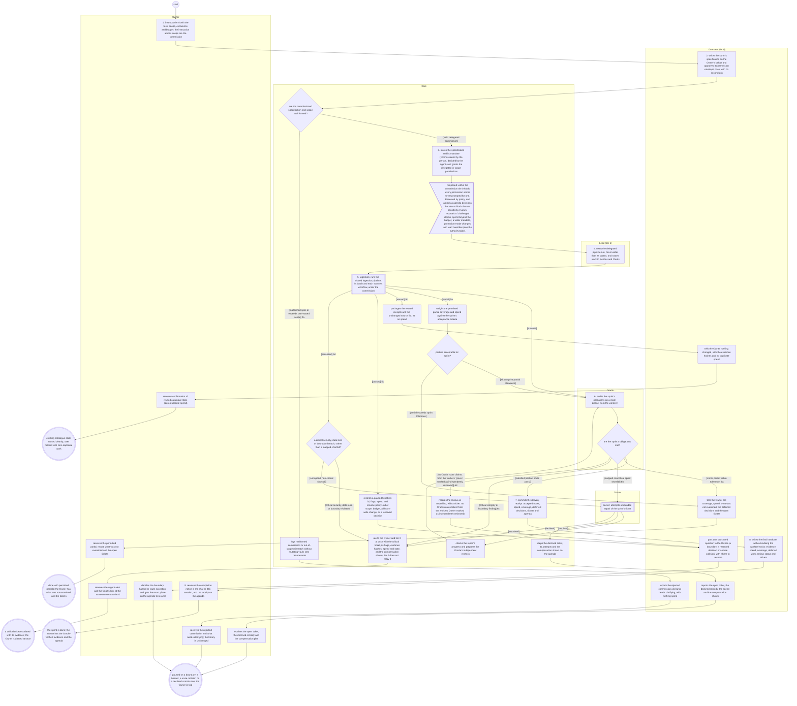

<!-- generated by render_pack.py from activation-overseer.spec.yaml sha256=c2d22fcd1bf3f24bf10bca2368383fddafdee08e660bf95fa25112ebe0c739db; edit the spec, not this file -->
# Work for the Owner as tier 0 (proposed)

**UC0 · to-be · `PROPOSED_UNACCEPTED`** · spec [activation-overseer.spec.yaml](../activation-overseer.spec.yaml)
Supersedes: `reports/2026-11-24-librarian-reconstruction-and-offering/diagrams/librarian-context1-tier0-delegated.spec.yaml`

| Problem | |
|---|---|
| symptom | As-is: tier 0 is refused the curate tier, stalls on hidden 150- and 600-second permission asks, is asked to approve twice, and has to watch low-value steps. |
| root | The Owner's instruction and scope are the commission: tier 0 approves the permission envelope once on the Owner's behalf, delegates the work to the Lead and the shared pipeline, and hands back one receipt. |

## Written use case

| Field | Content |
|---|---|
| **Use case name** | Work for the Owner as tier 0 (Context 1) |
| **Brief description** | The Owner instructs tier 0 once; tier 0 commissions the run, the Lead carries it out, and tier 0 hands over. |
| **Primary actor** | Owner |
| **Supporting actors** | Overseer (tier 0), Lead, Oracle, Doctor, Core |
| **Preconditions** | A commission with scope, exclusions and budget |
| **Trigger** | The Owner's instruction |
| **Success guarantee** | A verified handover in at most two tier-0 turns on the main path |
| **Minimal guarantee** | A malformed commission changes nothing |
| **Open questions** | How much standing authority may a commission carry (Rule 15)? |

**Main success scenario** (generated: the guard-true path, in step order)

1. The Owner instructs tier 0 with the task, scope, exclusions and budget: the instruction and its scope are the commission.
2. The Overseer (tier 0) writes the sprint's specification on the Owner's behalf and approves its permission envelope once, with no second ask.
3. The Core stores the specification and its mandate (commissioned by the person, decided by the agent) and grants the delegated in-scope permissions.
4. The Lead (tier 1) owns the delegated pipeline run, never wider than its parent, and routes work to Scribes and Clerks.
5. The Core runs the shared ingestion pipeline, its batch and each source's workflow, under the commission.
6. The Oracle audits the sprint's obligations on a route distinct from the workers'.
7. The Core commits the delivery receipt: accepted notes, spend, coverage, deferred decisions, tickets and agenda.
8. The Overseer (tier 0) writes the final handover without redoing the workers' tasks: evidence, spend, coverage, deferred work, review status and tickets.
9. The Owner receives the completion notice in the chat or IDE session, and the receipt on the agenda.

**Extensions** (generated: one per non-happy guard; numbered by the step it leaves)

- **2a** (from: are the commissioned specification and scope well formed?) *anticipated*
  - `2a1` Malformed spec or exceeds user-stated scope.
  - `2a2` The Core logs malformed commission or out-of-scope mismatch without mutating vault; sets resume note.
  - `2a3` The Overseer (tier 0) reports the rejected commission and what needs clarifying, with nothing spent.
  - `2a4` The Owner receives the rejected commission and what needs clarifying; the library is unchanged.
  - `2a5` The use case ends: paused on a boundary, a hazard, a route collision or a declined commission; the Owner is told.
- **5a** (from: runs the shared ingestion pipeline, its batch and each source's workflow, under the commission) *anticipated*
  - `5a1` Partial.
  - `5a2` The Core weighs the permitted partial coverage and spend against the sprint's acceptance criteria.
  - `5a3` The Core decides: partials acceptable for sprint?
  - `5a3a` If partial exceeds sprint tolerance: tells the Owner the coverage, spend, what was not examined, the deferred decisions and the open tickets.
  - `5a4` If within sprint partial allowance:
  - `5a5` Rejoin at 6.
- **5b** (from: runs the shared ingestion pipeline, its batch and each source's workflow, under the commission) *anticipated*
  - `5b1` Reused.
  - `5b2` The Core packages the reused receipts and the unchanged source list, at no spend.
  - `5b3` The Overseer (tier 0) tells the Owner nothing changed, with the evidence hashes and no duplicate spend.
  - `5b4` The Owner receives confirmation of reused catalogue state (zero duplicate spend).
  - `5b5` The use case ends: existing catalogue state reused cleanly; user notified with zero duplicate work.
- **5c** (from: runs the shared ingestion pipeline, its batch and each source's workflow, under the commission) *anticipated*
  - `5c1` Paused.
  - `5c2` The Core records a paused ticket (its id, flags, spend and resume point): out of scope, budget, a library-wide change, or a reserved decision.
  - `5c3` The Overseer (tier 0) puts one structured question to the Owner (a boundary, a reserved decision or a route collision) with where to resume.
  - `5c4` The Owner decides the boundary, hazard or route exception, and gets the exact place on the agenda to resume.
  - `5c5` The use case ends: paused on a boundary, a hazard, a route collision or a declined commission; the Owner is told.
- **5d** (from: runs the shared ingestion pipeline, its batch and each source's workflow, under the commission) *anticipated*
  - `5d1` Escalated.
  - `5d2` The Core decides: a critical security, data-loss or boundary breach, rather than a mapped shortfall?
  - `5d2a` If a mapped, non-critical shortfall: attempts a bounded repair of the sprint's ticket.
  - `5d3` If critical security, data-loss, or boundary violation:
  - `5d4` The Core alerts the Owner and tier 0 at once with the critical ticket, its flags, evidence hashes, spend and state, and the compensation shown; tier 0 does not relay it.
  - `5d5` The Owner receives the urgent alert and the ticket's link, at the same moment as tier 0.
  - `5d6` The use case ends: a critical ticket escalated with its evidence; the Owner is alerted at once.
- **6a** (from: are the sprint's obligations met?) *anticipated*
  - `6a1` Minor partial within tolerance.
  - `6a2` The Overseer (tier 0) tells the Owner the coverage, spend, what was not examined, the deferred decisions and the open tickets.
  - `6a3` The Owner receives the permitted partial report, what was not examined and the open tickets.
  - `6a4` The use case ends: done with permitted partials; the Owner has what was not examined and the tickets.
- **6b** (from: are the sprint's obligations met?) *anticipated*
  - `6b1` Mapped noncritical sprint shortfall.
  - `6b2` The Doctor attempts a bounded repair of the sprint's ticket (continues in doctor).
  - `6b2a` If declined: keeps the declined ticket, its attempts and the compensation shown on the agenda.
  - `6b2a` If escalated: alerts the Owner and tier 0 at once with the critical ticket, its flags, evidence hashes, spend and state, and the compensation shown; tier 0 does not relay it.
  - `6b3` If resolved:
  - `6b4` The Core checks the repair's progress and prepares the Oracle's independent recheck.
  - `6b5` Rejoin at 6.
- **6c** (from: are the sprint's obligations met?) *anticipated*
  - `6c1` Critical integrity or boundary finding.
  - `6c2` The Core alerts the Owner and tier 0 at once with the critical ticket, its flags, evidence hashes, spend and state, and the compensation shown; tier 0 does not relay it.
  - `6c3` The Owner receives the urgent alert and the ticket's link, at the same moment as tier 0.
  - `6c4` The use case ends: a critical ticket escalated with its evidence; the Owner is alerted at once.
- **6d** (from: are the sprint's obligations met?) *anticipated*
  - `6d1` No Oracle route distinct from the workers' (never marked as independently reviewed).
  - `6d2` The Core records the review as unverified, with a ticket: no Oracle route distinct from the workers' (never marked as independently reviewed).
  - `6d3` The Overseer (tier 0) puts one structured question to the Owner (a boundary, a reserved decision or a route collision) with where to resume.
  - `6d4` The Owner decides the boundary, hazard or route exception, and gets the exact place on the agenda to resume.
  - `6d5` The use case ends: paused on a boundary, a hazard, a route collision or a declined commission; the Owner is told.

## Activity diagram



## Lane load

| Lane | On the main success scenario | Anywhere in the diagram |
|---|---|---|
| Lead (tier 1) | 1 | 1 |
| Doctor | 0 | 1 |
| Oracle | 2 | 2 |
| Core | 4 | 14 |
| Overseer (tier 0) | 2 | 7 |
| Owner | 2 | 8 |

**Tier-0 turns** (each return of control to tier 0; owner's scale: 2 ideal, 3 expected, 4 rusty, 5–10 bad, more: might as well have done it themselves). Main success scenario: **2 (ideal)**. Worst path: T16, **2 (ideal)**. Paths by grade: ideal 12; escalated 4 (failures, not graded).

Paths by how they end: **escalated** 4, **partial** 2, **paused** 5, **reused** 1, **success** 1. Every *escalated* path is a failure of this use case: the work went back to tier 0.

## Decision tree

```text
start: Work for the Owner as tier 0 (proposed)
      └─ T1: valid delegated commission / success / satisfied (distinct route pass)  ⇒ the sprint is done; the Owner has the Oracle-verified evidence and the agenda
  └─ T2: malformed spec or exceeds user-stated scope  ⇒ paused on a boundary, a hazard, a route collision or a declined commission; the Owner is told
      └─ T3: valid delegated commission / partial / partial exceeds sprint tolerance  ⇒ done with permitted partials; the Owner has what was not examined and the tickets
      └─ T4: valid delegated commission / partial / within sprint partial allowance  ⇒ rejoins at step 6
    └─ T5: valid delegated commission / reused  ⇒ existing catalogue state reused cleanly; user notified with zero duplicate work
    └─ T6: valid delegated commission / paused  ⇒ paused on a boundary, a hazard, a route collision or a declined commission; the Owner is told
        └─ T7: valid delegated commission / escalated / a mapped, non-critical shortfall / declined  ⇒ paused on a boundary, a hazard, a route collision or a declined commission; the Owner is told
        └─ T8: valid delegated commission / escalated / a mapped, non-critical shortfall / escalated  ⇒ a critical ticket escalated with its evidence; the Owner is alerted at once
        └─ T9: valid delegated commission / escalated / a mapped, non-critical shortfall / resolved  ⇒ rejoins at step 6
      └─ T10: valid delegated commission / escalated / critical security, data-loss, or boundary violation  ⇒ a critical ticket escalated with its evidence; the Owner is alerted at once
      └─ T11: valid delegated commission / success / minor partial within tolerance  ⇒ done with permitted partials; the Owner has what was not examined and the tickets
        └─ T12: valid delegated commission / success / mapped noncritical sprint shortfall / declined  ⇒ paused on a boundary, a hazard, a route collision or a declined commission; the Owner is told
        └─ T13: valid delegated commission / success / mapped noncritical sprint shortfall / escalated  ⇒ a critical ticket escalated with its evidence; the Owner is alerted at once
        └─ T14: valid delegated commission / success / mapped noncritical sprint shortfall / resolved  ⇒ rejoins at step 6
      └─ T15: valid delegated commission / success / critical integrity or boundary finding  ⇒ a critical ticket escalated with its evidence; the Owner is alerted at once
      └─ T16: valid delegated commission / success / no Oracle route distinct from the workers' (never marked as independently reviewed)  ⇒ paused on a boundary, a hazard, a route collision or a declined commission; the Owner is told
```

## Test cases

One test per path: the main success scenario, then each extension.

| Test | Path (guards taken) | Extension | Expected outcome | Tier-0 turns |
|---|---|---|---|---|
| T1 | are the commissioned specification and scope well formed? → valid delegated commission; runs the shared ingestion pipeline, its batch and each source's workflow, under the commission → success; are the sprint's obligations met? → satisfied (distinct route pass) | MSS | the sprint is done; the Owner has the Oracle-verified evidence and the agenda | 2 (ideal) |
| T2 | are the commissioned specification and scope well formed? → malformed spec or exceeds user-stated scope | 2a | paused on a boundary, a hazard, a route collision or a declined commission; the Owner is told | 2 (ideal) |
| T3 | are the commissioned specification and scope well formed? → valid delegated commission; runs the shared ingestion pipeline, its batch and each source's workflow, under the commission → partial; partials acceptable for sprint? → partial exceeds sprint tolerance | 5a | done with permitted partials; the Owner has what was not examined and the tickets | 2 (ideal) |
| T4 | are the commissioned specification and scope well formed? → valid delegated commission; runs the shared ingestion pipeline, its batch and each source's workflow, under the commission → partial; partials acceptable for sprint? → within sprint partial allowance | 5a | rejoins at step 6 | 2 (ideal) |
| T5 | are the commissioned specification and scope well formed? → valid delegated commission; runs the shared ingestion pipeline, its batch and each source's workflow, under the commission → reused | 5b | existing catalogue state reused cleanly; user notified with zero duplicate work | 2 (ideal) |
| T6 | are the commissioned specification and scope well formed? → valid delegated commission; runs the shared ingestion pipeline, its batch and each source's workflow, under the commission → paused | 5c | paused on a boundary, a hazard, a route collision or a declined commission; the Owner is told | 2 (ideal) |
| T7 | are the commissioned specification and scope well formed? → valid delegated commission; runs the shared ingestion pipeline, its batch and each source's workflow, under the commission → escalated; a critical security, data-loss or boundary breach, rather than a mapped shortfall? → a mapped, non-critical shortfall; attempts a bounded repair of the sprint's ticket → declined | 5d | paused on a boundary, a hazard, a route collision or a declined commission; the Owner is told | 2 (ideal) |
| T8 | are the commissioned specification and scope well formed? → valid delegated commission; runs the shared ingestion pipeline, its batch and each source's workflow, under the commission → escalated; a critical security, data-loss or boundary breach, rather than a mapped shortfall? → a mapped, non-critical shortfall; attempts a bounded repair of the sprint's ticket → escalated | 5d | a critical ticket escalated with its evidence; the Owner is alerted at once | 1 (escalated: a failure) |
| T9 | are the commissioned specification and scope well formed? → valid delegated commission; runs the shared ingestion pipeline, its batch and each source's workflow, under the commission → escalated; a critical security, data-loss or boundary breach, rather than a mapped shortfall? → a mapped, non-critical shortfall; attempts a bounded repair of the sprint's ticket → resolved | 5d | rejoins at step 6 | 2 (ideal) |
| T10 | are the commissioned specification and scope well formed? → valid delegated commission; runs the shared ingestion pipeline, its batch and each source's workflow, under the commission → escalated; a critical security, data-loss or boundary breach, rather than a mapped shortfall? → critical security, data-loss, or boundary violation | 5d | a critical ticket escalated with its evidence; the Owner is alerted at once | 1 (escalated: a failure) |
| T11 | are the commissioned specification and scope well formed? → valid delegated commission; runs the shared ingestion pipeline, its batch and each source's workflow, under the commission → success; are the sprint's obligations met? → minor partial within tolerance | 6a | done with permitted partials; the Owner has what was not examined and the tickets | 2 (ideal) |
| T12 | are the commissioned specification and scope well formed? → valid delegated commission; runs the shared ingestion pipeline, its batch and each source's workflow, under the commission → success; are the sprint's obligations met? → mapped noncritical sprint shortfall; attempts a bounded repair of the sprint's ticket → declined | 6b | paused on a boundary, a hazard, a route collision or a declined commission; the Owner is told | 2 (ideal) |
| T13 | are the commissioned specification and scope well formed? → valid delegated commission; runs the shared ingestion pipeline, its batch and each source's workflow, under the commission → success; are the sprint's obligations met? → mapped noncritical sprint shortfall; attempts a bounded repair of the sprint's ticket → escalated | 6b | a critical ticket escalated with its evidence; the Owner is alerted at once | 1 (escalated: a failure) |
| T14 | are the commissioned specification and scope well formed? → valid delegated commission; runs the shared ingestion pipeline, its batch and each source's workflow, under the commission → success; are the sprint's obligations met? → mapped noncritical sprint shortfall; attempts a bounded repair of the sprint's ticket → resolved | 6b | rejoins at step 6 | 2 (ideal) |
| T15 | are the commissioned specification and scope well formed? → valid delegated commission; runs the shared ingestion pipeline, its batch and each source's workflow, under the commission → success; are the sprint's obligations met? → critical integrity or boundary finding | 6c | a critical ticket escalated with its evidence; the Owner is alerted at once | 1 (escalated: a failure) |
| T16 | are the commissioned specification and scope well formed? → valid delegated commission; runs the shared ingestion pipeline, its batch and each source's workflow, under the commission → success; are the sprint's obligations met? → no Oracle route distinct from the workers' (never marked as independently reviewed) | 6d | paused on a boundary, a hazard, a route collision or a declined commission; the Owner is told | 2 (ideal) |

### Boundary values

_None declared._

## As-is weaknesses this handles

| As-is weakness | Where here | How it is handled |
|---|---|---|
| W-ING-05 (ingestion): On 19-20 November control came back to tier 0 eight times on the main path, and ten on the worst (graded bad). | * | Tier 0 commissions once and receives one handover: two tier-0 turns on the main path (ideal). |
| W-ACT-01 (activation): Tier 0 through MCP is capped at contribute: it has no folder tools, and process_approved (curate) is refused, so each folder decision and batch start is handed back to the person. | storeenv | The commission grants tier 0 its delegated in-scope permissions, folder decisions and the batch start included. |

## Checks

Errors: none

Warnings: none
