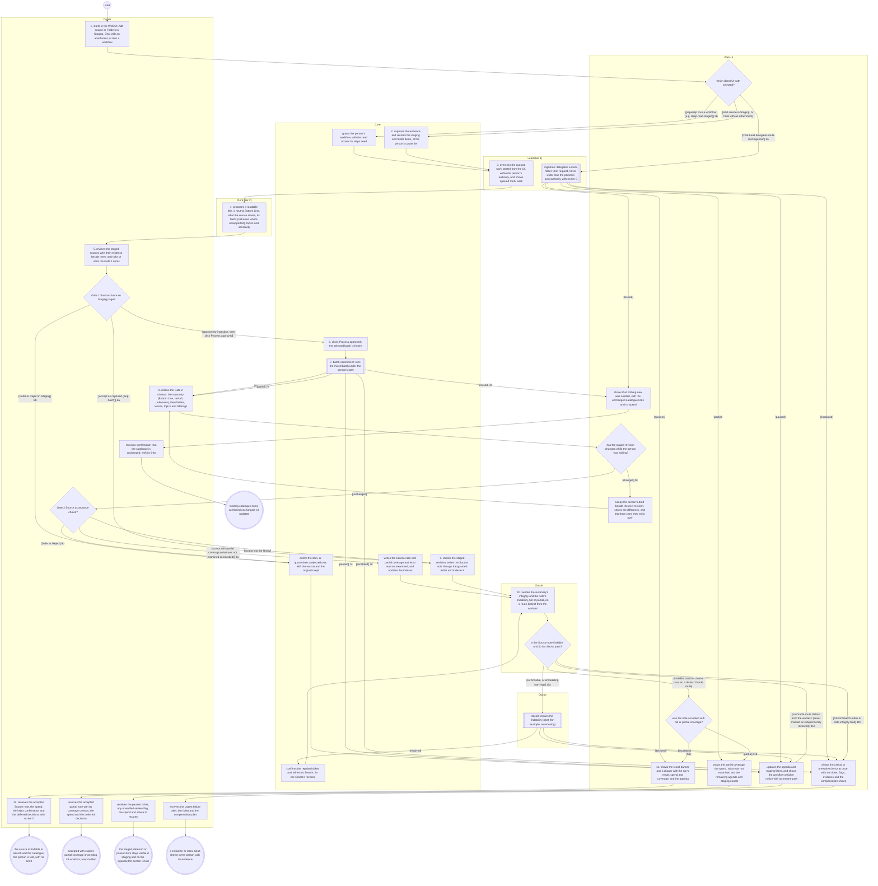

<!-- generated by render_pack.py from activation-web-ui.spec.yaml sha256=cb117262186ca6e790740d58d72cc084583bf2111d506900417a049a5d1c619b; edit the spec, not this file -->
# Work directly in the Web UI (proposed)

**UC0 · to-be · `PROPOSED_UNACCEPTED`** · spec [activation-web-ui.spec.yaml](../activation-web-ui.spec.yaml)
Supersedes: `reports/2026-11-24-librarian-reconstruction-and-offering/diagrams/librarian-context3-human-platform-ui.spec.yaml`

| Problem | |
|---|---|
| symptom | As-is: staging filters hide accepted and processing items, a background reload wipes the person's edits, a workflow's result is dropped (app.js:8472), and unfindable notes and queued Clerk work are invisible. |
| root | The Web UI starts the same parent processes with no tier 0; each decision (source, summary, folder, lens, topic, index) is separate and explicit, and every result is shown from the Core's record. |

## Written use case

| Field | Content |
|---|---|
| **Use case name** | Work directly in the Web UI (Context 3) |
| **Brief description** | The Owner curates in the Web UI; the Lead delegates; results open from the Core's record. |
| **Primary actor** | Owner |
| **Supporting actors** | Web UI, Lead, Clerk, Oracle, Doctor, Core |
| **Preconditions** | A Core running for the library |
| **Trigger** | Add source, Folders, Chat or a workflow |
| **Success guarantee** | A judged, findable note, with spend and coverage shown |
| **Minimal guarantee** | A pause or failure shows its ticket and resume path |
| **Open questions** | W-ACC-01: keeping the person's draft through a conflict |

**Main success scenario** (generated: the guard-true path, in step order)

1. The Owner starts in the Web UI: Add source or Folders in Staging, Chat with an attachment, or Run a workflow.
2. The Core captures the evidence and records the staging and folder items, at the person's curate tier.
3. The Lead (tier 1) oversees the queued work started from the UI, within the person's authority, and shows queued Clerk work.
4. The Clerk (tier 2) proposes a readable title, a neutral Bottom Line, what the source solves, its fields (Unknown where unsupported), topics and sensitivity.
5. The Owner reviews the staged sources with their evidence beside them, and ticks or edits the Gate 1 items.
6. The Core clicks Process approved; the selected batch is frozen.
7. The Core runs the mixed batch under the person's start.
8. The Owner makes the Gate 2 choices: the summary (Bottom Line, redraft, unknowns), then folders, lenses, topics and offerings.
9. The Core checks the staged revision, writes the Source note through the guarded writer and indexes it.
10. The Oracle verifies the summary's integrity and the note's findability, full or partial, on a route distinct from the workers'.
11. The Web UI shows the result banner and a drawer with the run's result, spend and coverage, and the agenda.
12. The Owner receives the accepted Source note, the spend, the index confirmation and the deferred decisions, with no tier 0.

**Extensions** (generated: one per non-happy guard; numbered by the step it leaves)

- **2a** (from: which direct UI path selected?) *anticipated*
  - `2a1` Chat Lead delegates multi-root ingestion.
  - `2a2` The Lead (tier 1) delegates a multi-folder Chat request, never wider than the person's own authority, with no tier 0 (continues in ingestion).
  - `2a2a` If partial: shows the partial coverage, the spend, what was not examined and the remaining agenda and staging counts.
  - `2a2a` If reused: shows that nothing new was needed, with the unchanged catalogue links and no spend.
  - `2a2a` If paused: updates the agenda and staging filters, and shows the workflow or ticket notice with its resume path.
  - `2a2a` If escalated: shows the critical or unresolved error at once, with the ticket, flags, evidence and the compensation shown.
  - `2a3` If success:
  - `2a4` Rejoin at 11.
- **2b** (from: which direct UI path selected?) *anticipated*
  - `2b1` Paperclip Run a workflow (e.g. deep-read-staged).
  - `2b2` The Core grants the person's workflow, with the read access its steps need.
  - `2b3` Rejoin at 3.
- **6a** (from: Gate 1 Source choice on Staging page?) *anticipated*
  - `6a1` Accept as captured (skip batch).
  - `6a2` Rejoin at 9.
- **6b** (from: Gate 1 Source choice on Staging page?) *anticipated*
  - `6b1` Defer or Reject in Staging.
  - `6b2` The Core defers the item, or quarantines a rejected one, with the reason and the originals kept.
  - `6b3` The Web UI updates the agenda and staging filters, and shows the workflow or ticket notice with its resume path.
  - `6b4` The Owner receives the paused ticket, any unverified-review flag, the spend and where to resume.
  - `6b5` The use case ends: the staged, deferred or paused item stays visible in Staging and on the agenda; the person is told.
- **7a** (from: runs the mixed batch under the person's start) *anticipated*
  - `7a1` Partial.
  - `7a2` Rejoin at 8.
- **7b** (from: runs the mixed batch under the person's start) *anticipated*
  - `7b1` Reused.
  - `7b2` The Web UI shows that nothing new was needed, with the unchanged catalogue links and no spend.
  - `7b3` The Owner receives confirmation that the catalogue is unchanged, with its links.
  - `7b4` The use case ends: existing catalogue items confirmed unchanged; UI updated.
- **7c** (from: runs the mixed batch under the person's start) *anticipated*
  - `7c1` Paused.
  - `7c2` The Web UI updates the agenda and staging filters, and shows the workflow or ticket notice with its resume path.
  - `7c3` The Owner receives the paused ticket, any unverified-review flag, the spend and where to resume.
  - `7c4` The use case ends: the staged, deferred or paused item stays visible in Staging and on the agenda; the person is told.
- **7d** (from: runs the mixed batch under the person's start) *anticipated*
  - `7d1` Escalated.
  - `7d2` The Web UI shows the critical or unresolved error at once, with the ticket, flags, evidence and the compensation shown.
  - `7d3` The Owner receives the urgent failure alert, the ticket and the compensation plan.
  - `7d4` The use case ends: a critical UI or index ticket shown to the person with its evidence.
- **9a** (from: Gate 2 Source acceptance choice?) *anticipated*
  - `9a1` Accept with partial coverage (what was not examined is recorded).
  - `9a2` The Core writes the Source note with partial coverage and what was not examined, and updates the indexes.
  - `9a3` Rejoin at 10.
- **9b** (from: Gate 2 Source acceptance choice?) *anticipated*
  - `9b1` Defer or Reject.
  - `9b2` The Core defers the item, or quarantines a rejected one, with the reason and the originals kept.
  - `9b3` The Web UI updates the agenda and staging filters, and shows the workflow or ticket notice with its resume path.
  - `9b4` The Owner receives the paused ticket, any unverified-review flag, the spend and where to resume.
  - `9b5` The use case ends: the staged, deferred or paused item stays visible in Staging and on the agenda; the person is told.
- **11a** (from: is the Source note findable, and do its checks pass?) *anticipated*
  - `11a1` Not findable, or embedding warnings.
  - `11a2` The Doctor repairs the findability ticket (for example, re-indexing) (continues in doctor).
  - `11a2a` If declined: updates the agenda and staging filters, and shows the workflow or ticket notice with its resume path.
  - `11a2a` If escalated: shows the critical or unresolved error at once, with the ticket, flags, evidence and the compensation shown.
  - `11a3` If resolved:
  - `11a4` The Core confirms the repaired ticket and refreshes Search, for the Oracle's recheck.
  - `11a5` Rejoin at 10.
- **11b** (from: is the Source note findable, and do its checks pass?) *anticipated*
  - `11b1` Critical Search-Index or data integrity fault.
  - `11b2` The Web UI shows the critical or unresolved error at once, with the ticket, flags, evidence and the compensation shown.
  - `11b3` The Owner receives the urgent failure alert, the ticket and the compensation plan.
  - `11b4` The use case ends: a critical UI or index ticket shown to the person with its evidence.
- **11c** (from: is the Source note findable, and do its checks pass?) *anticipated*
  - `11c1` No Oracle route distinct from the workers' (never marked as independently reviewed).
  - `11c2` The Web UI updates the agenda and staging filters, and shows the workflow or ticket notice with its resume path.
  - `11c3` The Owner receives the paused ticket, any unverified-review flag, the spend and where to resume.
  - `11c4` The use case ends: the staged, deferred or paused item stays visible in Staging and on the agenda; the person is told.
- **9c** (from: has the staged revision changed while the person was editing?) *anticipated*
  - `9c1` Changed.
  - `9c2` The Web UI keeps the person's draft beside the new revision, shows the difference, and lets them carry their edits over.
  - `9c3` Rejoin at 8.
- **11d** (from: was the note accepted with full or partial coverage?) *anticipated*
  - `11d1` Partial.
  - `11d2` The Web UI shows the partial coverage, the spend, what was not examined and the remaining agenda and staging counts.
  - `11d3` The Owner receives the accepted partial note with its coverage caveats, the spend and the deferred decisions.
  - `11d4` The use case ends: accepted with explicit partial coverage or pending UI worklists; user notified.

## Activity diagram



## Lane load

| Lane | On the main success scenario | Anywhere in the diagram |
|---|---|---|
| Clerk (tier 2) | 1 | 1 |
| Doctor | 0 | 1 |
| Oracle | 2 | 2 |
| Core | 4 | 8 |
| Lead (tier 1) | 1 | 2 |
| Web UI | 4 | 9 |
| Owner | 6 | 10 |

Paths by how they end: **escalated** 4, **partial** 2, **paused** 6, **reused** 2, **success** 1. Every *escalated* path is a failure of this use case: the work went back to tier 0.

## Decision tree

```text
start: Work directly in the Web UI (proposed)
              └─ T1: Add source in Staging, or Chat with an attachment / approve for ingestion, then click Process approved / success / unchanged / accept into the library / findable, and the checks pass on a distinct Oracle route / full  ⇒ the source is findable in Search and the catalogue; the person is told, with no tier 0
    └─ T2: Chat Lead delegates multi-root ingestion / partial  ⇒ accepted with explicit partial coverage or pending UI worklists; user notified
    └─ T3: Chat Lead delegates multi-root ingestion / reused  ⇒ existing catalogue items confirmed unchanged; UI updated
    └─ T4: Chat Lead delegates multi-root ingestion / paused  ⇒ the staged, deferred or paused item stays visible in Staging and on the agenda; the person is told
    └─ T5: Chat Lead delegates multi-root ingestion / escalated  ⇒ a critical UI or index ticket shown to the person with its evidence
    └─ T6: Chat Lead delegates multi-root ingestion / success  ⇒ rejoins at step 11
  └─ T7: paperclip Run a workflow (e.g. deep-read-staged)  ⇒ rejoins at step 3
    └─ T8: Add source in Staging, or Chat with an attachment / Accept as captured (skip batch)  ⇒ rejoins at step 9
    └─ T9: Add source in Staging, or Chat with an attachment / Defer or Reject in Staging  ⇒ the staged, deferred or paused item stays visible in Staging and on the agenda; the person is told
      └─ T10: Add source in Staging, or Chat with an attachment / approve for ingestion, then click Process approved / partial  ⇒ rejoins at step 8
      └─ T11: Add source in Staging, or Chat with an attachment / approve for ingestion, then click Process approved / reused  ⇒ existing catalogue items confirmed unchanged; UI updated
      └─ T12: Add source in Staging, or Chat with an attachment / approve for ingestion, then click Process approved / paused  ⇒ the staged, deferred or paused item stays visible in Staging and on the agenda; the person is told
      └─ T13: Add source in Staging, or Chat with an attachment / approve for ingestion, then click Process approved / escalated  ⇒ a critical UI or index ticket shown to the person with its evidence
        └─ T14: Add source in Staging, or Chat with an attachment / approve for ingestion, then click Process approved / success / changed  ⇒ rejoins at step 8
          └─ T15: Add source in Staging, or Chat with an attachment / approve for ingestion, then click Process approved / success / unchanged / accept with partial coverage (what was not examined is recorded)  ⇒ rejoins at step 10
          └─ T16: Add source in Staging, or Chat with an attachment / approve for ingestion, then click Process approved / success / unchanged / Defer or Reject  ⇒ the staged, deferred or paused item stays visible in Staging and on the agenda; the person is told
              └─ T17: Add source in Staging, or Chat with an attachment / approve for ingestion, then click Process approved / success / unchanged / accept into the library / not findable, or embedding warnings / declined  ⇒ the staged, deferred or paused item stays visible in Staging and on the agenda; the person is told
              └─ T18: Add source in Staging, or Chat with an attachment / approve for ingestion, then click Process approved / success / unchanged / accept into the library / not findable, or embedding warnings / escalated  ⇒ a critical UI or index ticket shown to the person with its evidence
              └─ T19: Add source in Staging, or Chat with an attachment / approve for ingestion, then click Process approved / success / unchanged / accept into the library / not findable, or embedding warnings / resolved  ⇒ rejoins at step 10
            └─ T20: Add source in Staging, or Chat with an attachment / approve for ingestion, then click Process approved / success / unchanged / accept into the library / critical Search-Index or data integrity fault  ⇒ a critical UI or index ticket shown to the person with its evidence
            └─ T21: Add source in Staging, or Chat with an attachment / approve for ingestion, then click Process approved / success / unchanged / accept into the library / no Oracle route distinct from the workers' (never marked as independently reviewed)  ⇒ the staged, deferred or paused item stays visible in Staging and on the agenda; the person is told
              └─ T22: Add source in Staging, or Chat with an attachment / approve for ingestion, then click Process approved / success / unchanged / accept into the library / findable, and the checks pass on a distinct Oracle route / partial  ⇒ accepted with explicit partial coverage or pending UI worklists; user notified
```

## Test cases

One test per path: the main success scenario, then each extension.

| Test | Path (guards taken) | Extension | Expected outcome |
|---|---|---|---|
| T1 | which direct UI path selected? → Add source in Staging, or Chat with an attachment; Gate 1 Source choice on Staging page? → approve for ingestion, then click Process approved; runs the mixed batch under the person's start → success; has the staged revision changed while the person was editing? → unchanged; Gate 2 Source acceptance choice? → accept into the library; is the Source note findable, and do its checks pass? → findable, and the checks pass on a distinct Oracle route; was the note accepted with full or partial coverage? → full | MSS | the source is findable in Search and the catalogue; the person is told, with no tier 0 |
| T2 | which direct UI path selected? → Chat Lead delegates multi-root ingestion; delegates a multi-folder Chat request, never wider than the person's own authority, with no tier 0 → partial | 2a | accepted with explicit partial coverage or pending UI worklists; user notified |
| T3 | which direct UI path selected? → Chat Lead delegates multi-root ingestion; delegates a multi-folder Chat request, never wider than the person's own authority, with no tier 0 → reused | 2a | existing catalogue items confirmed unchanged; UI updated |
| T4 | which direct UI path selected? → Chat Lead delegates multi-root ingestion; delegates a multi-folder Chat request, never wider than the person's own authority, with no tier 0 → paused | 2a | the staged, deferred or paused item stays visible in Staging and on the agenda; the person is told |
| T5 | which direct UI path selected? → Chat Lead delegates multi-root ingestion; delegates a multi-folder Chat request, never wider than the person's own authority, with no tier 0 → escalated | 2a | a critical UI or index ticket shown to the person with its evidence |
| T6 | which direct UI path selected? → Chat Lead delegates multi-root ingestion; delegates a multi-folder Chat request, never wider than the person's own authority, with no tier 0 → success | 2a | rejoins at step 11 |
| T7 | which direct UI path selected? → paperclip Run a workflow (e.g. deep-read-staged) | 2b | rejoins at step 3 |
| T8 | which direct UI path selected? → Add source in Staging, or Chat with an attachment; Gate 1 Source choice on Staging page? → Accept as captured (skip batch) | 6a | rejoins at step 9 |
| T9 | which direct UI path selected? → Add source in Staging, or Chat with an attachment; Gate 1 Source choice on Staging page? → Defer or Reject in Staging | 6b | the staged, deferred or paused item stays visible in Staging and on the agenda; the person is told |
| T10 | which direct UI path selected? → Add source in Staging, or Chat with an attachment; Gate 1 Source choice on Staging page? → approve for ingestion, then click Process approved; runs the mixed batch under the person's start → partial | 7a | rejoins at step 8 |
| T11 | which direct UI path selected? → Add source in Staging, or Chat with an attachment; Gate 1 Source choice on Staging page? → approve for ingestion, then click Process approved; runs the mixed batch under the person's start → reused | 7b | existing catalogue items confirmed unchanged; UI updated |
| T12 | which direct UI path selected? → Add source in Staging, or Chat with an attachment; Gate 1 Source choice on Staging page? → approve for ingestion, then click Process approved; runs the mixed batch under the person's start → paused | 7c | the staged, deferred or paused item stays visible in Staging and on the agenda; the person is told |
| T13 | which direct UI path selected? → Add source in Staging, or Chat with an attachment; Gate 1 Source choice on Staging page? → approve for ingestion, then click Process approved; runs the mixed batch under the person's start → escalated | 7d | a critical UI or index ticket shown to the person with its evidence |
| T14 | which direct UI path selected? → Add source in Staging, or Chat with an attachment; Gate 1 Source choice on Staging page? → approve for ingestion, then click Process approved; runs the mixed batch under the person's start → success; has the staged revision changed while the person was editing? → changed | 9c | rejoins at step 8 |
| T15 | which direct UI path selected? → Add source in Staging, or Chat with an attachment; Gate 1 Source choice on Staging page? → approve for ingestion, then click Process approved; runs the mixed batch under the person's start → success; has the staged revision changed while the person was editing? → unchanged; Gate 2 Source acceptance choice? → accept with partial coverage (what was not examined is recorded) | 9a | rejoins at step 10 |
| T16 | which direct UI path selected? → Add source in Staging, or Chat with an attachment; Gate 1 Source choice on Staging page? → approve for ingestion, then click Process approved; runs the mixed batch under the person's start → success; has the staged revision changed while the person was editing? → unchanged; Gate 2 Source acceptance choice? → Defer or Reject | 9b | the staged, deferred or paused item stays visible in Staging and on the agenda; the person is told |
| T17 | which direct UI path selected? → Add source in Staging, or Chat with an attachment; Gate 1 Source choice on Staging page? → approve for ingestion, then click Process approved; runs the mixed batch under the person's start → success; has the staged revision changed while the person was editing? → unchanged; Gate 2 Source acceptance choice? → accept into the library; is the Source note findable, and do its checks pass? → not findable, or embedding warnings; repairs the findability ticket (for example, re-indexing) → declined | 11a | the staged, deferred or paused item stays visible in Staging and on the agenda; the person is told |
| T18 | which direct UI path selected? → Add source in Staging, or Chat with an attachment; Gate 1 Source choice on Staging page? → approve for ingestion, then click Process approved; runs the mixed batch under the person's start → success; has the staged revision changed while the person was editing? → unchanged; Gate 2 Source acceptance choice? → accept into the library; is the Source note findable, and do its checks pass? → not findable, or embedding warnings; repairs the findability ticket (for example, re-indexing) → escalated | 11a | a critical UI or index ticket shown to the person with its evidence |
| T19 | which direct UI path selected? → Add source in Staging, or Chat with an attachment; Gate 1 Source choice on Staging page? → approve for ingestion, then click Process approved; runs the mixed batch under the person's start → success; has the staged revision changed while the person was editing? → unchanged; Gate 2 Source acceptance choice? → accept into the library; is the Source note findable, and do its checks pass? → not findable, or embedding warnings; repairs the findability ticket (for example, re-indexing) → resolved | 11a | rejoins at step 10 |
| T20 | which direct UI path selected? → Add source in Staging, or Chat with an attachment; Gate 1 Source choice on Staging page? → approve for ingestion, then click Process approved; runs the mixed batch under the person's start → success; has the staged revision changed while the person was editing? → unchanged; Gate 2 Source acceptance choice? → accept into the library; is the Source note findable, and do its checks pass? → critical Search-Index or data integrity fault | 11b | a critical UI or index ticket shown to the person with its evidence |
| T21 | which direct UI path selected? → Add source in Staging, or Chat with an attachment; Gate 1 Source choice on Staging page? → approve for ingestion, then click Process approved; runs the mixed batch under the person's start → success; has the staged revision changed while the person was editing? → unchanged; Gate 2 Source acceptance choice? → accept into the library; is the Source note findable, and do its checks pass? → no Oracle route distinct from the workers' (never marked as independently reviewed) | 11c | the staged, deferred or paused item stays visible in Staging and on the agenda; the person is told |
| T22 | which direct UI path selected? → Add source in Staging, or Chat with an attachment; Gate 1 Source choice on Staging page? → approve for ingestion, then click Process approved; runs the mixed batch under the person's start → success; has the staged revision changed while the person was editing? → unchanged; Gate 2 Source acceptance choice? → accept into the library; is the Source note findable, and do its checks pass? → findable, and the checks pass on a distinct Oracle route; was the note accepted with full or partial coverage? → partial | 11d | accepted with explicit partial coverage or pending UI worklists; user notified |

### Boundary values

_None declared._

## As-is weaknesses this handles

| As-is weakness | Where here | How it is handled |
|---|---|---|
| W-WFR-02 (workflow-run): A paused run shows a static chip, with no route picker, resume or dismiss. | uiagenda | A paused run appears on the agenda with its ticket and the exact resume path. |
| W-WFR-01 (workflow-run): The Web UI discards a run's result (app.js:8472): the person never sees what was read, what failed or why. | uinotify | The run's result, spend and coverage open in a drawer, from the Core's record. |
| W-ACC-01 (acceptance): A stale-revision conflict reloads the form and wipes the person's edits (F-09). | keepdraft | A stale revision keeps the person's draft beside the new one, shows the difference, and lets them carry their edits over. |

## Checks

Errors: none

Warnings: none
