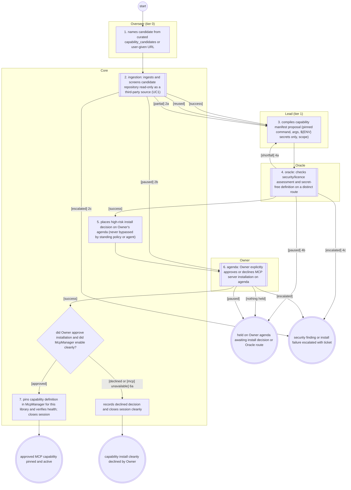

<!-- generated by render_pack.py from add-capability.spec.yaml sha256=d0fc23df2a7eb63486e268551214d88a89a63f29c8f6c16f7c68bc90d3be2add; edit the spec, not this file -->
# Add a capability (an MCP server) (proposed)

**UC15 · to-be · `PROPOSED_UNACCEPTED`** · spec [add-capability.spec.yaml](../add-capability.spec.yaml)
Supersedes: `reports/2026-11-25-systems-analysis-finalisation/librarian/as-is/add-capability.spec.yaml`

| Problem | |
|---|---|
| symptom | As-is: capability assessment relies on ad-hoc source reads, and unattended/chat install asks timeout instead of landing cleanly on the Owner's agenda. |
| root | Assess the candidate repository as an ingested source under UC1, have the Oracle check licence/scope/security risks, hold the high-risk install always on the Owner's agenda, and verify connection post-install. |

## Written use case

| Field | Content |
|---|---|
| **Use case name** | Add a capability (an MCP server) |
| **Brief description** | Candidate repository is ingested read-only via UC1, compiled as a secret-free (${ENV}-only) manifest, reviewed by Oracle for security/licence risks, and held on the Owner's agenda — never installed without the Owner's explicit yes. |
| **Primary actor** | Overseer (tier 0) |
| **Supporting actors** | Lead (tier 1), Oracle, Owner, Core |
| **Preconditions** | Curated candidate or user-supplied repository URL |
| **Trigger** | The Owner asks to add a new MCP capability |
| **Success guarantee** | Approved MCP capability pinned and enabled for this library, or cleanly declined by the Owner |
| **Minimal guarantee** | High-risk capability installation is always reserved to the Owner on the agenda; never auto-installed |
| **Open questions** | — |

**Main success scenario** (generated: the guard-true path, in step order)

1. The Overseer (tier 0) names candidate from curated capability_candidates or user-given URL.
2. The Core ingests and screens candidate repository read-only as a third-party source (UC1).
3. The Lead (tier 1) compiles capability manifest proposal (pinned command, args, ${ENV} secrets only, scope).
4. The Oracle checks security/licence assessment and secret-free definition on a distinct route.
5. The Core places high-risk install decision on Owner's agenda (never bypassed by standing policy or agent).
6. The Owner Owner explicitly approves or declines MCP server installation on agenda.
7. The Core pins capability definition in McpManager for this library and verifies health; closes session.

**Extensions** (generated: one per non-happy guard; numbered by the step it leaves)

- **2a** (from: ingests and screens candidate repository read-only as a third-party source (UC1)) *anticipated*
  - `2a1` Partial.
  - `2a2` Rejoin at 3.
- **2b** (from: ingests and screens candidate repository read-only as a third-party source (UC1)) *anticipated*
  - `2b1` Paused.
  - `2b2` Rejoin at 6.
- **2c** (from: ingests and screens candidate repository read-only as a third-party source (UC1)) *anticipated*
  - `2c1` Escalated.
  - `2c2` The use case ends: security finding or install failure escalated with ticket.
- **4a** (from: checks security/licence assessment and secret-free definition on a distinct route) *anticipated*
  - `4a1` Shortfall.
  - `4a2` Rejoin at 3.
- **4b** (from: checks security/licence assessment and secret-free definition on a distinct route) *anticipated*
  - `4b1` Paused.
  - `4b2` The use case ends: held on Owner agenda awaiting install decision or Oracle route.
- **4c** (from: checks security/licence assessment and secret-free definition on a distinct route) *anticipated*
  - `4c1` Escalated.
  - `4c2` The use case ends: security finding or install failure escalated with ticket.
- **6a** (from: did Owner approve installation and did McpManager enable cleanly?) *anticipated*
  - `6a1` Declined or [mcp] unavailable.
  - `6a2` The Core records declined decision and closes session cleanly.
  - `6a3` The use case ends: capability install cleanly declined by Owner.

## Activity diagram



## Lane load

| Lane | On the main success scenario | Anywhere in the diagram |
|---|---|---|
| Owner | 1 | 1 |
| Overseer (tier 0) | 1 | 1 |
| Lead (tier 1) | 1 | 1 |
| Oracle | 1 | 1 |
| Core | 4 | 5 |

**Tier-0 turns** (each return of control to tier 0; owner's scale: 2 ideal, 3 expected, 4 rusty, 5–10 bad, more: might as well have done it themselves). Main success scenario: **1 (ideal)**. Worst path: T12, **1 (ideal)**. Paths by grade: ideal 9; escalated 3 (failures, not graded).

Paths by how they end: **declined** 1, **escalated** 3, **paused** 3, **success** 1. Every *escalated* path is a failure of this use case: the work went back to tier 0.

## Decision tree

```text
start: Add a capability (an MCP server) (proposed)
        └─ T1: success / success / success / approved  ⇒ approved MCP capability pinned and active
  └─ T2: reused  ⇒ rejoins at step 3
  └─ T3: partial  ⇒ rejoins at step 3
  └─ T4: paused  ⇒ rejoins at step 6
  └─ T5: escalated  ⇒ security finding or install failure escalated with ticket
    └─ T6: success / shortfall  ⇒ rejoins at step 3
    └─ T7: success / paused  ⇒ held on Owner agenda awaiting install decision or Oracle route
    └─ T8: success / escalated  ⇒ security finding or install failure escalated with ticket
      └─ T9: success / success / nothing held  ⇒ held on Owner agenda awaiting install decision or Oracle route
      └─ T10: success / success / paused  ⇒ held on Owner agenda awaiting install decision or Oracle route
      └─ T11: success / success / escalated  ⇒ security finding or install failure escalated with ticket
        └─ T12: success / success / success / declined or [mcp] unavailable  ⇒ capability install cleanly declined by Owner
```

## Test cases

One test per path: the main success scenario, then each extension.

| Test | Path (guards taken) | Extension | Expected outcome | Tier-0 turns |
|---|---|---|---|---|
| T1 | ingests and screens candidate repository read-only as a third-party source (UC1) → success; checks security/licence assessment and secret-free definition on a distinct route → success; Owner explicitly approves or declines MCP server installation on agenda → success; did Owner approve installation and did McpManager enable cleanly? → approved | MSS | approved MCP capability pinned and active | 1 (ideal) |
| T2 | ingests and screens candidate repository read-only as a third-party source (UC1) → reused | MSS | rejoins at step 3 | 1 (ideal) |
| T3 | ingests and screens candidate repository read-only as a third-party source (UC1) → partial | 2a | rejoins at step 3 | 1 (ideal) |
| T4 | ingests and screens candidate repository read-only as a third-party source (UC1) → paused | 2b | rejoins at step 6 | 1 (ideal) |
| T5 | ingests and screens candidate repository read-only as a third-party source (UC1) → escalated | 2c | security finding or install failure escalated with ticket | 1 (escalated: a failure) |
| T6 | ingests and screens candidate repository read-only as a third-party source (UC1) → success; checks security/licence assessment and secret-free definition on a distinct route → shortfall | 4a | rejoins at step 3 | 1 (ideal) |
| T7 | ingests and screens candidate repository read-only as a third-party source (UC1) → success; checks security/licence assessment and secret-free definition on a distinct route → paused | 4b | held on Owner agenda awaiting install decision or Oracle route | 1 (ideal) |
| T8 | ingests and screens candidate repository read-only as a third-party source (UC1) → success; checks security/licence assessment and secret-free definition on a distinct route → escalated | 4c | security finding or install failure escalated with ticket | 1 (escalated: a failure) |
| T9 | ingests and screens candidate repository read-only as a third-party source (UC1) → success; checks security/licence assessment and secret-free definition on a distinct route → success; Owner explicitly approves or declines MCP server installation on agenda → nothing held | MSS | held on Owner agenda awaiting install decision or Oracle route | 1 (ideal) |
| T10 | ingests and screens candidate repository read-only as a third-party source (UC1) → success; checks security/licence assessment and secret-free definition on a distinct route → success; Owner explicitly approves or declines MCP server installation on agenda → paused | MSS | held on Owner agenda awaiting install decision or Oracle route | 1 (ideal) |
| T11 | ingests and screens candidate repository read-only as a third-party source (UC1) → success; checks security/licence assessment and secret-free definition on a distinct route → success; Owner explicitly approves or declines MCP server installation on agenda → escalated | MSS | security finding or install failure escalated with ticket | 1 (escalated: a failure) |
| T12 | ingests and screens candidate repository read-only as a third-party source (UC1) → success; checks security/licence assessment and secret-free definition on a distinct route → success; Owner explicitly approves or declines MCP server installation on agenda → success; did Owner approve installation and did McpManager enable cleanly? → declined or [mcp] unavailable | 6a | capability install cleanly declined by Owner | 1 (ideal) |

### Boundary values

_None declared._

## As-is weaknesses this handles

_None recorded._

## Evidence

- builds-on.md; phases.yaml add_capability; authority.md (install reserved to person); initiators.table.yaml UC15.

## Checks

Errors: none

Warnings: none
