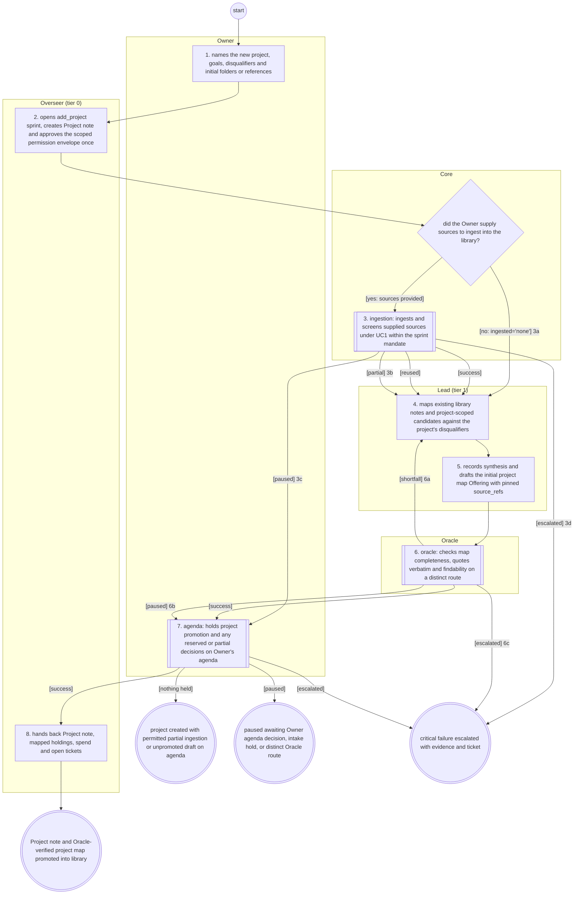

<!-- generated by render_pack.py from add-project.spec.yaml sha256=a31d40a6b83f860b1c80a3de253f9cb008edf2b51dc634a65342362919c2096e; edit the spec, not this file -->
# Add a project and map what the library holds for it (proposed)

**UC11 · to-be · `PROPOSED_UNACCEPTED`** · spec [add-project.spec.yaml](../add-project.spec.yaml)
Supersedes: `reports/2026-11-25-systems-analysis-finalisation/librarian/as-is/add-project.spec.yaml`

| Problem | |
|---|---|
| symptom | As-is: tier 0 walks eight serial phase gates with 150s asks, halving budgets, whole-library judge pools, and manual promotion prompts. |
| root | Compile the project setup as a commissioned sprint under one permission envelope, route supplied sources through UC1 ingestion, keep candidate pools scoped, verify via Oracle, and send reserved decisions to the Owner's agenda. |

## Written use case

| Field | Content |
|---|---|
| **Use case name** | Add a project and map what the library holds for it |
| **Brief description** | Tier 0 frames the new project under one approved permission envelope; Core delegates supplied sources to UC1 ingestion, Lead maps existing corpus holdings, Oracle checks completeness and citations, and promotion lands on the Owner's agenda. |
| **Primary actor** | Overseer (tier 0) |
| **Supporting actors** | Lead (tier 1), Core, Oracle, Owner |
| **Preconditions** | Project name, disqualifiers and optional source roots stated |
| **Trigger** | The Owner asks to add and map a new project |
| **Success guarantee** | Project note created, sources ingested under UC1, and Oracle-verified map Offering promoted via agenda |
| **Minimal guarantee** | Every partial source, open ticket or unpromoted draft stays visible on the agenda with nothing silently lost |
| **Open questions** | — |

**Main success scenario** (generated: the guard-true path, in step order)

1. The Owner names the new project, goals, disqualifiers and initial folders or references.
2. The Overseer (tier 0) opens add_project sprint, creates Project note and approves the scoped permission envelope once.
3. The Core ingests and screens supplied sources under UC1 within the sprint mandate.
4. The Lead (tier 1) maps existing library notes and project-scoped candidates against the project's disqualifiers.
5. The Lead (tier 1) records synthesis and drafts the initial project map Offering with pinned source_refs.
6. The Oracle checks map completeness, quotes verbatim and findability on a distinct route.
7. The Owner holds project promotion and any reserved or partial decisions on Owner's agenda.
8. The Overseer (tier 0) hands back Project note, mapped holdings, spend and open tickets.

**Extensions** (generated: one per non-happy guard; numbered by the step it leaves)

- **3a** (from: did the Owner supply sources to ingest into the library?) *anticipated*
  - `3a1` No: ingested='none'.
  - `3a2` Rejoin at 4.
- **3b** (from: ingests and screens supplied sources under UC1 within the sprint mandate) *anticipated*
  - `3b1` Partial.
  - `3b2` Rejoin at 4.
- **3c** (from: ingests and screens supplied sources under UC1 within the sprint mandate) *anticipated*
  - `3c1` Paused.
  - `3c2` Rejoin at 7.
- **3d** (from: ingests and screens supplied sources under UC1 within the sprint mandate) *anticipated*
  - `3d1` Escalated.
  - `3d2` The use case ends: critical failure escalated with evidence and ticket.
- **6a** (from: checks map completeness, quotes verbatim and findability on a distinct route) *anticipated*
  - `6a1` Shortfall.
  - `6a2` Rejoin at 4.
- **6b** (from: checks map completeness, quotes verbatim and findability on a distinct route) *anticipated*
  - `6b1` Paused.
  - `6b2` Rejoin at 7.
- **6c** (from: checks map completeness, quotes verbatim and findability on a distinct route) *anticipated*
  - `6c1` Escalated.
  - `6c2` The use case ends: critical failure escalated with evidence and ticket.

## Activity diagram



## Lane load

| Lane | On the main success scenario | Anywhere in the diagram |
|---|---|---|
| Owner | 2 | 2 |
| Overseer (tier 0) | 2 | 2 |
| Lead (tier 1) | 2 | 2 |
| Oracle | 1 | 1 |
| Core | 2 | 2 |

**Tier-0 turns** (each return of control to tier 0; owner's scale: 2 ideal, 3 expected, 4 rusty, 5–10 bad, more: might as well have done it themselves). Main success scenario: **2 (ideal)**. Worst path: T8, **2 (ideal)**. Paths by grade: ideal 9; escalated 3 (failures, not graded).

Paths by how they end: **escalated** 3, **partial** 1, **paused** 1, **success** 1. Every *escalated* path is a failure of this use case: the work went back to tier 0.

## Decision tree

```text
start: Add a project and map what the library holds for it (proposed)
        └─ T1: yes: sources provided / success / success / success  ⇒ Project note and Oracle-verified project map promoted into library
  └─ T2: no: ingested='none'  ⇒ rejoins at step 4
    └─ T3: yes: sources provided / reused  ⇒ rejoins at step 4
    └─ T4: yes: sources provided / partial  ⇒ rejoins at step 4
    └─ T5: yes: sources provided / paused  ⇒ rejoins at step 7
    └─ T6: yes: sources provided / escalated  ⇒ critical failure escalated with evidence and ticket
      └─ T7: yes: sources provided / success / shortfall  ⇒ rejoins at step 4
      └─ T8: yes: sources provided / success / paused  ⇒ rejoins at step 7
      └─ T9: yes: sources provided / success / escalated  ⇒ critical failure escalated with evidence and ticket
        └─ T10: yes: sources provided / success / success / nothing held  ⇒ project created with permitted partial ingestion or unpromoted draft on agenda
        └─ T11: yes: sources provided / success / success / paused  ⇒ paused awaiting Owner agenda decision, intake hold, or distinct Oracle route
        └─ T12: yes: sources provided / success / success / escalated  ⇒ critical failure escalated with evidence and ticket
```

## Test cases

One test per path: the main success scenario, then each extension.

| Test | Path (guards taken) | Extension | Expected outcome | Tier-0 turns |
|---|---|---|---|---|
| T1 | did the Owner supply sources to ingest into the library? → yes: sources provided; ingests and screens supplied sources under UC1 within the sprint mandate → success; checks map completeness, quotes verbatim and findability on a distinct route → success; holds project promotion and any reserved or partial decisions on Owner's agenda → success | MSS | Project note and Oracle-verified project map promoted into library | 2 (ideal) |
| T2 | did the Owner supply sources to ingest into the library? → no: ingested='none' | 3a | rejoins at step 4 | 2 (ideal) |
| T3 | did the Owner supply sources to ingest into the library? → yes: sources provided; ingests and screens supplied sources under UC1 within the sprint mandate → reused | MSS | rejoins at step 4 | 2 (ideal) |
| T4 | did the Owner supply sources to ingest into the library? → yes: sources provided; ingests and screens supplied sources under UC1 within the sprint mandate → partial | 3b | rejoins at step 4 | 2 (ideal) |
| T5 | did the Owner supply sources to ingest into the library? → yes: sources provided; ingests and screens supplied sources under UC1 within the sprint mandate → paused | 3c | rejoins at step 7 | 2 (ideal) |
| T6 | did the Owner supply sources to ingest into the library? → yes: sources provided; ingests and screens supplied sources under UC1 within the sprint mandate → escalated | 3d | critical failure escalated with evidence and ticket | 1 (escalated: a failure) |
| T7 | did the Owner supply sources to ingest into the library? → yes: sources provided; ingests and screens supplied sources under UC1 within the sprint mandate → success; checks map completeness, quotes verbatim and findability on a distinct route → shortfall | 6a | rejoins at step 4 | 2 (ideal) |
| T8 | did the Owner supply sources to ingest into the library? → yes: sources provided; ingests and screens supplied sources under UC1 within the sprint mandate → success; checks map completeness, quotes verbatim and findability on a distinct route → paused | 6b | rejoins at step 7 | 2 (ideal) |
| T9 | did the Owner supply sources to ingest into the library? → yes: sources provided; ingests and screens supplied sources under UC1 within the sprint mandate → success; checks map completeness, quotes verbatim and findability on a distinct route → escalated | 6c | critical failure escalated with evidence and ticket | 1 (escalated: a failure) |
| T10 | did the Owner supply sources to ingest into the library? → yes: sources provided; ingests and screens supplied sources under UC1 within the sprint mandate → success; checks map completeness, quotes verbatim and findability on a distinct route → success; holds project promotion and any reserved or partial decisions on Owner's agenda → nothing held | MSS | project created with permitted partial ingestion or unpromoted draft on agenda | 1 (ideal) |
| T11 | did the Owner supply sources to ingest into the library? → yes: sources provided; ingests and screens supplied sources under UC1 within the sprint mandate → success; checks map completeness, quotes verbatim and findability on a distinct route → success; holds project promotion and any reserved or partial decisions on Owner's agenda → paused | MSS | paused awaiting Owner agenda decision, intake hold, or distinct Oracle route | 1 (ideal) |
| T12 | did the Owner supply sources to ingest into the library? → yes: sources provided; ingests and screens supplied sources under UC1 within the sprint mandate → success; checks map completeness, quotes verbatim and findability on a distinct route → success; holds project promotion and any reserved or partial decisions on Owner's agenda → escalated | MSS | critical failure escalated with evidence and ticket | 1 (escalated: a failure) |

### Boundary values

_None declared._

## As-is weaknesses this handles

_None recorded._

## Evidence

- builds-on.md; phases.yaml add_project; initiators.table.yaml UC11; agenda, ingestion, oracle specs.

## Checks

Errors: none

Warnings: none
