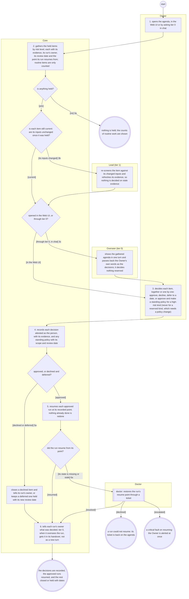

<!-- generated by render_pack.py from agenda.spec.yaml sha256=9c87425aa692125c1fb0408d6f73025d977ad5b3a711600cc17e3aaacf61a2ce; edit the spec, not this file -->
# Decide the agenda and resume held work (proposed)

**UC9 · to-be · `PROPOSED_UNACCEPTED`** · spec [agenda.spec.yaml](../agenda.spec.yaml)

| Problem | |
|---|---|
| symptom | The to-be sends reserved decisions, high-risk decisions from runs no tier 0 oversaw, and tickets assigned to the Owner to the agenda, but no process said how the Owner works through it or how a held run resumes. |
| root | A held item carries its evidence and the point its run resumes from; the Owner decides it once, the decision is recorded as the person's, and the run resumes at that point with nothing redone. |

## Written use case

| Field | Content |
|---|---|
| **Use case name** | Decide the agenda and resume held work |
| **Brief description** | The Owner works through what was held for them (reserved decisions, high-risk decisions from runs no tier 0 oversaw, tickets assigned to them); each decision is recorded as the person's, and approved runs resume where they stopped. |
| **Primary actor** | Owner |
| **Supporting actors** | Core, Lead, Doctor; tier 0 when the Owner asks in chat |
| **Preconditions** | Items held on the agenda, each with its evidence and resume point |
| **Trigger** | The Owner opens the agenda, or a review date arrives |
| **Success guarantee** | Every decided item is recorded as the person's, and each approved run resumes at its point with nothing redone |
| **Minimal guarantee** | An item whose inputs changed is re-screened before it is decided; an undecided item stays held |
| **Open questions** | May a standing policy ever cover a reserved kind (the open delegation decision)? How long may an item stay held before its run's state is dropped (retention)? |

**Main success scenario** (generated: the guard-true path, in step order)

1. The Owner opens the agenda, in the Web UI or by asking tier 0 in chat.
2. The Core gathers the held items by risk level, each with its evidence, its run's owner, its review date and the point its run resumes from; routine items are only counted.
3. The Owner decides each item, together or one by one: approve, decline, defer to a date, or approve and make a standing policy for a high-risk kind (never for a reserved kind, which needs a policy change).
4. The Core records each decision attested as the person, with its evidence, and any standing policy with its scope and review date.
5. The Core resumes each approved run at its recorded point; nothing already done is redone.
6. The Core tells each run's owner what was decided; tier 0, when it oversees the run, gets it in its handover, not as a new turn.

**Extensions** (generated: one per non-happy guard; numbered by the step it leaves)

- **3a** (from: is anything held?) *anticipated*
  - `3a1` No.
  - `3a2` The use case ends: nothing is held; the counts of routine work are shown.
- **3b** (from: is each item still current: are its inputs unchanged since it was held?) *anticipated*
  - `3b1` Its inputs changed.
  - `3b2` The Lead (tier 1) re-screens the item against its changed inputs and refreshes its evidence, so nothing is decided on stale evidence.
  - `3b3` The Core decides: opened in the Web UI, or through tier 0?
  - `3b3a` If through tier 0, in chat: shows the gathered agenda in one turn and passes back the Owner's own words as the decisions; it decides nothing reserved.
  - `3b4` If in the Web UI:
  - `3b5` Rejoin at 3.
- **3c** (from: opened in the Web UI, or through tier 0?) *anticipated*
  - `3c1` Through tier 0, in chat.
  - `3c2` The Overseer (tier 0) shows the gathered agenda in one turn and passes back the Owner's own words as the decisions; it decides nothing reserved.
  - `3c3` Rejoin at 3.
- **5a** (from: approved, or declined and deferred?) *anticipated*
  - `5a1` Declined or deferred.
  - `5a2` The Core closes a declined item and tells its run's owner, or keeps a deferred one held with its new review date.
  - `5a3` Rejoin at 6.
- **6a** (from: did the run resume from its point?) *anticipated*
  - `6a1` Its state is missing or stale.
  - `6a2` The Doctor restores the run's resume point through a ticket (continues in doctor).
  - `6a2a` If declined: the use case ends: a run could not resume: its ticket is back on the agenda.
  - `6a2a` If escalated: the use case ends: a critical fault on resuming: the Owner is alerted at once.
  - `6a3` If resolved:
  - `6a4` Rejoin at 6.

## Activity diagram



## Lane load

| Lane | On the main success scenario | Anywhere in the diagram |
|---|---|---|
| Owner | 2 | 2 |
| Overseer (tier 0) | 0 | 1 |
| Lead (tier 1) | 0 | 1 |
| Doctor | 0 | 1 |
| Core | 9 | 10 |

**Tier-0 turns** (each return of control to tier 0; owner's scale: 2 ideal, 3 expected, 4 rusty, 5–10 bad, more: might as well have done it themselves). Main success scenario: **0 (ideal)**. Worst path: T4, **1 (ideal)**. Paths by grade: ideal 7; escalated 1 (failures, not graded).

Paths by how they end: **escalated** 1, **nothing held** 1, **paused** 1, **success** 1. Every *escalated* path is a failure of this use case: the work went back to tier 0.

## Decision tree

```text
start: Decide the agenda and resume held work (proposed)
          └─ T1: yes / current / in the Web UI / approved / resumed  ⇒ the decisions are recorded, the approved runs resumed, and the rest closed or held with dates
  └─ T2: no  ⇒ nothing is held; the counts of routine work are shown
    └─ T3: yes / its inputs changed  ⇒ rejoins at 'opened in the Web UI, or through tier 0?' (before step 3)
      └─ T4: yes / current / through tier 0, in chat  ⇒ rejoins at step 3
        └─ T5: yes / current / in the Web UI / declined or deferred  ⇒ rejoins at step 6
            └─ T6: yes / current / in the Web UI / approved / its state is missing or stale / declined  ⇒ a run could not resume: its ticket is back on the agenda
            └─ T7: yes / current / in the Web UI / approved / its state is missing or stale / escalated  ⇒ a critical fault on resuming: the Owner is alerted at once
            └─ T8: yes / current / in the Web UI / approved / its state is missing or stale / resolved  ⇒ rejoins at step 6
```

## Test cases

One test per path: the main success scenario, then each extension.

| Test | Path (guards taken) | Extension | Expected outcome | Tier-0 turns |
|---|---|---|---|---|
| T1 | is anything held? → yes; is each item still current: are its inputs unchanged since it was held? → current; opened in the Web UI, or through tier 0? → in the Web UI; approved, or declined and deferred? → approved; did the run resume from its point? → resumed | MSS | the decisions are recorded, the approved runs resumed, and the rest closed or held with dates | 0 (ideal) |
| T2 | is anything held? → no | 3a | nothing is held; the counts of routine work are shown | 0 (ideal) |
| T3 | is anything held? → yes; is each item still current: are its inputs unchanged since it was held? → its inputs changed | 3b | rejoins at 'opened in the Web UI, or through tier 0?' (before step 3) | 0 (ideal) |
| T4 | is anything held? → yes; is each item still current: are its inputs unchanged since it was held? → current; opened in the Web UI, or through tier 0? → through tier 0, in chat | 3c | rejoins at step 3 | 1 (ideal) |
| T5 | is anything held? → yes; is each item still current: are its inputs unchanged since it was held? → current; opened in the Web UI, or through tier 0? → in the Web UI; approved, or declined and deferred? → declined or deferred | 5a | rejoins at step 6 | 0 (ideal) |
| T6 | is anything held? → yes; is each item still current: are its inputs unchanged since it was held? → current; opened in the Web UI, or through tier 0? → in the Web UI; approved, or declined and deferred? → approved; did the run resume from its point? → its state is missing or stale; restores the run's resume point through a ticket → declined | 6a | a run could not resume: its ticket is back on the agenda | 0 (ideal) |
| T7 | is anything held? → yes; is each item still current: are its inputs unchanged since it was held? → current; opened in the Web UI, or through tier 0? → in the Web UI; approved, or declined and deferred? → approved; did the run resume from its point? → its state is missing or stale; restores the run's resume point through a ticket → escalated | 6a | a critical fault on resuming: the Owner is alerted at once | 0 (escalated: a failure) |
| T8 | is anything held? → yes; is each item still current: are its inputs unchanged since it was held? → current; opened in the Web UI, or through tier 0? → in the Web UI; approved, or declined and deferred? → approved; did the run resume from its point? → its state is missing or stale; restores the run's resume point through a ticket → resolved | 6a | rejoins at step 6 | 0 (ideal) |

### Boundary values

_None declared._

## As-is weaknesses this handles

_None recorded._

## Checks

Errors: none

Warnings: none
