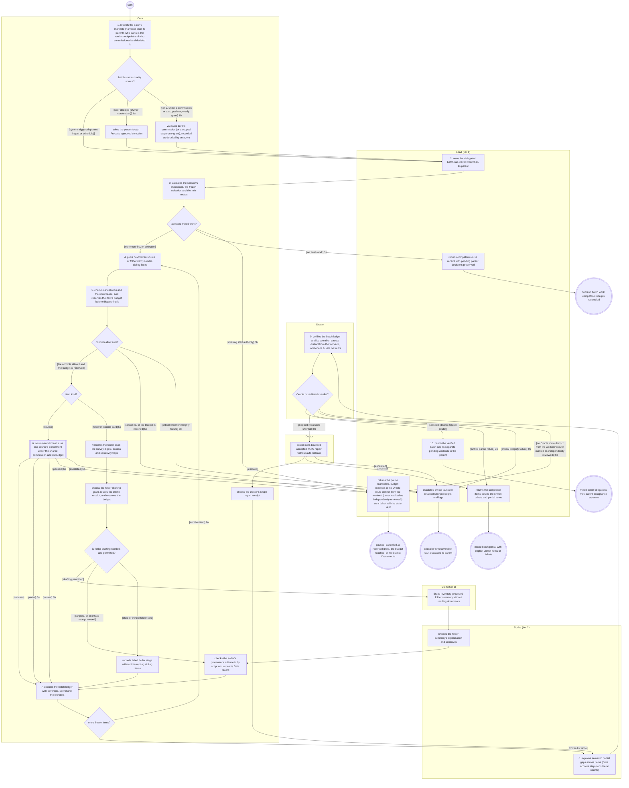

<!-- generated by render_pack.py from batch-enrichment.spec.yaml sha256=756c0391c1a953964b2b004d8b497806202398e5cb82dd02efdaa3100830af53; edit the spec, not this file -->
# Run the approved batch (proposed)

**UC1b · to-be · `PROPOSED_UNACCEPTED`** · spec [batch-enrichment.spec.yaml](../batch-enrichment.spec.yaml)
Supersedes: `reports/2026-11-24-librarian-reconstruction-and-offering/diagrams/librarian-batch-enrichment-tobe.spec.yaml`, `reports/2026-11-23-proposed-process-family/proposed-batch-enrichment.spec.yaml`

| Problem | |
|---|---|
| symptom | As-is: batches ran outside a session, checked the budget only before each item, drafted folders twice, and were repaired without an Oracle's check. |
| root | Record what started the batch, reuse the receipts of work already done, reserve the budget before each dispatch, gate the result with the Oracle, and let the Doctor repair once. |

## Written use case

| Field | Content |
|---|---|
| **Use case name** | Run the approved batch |
| **Brief description** | The frozen selection runs item by item under a budget reserve, folder cards drafted by a Clerk and reviewed by a Scribe, then judged by the Oracle. |
| **Primary actor** | Core |
| **Supporting actors** | Lead, Scribe, Clerk, Oracle, Doctor |
| **Preconditions** | Gate 1 within the mandate |
| **Trigger** | The parent's batch step |
| **Success guarantee** | A verified mixed ledger |
| **Minimal guarantee** | Sibling faults isolated; completed items kept |
| **Open questions** | — |

**Main success scenario** (generated: the guard-true path, in step order)

1. The Core records the batch's mandate (narrower than its parent), who owns it, the run's checkpoint and who commissioned and decided it.
2. The Lead (tier 1) owns the delegated batch run, never wider than its parent.
3. The Core validates the session's checkpoint, the frozen selection and the role routes.
4. The Core picks next frozen source or folder item; isolates sibling faults.
5. The Core checks cancellation and the writer lease, and reserves the item's budget before dispatching it.
6. The Core runs one source's enrichment under the shared commission and its budget.
7. The Core updates the batch ledger with coverage, spend and the worklists.
8. The Scribe (tier 2) explains semantic partial gaps across items (Core account step owns literal counts).
9. The Oracle verifies the batch ledger and its spend on a route distinct from the workers', and opens tickets on faults.
10. The Lead (tier 1) hands the verified batch and its separate pending worklists to the parent.

**Extensions** (generated: one per non-happy guard; numbered by the step it leaves)

- **1a** (from: batch start authority source?) *anticipated*
  - `1a1` User directed (Owner curate start).
  - `1a2` The Core takes the person's own Process approved selection.
  - `1a3` Rejoin at 2.
- **1b** (from: batch start authority source?) *anticipated*
  - `1b1` Tier 0, under a commission or a scoped stage-only grant.
  - `1b2` The Core validates tier 0's commission (or a scoped stage-only grant), recorded as decided by an agent.
  - `1b3` Rejoin at 2.
- **3a** (from: admitted mixed work?) *anticipated*
  - `3a1` No fresh work.
  - `3a2` The Lead (tier 1) returns compatible reuse receipt with pending parent decisions preserved.
  - `3a3` The use case ends: no fresh batch work; compatible receipts reconciled.
- **3b** (from: admitted mixed work?) *anticipated*
  - `3b1` Missing start authority.
  - `3b2` The Lead (tier 1) returns the pause (cancelled, budget reached, or no Oracle route distinct from the workers' (never marked as independently reviewed)) as a ticket, with its state kept.
  - `3b3` The use case ends: paused: cancelled, a reserved grant, the budget reached, or no distinct Oracle route.
- **5a** (from: controls allow item?) *anticipated*
  - `5a1` Cancelled, or the budget is reached.
  - `5a2` The Lead (tier 1) returns the pause (cancelled, budget reached, or no Oracle route distinct from the workers' (never marked as independently reviewed)) as a ticket, with its state kept.
  - `5a3` The use case ends: paused: cancelled, a reserved grant, the budget reached, or no distinct Oracle route.
- **5b** (from: controls allow item?) *anticipated*
  - `5b1` Critical writer or integrity failure.
  - `5b2` The Lead (tier 1) escalates critical fault with retained sibling receipts and logs.
  - `5b3` The use case ends: critical or unrecoverable fault escalated to parent.
- **5c** (from: item kind?) *anticipated*
  - `5c1` Folder metadata card.
  - `5c2` The Core validates the folder card: the survey digest, access and sensitivity flags.
  - `5c3` The Core checks the folder drafting grant, reuses the intake receipt, and reserves the budget.
  - `5c4` The Core decides: is folder drafting needed, and permitted?
  - `5c4a` If scripted, or an intake receipt reused: checks the folder's provenance arithmetic by script and writes its Data record.
  - `5c4a` If stale or invalid folder card: records failed folder stage without interrupting sibling items.
  - `5c5` If drafting permitted:
  - `5c6` The Clerk (tier 3) drafts inventory-grounded folder summary without reading documents.
  - `5c7` The Scribe (tier 2) reviews the folder summary's organisation and sensitivity.
  - `5c8` The Core checks the folder's provenance arithmetic by script and writes its Data record.
  - `5c9` Rejoin at 7.
- **6a** (from: runs one source's enrichment under the shared commission and its budget) *anticipated*
  - `6a1` Partial.
  - `6a2` Rejoin at 7.
- **6b** (from: runs one source's enrichment under the shared commission and its budget) *anticipated*
  - `6b1` Reused.
  - `6b2` Rejoin at 7.
- **6c** (from: runs one source's enrichment under the shared commission and its budget) *anticipated*
  - `6c1` Paused.
  - `6c2` The Lead (tier 1) returns the pause (cancelled, budget reached, or no Oracle route distinct from the workers' (never marked as independently reviewed)) as a ticket, with its state kept.
  - `6c3` The use case ends: paused: cancelled, a reserved grant, the budget reached, or no distinct Oracle route.
- **6d** (from: runs one source's enrichment under the shared commission and its budget) *anticipated*
  - `6d1` Escalated.
  - `6d2` The Lead (tier 1) escalates critical fault with retained sibling receipts and logs.
  - `6d3` The use case ends: critical or unrecoverable fault escalated to parent.
- **7a** (from: more frozen items?) *anticipated*
  - `7a1` Another item.
  - `7a2` Rejoin at 4.
- **9a** (from: Oracle mixed-batch verdict?) *anticipated*
  - `9a1` Mapped repairable shortfall.
  - `9a2` The Doctor runs bounded accepted YAML repair without auto-rollback (continues in doctor).
  - `9a2a` If declined: returns the completed items beside the unmet tickets and partial items.
  - `9a2a` If escalated: escalates critical fault with retained sibling receipts and logs.
  - `9a3` If resolved:
  - `9a4` The Core checks the Doctor's single repair receipt.
  - `9a5` Rejoin at 8.
- **9b** (from: Oracle mixed-batch verdict?) *anticipated*
  - `9b1` Truthful partial return.
  - `9b2` The Lead (tier 1) returns the completed items beside the unmet tickets and partial items.
  - `9b3` The use case ends: mixed batch partial with explicit unmet items or tickets.
- **9c** (from: Oracle mixed-batch verdict?) *anticipated*
  - `9c1` Critical integrity failure.
  - `9c2` The Lead (tier 1) escalates critical fault with retained sibling receipts and logs.
  - `9c3` The use case ends: critical or unrecoverable fault escalated to parent.
- **9d** (from: Oracle mixed-batch verdict?) *anticipated*
  - `9d1` No Oracle route distinct from the workers' (never marked as independently reviewed).
  - `9d2` The Lead (tier 1) returns the pause (cancelled, budget reached, or no Oracle route distinct from the workers' (never marked as independently reviewed)) as a ticket, with its state kept.
  - `9d3` The use case ends: paused: cancelled, a reserved grant, the budget reached, or no distinct Oracle route.

## Activity diagram



## Lane load

| Lane | On the main success scenario | Anywhere in the diagram |
|---|---|---|
| Oracle | 2 | 2 |
| Lead (tier 1) | 2 | 6 |
| Doctor | 0 | 1 |
| Scribe (tier 2) | 1 | 2 |
| Clerk (tier 3) | 0 | 1 |
| Core | 11 | 19 |

Paths by how they end: **escalated** 4, **partial** 2, **paused** 4, **reused** 1, **success** 1. Every *escalated* path is a failure of this use case: the work went back to tier 0.

## Decision tree

```text
start: Run the approved batch (proposed)
              └─ T1: system triggered (parent ingest or schedule) / nonempty frozen selection / the controls allow it and the budget is reserved / source / success / frozen list done / satisfied (distinct Oracle route)  ⇒ mixed batch obligations met; parent acceptance separate
  └─ T2: user directed (Owner curate start)  ⇒ rejoins at step 2
  └─ T3: tier 0, under a commission or a scoped stage-only grant  ⇒ rejoins at step 2
    └─ T4: system triggered (parent ingest or schedule) / no fresh work  ⇒ no fresh batch work; compatible receipts reconciled
    └─ T5: system triggered (parent ingest or schedule) / missing start authority  ⇒ paused: cancelled, a reserved grant, the budget reached, or no distinct Oracle route
      └─ T6: system triggered (parent ingest or schedule) / nonempty frozen selection / cancelled, or the budget is reached  ⇒ paused: cancelled, a reserved grant, the budget reached, or no distinct Oracle route
      └─ T7: system triggered (parent ingest or schedule) / nonempty frozen selection / critical writer or integrity failure  ⇒ critical or unrecoverable fault escalated to parent
          └─ T8: system triggered (parent ingest or schedule) / nonempty frozen selection / the controls allow it and the budget is reserved / folder metadata card / scripted, or an intake receipt reused  ⇒ rejoins at step 7
          └─ T9: system triggered (parent ingest or schedule) / nonempty frozen selection / the controls allow it and the budget is reserved / folder metadata card / stale or invalid folder card  ⇒ rejoins at step 7
          └─ T10: system triggered (parent ingest or schedule) / nonempty frozen selection / the controls allow it and the budget is reserved / folder metadata card / drafting permitted  ⇒ rejoins at step 7
          └─ T11: system triggered (parent ingest or schedule) / nonempty frozen selection / the controls allow it and the budget is reserved / source / partial  ⇒ rejoins at step 7
          └─ T12: system triggered (parent ingest or schedule) / nonempty frozen selection / the controls allow it and the budget is reserved / source / reused  ⇒ rejoins at step 7
          └─ T13: system triggered (parent ingest or schedule) / nonempty frozen selection / the controls allow it and the budget is reserved / source / paused  ⇒ paused: cancelled, a reserved grant, the budget reached, or no distinct Oracle route
          └─ T14: system triggered (parent ingest or schedule) / nonempty frozen selection / the controls allow it and the budget is reserved / source / escalated  ⇒ critical or unrecoverable fault escalated to parent
            └─ T15: system triggered (parent ingest or schedule) / nonempty frozen selection / the controls allow it and the budget is reserved / source / success / another item  ⇒ rejoins at step 4
                └─ T16: system triggered (parent ingest or schedule) / nonempty frozen selection / the controls allow it and the budget is reserved / source / success / frozen list done / mapped repairable shortfall / declined  ⇒ mixed batch partial with explicit unmet items or tickets
                └─ T17: system triggered (parent ingest or schedule) / nonempty frozen selection / the controls allow it and the budget is reserved / source / success / frozen list done / mapped repairable shortfall / escalated  ⇒ critical or unrecoverable fault escalated to parent
                └─ T18: system triggered (parent ingest or schedule) / nonempty frozen selection / the controls allow it and the budget is reserved / source / success / frozen list done / mapped repairable shortfall / resolved  ⇒ rejoins at step 8
              └─ T19: system triggered (parent ingest or schedule) / nonempty frozen selection / the controls allow it and the budget is reserved / source / success / frozen list done / truthful partial return  ⇒ mixed batch partial with explicit unmet items or tickets
              └─ T20: system triggered (parent ingest or schedule) / nonempty frozen selection / the controls allow it and the budget is reserved / source / success / frozen list done / critical integrity failure  ⇒ critical or unrecoverable fault escalated to parent
              └─ T21: system triggered (parent ingest or schedule) / nonempty frozen selection / the controls allow it and the budget is reserved / source / success / frozen list done / no Oracle route distinct from the workers' (never marked as independently reviewed)  ⇒ paused: cancelled, a reserved grant, the budget reached, or no distinct Oracle route
```

## Test cases

One test per path: the main success scenario, then each extension.

| Test | Path (guards taken) | Extension | Expected outcome |
|---|---|---|---|
| T1 | batch start authority source? → system triggered (parent ingest or schedule); admitted mixed work? → nonempty frozen selection; controls allow item? → the controls allow it and the budget is reserved; item kind? → source; runs one source's enrichment under the shared commission and its budget → success; more frozen items? → frozen list done; Oracle mixed-batch verdict? → satisfied (distinct Oracle route) | MSS | mixed batch obligations met; parent acceptance separate |
| T2 | batch start authority source? → user directed (Owner curate start) | 1a | rejoins at step 2 |
| T3 | batch start authority source? → tier 0, under a commission or a scoped stage-only grant | 1b | rejoins at step 2 |
| T4 | batch start authority source? → system triggered (parent ingest or schedule); admitted mixed work? → no fresh work | 3a | no fresh batch work; compatible receipts reconciled |
| T5 | batch start authority source? → system triggered (parent ingest or schedule); admitted mixed work? → missing start authority | 3b | paused: cancelled, a reserved grant, the budget reached, or no distinct Oracle route |
| T6 | batch start authority source? → system triggered (parent ingest or schedule); admitted mixed work? → nonempty frozen selection; controls allow item? → cancelled, or the budget is reached | 5a | paused: cancelled, a reserved grant, the budget reached, or no distinct Oracle route |
| T7 | batch start authority source? → system triggered (parent ingest or schedule); admitted mixed work? → nonempty frozen selection; controls allow item? → critical writer or integrity failure | 5b | critical or unrecoverable fault escalated to parent |
| T8 | batch start authority source? → system triggered (parent ingest or schedule); admitted mixed work? → nonempty frozen selection; controls allow item? → the controls allow it and the budget is reserved; item kind? → folder metadata card; is folder drafting needed, and permitted? → scripted, or an intake receipt reused | 5c | rejoins at step 7 |
| T9 | batch start authority source? → system triggered (parent ingest or schedule); admitted mixed work? → nonempty frozen selection; controls allow item? → the controls allow it and the budget is reserved; item kind? → folder metadata card; is folder drafting needed, and permitted? → stale or invalid folder card | 5c | rejoins at step 7 |
| T10 | batch start authority source? → system triggered (parent ingest or schedule); admitted mixed work? → nonempty frozen selection; controls allow item? → the controls allow it and the budget is reserved; item kind? → folder metadata card; is folder drafting needed, and permitted? → drafting permitted | 5c | rejoins at step 7 |
| T11 | batch start authority source? → system triggered (parent ingest or schedule); admitted mixed work? → nonempty frozen selection; controls allow item? → the controls allow it and the budget is reserved; item kind? → source; runs one source's enrichment under the shared commission and its budget → partial | 6a | rejoins at step 7 |
| T12 | batch start authority source? → system triggered (parent ingest or schedule); admitted mixed work? → nonempty frozen selection; controls allow item? → the controls allow it and the budget is reserved; item kind? → source; runs one source's enrichment under the shared commission and its budget → reused | 6b | rejoins at step 7 |
| T13 | batch start authority source? → system triggered (parent ingest or schedule); admitted mixed work? → nonempty frozen selection; controls allow item? → the controls allow it and the budget is reserved; item kind? → source; runs one source's enrichment under the shared commission and its budget → paused | 6c | paused: cancelled, a reserved grant, the budget reached, or no distinct Oracle route |
| T14 | batch start authority source? → system triggered (parent ingest or schedule); admitted mixed work? → nonempty frozen selection; controls allow item? → the controls allow it and the budget is reserved; item kind? → source; runs one source's enrichment under the shared commission and its budget → escalated | 6d | critical or unrecoverable fault escalated to parent |
| T15 | batch start authority source? → system triggered (parent ingest or schedule); admitted mixed work? → nonempty frozen selection; controls allow item? → the controls allow it and the budget is reserved; item kind? → source; runs one source's enrichment under the shared commission and its budget → success; more frozen items? → another item | 7a | rejoins at step 4 |
| T16 | batch start authority source? → system triggered (parent ingest or schedule); admitted mixed work? → nonempty frozen selection; controls allow item? → the controls allow it and the budget is reserved; item kind? → source; runs one source's enrichment under the shared commission and its budget → success; more frozen items? → frozen list done; Oracle mixed-batch verdict? → mapped repairable shortfall; runs bounded accepted YAML repair without auto-rollback → declined | 9a | mixed batch partial with explicit unmet items or tickets |
| T17 | batch start authority source? → system triggered (parent ingest or schedule); admitted mixed work? → nonempty frozen selection; controls allow item? → the controls allow it and the budget is reserved; item kind? → source; runs one source's enrichment under the shared commission and its budget → success; more frozen items? → frozen list done; Oracle mixed-batch verdict? → mapped repairable shortfall; runs bounded accepted YAML repair without auto-rollback → escalated | 9a | critical or unrecoverable fault escalated to parent |
| T18 | batch start authority source? → system triggered (parent ingest or schedule); admitted mixed work? → nonempty frozen selection; controls allow item? → the controls allow it and the budget is reserved; item kind? → source; runs one source's enrichment under the shared commission and its budget → success; more frozen items? → frozen list done; Oracle mixed-batch verdict? → mapped repairable shortfall; runs bounded accepted YAML repair without auto-rollback → resolved | 9a | rejoins at step 8 |
| T19 | batch start authority source? → system triggered (parent ingest or schedule); admitted mixed work? → nonempty frozen selection; controls allow item? → the controls allow it and the budget is reserved; item kind? → source; runs one source's enrichment under the shared commission and its budget → success; more frozen items? → frozen list done; Oracle mixed-batch verdict? → truthful partial return | 9b | mixed batch partial with explicit unmet items or tickets |
| T20 | batch start authority source? → system triggered (parent ingest or schedule); admitted mixed work? → nonempty frozen selection; controls allow item? → the controls allow it and the budget is reserved; item kind? → source; runs one source's enrichment under the shared commission and its budget → success; more frozen items? → frozen list done; Oracle mixed-batch verdict? → critical integrity failure | 9c | critical or unrecoverable fault escalated to parent |
| T21 | batch start authority source? → system triggered (parent ingest or schedule); admitted mixed work? → nonempty frozen selection; controls allow item? → the controls allow it and the budget is reserved; item kind? → source; runs one source's enrichment under the shared commission and its budget → success; more frozen items? → frozen list done; Oracle mixed-batch verdict? → no Oracle route distinct from the workers' (never marked as independently reviewed) | 9d | paused: cancelled, a reserved grant, the budget reached, or no distinct Oracle route |

### Boundary values

| Decision | Values to test | Expected |
|---|---|---|
| controls allow item? | reserve fits exactly; short by one call; cancelled between items | an item is dispatched only with its budget reserved |

## As-is weaknesses this handles

| As-is weakness | Where here | How it is handled |
|---|---|---|
| W-BAT-01 (batch-enrichment): folder_describe failed in all 12 audited folder-item attempts, and no folder_data success was observed. | fscribe | A Clerk drafts the folder summary from the inventory and a Scribe reviews it; a failed folder stage is recorded per item. |

## Checks

Errors: none

Warnings: none
