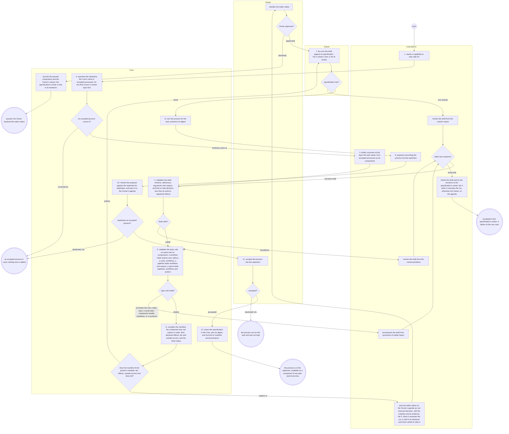

<!-- generated by render_pack.py from catalogue.spec.yaml sha256=c096917f2837e6ef292bc303b8f796e3302c647140b411f9d1c8d160bc3ed1aa; edit the spec, not this file -->
# Compose a process and promote it into the repertoire (proposed)

**UC8.2 · to-be · `PROPOSED_UNACCEPTED`** · spec [catalogue.spec.yaml](../catalogue.spec.yaml)
Supersedes: `reports/2026-11-20-workflow-map/examples/ingestion/compose.spec.yaml`

| Problem | |
|---|---|
| symptom | Canonicalisation kept the sprint-level compose and dropped the repertoire's lifecycle: duplicates, the Owner's acceptance, the pinned digest. |
| root | A process is reused if one is accepted, composed under the layer rule if not, and kept only through the Owner's acceptance, stored in the Core. |

## Written use case

| Field | Content |
|---|---|
| **Use case name** | Compose a process and promote it into the repertoire |
| **Brief description** | Reuse an accepted process; if none covers the task, compose one under the layer rule, check its manifest against the mandate, dry-run it with the Oracle, and keep it only if the Owner accepts it into the repertoire, stored in the Core with its digest pinned. |
| **Primary actor** | Lead (tier 1) |
| **Supporting actors** | Core, Oracle, Overseer (tier 0), Owner |
| **Preconditions** | Every action the draft names is registered and declares its effects |
| **Trigger** | A task needs a capability |
| **Success guarantee** | An accepted process in the Core's repertoire, digest-pinned, with its manifest and provenance |
| **Minimal guarantee** | Nothing enters the repertoire without the Owner's acceptance; a duplicate is reused, not added |
| **Open questions** | Layer rule: the accepted table (section 11.1) allows same-layer components only for workflows; the 20 November UC-C step 5 allowed them at every layer. Which holds? |

**Main success scenario** (generated: the guard-true path, in step order)

1. The Lead (tier 1) needs a capability its task calls for.
2. The Core searches the repertoire, the Core's store of accepted processes, for one that covers it, lowest layer first.
3. The Lead (tier 1) drafts a process at the layer the task needs, from accepted processes as its components.
4. The Core validates the draft: schema, references, arguments and outputs, and that no step declares less than its action's registered effects.
5. The Core validates the layer rule: an action has no components; a workflow holds actions and, without a cycle, workflows; a pipeline holds workflows and actions; a sprint holds pipelines, workflows and actions.
6. The Core compiles the manifest: the component tree, the actions in order, their declared effects, tier and outside access, and the blast radius.
7. The Oracle dry-runs the draft against its specification: Tier A checks, then a Tier B review.
8. The Core runs the process for the task, pinned to its digest.
9. The Lead (tier 1) proposes promoting the process into the repertoire.
10. The Core checks the proposal against the repertoire for duplicates, and puts it on the Owner's agenda.
11. The Owner accepts the process into the repertoire.
12. The Core stores the specification in the Core, pins its digest, and records its manifest and provenance.

**Extensions** (generated: one per non-happy guard; numbered by the step it leaves)

- **3a** (from: an accepted process covers it?) *anticipated*
  - `3a1` Covered.
  - `3a2` The use case ends: an accepted process is used; nothing new is added.
- **5a** (from: draft valid?) *anticipated*
  - `5a1` Invalid.
  - `5a2` The Lead (tier 1) revises the draft from the named problems.
  - `5a3` The Lead (tier 1) decides: within two revisions?
  - `5a3a` If none left: hands the draft and its two revisions to the specification's owner: tier 0 when it oversees the run, otherwise the Owner, on the agenda.
  - `5a4` If revisions left:
  - `5a5` Rejoin at 4.
- **6a** (from: layer rule holds?) *anticipated*
  - `6a1` It breaks the rule: a later layer, a same-layer component outside workflows, or a cycle.
  - `6a2` The Lead (tier 1) recomposes the draft from processes of earlier layers.
  - `6a3` The Lead (tier 1) decides: within two revisions?
  - `6a3a` If none left: hands the draft and its two revisions to the specification's owner: tier 0 when it oversees the run, otherwise the Owner, on the agenda.
  - `6a4` If revisions left:
  - `6a5` Rejoin at 4.
- **7a** (from: does the manifest fit the parent's mandate: tier, effects, outside access and deny list?) *anticipated*
  - `7a1` Wider.
  - `7a2` The Lead (tier 1) puts the wider radius on the Owner's agenda as one reserved decision, with the manifest and its evidence; tier 0, when it oversees the run, is told in its handover and never asked to relay it.
  - `7a3` The Owner decides the wider radius.
  - `7a4` The Owner decides: Owner approves?
  - `7a4a` If declined: records the paused composition and the Owner's reason; the specification's owner is told in its handover.
  - `7a5` If approved:
  - `7a6` Rejoin at 7.
- **8a** (from: specification met?) *anticipated*
  - `8a1` Not met.
  - `8a2` The Lead (tier 1) revises the draft from the oracle's report.
  - `8a3` The Lead (tier 1) decides: within two revisions?
  - `8a3a` If none left: hands the draft and its two revisions to the specification's owner: tier 0 when it oversees the run, otherwise the Owner, on the agenda.
  - `8a4` If revisions left:
  - `8a5` Rejoin at 4.
- **11a** (from: duplicates an accepted process?) *anticipated*
  - `11a1` Duplicate.
  - `11a2` The use case ends: an accepted process is used; nothing new is added.
- **12a** (from: accepted?) *anticipated*
  - `12a1` Declined.
  - `12a2` The use case ends: the process ran for this task and was not kept.

## Activity diagram



## Lane load

| Lane | On the main success scenario | Anywhere in the diagram |
|---|---|---|
| Owner | 2 | 4 |
| Oracle | 2 | 2 |
| Lead (tier 1) | 3 | 9 |
| Core | 12 | 13 |

Paths by how they end: **escalated** 3, **paused** 1, **reused** 2, **success** 1, **used once** 1. Every *escalated* path is a failure of this use case: the work went back to tier 0.

## Decision tree

```text
start: Compose a process and promote it into the repertoire (proposed)
              └─ T1: nothing covers it / valid / holds / within / met / new / accepted  ⇒ the process is in the repertoire, available as a component of any later parent process
  └─ T2: covered  ⇒ an accepted process is used; nothing new is added
      └─ T3: nothing covers it / invalid / none left  ⇒ escalated to the specification's owner: a failure of this use case
      └─ T4: nothing covers it / invalid / revisions left  ⇒ rejoins at step 4
        └─ T5: nothing covers it / valid / it breaks the rule: a later layer, a same-layer component outside workflows, or a cycle / none left  ⇒ escalated to the specification's owner: a failure of this use case
        └─ T6: nothing covers it / valid / it breaks the rule: a later layer, a same-layer component outside workflows, or a cycle / revisions left  ⇒ rejoins at step 4
          └─ T7: nothing covers it / valid / holds / wider / declined  ⇒ paused: the Owner declined the wider radius
          └─ T8: nothing covers it / valid / holds / wider / approved  ⇒ rejoins at step 7
            └─ T9: nothing covers it / valid / holds / within / not met / none left  ⇒ escalated to the specification's owner: a failure of this use case
            └─ T10: nothing covers it / valid / holds / within / not met / revisions left  ⇒ rejoins at step 4
            └─ T11: nothing covers it / valid / holds / within / met / duplicate  ⇒ an accepted process is used; nothing new is added
              └─ T12: nothing covers it / valid / holds / within / met / new / declined  ⇒ the process ran for this task and was not kept
```

## Test cases

One test per path: the main success scenario, then each extension.

| Test | Path (guards taken) | Extension | Expected outcome |
|---|---|---|---|
| T1 | an accepted process covers it? → nothing covers it; draft valid? → valid; layer rule holds? → holds; does the manifest fit the parent's mandate: tier, effects, outside access and deny list? → within; specification met? → met; duplicates an accepted process? → new; accepted? → accepted | MSS | the process is in the repertoire, available as a component of any later parent process |
| T2 | an accepted process covers it? → covered | 3a | an accepted process is used; nothing new is added |
| T3 | an accepted process covers it? → nothing covers it; draft valid? → invalid; within two revisions? → none left | 5a | escalated to the specification's owner: a failure of this use case |
| T4 | an accepted process covers it? → nothing covers it; draft valid? → invalid; within two revisions? → revisions left | 5a | rejoins at step 4 |
| T5 | an accepted process covers it? → nothing covers it; draft valid? → valid; layer rule holds? → it breaks the rule: a later layer, a same-layer component outside workflows, or a cycle; within two revisions? → none left | 6a | escalated to the specification's owner: a failure of this use case |
| T6 | an accepted process covers it? → nothing covers it; draft valid? → valid; layer rule holds? → it breaks the rule: a later layer, a same-layer component outside workflows, or a cycle; within two revisions? → revisions left | 6a | rejoins at step 4 |
| T7 | an accepted process covers it? → nothing covers it; draft valid? → valid; layer rule holds? → holds; does the manifest fit the parent's mandate: tier, effects, outside access and deny list? → wider; Owner approves? → declined | 7a | paused: the Owner declined the wider radius |
| T8 | an accepted process covers it? → nothing covers it; draft valid? → valid; layer rule holds? → holds; does the manifest fit the parent's mandate: tier, effects, outside access and deny list? → wider; Owner approves? → approved | 7a | rejoins at step 7 |
| T9 | an accepted process covers it? → nothing covers it; draft valid? → valid; layer rule holds? → holds; does the manifest fit the parent's mandate: tier, effects, outside access and deny list? → within; specification met? → not met; within two revisions? → none left | 8a | escalated to the specification's owner: a failure of this use case |
| T10 | an accepted process covers it? → nothing covers it; draft valid? → valid; layer rule holds? → holds; does the manifest fit the parent's mandate: tier, effects, outside access and deny list? → within; specification met? → not met; within two revisions? → revisions left | 8a | rejoins at step 4 |
| T11 | an accepted process covers it? → nothing covers it; draft valid? → valid; layer rule holds? → holds; does the manifest fit the parent's mandate: tier, effects, outside access and deny list? → within; specification met? → met; duplicates an accepted process? → duplicate | 11a | an accepted process is used; nothing new is added |
| T12 | an accepted process covers it? → nothing covers it; draft valid? → valid; layer rule holds? → holds; does the manifest fit the parent's mandate: tier, effects, outside access and deny list? → within; specification met? → met; duplicates an accepted process? → new; accepted? → declined | 12a | the process ran for this task and was not kept |

### Boundary values

_None declared._

## As-is weaknesses this handles

_None recorded._

## Evidence

- docs/proposals/diagram-workflows.md sections 11.1 (layer table), 11.3 (UC-C), 11.7 (manifests).
- docs/policy/agent-roles-and-authority.md: specifications belong within the Librarian Core.

## Checks

Errors: none

Warnings: none
