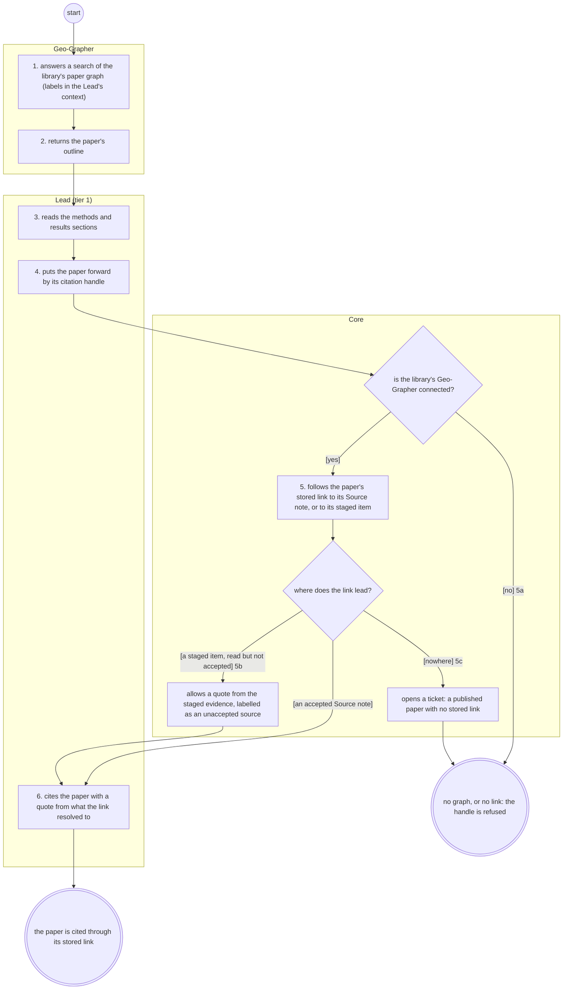

<!-- generated by render_pack.py from cite-graph.spec.yaml sha256=34b691d5e0fdd1e77cf932696ccdad97073f177fcb83a4752d61e773d1c81e21; edit the spec, not this file -->
# Read and cite a paper from the graph (proposed)

**UC4 · to-be · `PROPOSED_UNACCEPTED`** · spec [cite-graph.spec.yaml](../cite-graph.spec.yaml)

| Problem | |
|---|---|
| symptom | As-is: paper and note joined by title; a read but unaccepted paper could not be quoted. |
| root | Publication stores the paper's link to its staged item and, later, its note; a citation follows the stored link. |

## Written use case

| Field | Content |
|---|---|
| **Use case name** | Read and cite a paper from the graph |
| **Brief description** | A paper is cited through the link stored at publication, from its note or its staged evidence. |
| **Primary actor** | Lead |
| **Supporting actors** | Geo-Grapher, Core |
| **Preconditions** | The paper was published with its link |
| **Trigger** | A brief needs the paper |
| **Success guarantee** | Cited through its stored link |
| **Minimal guarantee** | A missing link opens a ticket |
| **Open questions** | — |

**Main success scenario** (generated: the guard-true path, in step order)

1. The Geo-Grapher answers a search of the library's paper graph (labels in the Lead's context).
2. The Geo-Grapher returns the paper's outline.
3. The Lead (tier 1) reads the methods and results sections.
4. The Lead (tier 1) puts the paper forward by its citation handle.
5. The Core follows the paper's stored link to its Source note, or to its staged item.
6. The Lead (tier 1) cites the paper with a quote from what the link resolved to.

**Extensions** (generated: one per non-happy guard; numbered by the step it leaves)

- **5a** (from: is the library's Geo-Grapher connected?) *anticipated*
  - `5a1` No.
  - `5a2` The use case ends: no graph, or no link: the handle is refused.
- **5b** (from: where does the link lead?) *anticipated*
  - `5b1` A staged item, read but not accepted.
  - `5b2` The Core allows a quote from the staged evidence, labelled as an unaccepted source.
  - `5b3` Rejoin at 6.
- **5c** (from: where does the link lead?) *anticipated*
  - `5c1` Nowhere.
  - `5c2` The Core opens a ticket: a published paper with no stored link.
  - `5c3` The use case ends: no graph, or no link: the handle is refused.

## Activity diagram



## Lane load

| Lane | On the main success scenario | Anywhere in the diagram |
|---|---|---|
| Lead (tier 1) | 3 | 3 |
| Core | 3 | 5 |
| Geo-Grapher | 2 | 2 |

Paths by how they end: **success** 1, **unavailable** 2.

## Decision tree

```text
start: Read and cite a paper from the graph (proposed)
    └─ T1: yes / an accepted Source note  ⇒ the paper is cited through its stored link
  └─ T2: no  ⇒ no graph, or no link: the handle is refused
    └─ T3: yes / a staged item, read but not accepted  ⇒ rejoins at step 6
    └─ T4: yes / nowhere  ⇒ no graph, or no link: the handle is refused
```

## Test cases

One test per path: the main success scenario, then each extension.

| Test | Path (guards taken) | Extension | Expected outcome |
|---|---|---|---|
| T1 | is the library's Geo-Grapher connected? → yes; where does the link lead? → an accepted Source note | MSS | the paper is cited through its stored link |
| T2 | is the library's Geo-Grapher connected? → no | 5a | no graph, or no link: the handle is refused |
| T3 | is the library's Geo-Grapher connected? → yes; where does the link lead? → a staged item, read but not accepted | 5b | rejoins at step 6 |
| T4 | is the library's Geo-Grapher connected? → yes; where does the link lead? → nowhere | 5c | no graph, or no link: the handle is refused |

### Boundary values

_None declared._

## As-is weaknesses this handles

| As-is weakness | Where here | How it is handled |
|---|---|---|
| W-CIT-01 (cite-graph): A graph paper is linked to its Source note by title, derived each time; a renamed note breaks the link. | resolve | A citation follows the link stored at publication, not the title. |
| W-CIT-02 (cite-graph): A read but unaccepted paper can be kept as a candidate but never quoted. | staged | A read but unaccepted paper is quoted from its staged evidence, labelled as unaccepted. |

## Evidence

- AS-IS-FINDINGS.md T8; as-is cite-graph 6b and the title assumption in USE-CASES.md UC4.

## Checks

Errors: none

Warnings: none
