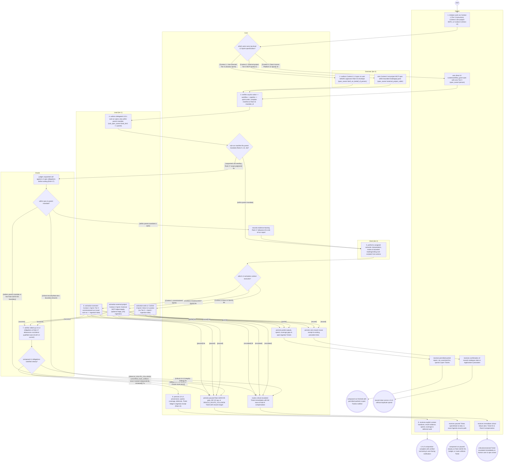

<!-- generated by render_pack.py from compose.spec.yaml sha256=fef65fef900aafeafa2f9d77c0fef6d572eea9933e17e19de40744ac26b53582; edit the spec, not this file -->
# Librarian Process Composition & Mandate Narrowing (Proposed To-Be: L0 Action -> L3 Sprint)

**UC8 · to-be · `PROPOSED_UNACCEPTED`** · spec [compose.spec.yaml](../compose.spec.yaml)
Supersedes: `reports/2026-11-24-librarian-reconstruction-and-offering/diagrams/librarian-process-composition-tobe.spec.yaml`, `reports/2026-11-20-workflow-map/examples/ingestion/compose.spec.yaml`

| Problem | |
|---|---|
| symptom | Prior model used layer names as swimlanes and omitted per-context spec_owner, Rule-17 Oracle scope judgment, and direct Human user exit handovers. |
| root | Enforce strict action -> workflow -> pipeline -> sprint composition across true actor lanes, explicit spec_owner attribution, Rule-9/16 narrowing, Rule-17 Oracle scope checks, and user handovers. |

## Written use case

| Field | Content |
|---|---|
| **Use case name** | Librarian Process Composition & Mandate Narrowing (Proposed To-Be: L0 Action -> L3 Sprint) |
| **Brief description** | — |
| **Primary actor** | — |
| **Supporting actors** | — |
| **Preconditions** | — |
| **Trigger** | — |
| **Success guarantee** | — |
| **Minimal guarantee** | — |
| **Open questions** | — |

**Main success scenario** (generated: the guard-true path, in step order)

1. The Owner initiates work via Context 1 (Tier 0 instruction), Context 2 (Ext project MCP), or Context 3 (Direct UI).
2. The Overseer (tier 0) authors Context-1 L3 spec on user behalf & approves Rule-15 envelope (spec_owner=tier0_on_behalf_of_person).
3. The Core verifies acyclic action -> workflow -> pipeline -> sprint order; compiles manifest & Rule-15 mandate_id.
4. The Lead (tier 1) authors delegated L2/L1 sub-run specs only within parent mandate (sub_spec_owner=lead_tier1 <= parent).
5. The Clerk (tier 2) performs assigned semantic interpretation, review & bounded reading/writing over scripted Core actions.
6. The Lead (tier 1) Context 1 Sprint: Tier 0 commissioned run (Lead sub-run -> ingestion-tobe).
7. The Oracle verifies rolled-up L0-L3 obligations & Rule-17 allowances via distinct qualified route (GLM-5.3 current).
8. The Core persists L0-L3 provenance, spend, coverage, deferrals, Ticket ledger & Agenda receipt (Rule 12).
9. The Owner receives explicit context handover, result evidence, spend, coverage & deferred work.

**Extensions** (generated: one per non-happy guard; numbered by the step it leaves)

- **1a** (from: which actor owns top-level L3 Sprint specification?) *anticipated*
  - `1a1` Context 2: External-project Tier 0 MCP Sprint.
  - `1a2` The Overseer (tier 0) sets Context-2 ext-project MCP spec within bounded read/apply grant (spec_owner=external_project_caller).
  - `1a3` Rejoin at 3.
- **1b** (from: which actor owns top-level L3 Sprint specification?) *anticipated*
  - `1b1` Context 3: Direct Human Platform UI Sprint.
  - `1b2` The Owner sets direct UI curate/workflow_grant spec with zero Tier 0 (spec_owner=person).
  - `1b3` Rejoin at 3.
- **4a** (from: sub-run manifest fits parent mandate (Rules 9, 10, 16)?) *anticipated*
  - `4a1` Ungranted call needing Rule-17 scope judgment.
  - `4a2` The Oracle judges ungranted call against L3 spec obligations before asking (Rule 17).
  - `4a3` The Oracle decides: within spec & parent mandate?
  - `4a3a` If widens parent mandate or hits Rule-16/OD-05 boundary: persists paused Rule-16/OD-05 gate, MC-10 cap, or ORACLE_ROUTE_COLLISION Ticket with resume target.
  - `4a3a` If critical security/data-loss boundary breach: routes critical escalated Ticket immediately with full trace & Rule-8 compensation.
  - `4a4` If within parent mandate & spec:
  - `4a5` The Core records evidence-bearing Rule-17 allowance for end-of-run report.
  - `4a6` Rejoin at 5.
- **6a** (from: which L3 activation context executes?) *anticipated*
  - `6a1` Context 2 External MCP Sprint.
  - `6a2` The Lead (tier 1) Context 2 Sprint: External MCP helpers/apply (optional stage_only ingestion) (continues in activation-external-project).
  - `6a2a` If partial: persists partial outputs, spend, coverage gaps & open Agenda Tickets.
  - `6a2a` If reused: persists zero-rework reuse receipt & existing precedent links.
  - `6a2a` If paused: persists paused Rule-16/OD-05 gate, MC-10 cap, or ORACLE_ROUTE_COLLISION Ticket with resume target.
  - `6a2a` If escalated: routes critical escalated Ticket immediately with full trace & Rule-8 compensation.
  - `6a3` If success:
  - `6a4` Rejoin at 7.
- **6b** (from: which L3 activation context executes?) *anticipated*
  - `6b1` Context 3 Direct UI Sprint.
  - `6b2` The Lead (tier 1) Context 3 Sprint: Direct UI curation (no Tier 0 -> batch / ingestion-tobe) (continues in activation-web-ui).
  - `6b2a` If partial: persists partial outputs, spend, coverage gaps & open Agenda Tickets.
  - `6b2a` If reused: persists zero-rework reuse receipt & existing precedent links.
  - `6b2a` If paused: persists paused Rule-16/OD-05 gate, MC-10 cap, or ORACLE_ROUTE_COLLISION Ticket with resume target.
  - `6b2a` If escalated: routes critical escalated Ticket immediately with full trace & Rule-8 compensation.
  - `6b3` If success:
  - `6b4` Rejoin at 7.
- **6c** (from: Context 1 Sprint: Tier 0 commissioned run (Lead sub-run -> ingestion-tobe)) *anticipated*
  - `6c1` Partial.
  - `6c2` The Core persists partial outputs, spend, coverage gaps & open Agenda Tickets.
  - `6c3` The Owner receives permitted partial report, not_examined list, spend & open Tickets.
  - `6c4` The use case ends: composed run finished with permitted partials & open Tickets notified.
- **6d** (from: Context 1 Sprint: Tier 0 commissioned run (Lead sub-run -> ingestion-tobe)) *anticipated*
  - `6d1` Reused.
  - `6d2` The Core persists zero-rework reuse receipt & existing precedent links.
  - `6d3` The Owner receives confirmation of reused catalogue state or Applications/ precedent.
  - `6d4` The use case ends: reused clean across L3-L0 without duplicate spend.
- **6e** (from: Context 1 Sprint: Tier 0 commissioned run (Lead sub-run -> ingestion-tobe)) *anticipated*
  - `6e1` Paused.
  - `6e2` The Core persists paused Rule-16/OD-05 gate, MC-10 cap, or ORACLE_ROUTE_COLLISION Ticket with resume target.
  - `6e3` The Owner receives paused Ticket, spend/state to date, & exact Agenda resume path.
  - `6e4` The use case ends: composed run paused cleanly on Rule-16/OD-05, budget, or route-collision Ticket.
- **6f** (from: Context 1 Sprint: Tier 0 commissioned run (Lead sub-run -> ingestion-tobe)) *anticipated*
  - `6f1` Escalated.
  - `6f2` The Core routes critical escalated Ticket immediately with full trace & Rule-8 compensation.
  - `6f3` The Owner receives immediate critical failure alert, Ticket ID & Rule-8 compensation.
  - `6f4` The use case ends: critical/unresolved Ticket escalated immediately to Human user & spec owner.
- **7a** (from: composed L3 obligations satisfied cleanly?) *anticipated*
  - `7a1` ORACLE_ROUTE_COLLISION (unverified_route_collision; never marked independently reviewed).
  - `7a2` The Core persists paused Rule-16/OD-05 gate, MC-10 cap, or ORACLE_ROUTE_COLLISION Ticket with resume target.
  - `7a3` The Owner receives paused Ticket, spend/state to date, & exact Agenda resume path.
  - `7a4` The use case ends: composed run paused cleanly on Rule-16/OD-05, budget, or route-collision Ticket.
- **7b** (from: composed L3 obligations satisfied cleanly?) *anticipated*
  - `7b1` Critical L0-L3 integrity finding.
  - `7b2` The Core routes critical escalated Ticket immediately with full trace & Rule-8 compensation.
  - `7b3` The Owner receives immediate critical failure alert, Ticket ID & Rule-8 compensation.
  - `7b4` The use case ends: critical/unresolved Ticket escalated immediately to Human user & spec owner.

## Activity diagram



## Lane load

| Lane | On the main success scenario | Anywhere in the diagram |
|---|---|---|
| Owner | 2 | 7 |
| Overseer (tier 0) | 1 | 2 |
| Clerk (tier 2) | 1 | 1 |
| Oracle | 2 | 4 |
| Lead (tier 1) | 2 | 4 |
| Core | 5 | 10 |

**Tier-0 turns** (each return of control to tier 0; owner's scale: 2 ideal, 3 expected, 4 rusty, 5–10 bad, more: might as well have done it themselves). Main success scenario: **1 (ideal)**. Worst path: T21, **1 (ideal)**. Paths by grade: ideal 17; escalated 5 (failures, not graded).

Paths by how they end: **escalated** 5, **partial** 3, **paused** 5, **reused** 3, **success** 1. Every *escalated* path is a failure of this use case: the work went back to tier 0.

## Decision tree

```text
start: Librarian Process Composition & Mandate Narrowing (Proposed To-Be: L0 Action -> L3 Sprint)
          └─ T1: Context 1: User-directed Tier 0 Librarian Sprint / within parent mandate / Context 1 commissioned Sprint / success / obligations met (distinct Oracle route pass)  ⇒ L3-L0 composition complete with verified narrowing & user-facing notification
  └─ T2: Context 2: External-project Tier 0 MCP Sprint  ⇒ rejoins at step 3
  └─ T3: Context 3: Direct Human Platform UI Sprint  ⇒ rejoins at step 3
      └─ T4: Context 1: User-directed Tier 0 Librarian Sprint / ungranted call needing Rule-17 scope judgment / widens parent mandate or hits Rule-16/OD-05 boundary  ⇒ composed run paused cleanly on Rule-16/OD-05, budget, or route-collision Ticket
      └─ T5: Context 1: User-directed Tier 0 Librarian Sprint / ungranted call needing Rule-17 scope judgment / critical security/data-loss boundary breach  ⇒ critical/unresolved Ticket escalated immediately to Human user & spec owner
      └─ T6: Context 1: User-directed Tier 0 Librarian Sprint / ungranted call needing Rule-17 scope judgment / within parent mandate & spec  ⇒ rejoins at step 5
        └─ T7: Context 1: User-directed Tier 0 Librarian Sprint / within parent mandate / Context 2 External MCP Sprint / partial  ⇒ composed run finished with permitted partials & open Tickets notified
        └─ T8: Context 1: User-directed Tier 0 Librarian Sprint / within parent mandate / Context 2 External MCP Sprint / reused  ⇒ reused clean across L3-L0 without duplicate spend
        └─ T9: Context 1: User-directed Tier 0 Librarian Sprint / within parent mandate / Context 2 External MCP Sprint / paused  ⇒ composed run paused cleanly on Rule-16/OD-05, budget, or route-collision Ticket
        └─ T10: Context 1: User-directed Tier 0 Librarian Sprint / within parent mandate / Context 2 External MCP Sprint / escalated  ⇒ critical/unresolved Ticket escalated immediately to Human user & spec owner
        └─ T11: Context 1: User-directed Tier 0 Librarian Sprint / within parent mandate / Context 2 External MCP Sprint / success  ⇒ rejoins at step 7
        └─ T12: Context 1: User-directed Tier 0 Librarian Sprint / within parent mandate / Context 3 Direct UI Sprint / partial  ⇒ composed run finished with permitted partials & open Tickets notified
        └─ T13: Context 1: User-directed Tier 0 Librarian Sprint / within parent mandate / Context 3 Direct UI Sprint / reused  ⇒ reused clean across L3-L0 without duplicate spend
        └─ T14: Context 1: User-directed Tier 0 Librarian Sprint / within parent mandate / Context 3 Direct UI Sprint / paused  ⇒ composed run paused cleanly on Rule-16/OD-05, budget, or route-collision Ticket
        └─ T15: Context 1: User-directed Tier 0 Librarian Sprint / within parent mandate / Context 3 Direct UI Sprint / escalated  ⇒ critical/unresolved Ticket escalated immediately to Human user & spec owner
        └─ T16: Context 1: User-directed Tier 0 Librarian Sprint / within parent mandate / Context 3 Direct UI Sprint / success  ⇒ rejoins at step 7
        └─ T17: Context 1: User-directed Tier 0 Librarian Sprint / within parent mandate / Context 1 commissioned Sprint / partial  ⇒ composed run finished with permitted partials & open Tickets notified
        └─ T18: Context 1: User-directed Tier 0 Librarian Sprint / within parent mandate / Context 1 commissioned Sprint / reused  ⇒ reused clean across L3-L0 without duplicate spend
        └─ T19: Context 1: User-directed Tier 0 Librarian Sprint / within parent mandate / Context 1 commissioned Sprint / paused  ⇒ composed run paused cleanly on Rule-16/OD-05, budget, or route-collision Ticket
        └─ T20: Context 1: User-directed Tier 0 Librarian Sprint / within parent mandate / Context 1 commissioned Sprint / escalated  ⇒ critical/unresolved Ticket escalated immediately to Human user & spec owner
          └─ T21: Context 1: User-directed Tier 0 Librarian Sprint / within parent mandate / Context 1 commissioned Sprint / success / ORACLE_ROUTE_COLLISION (unverified_route_collision; never marked independently reviewed)  ⇒ composed run paused cleanly on Rule-16/OD-05, budget, or route-collision Ticket
          └─ T22: Context 1: User-directed Tier 0 Librarian Sprint / within parent mandate / Context 1 commissioned Sprint / success / critical L0-L3 integrity finding  ⇒ critical/unresolved Ticket escalated immediately to Human user & spec owner
```

## Test cases

One test per path: the main success scenario, then each extension.

| Test | Path (guards taken) | Extension | Expected outcome | Tier-0 turns |
|---|---|---|---|---|
| T1 | which actor owns top-level L3 Sprint specification? → Context 1: User-directed Tier 0 Librarian Sprint; sub-run manifest fits parent mandate (Rules 9, 10, 16)? → within parent mandate; which L3 activation context executes? → Context 1 commissioned Sprint; Context 1 Sprint: Tier 0 commissioned run (Lead sub-run -> ingestion-tobe) → success; composed L3 obligations satisfied cleanly? → obligations met (distinct Oracle route pass) | MSS | L3-L0 composition complete with verified narrowing & user-facing notification | 1 (ideal) |
| T2 | which actor owns top-level L3 Sprint specification? → Context 2: External-project Tier 0 MCP Sprint | 1a | rejoins at step 3 | 1 (ideal) |
| T3 | which actor owns top-level L3 Sprint specification? → Context 3: Direct Human Platform UI Sprint | 1b | rejoins at step 3 | 0 (ideal) |
| T4 | which actor owns top-level L3 Sprint specification? → Context 1: User-directed Tier 0 Librarian Sprint; sub-run manifest fits parent mandate (Rules 9, 10, 16)? → ungranted call needing Rule-17 scope judgment; within spec & parent mandate? → widens parent mandate or hits Rule-16/OD-05 boundary | 4a | composed run paused cleanly on Rule-16/OD-05, budget, or route-collision Ticket | 1 (ideal) |
| T5 | which actor owns top-level L3 Sprint specification? → Context 1: User-directed Tier 0 Librarian Sprint; sub-run manifest fits parent mandate (Rules 9, 10, 16)? → ungranted call needing Rule-17 scope judgment; within spec & parent mandate? → critical security/data-loss boundary breach | 4a | critical/unresolved Ticket escalated immediately to Human user & spec owner | 1 (escalated: a failure) |
| T6 | which actor owns top-level L3 Sprint specification? → Context 1: User-directed Tier 0 Librarian Sprint; sub-run manifest fits parent mandate (Rules 9, 10, 16)? → ungranted call needing Rule-17 scope judgment; within spec & parent mandate? → within parent mandate & spec | 4a | rejoins at step 5 | 1 (ideal) |
| T7 | which actor owns top-level L3 Sprint specification? → Context 1: User-directed Tier 0 Librarian Sprint; sub-run manifest fits parent mandate (Rules 9, 10, 16)? → within parent mandate; which L3 activation context executes? → Context 2 External MCP Sprint; Context 2 Sprint: External MCP helpers/apply (optional stage_only ingestion) → partial | 6a | composed run finished with permitted partials & open Tickets notified | 1 (ideal) |
| T8 | which actor owns top-level L3 Sprint specification? → Context 1: User-directed Tier 0 Librarian Sprint; sub-run manifest fits parent mandate (Rules 9, 10, 16)? → within parent mandate; which L3 activation context executes? → Context 2 External MCP Sprint; Context 2 Sprint: External MCP helpers/apply (optional stage_only ingestion) → reused | 6a | reused clean across L3-L0 without duplicate spend | 1 (ideal) |
| T9 | which actor owns top-level L3 Sprint specification? → Context 1: User-directed Tier 0 Librarian Sprint; sub-run manifest fits parent mandate (Rules 9, 10, 16)? → within parent mandate; which L3 activation context executes? → Context 2 External MCP Sprint; Context 2 Sprint: External MCP helpers/apply (optional stage_only ingestion) → paused | 6a | composed run paused cleanly on Rule-16/OD-05, budget, or route-collision Ticket | 1 (ideal) |
| T10 | which actor owns top-level L3 Sprint specification? → Context 1: User-directed Tier 0 Librarian Sprint; sub-run manifest fits parent mandate (Rules 9, 10, 16)? → within parent mandate; which L3 activation context executes? → Context 2 External MCP Sprint; Context 2 Sprint: External MCP helpers/apply (optional stage_only ingestion) → escalated | 6a | critical/unresolved Ticket escalated immediately to Human user & spec owner | 1 (escalated: a failure) |
| T11 | which actor owns top-level L3 Sprint specification? → Context 1: User-directed Tier 0 Librarian Sprint; sub-run manifest fits parent mandate (Rules 9, 10, 16)? → within parent mandate; which L3 activation context executes? → Context 2 External MCP Sprint; Context 2 Sprint: External MCP helpers/apply (optional stage_only ingestion) → success | 6a | rejoins at step 7 | 1 (ideal) |
| T12 | which actor owns top-level L3 Sprint specification? → Context 1: User-directed Tier 0 Librarian Sprint; sub-run manifest fits parent mandate (Rules 9, 10, 16)? → within parent mandate; which L3 activation context executes? → Context 3 Direct UI Sprint; Context 3 Sprint: Direct UI curation (no Tier 0 -> batch / ingestion-tobe) → partial | 6b | composed run finished with permitted partials & open Tickets notified | 1 (ideal) |
| T13 | which actor owns top-level L3 Sprint specification? → Context 1: User-directed Tier 0 Librarian Sprint; sub-run manifest fits parent mandate (Rules 9, 10, 16)? → within parent mandate; which L3 activation context executes? → Context 3 Direct UI Sprint; Context 3 Sprint: Direct UI curation (no Tier 0 -> batch / ingestion-tobe) → reused | 6b | reused clean across L3-L0 without duplicate spend | 1 (ideal) |
| T14 | which actor owns top-level L3 Sprint specification? → Context 1: User-directed Tier 0 Librarian Sprint; sub-run manifest fits parent mandate (Rules 9, 10, 16)? → within parent mandate; which L3 activation context executes? → Context 3 Direct UI Sprint; Context 3 Sprint: Direct UI curation (no Tier 0 -> batch / ingestion-tobe) → paused | 6b | composed run paused cleanly on Rule-16/OD-05, budget, or route-collision Ticket | 1 (ideal) |
| T15 | which actor owns top-level L3 Sprint specification? → Context 1: User-directed Tier 0 Librarian Sprint; sub-run manifest fits parent mandate (Rules 9, 10, 16)? → within parent mandate; which L3 activation context executes? → Context 3 Direct UI Sprint; Context 3 Sprint: Direct UI curation (no Tier 0 -> batch / ingestion-tobe) → escalated | 6b | critical/unresolved Ticket escalated immediately to Human user & spec owner | 1 (escalated: a failure) |
| T16 | which actor owns top-level L3 Sprint specification? → Context 1: User-directed Tier 0 Librarian Sprint; sub-run manifest fits parent mandate (Rules 9, 10, 16)? → within parent mandate; which L3 activation context executes? → Context 3 Direct UI Sprint; Context 3 Sprint: Direct UI curation (no Tier 0 -> batch / ingestion-tobe) → success | 6b | rejoins at step 7 | 1 (ideal) |
| T17 | which actor owns top-level L3 Sprint specification? → Context 1: User-directed Tier 0 Librarian Sprint; sub-run manifest fits parent mandate (Rules 9, 10, 16)? → within parent mandate; which L3 activation context executes? → Context 1 commissioned Sprint; Context 1 Sprint: Tier 0 commissioned run (Lead sub-run -> ingestion-tobe) → partial | 6c | composed run finished with permitted partials & open Tickets notified | 1 (ideal) |
| T18 | which actor owns top-level L3 Sprint specification? → Context 1: User-directed Tier 0 Librarian Sprint; sub-run manifest fits parent mandate (Rules 9, 10, 16)? → within parent mandate; which L3 activation context executes? → Context 1 commissioned Sprint; Context 1 Sprint: Tier 0 commissioned run (Lead sub-run -> ingestion-tobe) → reused | 6d | reused clean across L3-L0 without duplicate spend | 1 (ideal) |
| T19 | which actor owns top-level L3 Sprint specification? → Context 1: User-directed Tier 0 Librarian Sprint; sub-run manifest fits parent mandate (Rules 9, 10, 16)? → within parent mandate; which L3 activation context executes? → Context 1 commissioned Sprint; Context 1 Sprint: Tier 0 commissioned run (Lead sub-run -> ingestion-tobe) → paused | 6e | composed run paused cleanly on Rule-16/OD-05, budget, or route-collision Ticket | 1 (ideal) |
| T20 | which actor owns top-level L3 Sprint specification? → Context 1: User-directed Tier 0 Librarian Sprint; sub-run manifest fits parent mandate (Rules 9, 10, 16)? → within parent mandate; which L3 activation context executes? → Context 1 commissioned Sprint; Context 1 Sprint: Tier 0 commissioned run (Lead sub-run -> ingestion-tobe) → escalated | 6f | critical/unresolved Ticket escalated immediately to Human user & spec owner | 1 (escalated: a failure) |
| T21 | which actor owns top-level L3 Sprint specification? → Context 1: User-directed Tier 0 Librarian Sprint; sub-run manifest fits parent mandate (Rules 9, 10, 16)? → within parent mandate; which L3 activation context executes? → Context 1 commissioned Sprint; Context 1 Sprint: Tier 0 commissioned run (Lead sub-run -> ingestion-tobe) → success; composed L3 obligations satisfied cleanly? → ORACLE_ROUTE_COLLISION (unverified_route_collision; never marked independently reviewed) | 7a | composed run paused cleanly on Rule-16/OD-05, budget, or route-collision Ticket | 1 (ideal) |
| T22 | which actor owns top-level L3 Sprint specification? → Context 1: User-directed Tier 0 Librarian Sprint; sub-run manifest fits parent mandate (Rules 9, 10, 16)? → within parent mandate; which L3 activation context executes? → Context 1 commissioned Sprint; Context 1 Sprint: Tier 0 commissioned run (Lead sub-run -> ingestion-tobe) → success; composed L3 obligations satisfied cleanly? → critical L0-L3 integrity finding | 7b | critical/unresolved Ticket escalated immediately to Human user & spec owner | 1 (escalated: a failure) |

### Boundary values

_None declared._

## As-is weaknesses this handles

_None recorded._

## Checks

Errors: none

Warnings: 
- written use case lacks: Use case name, Brief description, Primary actor, Supporting actors, Preconditions, Trigger, Success guarantee, Minimal guarantee, Open questions
- decision dnarrow ('sub-run manifest fits parent mandate (Rules 9, 10, 16)?') tests a quantity but declares no boundary values
- decision dscope ('within spec & parent mandate?') tests a quantity but declares no boundary values
