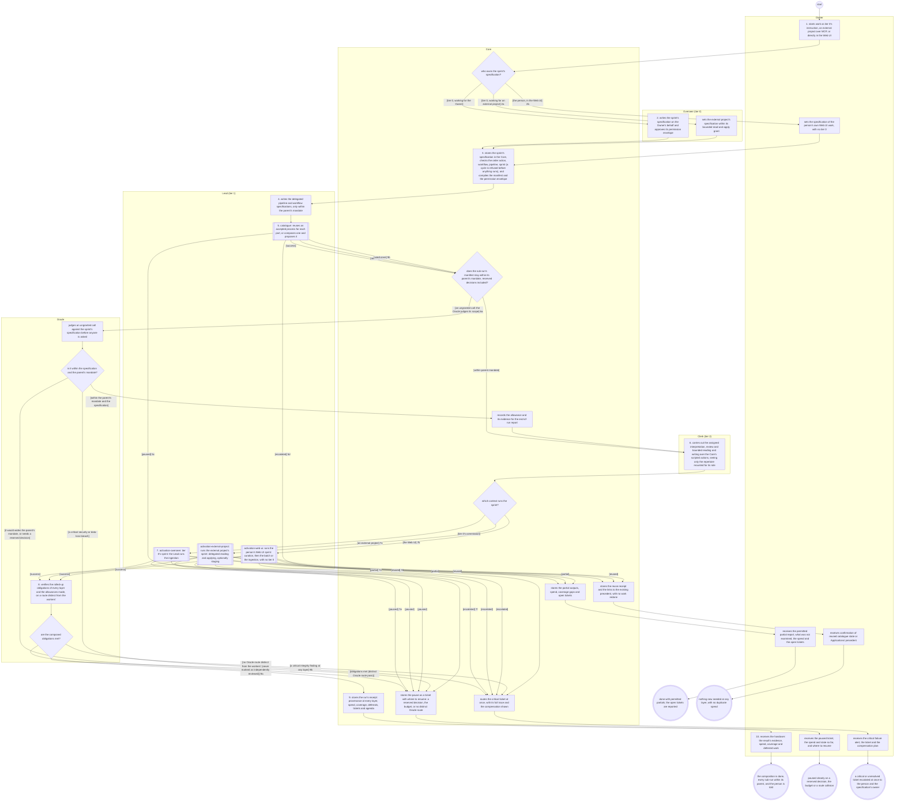

<!-- generated by render_pack.py from compose.spec.yaml sha256=09ca1b2140b822cf1da247db727eddb46db9b4a4ebe7ed0f12c84725d8bd6bfa; edit the spec, not this file -->
# Compose and start a sprint (proposed)

**UC8 · to-be · `PROPOSED_UNACCEPTED`** · spec [compose.spec.yaml](../compose.spec.yaml)
Supersedes: `reports/2026-11-24-librarian-reconstruction-and-offering/diagrams/librarian-process-composition-tobe.spec.yaml`, `reports/2026-11-20-workflow-map/examples/ingestion/compose.spec.yaml`

| Problem | |
|---|---|
| symptom | The earlier model used the composition layers as swim lanes, and left out who owns each specification, the Oracle's scope judgment and the handovers to the person. |
| root | Compose strictly action, workflow, pipeline, sprint across the real actors; name each specification's owner; keep every sub-run within its parent; let the Oracle judge scope; hand over to the person. |

## Written use case

| Field | Content |
|---|---|
| **Use case name** | Compose and start a sprint |
| **Brief description** | Whichever context starts the work, it becomes one composed sprint: an owned specification, a compiled manifest, one envelope, a rolled-up Oracle verdict. |
| **Primary actor** | Owner, or tier 0 on the Owner's behalf |
| **Supporting actors** | Lead, Clerk, Scribe, Oracle, Core |
| **Preconditions** | Every action the sprint reaches is registered and declares its effects |
| **Trigger** | A request in any context |
| **Success guarantee** | One result, judged against the sprint's specification, with spend and coverage |
| **Minimal guarantee** | Nothing runs outside the parent's mandate; an ungranted call is judged before anyone is asked |
| **Open questions** | Which rules let the Oracle allow extra work without the Owner (W9)? |

**Main success scenario** (generated: the guard-true path, in step order)

1. The Owner starts work as tier 0's instruction, an external project over MCP, or directly in the Web UI.
2. The Overseer (tier 0) writes the sprint's specification on the Owner's behalf and approves its permission envelope.
3. The Core stores the sprint's specification in the Core, checks the order action, workflow, pipeline, sprint (a cycle is refused before anything runs), and compiles the manifest and the permission envelope.
4. The Lead (tier 1) writes the delegated pipeline and workflow specifications, only within the parent's mandate.
5. The Lead (tier 1) reuses an accepted process for each part, or composes one and proposes it.
6. The Clerk (tier 2) carries out the assigned interpretation, review and bounded reading and writing over the Core's scripted actions, seeing only the repertoire mounted for its role.
7. The Lead (tier 1) tier 0's sprint: the Lead runs the ingestion.
8. The Oracle verifies the rolled-up obligations of every layer and the allowances made, on a route distinct from the workers'.
9. The Core stores the run's receipt: provenance at every layer, spend, coverage, deferrals, tickets and agenda.
10. The Owner receives the handover: the result's evidence, spend, coverage and deferred work.

**Extensions** (generated: one per non-happy guard; numbered by the step it leaves)

- **2a** (from: who owns the sprint's specification?) *anticipated*
  - `2a1` Tier 0, working for an external project.
  - `2a2` The Overseer (tier 0) sets the external project's specification within its bounded read-and-apply grant.
  - `2a3` Rejoin at 3.
- **2b** (from: who owns the sprint's specification?) *anticipated*
  - `2b1` The person, in the Web UI.
  - `2b2` The Owner sets the specification of the person's own Web UI work, with no tier 0.
  - `2b3` Rejoin at 3.
- **6a** (from: does the sub-run's manifest stay within its parent's mandate, reserved decisions included?) *anticipated*
  - `6a1` An ungranted call: the Oracle judges its scope.
  - `6a2` The Oracle judges an ungranted call against the sprint's specification before anyone is asked.
  - `6a3` The Oracle decides: is it within the specification and the parent's mandate?
  - `6a3a` If it would widen the parent's mandate, or needs a reserved decision: stores the pause as a ticket with where to resume: a reserved decision, the budget, or no distinct Oracle route.
  - `6a3a` If a critical security or data-loss breach: routes the critical ticket at once, with its full trace and the compensation shown.
  - `6a4` If within the parent's mandate and the specification:
  - `6a5` The Core records the allowance and its evidence for the end-of-run report.
  - `6a6` Rejoin at 6.
- **7a** (from: which context runs the sprint?) *anticipated*
  - `7a1` An external project.
  - `7a2` The Lead (tier 1) runs the external project's sprint: delegated reading and applying, optionally staging (continues in activation-external-project).
  - `7a2a` If partial: stores the partial outputs, spend, coverage gaps and open tickets.
  - `7a2a` If reused: stores the reuse receipt and the links to the existing precedent, with no work redone.
  - `7a2a` If paused: stores the pause as a ticket with where to resume: a reserved decision, the budget, or no distinct Oracle route.
  - `7a2a` If escalated: routes the critical ticket at once, with its full trace and the compensation shown.
  - `7a3` If success:
  - `7a4` Rejoin at 8.
- **7b** (from: which context runs the sprint?) *anticipated*
  - `7b1` The Web UI.
  - `7b2` The Lead (tier 1) runs the person's Web UI sprint: curation, then the batch or the ingestion, with no tier 0 (continues in activation-web-ui).
  - `7b2a` If partial: stores the partial outputs, spend, coverage gaps and open tickets.
  - `7b2a` If reused: stores the reuse receipt and the links to the existing precedent, with no work redone.
  - `7b2a` If paused: stores the pause as a ticket with where to resume: a reserved decision, the budget, or no distinct Oracle route.
  - `7b2a` If escalated: routes the critical ticket at once, with its full trace and the compensation shown.
  - `7b3` If success:
  - `7b4` Rejoin at 8.
- **7c** (from: tier 0's sprint: the Lead runs the ingestion) *anticipated*
  - `7c1` Partial.
  - `7c2` The Core stores the partial outputs, spend, coverage gaps and open tickets.
  - `7c3` The Owner receives the permitted partial report, what was not examined, the spend and the open tickets.
  - `7c4` The use case ends: done with permitted partials; the open tickets are reported.
- **7d** (from: tier 0's sprint: the Lead runs the ingestion) *anticipated*
  - `7d1` Reused.
  - `7d2` The Core stores the reuse receipt and the links to the existing precedent, with no work redone.
  - `7d3` The Owner receives confirmation of reused catalogue state or Applications/ precedent.
  - `7d4` The use case ends: nothing new needed at any layer, with no duplicate spend.
- **7e** (from: tier 0's sprint: the Lead runs the ingestion) *anticipated*
  - `7e1` Paused.
  - `7e2` The Core stores the pause as a ticket with where to resume: a reserved decision, the budget, or no distinct Oracle route.
  - `7e3` The Owner receives the paused ticket, the spend and state so far, and where to resume.
  - `7e4` The use case ends: paused cleanly on a reserved decision, the budget or a route collision.
- **7f** (from: tier 0's sprint: the Lead runs the ingestion) *anticipated*
  - `7f1` Escalated.
  - `7f2` The Core routes the critical ticket at once, with its full trace and the compensation shown.
  - `7f3` The Owner receives the critical failure alert, the ticket and the compensation plan.
  - `7f4` The use case ends: a critical or unresolved ticket escalated at once to the person and the specification's owner.
- **9a** (from: are the composed obligations met?) *anticipated*
  - `9a1` No Oracle route distinct from the workers' (never marked as independently reviewed).
  - `9a2` The Core stores the pause as a ticket with where to resume: a reserved decision, the budget, or no distinct Oracle route.
  - `9a3` The Owner receives the paused ticket, the spend and state so far, and where to resume.
  - `9a4` The use case ends: paused cleanly on a reserved decision, the budget or a route collision.
- **9b** (from: are the composed obligations met?) *anticipated*
  - `9b1` A critical integrity finding at any layer.
  - `9b2` The Core routes the critical ticket at once, with its full trace and the compensation shown.
  - `9b3` The Owner receives the critical failure alert, the ticket and the compensation plan.
  - `9b4` The use case ends: a critical or unresolved ticket escalated at once to the person and the specification's owner.
- **5a** (from: reuses an accepted process for each part, or composes one and proposes it) *anticipated*
  - `5a1` Reused.
  - `5a2` The Core decides: does the sub-run's manifest stay within its parent's mandate, reserved decisions included?
  - `5a2a` If an ungranted call: the Oracle judges its scope: judges an ungranted call against the sprint's specification before anyone is asked.
  - `5a3` If within parent mandate:
  - `5a4` Rejoin at 6.
- **5b** (from: reuses an accepted process for each part, or composes one and proposes it) *anticipated*
  - `5b1` Used once.
  - `5b2` The Core decides: does the sub-run's manifest stay within its parent's mandate, reserved decisions included?
  - `5b2a` If an ungranted call: the Oracle judges its scope: judges an ungranted call against the sprint's specification before anyone is asked.
  - `5b3` If within parent mandate:
  - `5b4` Rejoin at 6.
- **5c** (from: reuses an accepted process for each part, or composes one and proposes it) *anticipated*
  - `5c1` Paused.
  - `5c2` The Core stores the pause as a ticket with where to resume: a reserved decision, the budget, or no distinct Oracle route.
  - `5c3` The Owner receives the paused ticket, the spend and state so far, and where to resume.
  - `5c4` The use case ends: paused cleanly on a reserved decision, the budget or a route collision.
- **5d** (from: reuses an accepted process for each part, or composes one and proposes it) *anticipated*
  - `5d1` Escalated.
  - `5d2` The Core routes the critical ticket at once, with its full trace and the compensation shown.
  - `5d3` The Owner receives the critical failure alert, the ticket and the compensation plan.
  - `5d4` The use case ends: a critical or unresolved ticket escalated at once to the person and the specification's owner.

## Activity diagram



## Lane load

| Lane | On the main success scenario | Anywhere in the diagram |
|---|---|---|
| Owner | 2 | 7 |
| Overseer (tier 0) | 1 | 2 |
| Clerk (tier 2) | 1 | 1 |
| Oracle | 2 | 4 |
| Lead (tier 1) | 3 | 5 |
| Core | 5 | 10 |

**Tier-0 turns** (each return of control to tier 0; owner's scale: 2 ideal, 3 expected, 4 rusty, 5–10 bad, more: might as well have done it themselves). Main success scenario: **1 (ideal)**. Worst path: T25, **1 (ideal)**. Paths by grade: ideal 20; escalated 6 (failures, not graded).

Paths by how they end: **escalated** 6, **partial** 3, **paused** 6, **reused** 3, **success** 1. Every *escalated* path is a failure of this use case: the work went back to tier 0.

## Decision tree

```text
start: Compose and start a sprint (proposed)
            └─ T1: tier 0, working for the Owner / success / within parent mandate / tier 0's commission / success / obligations met (distinct Oracle route pass)  ⇒ the composition is done, every sub-run within its parent, and the person is told
  └─ T2: tier 0, working for an external project  ⇒ rejoins at step 3
  └─ T3: the person, in the Web UI  ⇒ rejoins at step 3
    └─ T4: tier 0, working for the Owner / reused  ⇒ rejoins at 'does the sub-run's manifest stay within its parent's mandate, reserved decisions included?' (before step 6)
    └─ T5: tier 0, working for the Owner / used once  ⇒ rejoins at 'does the sub-run's manifest stay within its parent's mandate, reserved decisions included?' (before step 6)
    └─ T6: tier 0, working for the Owner / paused  ⇒ paused cleanly on a reserved decision, the budget or a route collision
    └─ T7: tier 0, working for the Owner / escalated  ⇒ a critical or unresolved ticket escalated at once to the person and the specification's owner
        └─ T8: tier 0, working for the Owner / success / an ungranted call: the Oracle judges its scope / it would widen the parent's mandate, or needs a reserved decision  ⇒ paused cleanly on a reserved decision, the budget or a route collision
        └─ T9: tier 0, working for the Owner / success / an ungranted call: the Oracle judges its scope / a critical security or data-loss breach  ⇒ a critical or unresolved ticket escalated at once to the person and the specification's owner
        └─ T10: tier 0, working for the Owner / success / an ungranted call: the Oracle judges its scope / within the parent's mandate and the specification  ⇒ rejoins at step 6
          └─ T11: tier 0, working for the Owner / success / within parent mandate / an external project / partial  ⇒ done with permitted partials; the open tickets are reported
          └─ T12: tier 0, working for the Owner / success / within parent mandate / an external project / reused  ⇒ nothing new needed at any layer, with no duplicate spend
          └─ T13: tier 0, working for the Owner / success / within parent mandate / an external project / paused  ⇒ paused cleanly on a reserved decision, the budget or a route collision
          └─ T14: tier 0, working for the Owner / success / within parent mandate / an external project / escalated  ⇒ a critical or unresolved ticket escalated at once to the person and the specification's owner
          └─ T15: tier 0, working for the Owner / success / within parent mandate / an external project / success  ⇒ rejoins at step 8
          └─ T16: tier 0, working for the Owner / success / within parent mandate / the Web UI / partial  ⇒ done with permitted partials; the open tickets are reported
          └─ T17: tier 0, working for the Owner / success / within parent mandate / the Web UI / reused  ⇒ nothing new needed at any layer, with no duplicate spend
          └─ T18: tier 0, working for the Owner / success / within parent mandate / the Web UI / paused  ⇒ paused cleanly on a reserved decision, the budget or a route collision
          └─ T19: tier 0, working for the Owner / success / within parent mandate / the Web UI / escalated  ⇒ a critical or unresolved ticket escalated at once to the person and the specification's owner
          └─ T20: tier 0, working for the Owner / success / within parent mandate / the Web UI / success  ⇒ rejoins at step 8
          └─ T21: tier 0, working for the Owner / success / within parent mandate / tier 0's commission / partial  ⇒ done with permitted partials; the open tickets are reported
          └─ T22: tier 0, working for the Owner / success / within parent mandate / tier 0's commission / reused  ⇒ nothing new needed at any layer, with no duplicate spend
          └─ T23: tier 0, working for the Owner / success / within parent mandate / tier 0's commission / paused  ⇒ paused cleanly on a reserved decision, the budget or a route collision
          └─ T24: tier 0, working for the Owner / success / within parent mandate / tier 0's commission / escalated  ⇒ a critical or unresolved ticket escalated at once to the person and the specification's owner
            └─ T25: tier 0, working for the Owner / success / within parent mandate / tier 0's commission / success / no Oracle route distinct from the workers' (never marked as independently reviewed)  ⇒ paused cleanly on a reserved decision, the budget or a route collision
            └─ T26: tier 0, working for the Owner / success / within parent mandate / tier 0's commission / success / a critical integrity finding at any layer  ⇒ a critical or unresolved ticket escalated at once to the person and the specification's owner
```

## Test cases

One test per path: the main success scenario, then each extension.

| Test | Path (guards taken) | Extension | Expected outcome | Tier-0 turns |
|---|---|---|---|---|
| T1 | who owns the sprint's specification? → tier 0, working for the Owner; reuses an accepted process for each part, or composes one and proposes it → success; does the sub-run's manifest stay within its parent's mandate, reserved decisions included? → within parent mandate; which context runs the sprint? → tier 0's commission; tier 0's sprint: the Lead runs the ingestion → success; are the composed obligations met? → obligations met (distinct Oracle route pass) | MSS | the composition is done, every sub-run within its parent, and the person is told | 1 (ideal) |
| T2 | who owns the sprint's specification? → tier 0, working for an external project | 2a | rejoins at step 3 | 1 (ideal) |
| T3 | who owns the sprint's specification? → the person, in the Web UI | 2b | rejoins at step 3 | 0 (ideal) |
| T4 | who owns the sprint's specification? → tier 0, working for the Owner; reuses an accepted process for each part, or composes one and proposes it → reused | 5a | rejoins at 'does the sub-run's manifest stay within its parent's mandate, reserved decisions included?' (before step 6) | 1 (ideal) |
| T5 | who owns the sprint's specification? → tier 0, working for the Owner; reuses an accepted process for each part, or composes one and proposes it → used once | 5b | rejoins at 'does the sub-run's manifest stay within its parent's mandate, reserved decisions included?' (before step 6) | 1 (ideal) |
| T6 | who owns the sprint's specification? → tier 0, working for the Owner; reuses an accepted process for each part, or composes one and proposes it → paused | 5c | paused cleanly on a reserved decision, the budget or a route collision | 1 (ideal) |
| T7 | who owns the sprint's specification? → tier 0, working for the Owner; reuses an accepted process for each part, or composes one and proposes it → escalated | 5d | a critical or unresolved ticket escalated at once to the person and the specification's owner | 1 (escalated: a failure) |
| T8 | who owns the sprint's specification? → tier 0, working for the Owner; reuses an accepted process for each part, or composes one and proposes it → success; does the sub-run's manifest stay within its parent's mandate, reserved decisions included? → an ungranted call: the Oracle judges its scope; is it within the specification and the parent's mandate? → it would widen the parent's mandate, or needs a reserved decision | 6a | paused cleanly on a reserved decision, the budget or a route collision | 1 (ideal) |
| T9 | who owns the sprint's specification? → tier 0, working for the Owner; reuses an accepted process for each part, or composes one and proposes it → success; does the sub-run's manifest stay within its parent's mandate, reserved decisions included? → an ungranted call: the Oracle judges its scope; is it within the specification and the parent's mandate? → a critical security or data-loss breach | 6a | a critical or unresolved ticket escalated at once to the person and the specification's owner | 1 (escalated: a failure) |
| T10 | who owns the sprint's specification? → tier 0, working for the Owner; reuses an accepted process for each part, or composes one and proposes it → success; does the sub-run's manifest stay within its parent's mandate, reserved decisions included? → an ungranted call: the Oracle judges its scope; is it within the specification and the parent's mandate? → within the parent's mandate and the specification | 6a | rejoins at step 6 | 1 (ideal) |
| T11 | who owns the sprint's specification? → tier 0, working for the Owner; reuses an accepted process for each part, or composes one and proposes it → success; does the sub-run's manifest stay within its parent's mandate, reserved decisions included? → within parent mandate; which context runs the sprint? → an external project; runs the external project's sprint: delegated reading and applying, optionally staging → partial | 7a | done with permitted partials; the open tickets are reported | 1 (ideal) |
| T12 | who owns the sprint's specification? → tier 0, working for the Owner; reuses an accepted process for each part, or composes one and proposes it → success; does the sub-run's manifest stay within its parent's mandate, reserved decisions included? → within parent mandate; which context runs the sprint? → an external project; runs the external project's sprint: delegated reading and applying, optionally staging → reused | 7a | nothing new needed at any layer, with no duplicate spend | 1 (ideal) |
| T13 | who owns the sprint's specification? → tier 0, working for the Owner; reuses an accepted process for each part, or composes one and proposes it → success; does the sub-run's manifest stay within its parent's mandate, reserved decisions included? → within parent mandate; which context runs the sprint? → an external project; runs the external project's sprint: delegated reading and applying, optionally staging → paused | 7a | paused cleanly on a reserved decision, the budget or a route collision | 1 (ideal) |
| T14 | who owns the sprint's specification? → tier 0, working for the Owner; reuses an accepted process for each part, or composes one and proposes it → success; does the sub-run's manifest stay within its parent's mandate, reserved decisions included? → within parent mandate; which context runs the sprint? → an external project; runs the external project's sprint: delegated reading and applying, optionally staging → escalated | 7a | a critical or unresolved ticket escalated at once to the person and the specification's owner | 1 (escalated: a failure) |
| T15 | who owns the sprint's specification? → tier 0, working for the Owner; reuses an accepted process for each part, or composes one and proposes it → success; does the sub-run's manifest stay within its parent's mandate, reserved decisions included? → within parent mandate; which context runs the sprint? → an external project; runs the external project's sprint: delegated reading and applying, optionally staging → success | 7a | rejoins at step 8 | 1 (ideal) |
| T16 | who owns the sprint's specification? → tier 0, working for the Owner; reuses an accepted process for each part, or composes one and proposes it → success; does the sub-run's manifest stay within its parent's mandate, reserved decisions included? → within parent mandate; which context runs the sprint? → the Web UI; runs the person's Web UI sprint: curation, then the batch or the ingestion, with no tier 0 → partial | 7b | done with permitted partials; the open tickets are reported | 1 (ideal) |
| T17 | who owns the sprint's specification? → tier 0, working for the Owner; reuses an accepted process for each part, or composes one and proposes it → success; does the sub-run's manifest stay within its parent's mandate, reserved decisions included? → within parent mandate; which context runs the sprint? → the Web UI; runs the person's Web UI sprint: curation, then the batch or the ingestion, with no tier 0 → reused | 7b | nothing new needed at any layer, with no duplicate spend | 1 (ideal) |
| T18 | who owns the sprint's specification? → tier 0, working for the Owner; reuses an accepted process for each part, or composes one and proposes it → success; does the sub-run's manifest stay within its parent's mandate, reserved decisions included? → within parent mandate; which context runs the sprint? → the Web UI; runs the person's Web UI sprint: curation, then the batch or the ingestion, with no tier 0 → paused | 7b | paused cleanly on a reserved decision, the budget or a route collision | 1 (ideal) |
| T19 | who owns the sprint's specification? → tier 0, working for the Owner; reuses an accepted process for each part, or composes one and proposes it → success; does the sub-run's manifest stay within its parent's mandate, reserved decisions included? → within parent mandate; which context runs the sprint? → the Web UI; runs the person's Web UI sprint: curation, then the batch or the ingestion, with no tier 0 → escalated | 7b | a critical or unresolved ticket escalated at once to the person and the specification's owner | 1 (escalated: a failure) |
| T20 | who owns the sprint's specification? → tier 0, working for the Owner; reuses an accepted process for each part, or composes one and proposes it → success; does the sub-run's manifest stay within its parent's mandate, reserved decisions included? → within parent mandate; which context runs the sprint? → the Web UI; runs the person's Web UI sprint: curation, then the batch or the ingestion, with no tier 0 → success | 7b | rejoins at step 8 | 1 (ideal) |
| T21 | who owns the sprint's specification? → tier 0, working for the Owner; reuses an accepted process for each part, or composes one and proposes it → success; does the sub-run's manifest stay within its parent's mandate, reserved decisions included? → within parent mandate; which context runs the sprint? → tier 0's commission; tier 0's sprint: the Lead runs the ingestion → partial | 7c | done with permitted partials; the open tickets are reported | 1 (ideal) |
| T22 | who owns the sprint's specification? → tier 0, working for the Owner; reuses an accepted process for each part, or composes one and proposes it → success; does the sub-run's manifest stay within its parent's mandate, reserved decisions included? → within parent mandate; which context runs the sprint? → tier 0's commission; tier 0's sprint: the Lead runs the ingestion → reused | 7d | nothing new needed at any layer, with no duplicate spend | 1 (ideal) |
| T23 | who owns the sprint's specification? → tier 0, working for the Owner; reuses an accepted process for each part, or composes one and proposes it → success; does the sub-run's manifest stay within its parent's mandate, reserved decisions included? → within parent mandate; which context runs the sprint? → tier 0's commission; tier 0's sprint: the Lead runs the ingestion → paused | 7e | paused cleanly on a reserved decision, the budget or a route collision | 1 (ideal) |
| T24 | who owns the sprint's specification? → tier 0, working for the Owner; reuses an accepted process for each part, or composes one and proposes it → success; does the sub-run's manifest stay within its parent's mandate, reserved decisions included? → within parent mandate; which context runs the sprint? → tier 0's commission; tier 0's sprint: the Lead runs the ingestion → escalated | 7f | a critical or unresolved ticket escalated at once to the person and the specification's owner | 1 (escalated: a failure) |
| T25 | who owns the sprint's specification? → tier 0, working for the Owner; reuses an accepted process for each part, or composes one and proposes it → success; does the sub-run's manifest stay within its parent's mandate, reserved decisions included? → within parent mandate; which context runs the sprint? → tier 0's commission; tier 0's sprint: the Lead runs the ingestion → success; are the composed obligations met? → no Oracle route distinct from the workers' (never marked as independently reviewed) | 9a | paused cleanly on a reserved decision, the budget or a route collision | 1 (ideal) |
| T26 | who owns the sprint's specification? → tier 0, working for the Owner; reuses an accepted process for each part, or composes one and proposes it → success; does the sub-run's manifest stay within its parent's mandate, reserved decisions included? → within parent mandate; which context runs the sprint? → tier 0's commission; tier 0's sprint: the Lead runs the ingestion → success; are the composed obligations met? → a critical integrity finding at any layer | 9b | a critical or unresolved ticket escalated at once to the person and the specification's owner | 1 (escalated: a failure) |

### Boundary values

_None declared._

## As-is weaknesses this handles

| As-is weakness | Where here | How it is handled |
|---|---|---|
| W-ACT-04 (activation): Six surfaces enter the Core with different tiers and gates, and none reaches a common parent process for the work it starts. | dspec_owner | Every context starts the same composed sprint; contexts differ only in who owns the specification. |
| W-CMP-01 (compose): The batch's stages and the session's phases are not compositions: stages are code, and phases are declared data that no workflow can call (OP16). | compile_manifest | Action, workflow, pipeline and sprint compile into one manifest, so ingestion is a composition like any other. |
| W-ACT-03 (activation): The in-app Lead asks tool by tool (Ask mode, 600 s wait); there is no permission envelope for a whole run. | oracle_scope | The envelope is granted once; an ungranted call goes to the Oracle as a scope question before anyone is asked. |

## Checks

Errors: none

Warnings: none
