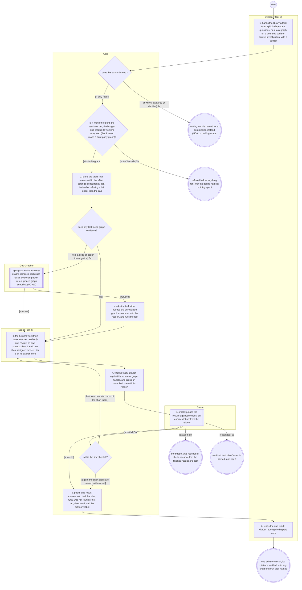

<!-- generated by render_pack.py from delegate.spec.yaml sha256=e678466f05475fba871b302e02decf456c403ce7142971f4f96a6c41aa37d253; edit the spec, not this file -->
# Delegate a task to the library's workers, as tier 0 (proposed)

**UC0.4 · to-be · `PROPOSED_UNACCEPTED`** · spec [delegate.spec.yaml](../delegate.spec.yaml)

| Problem | |
|---|---|
| symptom | Tier 0 can hand questions to helpers (delegate) or run a task graph (dispatch_plan), but no flow was drawn: delegate refuses a question list longer than the effort cap, and a task needing graph evidence depends on Geo-Grapher with no stated outcome when the graph is unreadable. |
| root | One delegation path that only reads: the Core checks the grant once, plans waves within the cap instead of refusing, compiles graph packets through Geo-Grapher, verifies every citation, has the Oracle judge the result, and returns one advisory result, so tier 0 spends two turns. |

## Written use case

| Field | Content |
|---|---|
| **Use case name** | Delegate a task to the library's workers, as tier 0 |
| **Brief description** | Tier 0 hands read-only questions or a task graph to the library's helpers; the Core checks the grant once, plans waves within the effort cap, compiles graph packets through Geo-Grapher, verifies every citation, and the Oracle judges the one result. |
| **Primary actor** | Overseer (tier 0) |
| **Supporting actors** | Core, Scribes and Clerks as helpers, Oracle, Geo-Grapher |
| **Preconditions** | A session at contribute tier; the task only reads |
| **Trigger** | Tier 0's own work splits into independent questions or a task graph |
| **Success guarantee** | One advisory result with verified citations, in two tier-0 turns |
| **Minimal guarantee** | A task out of bounds is refused before anything runs or is spent; writing work is named for a commission |
| **Open questions** | Should writing work be composed as a sprint under the same commission, instead of being named back (which costs tier 0 a third turn)? |

**Main success scenario** (generated: the guard-true path, in step order)

1. The Overseer (tier 0) hands the library a task it can split: independent questions, or a task graph for a bounded code or source investigation, with a budget.
2. The Core plans the tasks into waves within the effort setting's concurrency cap, instead of refusing a list longer than the cap.
3. The Scribe (tier 2) the helpers work their tasks at once, read-only and each in its own context: tiers 1 and 2 on their assigned models, tier 3 on its packet alone.
4. The Core checks every citation against its source or graph handle, and drops an unverified one with its reason.
5. The Oracle judges the results against the task, on a route distinct from the helpers'.
6. The Core packs one result: answers with their handles, what was not found or not run, the spend, and the advisory label.
7. The Overseer (tier 0) reads the one result, without redoing the helpers' work.

**Extensions** (generated: one per non-happy guard; numbered by the step it leaves)

- **2a** (from: does the task only read?) *anticipated*
  - `2a1` It writes, captures or decides.
  - `2a2` The use case ends: writing work is named for a commission instead (UC0.1): nothing written.
- **2b** (from: is it within the grant: the session's tier, the budget, and graphs its workers may read (tier 3 never reads a third-party graph)?) *anticipated*
  - `2b1` Out of bounds.
  - `2b2` The use case ends: refused before anything ran, with the bound named; nothing spent.
- **3a** (from: does any task need graph evidence?) *anticipated*
  - `3a1` Yes: a code or paper investigation.
  - `3a2` The Geo-Grapher compiles each such task's evidence packet from a pinned graph snapshot (UC-G3) (continues in geo-grapher/to-be/query-graph).
  - `3a2a` If refused: marks the tasks that needed the unreadable graph as not run, with the reason, and runs the rest.
  - `3a3` If success:
  - `3a4` Rejoin at 3.
- **5a** (from: judges the results against the task, on a route distinct from the helpers') *anticipated*
  - `5a1` Shortfall.
  - `5a2` The Core decides: is this the first shortfall?
  - `5a2a` If again: the short tasks are named in the result: rejoin at 6.
  - `5a3` If first: one bounded rerun of the short tasks:
  - `5a4` Rejoin at 3.
- **5b** (from: judges the results against the task, on a route distinct from the helpers') *anticipated*
  - `5b1` Paused.
  - `5b2` The use case ends: the budget was reached or the task cancelled; the finished results are kept.
- **5c** (from: judges the results against the task, on a route distinct from the helpers') *anticipated*
  - `5c1` Escalated.
  - `5c2` The use case ends: a critical fault: the Owner is alerted, and tier 0.

## Activity diagram



## Lane load

| Lane | On the main success scenario | Anywhere in the diagram |
|---|---|---|
| Overseer (tier 0) | 2 | 2 |
| Core | 6 | 8 |
| Scribe (tier 2) | 1 | 1 |
| Oracle | 1 | 1 |
| Geo-Grapher | 0 | 1 |

**Tier-0 turns** (each return of control to tier 0; owner's scale: 2 ideal, 3 expected, 4 rusty, 5–10 bad, more: might as well have done it themselves). Main success scenario: **2 (ideal)**. Worst path: T7, **2 (ideal)**. Paths by grade: ideal 8; escalated 1 (failures, not graded).

Paths by how they end: **escalated** 1, **paused** 1, **redirected** 1, **refused** 1, **success** 1. Every *escalated* path is a failure of this use case: the work went back to tier 0.

## Decision tree

```text
start: Delegate a task to the library's workers, as tier 0 (proposed)
        └─ T1: it only reads / within the grant / no / success  ⇒ one advisory result, its citations verified, with any short or unrun task named
  └─ T2: it writes, captures or decides  ⇒ writing work is named for a commission instead (UC0.1): nothing written
    └─ T3: it only reads / out of bounds  ⇒ refused before anything ran, with the bound named; nothing spent
        └─ T4: it only reads / within the grant / yes: a code or paper investigation / refused  ⇒ rejoins at step 3
        └─ T5: it only reads / within the grant / yes: a code or paper investigation / success  ⇒ rejoins at step 3
          └─ T6: it only reads / within the grant / no / shortfall / again: the short tasks are named in the result  ⇒ rejoins at step 6
          └─ T7: it only reads / within the grant / no / shortfall / first: one bounded rerun of the short tasks  ⇒ rejoins at step 3
        └─ T8: it only reads / within the grant / no / paused  ⇒ the budget was reached or the task cancelled; the finished results are kept
        └─ T9: it only reads / within the grant / no / escalated  ⇒ a critical fault: the Owner is alerted, and tier 0
```

## Test cases

One test per path: the main success scenario, then each extension.

| Test | Path (guards taken) | Extension | Expected outcome | Tier-0 turns |
|---|---|---|---|---|
| T1 | does the task only read? → it only reads; is it within the grant: the session's tier, the budget, and graphs its workers may read (tier 3 never reads a third-party graph)? → within the grant; does any task need graph evidence? → no; judges the results against the task, on a route distinct from the helpers' → success | MSS | one advisory result, its citations verified, with any short or unrun task named | 2 (ideal) |
| T2 | does the task only read? → it writes, captures or decides | 2a | writing work is named for a commission instead (UC0.1): nothing written | 1 (ideal) |
| T3 | does the task only read? → it only reads; is it within the grant: the session's tier, the budget, and graphs its workers may read (tier 3 never reads a third-party graph)? → out of bounds | 2b | refused before anything ran, with the bound named; nothing spent | 1 (ideal) |
| T4 | does the task only read? → it only reads; is it within the grant: the session's tier, the budget, and graphs its workers may read (tier 3 never reads a third-party graph)? → within the grant; does any task need graph evidence? → yes: a code or paper investigation; compiles each such task's evidence packet from a pinned graph snapshot (UC-G3) → refused | 3a | rejoins at step 3 | 2 (ideal) |
| T5 | does the task only read? → it only reads; is it within the grant: the session's tier, the budget, and graphs its workers may read (tier 3 never reads a third-party graph)? → within the grant; does any task need graph evidence? → yes: a code or paper investigation; compiles each such task's evidence packet from a pinned graph snapshot (UC-G3) → success | 3a | rejoins at step 3 | 2 (ideal) |
| T6 | does the task only read? → it only reads; is it within the grant: the session's tier, the budget, and graphs its workers may read (tier 3 never reads a third-party graph)? → within the grant; does any task need graph evidence? → no; judges the results against the task, on a route distinct from the helpers' → shortfall; is this the first shortfall? → again: the short tasks are named in the result | 5a | rejoins at step 6 | 2 (ideal) |
| T7 | does the task only read? → it only reads; is it within the grant: the session's tier, the budget, and graphs its workers may read (tier 3 never reads a third-party graph)? → within the grant; does any task need graph evidence? → no; judges the results against the task, on a route distinct from the helpers' → shortfall; is this the first shortfall? → first: one bounded rerun of the short tasks | 5a | rejoins at step 3 | 2 (ideal) |
| T8 | does the task only read? → it only reads; is it within the grant: the session's tier, the budget, and graphs its workers may read (tier 3 never reads a third-party graph)? → within the grant; does any task need graph evidence? → no; judges the results against the task, on a route distinct from the helpers' → paused | 5b | the budget was reached or the task cancelled; the finished results are kept | 1 (ideal) |
| T9 | does the task only read? → it only reads; is it within the grant: the session's tier, the budget, and graphs its workers may read (tier 3 never reads a third-party graph)? → within the grant; does any task need graph evidence? → no; judges the results against the task, on a route distinct from the helpers' → escalated | 5c | a critical fault: the Owner is alerted, and tier 0 | 1 (escalated: a failure) |

### Boundary values

| Decision | Values to test | Expected |
|---|---|---|
| is it within the grant: the session's tier, the budget, and graphs its workers may read (tier 3 never reads a third-party graph)? | a budget equal to the grant; one unit over the grant | at the grant the task runs; over it, it is refused before anything is spent |
| plans the tasks into waves within the effort setting's concurrency cap, instead of refusing a list longer than the cap | as many tasks as the effort cap; one task more than the cap | at the cap one wave; one more makes a second wave, never a refusal |

## As-is weaknesses this handles

_None recorded._

## Checks

Errors: none

Warnings: none
