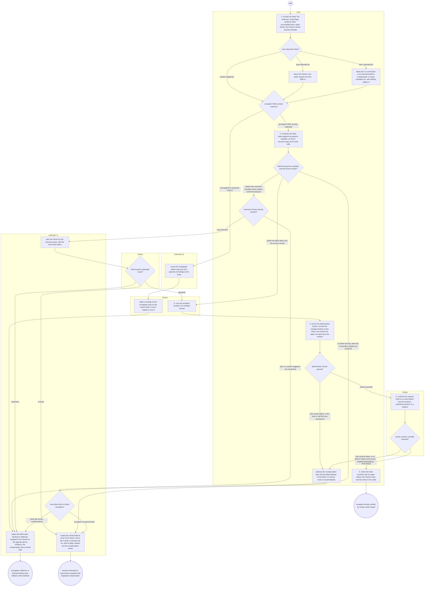

<!-- generated by render_pack.py from doctor.spec.yaml sha256=925f1c09bcc35e8d9c02c6fe254ff283b292336cbb454cf9eefbf431dcff9b98; edit the spec, not this file -->
# Repair a failure through a ticket (proposed)

**UC-D · to-be · `PROPOSED_UNACCEPTED`** · spec [doctor.spec.yaml](../doctor.spec.yaml)
Supersedes: `reports/2026-11-24-librarian-reconstruction-and-offering/diagrams/librarian-doctor-tobe.spec.yaml`, `reports/2026-11-20-workflow-map/examples/ingestion/doctor.spec.yaml`

| Problem | |
|---|---|
| symptom | The earlier doctor rolled compensation back automatically, used a helper role, had no activation or ticket routing, and blocked unattended runs on the Owner. |
| root | A structured ticket (extension, flags, owner, repair history), only accepted remedies within a computed blast radius and the Doctor's limits, routing that never blocks the caller, compensation shown not run, and the Oracle's recheck. |

## Written use case

| Field | Content |
|---|---|
| **Use case name** | Repair a failure through a ticket |
| **Brief description** | A ticket, a matching accepted remedy, a blast-radius check, the repair, then the Oracle's confirmation. |
| **Primary actor** | Doctor |
| **Supporting actors** | Clerk, Lead, Owner, Oracle, Core |
| **Preconditions** | An open ticket |
| **Trigger** | A failure at a mapped extension |
| **Success guarantee** | Resolved, confirmed by the Oracle |
| **Minimal guarantee** | Never beyond the mandate without the Owner |
| **Open questions** | The repair role's code name (W-DOC-05) |

**Main success scenario** (generated: the guard-true path, in step order)

1. The Core records the ticket: the extension, tiered flags, evidence hash, accountable actor, repair history, the Oracle it needs, and the mandate.
2. The Core computes the blast radius against the parent's mandate: at most 3 recovery steps and 2 paid calls.
3. The Doctor runs the accepted remedy in an isolated context.
4. The Core reruns the deterministic checks, records the changed hashes on the ticket, and checks the repair ran apart from the workers.
5. The Oracle confirms the cleared ticket on a route distinct from the workers', switching reviewer on a collision.
6. The Core marks the ticket resolved, with its repair history, the Oracle's pass and the notice to the caller.

**Extensions** (generated: one per non-happy guard; numbered by the step it leaves)

- **2a** (from: who raised the ticket?) *anticipated*
  - `2a1` User directed.
  - `2a2` The Core takes the Owner's own repair request from the Web UI.
  - `2a3` The Core decides: accepted YAML remedy matches?
  - `2a3a` If unmapped or proposed-only: scouts the unmapped defect read-only and attaches its findings to the ticket.
  - `2a4` If accepted YAML remedy matched:
  - `2a5` Rejoin at 2.
- **2b** (from: who raised the ticket?) *anticipated*
  - `2b1` Tier 0 directed.
  - `2b2` The Core takes tier 0's commission or an external project's scoped grant; in-scope remedies run, and nothing widens it.
  - `2b3` The Core decides: accepted YAML remedy matches?
  - `2b3a` If unmapped or proposed-only: scouts the unmapped defect read-only and attaches its findings to the ticket.
  - `2b4` If accepted YAML remedy matched:
  - `2b5` Rejoin at 2.
- **2c** (from: accepted YAML remedy matches?) *anticipated*
  - `2c1` Unmapped or proposed-only.
  - `2c2` The Clerk (tier 2) scouts the unmapped defect read-only and attaches its findings to the ticket.
  - `2c3` The Doctor drafts a remedy for the unmapped case on the Lead's ticket; it never installs or runs it.
  - `2c4` The Lead (tier 1) keeps the ticket open, declined or deferred, assigned to the Owner on the agenda with its evidence, the compensation and a review date.
  - `2c5` The use case ends: unmapped, deferred, or declined without auto-rollback; ticket retained.
- **3a** (from: within the parent's mandate and the Doctor's limits?) *anticipated*
  - `3a1` Wider than narrowed mandate (never widens autonomously).
  - `3a2` The Core decides: interactive Owner directly present?
  - `3a2a` If tier 0 or system triggered (do not block): keeps the ticket open, declined or deferred, assigned to the Owner on the agenda with its evidence, the compensation and a review date.
  - `3a3` If user directed:
  - `3a4` The Lead (tier 1) asks the Owner for the reserved scope, with the exact blast radius.
  - `3a5` The Owner decides: Owner grants expanded scope?
  - `3a5a` If declined: keeps the ticket open, declined or deferred, assigned to the Owner on the agenda with its evidence, the compensation and a review date.
  - `3a5a` If critical: routes the critical ticket at once to the Owner, and to tier 0 when it oversees the run, with its flags, hashes and the compensation shown.
  - `3a6` If granted:
  - `3a7` Rejoin at 3.
- **3b** (from: within the parent's mandate and the Doctor's limits?) *anticipated*
  - `3b1` A critical security, data-loss or boundary violation (at once).
  - `3b2` The Lead (tier 1) routes the critical ticket at once to the Owner, and to tier 0 when it oversees the run, with its flags, hashes and the compensation shown.
  - `3b3` The use case ends: bounds exhausted or critical fault; escalated with displayed compensation.
- **5a** (from: deterministic checks passed?) *anticipated*
  - `5a1` The checks failed, or the step or call limit was reached.
  - `5a2` The Core attaches the compensation plan and the failed attempt to the ticket; it is shown, never run automatically.
  - `5a3` The Lead (tier 1) decides: noncritical hold vs critical escalation?
  - `5a3a` If escalate unresolved fault: routes the critical ticket at once to the Owner, and to tier 0 when it oversees the run, with its flags, hashes and the compensation shown.
  - `5a4` If hold with shown compensation:
  - `5a5` The Lead (tier 1) keeps the ticket open, declined or deferred, assigned to the Owner on the agenda with its evidence, the compensation and a review date.
  - `5a6` The use case ends: unmapped, deferred, or declined without auto-rollback; ticket retained.
- **6a** (from: Oracle confirms shortfall resolved?) *anticipated*
  - `6a1` The recheck failed, or no distinct Oracle route (never marked resolved).
  - `6a2` The Core attaches the compensation plan and the failed attempt to the ticket; it is shown, never run automatically.
  - `6a3` The Lead (tier 1) decides: noncritical hold vs critical escalation?
  - `6a3a` If escalate unresolved fault: routes the critical ticket at once to the Owner, and to tier 0 when it oversees the run, with its flags, hashes and the compensation shown.
  - `6a4` If hold with shown compensation:
  - `6a5` The Lead (tier 1) keeps the ticket open, declined or deferred, assigned to the Owner on the agenda with its evidence, the compensation and a review date.
  - `6a6` The use case ends: unmapped, deferred, or declined without auto-rollback; ticket retained.

## Activity diagram



## Lane load

| Lane | On the main success scenario | Anywhere in the diagram |
|---|---|---|
| Owner | 0 | 1 |
| Oracle | 2 | 2 |
| Lead (tier 1) | 0 | 4 |
| Doctor | 1 | 2 |
| Clerk (tier 2) | 0 | 1 |
| Core | 8 | 12 |

Paths by how they end: **declined** 5, **escalated** 4, **resolved** 1. Every *escalated* path is a failure of this use case: the work went back to tier 0.

## Decision tree

```text
start: Repair a failure through a ticket (proposed)
          └─ T1: system triggered / accepted YAML remedy matched / within the blast radius and the Doctor's limits / checks passed / resolved (distinct Oracle route pass)  ⇒ accepted remedy verified by Oracle; ticket closed
  └─ T2: user directed  ⇒ rejoins at 'accepted YAML remedy matches?' (before step 2)
  └─ T3: tier 0 directed  ⇒ rejoins at 'accepted YAML remedy matches?' (before step 2)
    └─ T4: system triggered / unmapped or proposed-only  ⇒ unmapped, deferred, or declined without auto-rollback; ticket retained
        └─ T5: system triggered / accepted YAML remedy matched / wider than narrowed mandate (never widens autonomously) / tier 0 or system triggered (do not block)  ⇒ unmapped, deferred, or declined without auto-rollback; ticket retained
          └─ T6: system triggered / accepted YAML remedy matched / wider than narrowed mandate (never widens autonomously) / user directed / declined  ⇒ unmapped, deferred, or declined without auto-rollback; ticket retained
          └─ T7: system triggered / accepted YAML remedy matched / wider than narrowed mandate (never widens autonomously) / user directed / critical  ⇒ bounds exhausted or critical fault; escalated with displayed compensation
          └─ T8: system triggered / accepted YAML remedy matched / wider than narrowed mandate (never widens autonomously) / user directed / granted  ⇒ rejoins at step 3
      └─ T9: system triggered / accepted YAML remedy matched / a critical security, data-loss or boundary violation (at once)  ⇒ bounds exhausted or critical fault; escalated with displayed compensation
          └─ T10: system triggered / accepted YAML remedy matched / within the blast radius and the Doctor's limits / the checks failed, or the step or call limit was reached / escalate unresolved fault  ⇒ bounds exhausted or critical fault; escalated with displayed compensation
          └─ T11: system triggered / accepted YAML remedy matched / within the blast radius and the Doctor's limits / the checks failed, or the step or call limit was reached / hold with shown compensation  ⇒ unmapped, deferred, or declined without auto-rollback; ticket retained
            └─ T12: system triggered / accepted YAML remedy matched / within the blast radius and the Doctor's limits / checks passed / the recheck failed, or no distinct Oracle route (never marked resolved) / escalate unresolved fault  ⇒ bounds exhausted or critical fault; escalated with displayed compensation
            └─ T13: system triggered / accepted YAML remedy matched / within the blast radius and the Doctor's limits / checks passed / the recheck failed, or no distinct Oracle route (never marked resolved) / hold with shown compensation  ⇒ unmapped, deferred, or declined without auto-rollback; ticket retained
```

## Test cases

One test per path: the main success scenario, then each extension.

| Test | Path (guards taken) | Extension | Expected outcome |
|---|---|---|---|
| T1 | who raised the ticket? → system triggered; accepted YAML remedy matches? → accepted YAML remedy matched; within the parent's mandate and the Doctor's limits? → within the blast radius and the Doctor's limits; deterministic checks passed? → checks passed; Oracle confirms shortfall resolved? → resolved (distinct Oracle route pass) | MSS | accepted remedy verified by Oracle; ticket closed |
| T2 | who raised the ticket? → user directed | 2a | rejoins at 'accepted YAML remedy matches?' (before step 2) |
| T3 | who raised the ticket? → tier 0 directed | 2b | rejoins at 'accepted YAML remedy matches?' (before step 2) |
| T4 | who raised the ticket? → system triggered; accepted YAML remedy matches? → unmapped or proposed-only | 2c | unmapped, deferred, or declined without auto-rollback; ticket retained |
| T5 | who raised the ticket? → system triggered; accepted YAML remedy matches? → accepted YAML remedy matched; within the parent's mandate and the Doctor's limits? → wider than narrowed mandate (never widens autonomously); interactive Owner directly present? → tier 0 or system triggered (do not block) | 3a | unmapped, deferred, or declined without auto-rollback; ticket retained |
| T6 | who raised the ticket? → system triggered; accepted YAML remedy matches? → accepted YAML remedy matched; within the parent's mandate and the Doctor's limits? → wider than narrowed mandate (never widens autonomously); interactive Owner directly present? → user directed; Owner grants expanded scope? → declined | 3a | unmapped, deferred, or declined without auto-rollback; ticket retained |
| T7 | who raised the ticket? → system triggered; accepted YAML remedy matches? → accepted YAML remedy matched; within the parent's mandate and the Doctor's limits? → wider than narrowed mandate (never widens autonomously); interactive Owner directly present? → user directed; Owner grants expanded scope? → critical | 3a | bounds exhausted or critical fault; escalated with displayed compensation |
| T8 | who raised the ticket? → system triggered; accepted YAML remedy matches? → accepted YAML remedy matched; within the parent's mandate and the Doctor's limits? → wider than narrowed mandate (never widens autonomously); interactive Owner directly present? → user directed; Owner grants expanded scope? → granted | 3a | rejoins at step 3 |
| T9 | who raised the ticket? → system triggered; accepted YAML remedy matches? → accepted YAML remedy matched; within the parent's mandate and the Doctor's limits? → a critical security, data-loss or boundary violation (at once) | 3b | bounds exhausted or critical fault; escalated with displayed compensation |
| T10 | who raised the ticket? → system triggered; accepted YAML remedy matches? → accepted YAML remedy matched; within the parent's mandate and the Doctor's limits? → within the blast radius and the Doctor's limits; deterministic checks passed? → the checks failed, or the step or call limit was reached; noncritical hold vs critical escalation? → escalate unresolved fault | 5a | bounds exhausted or critical fault; escalated with displayed compensation |
| T11 | who raised the ticket? → system triggered; accepted YAML remedy matches? → accepted YAML remedy matched; within the parent's mandate and the Doctor's limits? → within the blast radius and the Doctor's limits; deterministic checks passed? → the checks failed, or the step or call limit was reached; noncritical hold vs critical escalation? → hold with shown compensation | 5a | unmapped, deferred, or declined without auto-rollback; ticket retained |
| T12 | who raised the ticket? → system triggered; accepted YAML remedy matches? → accepted YAML remedy matched; within the parent's mandate and the Doctor's limits? → within the blast radius and the Doctor's limits; deterministic checks passed? → checks passed; Oracle confirms shortfall resolved? → the recheck failed, or no distinct Oracle route (never marked resolved); noncritical hold vs critical escalation? → escalate unresolved fault | 6a | bounds exhausted or critical fault; escalated with displayed compensation |
| T13 | who raised the ticket? → system triggered; accepted YAML remedy matches? → accepted YAML remedy matched; within the parent's mandate and the Doctor's limits? → within the blast radius and the Doctor's limits; deterministic checks passed? → checks passed; Oracle confirms shortfall resolved? → the recheck failed, or no distinct Oracle route (never marked resolved); noncritical hold vs critical escalation? → hold with shown compensation | 6a | unmapped, deferred, or declined without auto-rollback; ticket retained |

### Boundary values

| Decision | Values to test | Expected |
|---|---|---|
| within the parent's mandate and the Doctor's limits? | 3 recovery steps; 4; 2 paid calls; 3 | over 3 steps or 2 paid calls goes to the Owner |
| deterministic checks passed? | the checks pass on the last allowed step; a fourth step or third paid call would be needed | at the limit the ticket stops and shows its compensation |

## As-is weaknesses this handles

| As-is weakness | Where here | How it is handled |
|---|---|---|
| W-DOC-04 (doctor): Whether a repair worked is judged by the agent that made it. | oracle | A distinct Oracle confirms a cleared ticket; the Doctor never judges its own repair. |
| W-DOC-01 (doctor): Every repair is tier-0 work: each failure of the 19-20 November run came back to tier 0. | runremedy | The Doctor runs an accepted remedy; tier 0 gets only what no remedy covers. |
| W-DOC-02 (doctor): A failure is a refusal code in a call's result, not a ticket: there is no register of open failures, their owners or their repairs. | intake | Every failure opens a ticket with its extension, flags, evidence, accountable actor and repair history. |
| W-DOC-03 (doctor): Nothing checks a repair's reach before it runs: R1's re-survey re-applied every group in the library. | blast | The blast radius is computed against the parent's mandate before any remedy runs. |
| W-DOC-05 (doctor): `doctor` already names the install capability check (doctor.py, the doctor tool); the repair role needs a distinct code name. | * | Proposed: the repair role takes a distinct code name, and `doctor` stays the install check. |

## Checks

Errors: none

Warnings: none
