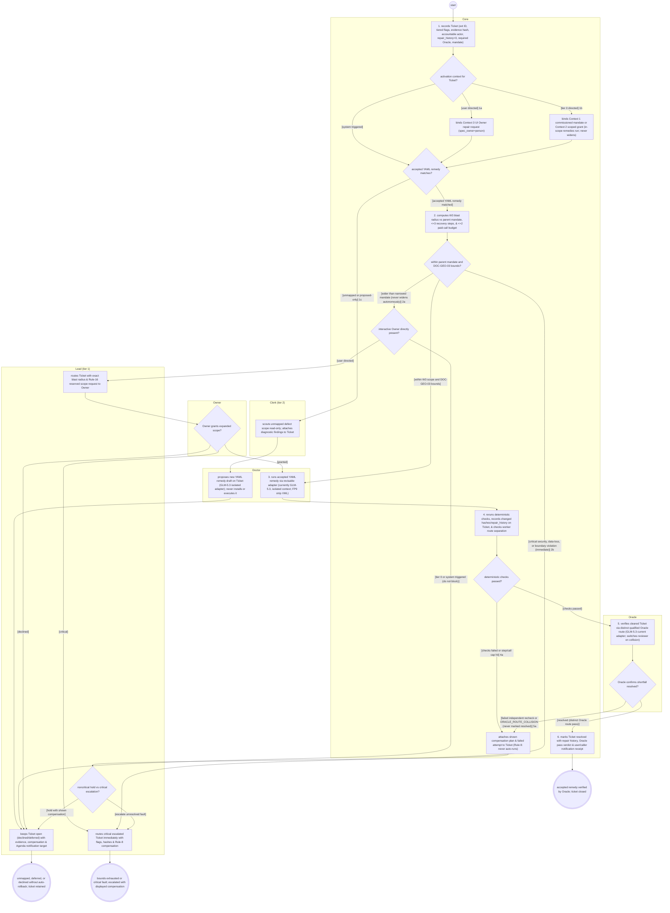

<!-- generated by render_pack.py from doctor.spec.yaml sha256=a734eebb70a9445bb1d77ae7b47d82a1bfbe1cf14c5ac983098aad249aabfed4; edit the spec, not this file -->
# Librarian Doctor Recovery & Ticket Workflow (Proposed To-Be, Rule-8 Compliant)

**UC-D · to-be · `PROPOSED_UNACCEPTED`** · spec [doctor.spec.yaml](../doctor.spec.yaml)
Supersedes: `reports/2026-11-24-librarian-reconstruction-and-offering/diagrams/librarian-doctor-tobe.spec.yaml`, `reports/2026-11-20-workflow-map/examples/ingestion/doctor.spec.yaml`

| Problem | |
|---|---|
| symptom | Prior UC-D auto-rolled back compensation (x4), used Helper (tier 2), omitted activation triggers/ticket routing, and blocked non-interactive runs on Owner escalation. |
| root | Enforce structured Ticket intake (extension ID, flags, owner, repair history), accepted-only YAML remedies + W3/DOC-GEO-03 bounds, revisable GLM-5.3 isolated adapters, non-blocking caller routing, shown compensation (Rule 8), and Oracle recheck. |

## Written use case

| Field | Content |
|---|---|
| **Use case name** | Repair a failure through a ticket |
| **Brief description** | A ticket, a matching accepted remedy, a blast-radius check, the repair, then the Oracle's confirmation. |
| **Primary actor** | Doctor |
| **Supporting actors** | Clerk, Lead, Owner, Oracle, Core |
| **Preconditions** | An open ticket |
| **Trigger** | A failure at a mapped extension |
| **Success guarantee** | Resolved, confirmed by the Oracle |
| **Minimal guarantee** | Never beyond the mandate without the Owner |
| **Open questions** | The repair role's code name (W-DOC-05) |

**Main success scenario** (generated: the guard-true path, in step order)

1. The Core records Ticket (ext ID, tiered flags, evidence hash, accountable actor, repair_history=0, required Oracle, mandate).
2. The Core computes W3 blast radius vs parent mandate, <=3 recovery steps, & <=2 paid-call budget.
3. The Doctor runs accepted YAML remedy via revisable adapter (currently GLM-5.3, isolated context; FP9 strip XML).
4. The Core reruns deterministic checks, records changed hashes/repair_history on Ticket, & checks worker route separation.
5. The Oracle verifies cleared Ticket via distinct qualified Oracle route (GLM-5.3 current adapter; switches reviewer on collision).
6. The Core marks Ticket resolved with repair history, Oracle pass verdict & user/caller notification receipt.

**Extensions** (generated: one per non-happy guard; numbered by the step it leaves)

- **1a** (from: activation context for Ticket?) *anticipated*
  - `1a1` User directed.
  - `1a2` The Core binds Context 3 UI Owner repair request (spec_owner=person).
  - `1a3` The Core decides: accepted YAML remedy matches?
  - `1a3a` If unmapped or proposed-only: scouts unmapped defect scope read-only; attaches diagnostic findings to Ticket.
  - `1a4` If accepted YAML remedy matched:
  - `1a5` Rejoin at 2.
- **1b** (from: activation context for Ticket?) *anticipated*
  - `1b1` Tier 0 directed.
  - `1b2` The Core binds Context 1 commissioned mandate or Context 2 scoped grant (in-scope remedies run; never widens).
  - `1b3` The Core decides: accepted YAML remedy matches?
  - `1b3a` If unmapped or proposed-only: scouts unmapped defect scope read-only; attaches diagnostic findings to Ticket.
  - `1b4` If accepted YAML remedy matched:
  - `1b5` Rejoin at 2.
- **1c** (from: accepted YAML remedy matches?) *anticipated*
  - `1c1` Unmapped or proposed-only.
  - `1c2` The Clerk (tier 2) scouts unmapped defect scope read-only; attaches diagnostic findings to Ticket.
  - `1c3` The Doctor proposes new YAML remedy draft on Ticket (GLM-5.3 isolated adapter); never installs or executes it.
  - `1c4` The Lead (tier 1) keeps Ticket open (declined/deferred) with evidence, compensation & Agenda notification target.
  - `1c5` The use case ends: unmapped, deferred, or declined without auto-rollback; ticket retained.
- **2a** (from: within parent mandate and DOC-GEO-03 bounds?) *anticipated*
  - `2a1` Wider than narrowed mandate (never widens autonomously).
  - `2a2` The Core decides: interactive Owner directly present?
  - `2a2a` If tier 0 or system triggered (do not block): keeps Ticket open (declined/deferred) with evidence, compensation & Agenda notification target.
  - `2a3` If user directed:
  - `2a4` The Lead (tier 1) routes Ticket with exact blast radius & Rule-16 reserved scope request to Owner.
  - `2a5` The Owner decides: Owner grants expanded scope?
  - `2a5a` If declined: keeps Ticket open (declined/deferred) with evidence, compensation & Agenda notification target.
  - `2a5a` If critical: routes critical escalated Ticket immediately with flags, hashes & Rule-8 compensation.
  - `2a6` If granted:
  - `2a7` Rejoin at 3.
- **2b** (from: within parent mandate and DOC-GEO-03 bounds?) *anticipated*
  - `2b1` Critical security, data-loss, or boundary violation (immediate).
  - `2b2` The Lead (tier 1) routes critical escalated Ticket immediately with flags, hashes & Rule-8 compensation.
  - `2b3` The use case ends: bounds exhausted or critical fault; escalated with displayed compensation.
- **4a** (from: deterministic checks passed?) *anticipated*
  - `4a1` Checks failed or step/call cap hit.
  - `4a2` The Core attaches shown compensation plan & failed attempt to Ticket (Rule 8: never auto-runs).
  - `4a3` The Lead (tier 1) decides: noncritical hold vs critical escalation?
  - `4a3a` If escalate unresolved fault: routes critical escalated Ticket immediately with flags, hashes & Rule-8 compensation.
  - `4a4` If hold with shown compensation:
  - `4a5` The Lead (tier 1) keeps Ticket open (declined/deferred) with evidence, compensation & Agenda notification target.
  - `4a6` The use case ends: unmapped, deferred, or declined without auto-rollback; ticket retained.
- **5a** (from: Oracle confirms shortfall resolved?) *anticipated*
  - `5a1` Failed independent recheck or ORACLE_ROUTE_COLLISION (never marked resolved).
  - `5a2` The Core attaches shown compensation plan & failed attempt to Ticket (Rule 8: never auto-runs).
  - `5a3` The Lead (tier 1) decides: noncritical hold vs critical escalation?
  - `5a3a` If escalate unresolved fault: routes critical escalated Ticket immediately with flags, hashes & Rule-8 compensation.
  - `5a4` If hold with shown compensation:
  - `5a5` The Lead (tier 1) keeps Ticket open (declined/deferred) with evidence, compensation & Agenda notification target.
  - `5a6` The use case ends: unmapped, deferred, or declined without auto-rollback; ticket retained.

## Activity diagram



## Lane load

| Lane | On the main success scenario | Anywhere in the diagram |
|---|---|---|
| Owner | 0 | 1 |
| Oracle | 2 | 2 |
| Lead (tier 1) | 0 | 4 |
| Doctor | 1 | 2 |
| Clerk (tier 2) | 0 | 1 |
| Core | 8 | 12 |

Paths by how they end: **declined** 5, **escalated** 4, **resolved** 1. Every *escalated* path is a failure of this use case: the work went back to tier 0.

## Decision tree

```text
start: Librarian Doctor Recovery & Ticket Workflow (Proposed To-Be, Rule-8 Compliant)
          └─ T1: system triggered / accepted YAML remedy matched / within W3 scope and DOC-GEO-03 bounds / checks passed / resolved (distinct Oracle route pass)  ⇒ accepted remedy verified by Oracle; ticket closed
  └─ T2: user directed  ⇒ rejoins at 'accepted YAML remedy matches?' (before step 2)
  └─ T3: tier 0 directed  ⇒ rejoins at 'accepted YAML remedy matches?' (before step 2)
    └─ T4: system triggered / unmapped or proposed-only  ⇒ unmapped, deferred, or declined without auto-rollback; ticket retained
        └─ T5: system triggered / accepted YAML remedy matched / wider than narrowed mandate (never widens autonomously) / tier 0 or system triggered (do not block)  ⇒ unmapped, deferred, or declined without auto-rollback; ticket retained
          └─ T6: system triggered / accepted YAML remedy matched / wider than narrowed mandate (never widens autonomously) / user directed / declined  ⇒ unmapped, deferred, or declined without auto-rollback; ticket retained
          └─ T7: system triggered / accepted YAML remedy matched / wider than narrowed mandate (never widens autonomously) / user directed / critical  ⇒ bounds exhausted or critical fault; escalated with displayed compensation
          └─ T8: system triggered / accepted YAML remedy matched / wider than narrowed mandate (never widens autonomously) / user directed / granted  ⇒ rejoins at step 3
      └─ T9: system triggered / accepted YAML remedy matched / critical security, data-loss, or boundary violation (immediate)  ⇒ bounds exhausted or critical fault; escalated with displayed compensation
          └─ T10: system triggered / accepted YAML remedy matched / within W3 scope and DOC-GEO-03 bounds / checks failed or step/call cap hit / escalate unresolved fault  ⇒ bounds exhausted or critical fault; escalated with displayed compensation
          └─ T11: system triggered / accepted YAML remedy matched / within W3 scope and DOC-GEO-03 bounds / checks failed or step/call cap hit / hold with shown compensation  ⇒ unmapped, deferred, or declined without auto-rollback; ticket retained
            └─ T12: system triggered / accepted YAML remedy matched / within W3 scope and DOC-GEO-03 bounds / checks passed / failed independent recheck or ORACLE_ROUTE_COLLISION (never marked resolved) / escalate unresolved fault  ⇒ bounds exhausted or critical fault; escalated with displayed compensation
            └─ T13: system triggered / accepted YAML remedy matched / within W3 scope and DOC-GEO-03 bounds / checks passed / failed independent recheck or ORACLE_ROUTE_COLLISION (never marked resolved) / hold with shown compensation  ⇒ unmapped, deferred, or declined without auto-rollback; ticket retained
```

## Test cases

One test per path: the main success scenario, then each extension.

| Test | Path (guards taken) | Extension | Expected outcome |
|---|---|---|---|
| T1 | activation context for Ticket? → system triggered; accepted YAML remedy matches? → accepted YAML remedy matched; within parent mandate and DOC-GEO-03 bounds? → within W3 scope and DOC-GEO-03 bounds; deterministic checks passed? → checks passed; Oracle confirms shortfall resolved? → resolved (distinct Oracle route pass) | MSS | accepted remedy verified by Oracle; ticket closed |
| T2 | activation context for Ticket? → user directed | 1a | rejoins at 'accepted YAML remedy matches?' (before step 2) |
| T3 | activation context for Ticket? → tier 0 directed | 1b | rejoins at 'accepted YAML remedy matches?' (before step 2) |
| T4 | activation context for Ticket? → system triggered; accepted YAML remedy matches? → unmapped or proposed-only | 1c | unmapped, deferred, or declined without auto-rollback; ticket retained |
| T5 | activation context for Ticket? → system triggered; accepted YAML remedy matches? → accepted YAML remedy matched; within parent mandate and DOC-GEO-03 bounds? → wider than narrowed mandate (never widens autonomously); interactive Owner directly present? → tier 0 or system triggered (do not block) | 2a | unmapped, deferred, or declined without auto-rollback; ticket retained |
| T6 | activation context for Ticket? → system triggered; accepted YAML remedy matches? → accepted YAML remedy matched; within parent mandate and DOC-GEO-03 bounds? → wider than narrowed mandate (never widens autonomously); interactive Owner directly present? → user directed; Owner grants expanded scope? → declined | 2a | unmapped, deferred, or declined without auto-rollback; ticket retained |
| T7 | activation context for Ticket? → system triggered; accepted YAML remedy matches? → accepted YAML remedy matched; within parent mandate and DOC-GEO-03 bounds? → wider than narrowed mandate (never widens autonomously); interactive Owner directly present? → user directed; Owner grants expanded scope? → critical | 2a | bounds exhausted or critical fault; escalated with displayed compensation |
| T8 | activation context for Ticket? → system triggered; accepted YAML remedy matches? → accepted YAML remedy matched; within parent mandate and DOC-GEO-03 bounds? → wider than narrowed mandate (never widens autonomously); interactive Owner directly present? → user directed; Owner grants expanded scope? → granted | 2a | rejoins at step 3 |
| T9 | activation context for Ticket? → system triggered; accepted YAML remedy matches? → accepted YAML remedy matched; within parent mandate and DOC-GEO-03 bounds? → critical security, data-loss, or boundary violation (immediate) | 2b | bounds exhausted or critical fault; escalated with displayed compensation |
| T10 | activation context for Ticket? → system triggered; accepted YAML remedy matches? → accepted YAML remedy matched; within parent mandate and DOC-GEO-03 bounds? → within W3 scope and DOC-GEO-03 bounds; deterministic checks passed? → checks failed or step/call cap hit; noncritical hold vs critical escalation? → escalate unresolved fault | 4a | bounds exhausted or critical fault; escalated with displayed compensation |
| T11 | activation context for Ticket? → system triggered; accepted YAML remedy matches? → accepted YAML remedy matched; within parent mandate and DOC-GEO-03 bounds? → within W3 scope and DOC-GEO-03 bounds; deterministic checks passed? → checks failed or step/call cap hit; noncritical hold vs critical escalation? → hold with shown compensation | 4a | unmapped, deferred, or declined without auto-rollback; ticket retained |
| T12 | activation context for Ticket? → system triggered; accepted YAML remedy matches? → accepted YAML remedy matched; within parent mandate and DOC-GEO-03 bounds? → within W3 scope and DOC-GEO-03 bounds; deterministic checks passed? → checks passed; Oracle confirms shortfall resolved? → failed independent recheck or ORACLE_ROUTE_COLLISION (never marked resolved); noncritical hold vs critical escalation? → escalate unresolved fault | 5a | bounds exhausted or critical fault; escalated with displayed compensation |
| T13 | activation context for Ticket? → system triggered; accepted YAML remedy matches? → accepted YAML remedy matched; within parent mandate and DOC-GEO-03 bounds? → within W3 scope and DOC-GEO-03 bounds; deterministic checks passed? → checks passed; Oracle confirms shortfall resolved? → failed independent recheck or ORACLE_ROUTE_COLLISION (never marked resolved); noncritical hold vs critical escalation? → hold with shown compensation | 5a | unmapped, deferred, or declined without auto-rollback; ticket retained |

### Boundary values

_None declared._

## As-is weaknesses this handles

| As-is weakness | Where here | How it is handled |
|---|---|---|
| W-DOC-04 (doctor): Whether a repair worked is judged by the agent that made it. | oracle | A distinct Oracle confirms a cleared ticket; the Doctor never judges its own repair. |
| W-DOC-01 (doctor): Every repair is tier-0 work: each failure of the 19-20 November run came back to tier 0. | runremedy | The Doctor runs an accepted remedy; tier 0 gets only what no remedy covers. |
| W-DOC-02 (doctor): A failure is a refusal code in a call's result, not a ticket: there is no register of open failures, their owners or their repairs. | intake | Every failure opens a ticket with its extension, flags, evidence, accountable actor and repair history. |
| W-DOC-03 (doctor): Nothing checks a repair's reach before it runs: R1's re-survey re-applied every group in the library. | blast | The blast radius is computed against the parent's mandate before any remedy runs. |
| W-DOC-05 (doctor): `doctor` already names the install capability check (doctor.py, the doctor tool); the repair role needs a distinct code name. | * | Proposed: the repair role takes a distinct code name, and `doctor` stays the install check. |

## Checks

Errors: none

Warnings: 
- decision dgrant ('within parent mandate and DOC-GEO-03 bounds?') tests a quantity but declares no boundary values
