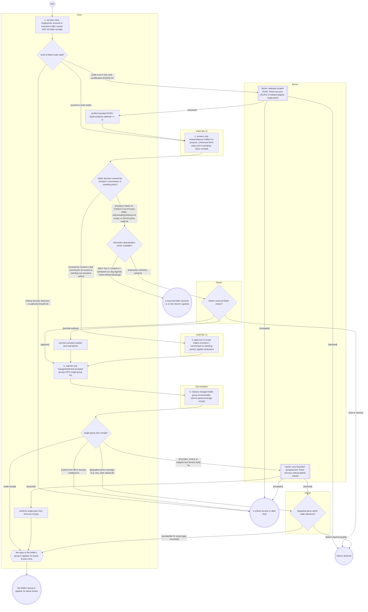

<!-- generated by render_pack.py from folder-review.spec.yaml sha256=b8879a88bc171aab64b1b228b44be19a7a1e36fb460822fd44db6d908b213e0e; edit the spec, not this file -->
# Review a folder and apply its group (proposed)

**UC1.1 · to-be · `PROPOSED_UNACCEPTED`** · spec [folder-review.spec.yaml](../folder-review.spec.yaml)

## Written use case

| Field | Content |
|---|---|
| **Use case name** | Review a folder and apply its group |
| **Brief description** | Survey, screen the new or ambiguous folders, decide within the mandate or ask once, and apply only the changed group. |
| **Primary actor** | Lead |
| **Supporting actors** | Clerk, Owner, Doctor, Oracle, Core, Geo-Grapher |
| **Preconditions** | Roots within the mandate |
| **Trigger** | The ingestion parent's first step |
| **Success guarantee** | The folder's group is applied, its inputs known |
| **Minimal guarantee** | A stale root is repaired in its own scope or held with a ticket |
| **Open questions** | Standing policy for folder decisions |

**Main success scenario** (generated: the guard-true path, in step order)

1. The Core surveys roots, fingerprints, licences & exclusions ($0); reuses NAT-13 folder receipts.
2. The Clerk (tier 2) screens only new/ambiguous folders for purpose, unlicensed third-party risk & sensitivity (docs unread).
3. The Lead (tier 1) approves in-scope folders (Context 1 commission or standing policy); applies exclusions.
4. The Core submits only changed/selected accepted groups (OP2 single-group fix).
5. The Geo-Grapher indexes changed folder group incrementally; returns parse/coverage receipt.

**Extensions** (generated: one per non-happy guard; numbered by the step it leaves)

- **2a** (from: roots & folder-route valid?) *anticipated*
  - `2a1` Stale root or lost route qualification (R1/R2).
  - `2a2` The Doctor attempts scoped R1/R2 Ticket recovery (GLM-5.3 isolated adapter; single-pass) (continues in doctor).
  - `2a2a` If declined: the use case ends: held or declined.
  - `2a2a` If escalated: the use case ends: a critical security or data fault.
  - `2a3` If resolved:
  - `2a4` The Core verifies bounded R1/R2 repair progress (attempt <= 1).
  - `2a5` Rejoin at 2.
- **2b** (from: roots & folder-route valid?) *anticipated*
  - `2b1` Critical security, data-loss, or authority breach.
  - `2b2` The use case ends: a critical security or data fault.
- **3a** (from: folder decision covered by Context-1 commission or standing policy?) *anticipated*
  - `3a1` Context-3 direct UI, Context-2 out-of-scope folder, unlicensed/symlink/out-of-scope, or OD-05 policy hold.
  - `3a2` The Core decides: interactive Specification owner available?
  - `3a2a` If MCP Tier 0 / Context-2 / scheduled run (log Agenda Ticket without blocking): the use case ends: a reserved folder decision is on the Owner's agenda.
  - `3a3` If interactive UI/Owner present:
  - `3a4` The Owner decides: Owner reserved folder choice?
  - `3a4a` If exclude subtree: records excluded subtree and read barrier.
  - `3a4a` If hold or decline: the use case ends: held or declined.
  - `3a5` If approve:
  - `3a6` Rejoin at 4.
- **5a** (from: single-group Geo receipt?) *anticipated*
  - `5a1` FOLDER_STALE or mapped Geo service fault.
  - `5a2` The Doctor runs bounded group/service Ticket recovery without global rebuild (continues in doctor).
  - `5a2a` If declined: degraded parse within caller tolerance?.
  - `5a2a` If escalated: the use case ends: a critical security or data fault.
  - `5a3` If resolved:
  - `5a4` The Core confirms single-pass Geo recovery receipt.
  - `5a5` Rejoin at 'the ways to the folder's group is applied, its inputs known meet'.
- **5b** (from: single-group Geo receipt?) *anticipated*
  - `5b1` Degraded parse coverage (e.g. tree_sitter skips).
  - `5b2` The Oracle decides: degraded parse within caller tolerance?
  - `5b2a` If below required quality: the use case ends: held or declined.
  - `5b3` If acceptable for scope (gap recorded):
  - `5b4` Rejoin at 'the ways to the folder's group is applied, its inputs known meet'.
- **5c** (from: single-group Geo receipt?) *anticipated*
  - `5c1` Critical Geo DB or security violation.
  - `5c2` The use case ends: a critical security or data fault.

## Activity diagram



## Lane load

| Lane | On the main success scenario | Anywhere in the diagram |
|---|---|---|
| Owner | 0 | 1 |
| Lead (tier 1) | 1 | 1 |
| Clerk (tier 2) | 1 | 1 |
| Doctor | 0 | 2 |
| Oracle | 0 | 1 |
| Core | 5 | 9 |
| Geo-Grapher | 1 | 1 |

Paths by how they end: **escalated** 4, **held for the Owner** 1, **paused** 4, **success** 1. Every *escalated* path is a failure of this use case: the work went back to tier 0.

## Decision tree

```text
start: Review a folder and apply its group (proposed)
      └─ T1: current & route ready / covered by Context-1 task commission (in-scope) or standing non-sensitive policy / valid receipt  ⇒ the folder's group is applied, its inputs known
    └─ T2: stale root or lost route qualification (R1/R2) / declined  ⇒ held or declined
    └─ T3: stale root or lost route qualification (R1/R2) / escalated  ⇒ a critical security or data fault
    └─ T4: stale root or lost route qualification (R1/R2) / resolved  ⇒ rejoins at step 2
  └─ T5: critical security, data-loss, or authority breach  ⇒ a critical security or data fault
      └─ T6: current & route ready / Context-3 direct UI, Context-2 out-of-scope folder, unlicensed/symlink/out-of-scope, or OD-05 policy hold / MCP Tier 0 / Context-2 / scheduled run (log Agenda Ticket without blocking)  ⇒ a reserved folder decision is on the Owner's agenda
        └─ T7: current & route ready / Context-3 direct UI, Context-2 out-of-scope folder, unlicensed/symlink/out-of-scope, or OD-05 policy hold / interactive UI/Owner present / exclude subtree  ⇒ rejoins at step 4
        └─ T8: current & route ready / Context-3 direct UI, Context-2 out-of-scope folder, unlicensed/symlink/out-of-scope, or OD-05 policy hold / interactive UI/Owner present / hold or decline  ⇒ held or declined
        └─ T9: current & route ready / Context-3 direct UI, Context-2 out-of-scope folder, unlicensed/symlink/out-of-scope, or OD-05 policy hold / interactive UI/Owner present / approve  ⇒ rejoins at step 4
          └─ T10: current & route ready / covered by Context-1 task commission (in-scope) or standing non-sensitive policy / FOLDER_STALE or mapped Geo service fault / declined / below required quality  ⇒ held or declined
          └─ T11: current & route ready / covered by Context-1 task commission (in-scope) or standing non-sensitive policy / FOLDER_STALE or mapped Geo service fault / declined / acceptable for scope (gap recorded)  ⇒ rejoins at 'the ways to the folder's group is applied, its inputs known meet' (before step None)
        └─ T12: current & route ready / covered by Context-1 task commission (in-scope) or standing non-sensitive policy / FOLDER_STALE or mapped Geo service fault / escalated  ⇒ a critical security or data fault
        └─ T13: current & route ready / covered by Context-1 task commission (in-scope) or standing non-sensitive policy / FOLDER_STALE or mapped Geo service fault / resolved  ⇒ rejoins at 'the ways to the folder's group is applied, its inputs known meet' (before step None)
        └─ T14: current & route ready / covered by Context-1 task commission (in-scope) or standing non-sensitive policy / degraded parse coverage (e.g. tree_sitter skips) / below required quality  ⇒ held or declined
        └─ T15: current & route ready / covered by Context-1 task commission (in-scope) or standing non-sensitive policy / degraded parse coverage (e.g. tree_sitter skips) / acceptable for scope (gap recorded)  ⇒ rejoins at 'the ways to the folder's group is applied, its inputs known meet' (before step None)
      └─ T16: current & route ready / covered by Context-1 task commission (in-scope) or standing non-sensitive policy / critical Geo DB or security violation  ⇒ a critical security or data fault
```

## Test cases

One test per path: the main success scenario, then each extension.

| Test | Path (guards taken) | Extension | Expected outcome |
|---|---|---|---|
| T1 | roots & folder-route valid? → current & route ready; folder decision covered by Context-1 commission or standing policy? → covered by Context-1 task commission (in-scope) or standing non-sensitive policy; single-group Geo receipt? → valid receipt | MSS | the folder's group is applied, its inputs known |
| T2 | roots & folder-route valid? → stale root or lost route qualification (R1/R2); attempts scoped R1/R2 Ticket recovery (GLM-5.3 isolated adapter; single-pass) → declined | 2a | held or declined |
| T3 | roots & folder-route valid? → stale root or lost route qualification (R1/R2); attempts scoped R1/R2 Ticket recovery (GLM-5.3 isolated adapter; single-pass) → escalated | 2a | a critical security or data fault |
| T4 | roots & folder-route valid? → stale root or lost route qualification (R1/R2); attempts scoped R1/R2 Ticket recovery (GLM-5.3 isolated adapter; single-pass) → resolved | 2a | rejoins at step 2 |
| T5 | roots & folder-route valid? → critical security, data-loss, or authority breach | 2b | a critical security or data fault |
| T6 | roots & folder-route valid? → current & route ready; folder decision covered by Context-1 commission or standing policy? → Context-3 direct UI, Context-2 out-of-scope folder, unlicensed/symlink/out-of-scope, or OD-05 policy hold; interactive Specification owner available? → MCP Tier 0 / Context-2 / scheduled run (log Agenda Ticket without blocking) | 3a | a reserved folder decision is on the Owner's agenda |
| T7 | roots & folder-route valid? → current & route ready; folder decision covered by Context-1 commission or standing policy? → Context-3 direct UI, Context-2 out-of-scope folder, unlicensed/symlink/out-of-scope, or OD-05 policy hold; interactive Specification owner available? → interactive UI/Owner present; Owner reserved folder choice? → exclude subtree | 3a | rejoins at step 4 |
| T8 | roots & folder-route valid? → current & route ready; folder decision covered by Context-1 commission or standing policy? → Context-3 direct UI, Context-2 out-of-scope folder, unlicensed/symlink/out-of-scope, or OD-05 policy hold; interactive Specification owner available? → interactive UI/Owner present; Owner reserved folder choice? → hold or decline | 3a | held or declined |
| T9 | roots & folder-route valid? → current & route ready; folder decision covered by Context-1 commission or standing policy? → Context-3 direct UI, Context-2 out-of-scope folder, unlicensed/symlink/out-of-scope, or OD-05 policy hold; interactive Specification owner available? → interactive UI/Owner present; Owner reserved folder choice? → approve | 3a | rejoins at step 4 |
| T10 | roots & folder-route valid? → current & route ready; folder decision covered by Context-1 commission or standing policy? → covered by Context-1 task commission (in-scope) or standing non-sensitive policy; single-group Geo receipt? → FOLDER_STALE or mapped Geo service fault; runs bounded group/service Ticket recovery without global rebuild → declined; degraded parse within caller tolerance? → below required quality | 5a | held or declined |
| T11 | roots & folder-route valid? → current & route ready; folder decision covered by Context-1 commission or standing policy? → covered by Context-1 task commission (in-scope) or standing non-sensitive policy; single-group Geo receipt? → FOLDER_STALE or mapped Geo service fault; runs bounded group/service Ticket recovery without global rebuild → declined; degraded parse within caller tolerance? → acceptable for scope (gap recorded) | 5a | rejoins at 'the ways to the folder's group is applied, its inputs known meet' (before step None) |
| T12 | roots & folder-route valid? → current & route ready; folder decision covered by Context-1 commission or standing policy? → covered by Context-1 task commission (in-scope) or standing non-sensitive policy; single-group Geo receipt? → FOLDER_STALE or mapped Geo service fault; runs bounded group/service Ticket recovery without global rebuild → escalated | 5a | a critical security or data fault |
| T13 | roots & folder-route valid? → current & route ready; folder decision covered by Context-1 commission or standing policy? → covered by Context-1 task commission (in-scope) or standing non-sensitive policy; single-group Geo receipt? → FOLDER_STALE or mapped Geo service fault; runs bounded group/service Ticket recovery without global rebuild → resolved | 5a | rejoins at 'the ways to the folder's group is applied, its inputs known meet' (before step None) |
| T14 | roots & folder-route valid? → current & route ready; folder decision covered by Context-1 commission or standing policy? → covered by Context-1 task commission (in-scope) or standing non-sensitive policy; single-group Geo receipt? → degraded parse coverage (e.g. tree_sitter skips); degraded parse within caller tolerance? → below required quality | 5b | held or declined |
| T15 | roots & folder-route valid? → current & route ready; folder decision covered by Context-1 commission or standing policy? → covered by Context-1 task commission (in-scope) or standing non-sensitive policy; single-group Geo receipt? → degraded parse coverage (e.g. tree_sitter skips); degraded parse within caller tolerance? → acceptable for scope (gap recorded) | 5b | rejoins at 'the ways to the folder's group is applied, its inputs known meet' (before step None) |
| T16 | roots & folder-route valid? → current & route ready; folder decision covered by Context-1 commission or standing policy? → covered by Context-1 task commission (in-scope) or standing non-sensitive policy; single-group Geo receipt? → critical Geo DB or security violation | 5c | a critical security or data fault |

### Boundary values

_None declared._

## As-is weaknesses this handles

| As-is weakness | Where here | How it is handled |
|---|---|---|
| W-FOL-03 (folder-review): The model's draft of a folder's purpose is off by default (FOLDER_DRAFT_DISABLED); when on, it sees only file counts and bytes. | folderscreen | A Clerk screens the new or ambiguous folders for purpose, licence risk and sensitivity. |
| W-FOL-01 (folder-review): Every accept re-applies every accepted group in the library (OP2): one folder's decision has a whole-library radius. | folderapply | Only the changed or selected group is submitted, and Geo-Grapher indexes it incrementally. |
| W-FOL-02 (folder-review): A stale card anywhere refuses this decision (FOLDER_STALE across all groups); R1 needed a re-survey of an unrelated root. | doctorroot | A stale root is recovered within its own scope (R1) instead of blocking every decision. |

## Checks

Errors: none

Warnings: 
- decision oraclecov ('degraded parse within caller tolerance?') tests a quantity but declares no boundary values
