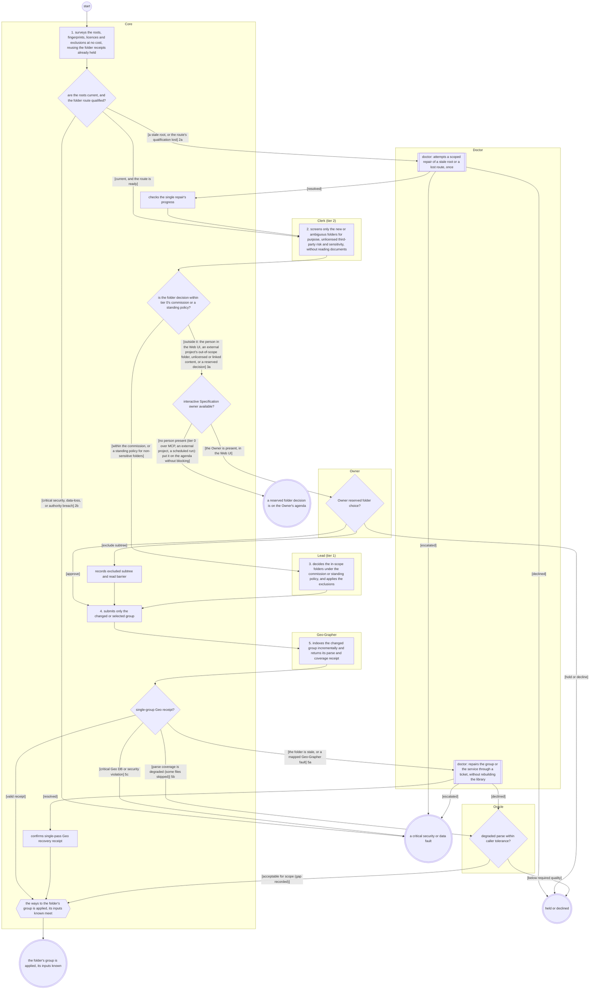

<!-- generated by render_pack.py from folder-review.spec.yaml sha256=eaf98ea51d648e85cb6264d99d9f3da568ee7c2101238eeadab901ca42665465; edit the spec, not this file -->
# Review a folder and apply its group (proposed)

**UC1.1 · to-be · `PROPOSED_UNACCEPTED`** · spec [folder-review.spec.yaml](../folder-review.spec.yaml)

## Written use case

| Field | Content |
|---|---|
| **Use case name** | Review a folder and apply its group |
| **Brief description** | Survey, screen the new or ambiguous folders, decide within the mandate or ask once, and apply only the changed group. |
| **Primary actor** | Lead |
| **Supporting actors** | Clerk, Owner, Doctor, Oracle, Core, Geo-Grapher |
| **Preconditions** | Roots within the mandate |
| **Trigger** | The ingestion parent's first step |
| **Success guarantee** | The folder's group is applied, its inputs known |
| **Minimal guarantee** | A stale root is repaired in its own scope or held with a ticket |
| **Open questions** | Standing policy for folder decisions |

**Main success scenario** (generated: the guard-true path, in step order)

1. The Core surveys the roots, fingerprints, licences and exclusions at no cost, reusing the folder receipts already held.
2. The Clerk (tier 2) screens only the new or ambiguous folders for purpose, unlicensed third-party risk and sensitivity, without reading documents.
3. The Lead (tier 1) decides the in-scope folders under the commission or standing policy, and applies the exclusions.
4. The Core submits only the changed or selected group.
5. The Geo-Grapher indexes the changed group incrementally and returns its parse and coverage receipt.

**Extensions** (generated: one per non-happy guard; numbered by the step it leaves)

- **2a** (from: are the roots current, and the folder route qualified?) *anticipated*
  - `2a1` A stale root, or the route's qualification lost.
  - `2a2` The Doctor attempts a scoped repair of a stale root or a lost route, once (continues in doctor).
  - `2a2a` If declined: the use case ends: held or declined.
  - `2a2a` If escalated: the use case ends: a critical security or data fault.
  - `2a3` If resolved:
  - `2a4` The Core checks the single repair's progress.
  - `2a5` Rejoin at 2.
- **2b** (from: are the roots current, and the folder route qualified?) *anticipated*
  - `2b1` Critical security, data-loss, or authority breach.
  - `2b2` The use case ends: a critical security or data fault.
- **3a** (from: is the folder decision within tier 0's commission or a standing policy?) *anticipated*
  - `3a1` Outside it: the person in the Web UI, an external project's out-of-scope folder, unlicensed or linked content, or a reserved decision.
  - `3a2` The Core decides: interactive Specification owner available?
  - `3a2a` If no person present (tier 0 over MCP, an external project, a scheduled run): put it on the agenda without blocking: the use case ends: a reserved folder decision is on the Owner's agenda.
  - `3a3` If the Owner is present, in the Web UI:
  - `3a4` The Owner decides: Owner reserved folder choice?
  - `3a4a` If exclude subtree: records excluded subtree and read barrier.
  - `3a4a` If hold or decline: the use case ends: held or declined.
  - `3a5` If approve:
  - `3a6` Rejoin at 4.
- **5a** (from: single-group Geo receipt?) *anticipated*
  - `5a1` The folder is stale, or a mapped Geo-Grapher fault.
  - `5a2` The Doctor repairs the group or the service through a ticket, without rebuilding the library (continues in doctor).
  - `5a2a` If declined: degraded parse within caller tolerance?.
  - `5a2a` If escalated: the use case ends: a critical security or data fault.
  - `5a3` If resolved:
  - `5a4` The Core confirms single-pass Geo recovery receipt.
  - `5a5` Rejoin at 'the ways to the folder's group is applied, its inputs known meet'.
- **5b** (from: single-group Geo receipt?) *anticipated*
  - `5b1` Parse coverage is degraded (some files skipped).
  - `5b2` The Oracle decides: degraded parse within caller tolerance?
  - `5b2a` If below required quality: the use case ends: held or declined.
  - `5b3` If acceptable for scope (gap recorded):
  - `5b4` Rejoin at 'the ways to the folder's group is applied, its inputs known meet'.
- **5c** (from: single-group Geo receipt?) *anticipated*
  - `5c1` Critical Geo DB or security violation.
  - `5c2` The use case ends: a critical security or data fault.

## Activity diagram



## Lane load

| Lane | On the main success scenario | Anywhere in the diagram |
|---|---|---|
| Owner | 0 | 1 |
| Lead (tier 1) | 1 | 1 |
| Clerk (tier 2) | 1 | 1 |
| Doctor | 0 | 2 |
| Oracle | 0 | 1 |
| Core | 5 | 9 |
| Geo-Grapher | 1 | 1 |

Paths by how they end: **escalated** 4, **held for the Owner** 1, **paused** 4, **success** 1. Every *escalated* path is a failure of this use case: the work went back to tier 0.

## Decision tree

```text
start: Review a folder and apply its group (proposed)
      └─ T1: current, and the route is ready / within the commission, or a standing policy for non-sensitive folders / valid receipt  ⇒ the folder's group is applied, its inputs known
    └─ T2: a stale root, or the route's qualification lost / declined  ⇒ held or declined
    └─ T3: a stale root, or the route's qualification lost / escalated  ⇒ a critical security or data fault
    └─ T4: a stale root, or the route's qualification lost / resolved  ⇒ rejoins at step 2
  └─ T5: critical security, data-loss, or authority breach  ⇒ a critical security or data fault
      └─ T6: current, and the route is ready / outside it: the person in the Web UI, an external project's out-of-scope folder, unlicensed or linked content, or a reserved decision / no person present (tier 0 over MCP, an external project, a scheduled run): put it on the agenda without blocking  ⇒ a reserved folder decision is on the Owner's agenda
        └─ T7: current, and the route is ready / outside it: the person in the Web UI, an external project's out-of-scope folder, unlicensed or linked content, or a reserved decision / the Owner is present, in the Web UI / exclude subtree  ⇒ rejoins at step 4
        └─ T8: current, and the route is ready / outside it: the person in the Web UI, an external project's out-of-scope folder, unlicensed or linked content, or a reserved decision / the Owner is present, in the Web UI / hold or decline  ⇒ held or declined
        └─ T9: current, and the route is ready / outside it: the person in the Web UI, an external project's out-of-scope folder, unlicensed or linked content, or a reserved decision / the Owner is present, in the Web UI / approve  ⇒ rejoins at step 4
          └─ T10: current, and the route is ready / within the commission, or a standing policy for non-sensitive folders / the folder is stale, or a mapped Geo-Grapher fault / declined / below required quality  ⇒ held or declined
          └─ T11: current, and the route is ready / within the commission, or a standing policy for non-sensitive folders / the folder is stale, or a mapped Geo-Grapher fault / declined / acceptable for scope (gap recorded)  ⇒ rejoins at 'the ways to the folder's group is applied, its inputs known meet' (before step None)
        └─ T12: current, and the route is ready / within the commission, or a standing policy for non-sensitive folders / the folder is stale, or a mapped Geo-Grapher fault / escalated  ⇒ a critical security or data fault
        └─ T13: current, and the route is ready / within the commission, or a standing policy for non-sensitive folders / the folder is stale, or a mapped Geo-Grapher fault / resolved  ⇒ rejoins at 'the ways to the folder's group is applied, its inputs known meet' (before step None)
        └─ T14: current, and the route is ready / within the commission, or a standing policy for non-sensitive folders / parse coverage is degraded (some files skipped) / below required quality  ⇒ held or declined
        └─ T15: current, and the route is ready / within the commission, or a standing policy for non-sensitive folders / parse coverage is degraded (some files skipped) / acceptable for scope (gap recorded)  ⇒ rejoins at 'the ways to the folder's group is applied, its inputs known meet' (before step None)
      └─ T16: current, and the route is ready / within the commission, or a standing policy for non-sensitive folders / critical Geo DB or security violation  ⇒ a critical security or data fault
```

## Test cases

One test per path: the main success scenario, then each extension.

| Test | Path (guards taken) | Extension | Expected outcome |
|---|---|---|---|
| T1 | are the roots current, and the folder route qualified? → current, and the route is ready; is the folder decision within tier 0's commission or a standing policy? → within the commission, or a standing policy for non-sensitive folders; single-group Geo receipt? → valid receipt | MSS | the folder's group is applied, its inputs known |
| T2 | are the roots current, and the folder route qualified? → a stale root, or the route's qualification lost; attempts a scoped repair of a stale root or a lost route, once → declined | 2a | held or declined |
| T3 | are the roots current, and the folder route qualified? → a stale root, or the route's qualification lost; attempts a scoped repair of a stale root or a lost route, once → escalated | 2a | a critical security or data fault |
| T4 | are the roots current, and the folder route qualified? → a stale root, or the route's qualification lost; attempts a scoped repair of a stale root or a lost route, once → resolved | 2a | rejoins at step 2 |
| T5 | are the roots current, and the folder route qualified? → critical security, data-loss, or authority breach | 2b | a critical security or data fault |
| T6 | are the roots current, and the folder route qualified? → current, and the route is ready; is the folder decision within tier 0's commission or a standing policy? → outside it: the person in the Web UI, an external project's out-of-scope folder, unlicensed or linked content, or a reserved decision; interactive Specification owner available? → no person present (tier 0 over MCP, an external project, a scheduled run): put it on the agenda without blocking | 3a | a reserved folder decision is on the Owner's agenda |
| T7 | are the roots current, and the folder route qualified? → current, and the route is ready; is the folder decision within tier 0's commission or a standing policy? → outside it: the person in the Web UI, an external project's out-of-scope folder, unlicensed or linked content, or a reserved decision; interactive Specification owner available? → the Owner is present, in the Web UI; Owner reserved folder choice? → exclude subtree | 3a | rejoins at step 4 |
| T8 | are the roots current, and the folder route qualified? → current, and the route is ready; is the folder decision within tier 0's commission or a standing policy? → outside it: the person in the Web UI, an external project's out-of-scope folder, unlicensed or linked content, or a reserved decision; interactive Specification owner available? → the Owner is present, in the Web UI; Owner reserved folder choice? → hold or decline | 3a | held or declined |
| T9 | are the roots current, and the folder route qualified? → current, and the route is ready; is the folder decision within tier 0's commission or a standing policy? → outside it: the person in the Web UI, an external project's out-of-scope folder, unlicensed or linked content, or a reserved decision; interactive Specification owner available? → the Owner is present, in the Web UI; Owner reserved folder choice? → approve | 3a | rejoins at step 4 |
| T10 | are the roots current, and the folder route qualified? → current, and the route is ready; is the folder decision within tier 0's commission or a standing policy? → within the commission, or a standing policy for non-sensitive folders; single-group Geo receipt? → the folder is stale, or a mapped Geo-Grapher fault; repairs the group or the service through a ticket, without rebuilding the library → declined; degraded parse within caller tolerance? → below required quality | 5a | held or declined |
| T11 | are the roots current, and the folder route qualified? → current, and the route is ready; is the folder decision within tier 0's commission or a standing policy? → within the commission, or a standing policy for non-sensitive folders; single-group Geo receipt? → the folder is stale, or a mapped Geo-Grapher fault; repairs the group or the service through a ticket, without rebuilding the library → declined; degraded parse within caller tolerance? → acceptable for scope (gap recorded) | 5a | rejoins at 'the ways to the folder's group is applied, its inputs known meet' (before step None) |
| T12 | are the roots current, and the folder route qualified? → current, and the route is ready; is the folder decision within tier 0's commission or a standing policy? → within the commission, or a standing policy for non-sensitive folders; single-group Geo receipt? → the folder is stale, or a mapped Geo-Grapher fault; repairs the group or the service through a ticket, without rebuilding the library → escalated | 5a | a critical security or data fault |
| T13 | are the roots current, and the folder route qualified? → current, and the route is ready; is the folder decision within tier 0's commission or a standing policy? → within the commission, or a standing policy for non-sensitive folders; single-group Geo receipt? → the folder is stale, or a mapped Geo-Grapher fault; repairs the group or the service through a ticket, without rebuilding the library → resolved | 5a | rejoins at 'the ways to the folder's group is applied, its inputs known meet' (before step None) |
| T14 | are the roots current, and the folder route qualified? → current, and the route is ready; is the folder decision within tier 0's commission or a standing policy? → within the commission, or a standing policy for non-sensitive folders; single-group Geo receipt? → parse coverage is degraded (some files skipped); degraded parse within caller tolerance? → below required quality | 5b | held or declined |
| T15 | are the roots current, and the folder route qualified? → current, and the route is ready; is the folder decision within tier 0's commission or a standing policy? → within the commission, or a standing policy for non-sensitive folders; single-group Geo receipt? → parse coverage is degraded (some files skipped); degraded parse within caller tolerance? → acceptable for scope (gap recorded) | 5b | rejoins at 'the ways to the folder's group is applied, its inputs known meet' (before step None) |
| T16 | are the roots current, and the folder route qualified? → current, and the route is ready; is the folder decision within tier 0's commission or a standing policy? → within the commission, or a standing policy for non-sensitive folders; single-group Geo receipt? → critical Geo DB or security violation | 5c | a critical security or data fault |

### Boundary values

_None declared._

## As-is weaknesses this handles

| As-is weakness | Where here | How it is handled |
|---|---|---|
| W-FOL-03 (folder-review): The model's draft of a folder's purpose is off by default (FOLDER_DRAFT_DISABLED); when on, it sees only file counts and bytes. | folderscreen | A Clerk screens the new or ambiguous folders for purpose, licence risk and sensitivity. |
| W-FOL-01 (folder-review): Every accept re-applies every accepted group in the library (OP2): one folder's decision has a whole-library radius. | folderapply | Only the changed or selected group is submitted, and Geo-Grapher indexes it incrementally. |
| W-FOL-02 (folder-review): A stale card anywhere refuses this decision (FOLDER_STALE across all groups); R1 needed a re-survey of an unrelated root. | doctorroot | A stale root is recovered within its own scope (R1) instead of blocking every decision. |

## Checks

Errors: none

Warnings: none
