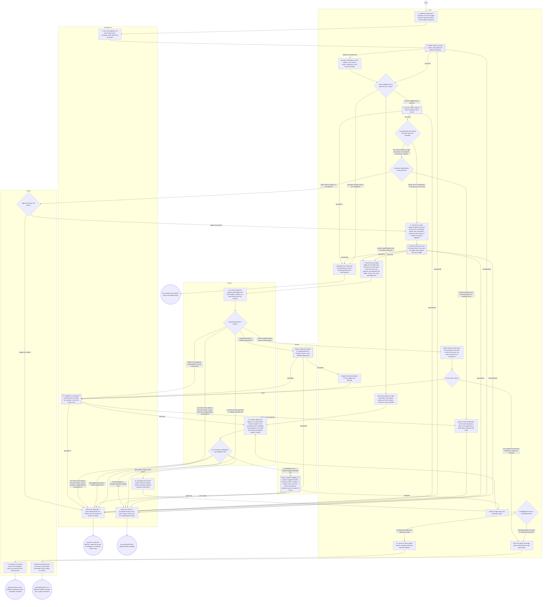

<!-- generated by render_pack.py from ingestion.spec.yaml sha256=0fced071b089fd659eb952a426a11fcbac3f07af899c07be0997d4feae556d57; edit the spec, not this file -->
# Make a folder of documents into Source notes (proposed)

**UC1 · to-be · `PROPOSED_UNACCEPTED`** · spec [ingestion.spec.yaml](../ingestion.spec.yaml)
Supersedes: `reports/2026-11-24-librarian-reconstruction-and-offering/diagrams/librarian-ingestion-tobe.spec.yaml`, `reports/2026-11-20-workflow-map/examples/ingestion/ingestion-tobe.spec.yaml`, `reports/2026-11-23-proposed-process-family/proposed-ingestion.spec.yaml`

| Problem | |
|---|---|
| symptom | The earlier draft hid three different callers behind one trigger, gave the Owner seven main-path steps and three serial acceptance prompts, could block an external tier 0 at curate, and skipped the final Oracle check on code-only folders. |
| root | Take a mandate from any caller that never widens its parent; delegate routine screening and acceptance to the Lead, the Oracle and the Doctor; consolidate acceptance into one decision; end with one of five outcomes and its tickets. |

## Written use case

| Field | Content |
|---|---|
| **Use case name** | Make a folder of documents into Source notes |
| **Brief description** | One parent owns the folder from survey to judged notes: it applies the folder's own group, stages, enriches, screens, accepts within its mandate and verifies. |
| **Primary actor** | Owner, or tier 0 under a commission |
| **Supporting actors** | Lead, Clerk, Oracle, Doctor, Core, Geo-Grapher |
| **Preconditions** | A mandate naming the roots, exclusions, budget and reserved decisions |
| **Trigger** | A commission, or the Owner's request |
| **Success guarantee** | Every document is a judged, findable note, or an explicit gap with a ticket |
| **Minimal guarantee** | The ledger reconciles every input to one outcome |
| **Open questions** | OP2 in Geo-Grapher: incremental group application |

**Main success scenario** (generated: the guard-true path, in step order)

1. The Core admits the ingestion's mandate, its owner, budget and who commissioned it; it never widens its parent.
2. The Lead (tier 1) owns the ingestion run and its permission envelope, never wider than the parent.
3. The Core surveys, screens and applies the folder's own group.
4. The Core captures, titles and stages each source.
5. The Core checks the Lead's approval against the grant and the run's checkpoint, freezes the mixed batch, and returns the active run instead of starting a duplicate.
6. The Core runs the mixed batch of sources and folder cards against the frozen ledger.
7. The Core reconciles one paged ledger for the folder from each item's current state, never from what was queued, and separates the folder, source, lens, topic and bridge lists.
8. The Oracle screens the batch's outputs, partial gaps and Geo-Grapher receipts on a route distinct from the workers'.
9. The Lead (tier 1) accepts the screened sources within the mandate, or asks the Owner once.
10. The Oracle verifies against the ledger, on a route distinct from the workers': the committed notes' findability and neutrality, or for code-only folders the applied groups' receipts.
11. The Lead (tier 1) packages the Oracle's verdict, evidence hashes, spend, coverage, deferred decisions and tickets.
12. The Core stores the final receipt: spend, coverage, deferrals and the handover.
13. The Owner receives the verified result: the catalogued notes, the spend and the deferred work.

**Extensions** (generated: one per non-happy guard; numbered by the step it leaves)

- **4a** (from: Source-eligible files or queued refs in scope?) *anticipated*
  - `4a1` Code or graph folders only (no Source notes).
  - `4a2` The Core records the ledger for code-only folders: the applied groups and their receipts, no Source notes expected.
  - `4a3` Rejoin at 10.
- **4b** (from: Source-eligible files or queued refs in scope?) *anticipated*
  - `4b1` All inputs already current or excluded.
  - `4b2` The Core reconciles the reused and excluded inputs, with no batch dispatched and nothing spent.
  - `4b3` The use case ends: the existing and excluded inputs reconciled cleanly.
- **5a** (from: are approving and starting the batch within the mandate?) *anticipated*
  - `5a1` An external project's stage-only scope, or waiting for the person's start.
  - `5a2` The Core decides: interactive Specification owner present?
  - `5a2a` If no person present (an external project or a scheduled run): puts the reserved decision, or the external project's hold, on the agenda as a ticket without blocking the caller.
  - `5a3` If the Owner is present, in the Web UI:
  - `5a4` The Owner decides: approve and start the batch?
  - `5a4a` If stage only / defer: returns the held gate, a route-collision ticket or a refusal, with the spend and where to resume.
  - `5a5` If approve and start:
  - `5a6` Rejoin at 5.
- **6a** (from: runs the mixed batch of sources and folder cards against the frozen ledger) *anticipated*
  - `6a1` Partial.
  - `6a2` Rejoin at 7.
- **6b** (from: runs the mixed batch of sources and folder cards against the frozen ledger) *anticipated*
  - `6b1` Reused.
  - `6b2` The Core reconciles the reused and excluded inputs, with no batch dispatched and nothing spent.
  - `6b3` The use case ends: the existing and excluded inputs reconciled cleanly.
- **6c** (from: runs the mixed batch of sources and folder cards against the frozen ledger) *anticipated*
  - `6c1` Paused.
  - `6c2` The Lead (tier 1) returns the held gate, a route-collision ticket or a refusal, with the spend and where to resume.
  - `6c3` The use case ends: paused: a reserved decision, stage-only scope, the budget, or no distinct Oracle route.
- **6d** (from: runs the mixed batch of sources and folder cards against the frozen ledger) *anticipated*
  - `6d1` Escalated.
  - `6d2` The Lead (tier 1) routes the critical or unresolved ticket at once, with its flags, hashes and the compensation shown.
  - `6d3` The use case ends: an unresolved critical integrity ticket escalated.
- **9a** (from: pre-promotion batch quality?) *anticipated*
  - `9a1` Repairable partial or publish gap (R4).
  - `9a2` The Doctor repairs the partial or unpublished items through a ticket, on the affected subset only (continues in doctor).
  - `9a2a` If declined: rejoin at 9.
  - `9a2a` If escalated: routes the critical or unresolved ticket at once, with its flags, hashes and the compensation shown.
  - `9a3` If resolved:
  - `9a4` The Core merges the checked repair into the ledger (one attempt).
  - `9a5` Rejoin at 9.
- **9b** (from: pre-promotion batch quality?) *anticipated*
  - `9b1` Unmet required output blocks promotion.
  - `9b2` The Core holds only the unmet items on the agenda, each with its ticket and owner; the clean items go on to acceptance.
  - `9b3` The Core decides: are any items clean?
  - `9b3a` If no: nothing to accept; the held items' tickets are returned: stores the partial coverage, spend, deferred items and open tickets.
  - `9b4` If yes:
  - `9b5` Rejoin at 9.
- **9c** (from: pre-promotion batch quality?) *anticipated*
  - `9c1` No Oracle route distinct from the workers' (never marked as independently reviewed).
  - `9c2` The Lead (tier 1) returns the held gate, a route-collision ticket or a refusal, with the spend and where to resume.
  - `9c3` The use case ends: paused: a reserved decision, stage-only scope, the budget, or no distinct Oracle route.
- **9d** (from: pre-promotion batch quality?) *anticipated*
  - `9d1` A critical security, data-loss or integrity violation.
  - `9d2` The Lead (tier 1) routes the critical or unresolved ticket at once, with its flags, hashes and the compensation shown.
  - `9d3` The use case ends: an unresolved critical integrity ticket escalated.
- **11a** (from: are the parent's obligations and findability met?) *anticipated*
  - `11a1` A findability miss, or another mapped shortfall.
  - `11a2` The Doctor repairs findability, or another mapped shortfall, through a ticket; a repair re-indexes only, and never invents concepts or enables vectors to pass the check (continues in doctor).
  - `11a2a` If declined: returns the held gate, a route-collision ticket or a refusal, with the spend and where to resume.
  - `11a2a` If escalated: routes the critical or unresolved ticket at once, with its flags, hashes and the compensation shown.
  - `11a3` If resolved:
  - `11a4` The Core confirms single-pass post-promotion repair.
  - `11a5` Rejoin at 10.
- **11b** (from: are the parent's obligations and findability met?) *anticipated*
  - `11b1` Unmapped gap requires Owner decision.
  - `11b2` The Lead (tier 1) returns the held gate, a route-collision ticket or a refusal, with the spend and where to resume.
  - `11b3` The use case ends: paused: a reserved decision, stage-only scope, the budget, or no distinct Oracle route.
- **11c** (from: are the parent's obligations and findability met?) *anticipated*
  - `11c1` No Oracle route distinct from the workers' (never marked as independently reviewed).
  - `11c2` The Lead (tier 1) returns the held gate, a route-collision ticket or a refusal, with the spend and where to resume.
  - `11c3` The use case ends: paused: a reserved decision, stage-only scope, the budget, or no distinct Oracle route.
- **11d** (from: are the parent's obligations and findability met?) *anticipated*
  - `11d1` Critical integrity or authority-boundary finding.
  - `11d2` The Lead (tier 1) routes the critical or unresolved ticket at once, with its flags, hashes and the compensation shown.
  - `11d3` The use case ends: an unresolved critical integrity ticket escalated.
- **12a** (from: full obligations clean vs permitted partial?) *anticipated*
  - `12a1` Permitted partial coverage or deferred lenses.
  - `12a2` The Core stores the partial coverage, spend, deferred items and open tickets.
  - `12a3` The Owner receives the partial result, what was not examined, the spend and the tickets to resume.
  - `12a4` The use case ends: a permitted partial, or a deferred worklist, returned with its gaps and tickets.
- **3a** (from: surveys, screens and applies the folder's own group) *anticipated*
  - `3a1` Held for the Owner.
  - `3a2` The Core puts the held folders on the agenda, each with its owner, and goes on with the other folders.
  - `3a3` The Core decides: Source-eligible files or queued refs in scope?
  - `3a3a` If code or graph folders only (no Source notes): records the ledger for code-only folders: the applied groups and their receipts, no Source notes expected.
  - `3a3a` If all inputs already current or excluded: reconciles the reused and excluded inputs, with no batch dispatched and nothing spent.
  - `3a4` If Source-eligible inputs present:
  - `3a5` Rejoin at 4.
- **3b** (from: surveys, screens and applies the folder's own group) *anticipated*
  - `3b1` Paused.
  - `3b2` The Lead (tier 1) returns the held gate, a route-collision ticket or a refusal, with the spend and where to resume.
  - `3b3` The use case ends: paused: a reserved decision, stage-only scope, the budget, or no distinct Oracle route.
- **3c** (from: surveys, screens and applies the folder's own group) *anticipated*
  - `3c1` Escalated.
  - `3c2` The Lead (tier 1) routes the critical or unresolved ticket at once, with its flags, hashes and the compensation shown.
  - `3c3` The use case ends: an unresolved critical integrity ticket escalated.
- **4c** (from: captures, titles and stages each source) *anticipated*
  - `4c1` Reused.
  - `4c2` The Core reconciles the reused and excluded inputs, with no batch dispatched and nothing spent.
  - `4c3` The use case ends: the existing and excluded inputs reconciled cleanly.
- **4d** (from: captures, titles and stages each source) *anticipated*
  - `4d1` Paused.
  - `4d2` The Lead (tier 1) returns the held gate, a route-collision ticket or a refusal, with the spend and where to resume.
  - `4d3` The use case ends: paused: a reserved decision, stage-only scope, the budget, or no distinct Oracle route.
- **9e** (from: accepts the screened sources within the mandate, or asks the Owner once) *anticipated*
  - `9e1` Held for the Owner.
  - `9e2` The Core puts the reserved decision, or the external project's hold, on the agenda as a ticket without blocking the caller.
  - `9e3` The Lead (tier 1) returns the held gate, a route-collision ticket or a refusal, with the spend and where to resume.
  - `9e4` The use case ends: paused: a reserved decision, stage-only scope, the budget, or no distinct Oracle route.
- **9f** (from: accepts the screened sources within the mandate, or asks the Owner once) *anticipated*
  - `9f1` Paused.
  - `9f2` The Lead (tier 1) returns the held gate, a route-collision ticket or a refusal, with the spend and where to resume.
  - `9f3` The use case ends: paused: a reserved decision, stage-only scope, the budget, or no distinct Oracle route.

## Activity diagram



## Lane load

| Lane | On the main success scenario | Anywhere in the diagram |
|---|---|---|
| Owner | 1 | 3 |
| Lead (tier 1) | 3 | 5 |
| Doctor | 0 | 2 |
| Oracle | 4 | 4 |
| Core | 10 | 20 |

Paths by how they end: **escalated** 6, **partial** 2, **paused** 11, **reused** 3, **success** 1. Every *escalated* path is a failure of this use case: the work went back to tier 0.

## Decision tree

```text
start: Make a folder of documents into Source notes (proposed)
                  └─ T1: success / Source-eligible inputs present / success / within tier 0's commission, or the person's own start / success / ready for acceptance routing (distinct Oracle route pass) / success / met (distinct Oracle route pass) / everything required and optional is clean  ⇒ parent receives Oracle-verified full catalogue state; notification recorded
  └─ T2: held for the Owner  ⇒ rejoins at 'Source-eligible files or queued refs in scope?' (before step 4)
  └─ T3: paused  ⇒ paused: a reserved decision, stage-only scope, the budget, or no distinct Oracle route
  └─ T4: escalated  ⇒ an unresolved critical integrity ticket escalated
    └─ T5: success / code or graph folders only (no Source notes)  ⇒ rejoins at step 10
    └─ T6: success / all inputs already current or excluded  ⇒ the existing and excluded inputs reconciled cleanly
      └─ T7: success / Source-eligible inputs present / reused  ⇒ the existing and excluded inputs reconciled cleanly
      └─ T8: success / Source-eligible inputs present / paused  ⇒ paused: a reserved decision, stage-only scope, the budget, or no distinct Oracle route
          └─ T9: success / Source-eligible inputs present / success / an external project's stage-only scope, or waiting for the person's start / no person present (an external project or a scheduled run)  ⇒ paused: a reserved decision, stage-only scope, the budget, or no distinct Oracle route
            └─ T10: success / Source-eligible inputs present / success / an external project's stage-only scope, or waiting for the person's start / the Owner is present, in the Web UI / stage only / defer  ⇒ paused: a reserved decision, stage-only scope, the budget, or no distinct Oracle route
            └─ T11: success / Source-eligible inputs present / success / an external project's stage-only scope, or waiting for the person's start / the Owner is present, in the Web UI / approve and start  ⇒ rejoins at step 5
          └─ T12: success / Source-eligible inputs present / success / within tier 0's commission, or the person's own start / partial  ⇒ rejoins at step 7
          └─ T13: success / Source-eligible inputs present / success / within tier 0's commission, or the person's own start / reused  ⇒ the existing and excluded inputs reconciled cleanly
          └─ T14: success / Source-eligible inputs present / success / within tier 0's commission, or the person's own start / paused  ⇒ paused: a reserved decision, stage-only scope, the budget, or no distinct Oracle route
          └─ T15: success / Source-eligible inputs present / success / within tier 0's commission, or the person's own start / escalated  ⇒ an unresolved critical integrity ticket escalated
              └─ T16: success / Source-eligible inputs present / success / within tier 0's commission, or the person's own start / success / repairable partial or publish gap (R4) / declined  ⇒ rejoins at step 9
              └─ T17: success / Source-eligible inputs present / success / within tier 0's commission, or the person's own start / success / repairable partial or publish gap (R4) / escalated  ⇒ an unresolved critical integrity ticket escalated
              └─ T18: success / Source-eligible inputs present / success / within tier 0's commission, or the person's own start / success / repairable partial or publish gap (R4) / resolved  ⇒ rejoins at step 9
              └─ T19: success / Source-eligible inputs present / success / within tier 0's commission, or the person's own start / success / unmet required output blocks promotion / no: nothing to accept; the held items' tickets are returned  ⇒ a permitted partial, or a deferred worklist, returned with its gaps and tickets
              └─ T20: success / Source-eligible inputs present / success / within tier 0's commission, or the person's own start / success / unmet required output blocks promotion / yes  ⇒ rejoins at step 9
            └─ T21: success / Source-eligible inputs present / success / within tier 0's commission, or the person's own start / success / no Oracle route distinct from the workers' (never marked as independently reviewed)  ⇒ paused: a reserved decision, stage-only scope, the budget, or no distinct Oracle route
            └─ T22: success / Source-eligible inputs present / success / within tier 0's commission, or the person's own start / success / a critical security, data-loss or integrity violation  ⇒ an unresolved critical integrity ticket escalated
              └─ T23: success / Source-eligible inputs present / success / within tier 0's commission, or the person's own start / success / ready for acceptance routing (distinct Oracle route pass) / held for the Owner  ⇒ paused: a reserved decision, stage-only scope, the budget, or no distinct Oracle route
              └─ T24: success / Source-eligible inputs present / success / within tier 0's commission, or the person's own start / success / ready for acceptance routing (distinct Oracle route pass) / paused  ⇒ paused: a reserved decision, stage-only scope, the budget, or no distinct Oracle route
                  └─ T25: success / Source-eligible inputs present / success / within tier 0's commission, or the person's own start / success / ready for acceptance routing (distinct Oracle route pass) / success / a findability miss, or another mapped shortfall / declined  ⇒ paused: a reserved decision, stage-only scope, the budget, or no distinct Oracle route
                  └─ T26: success / Source-eligible inputs present / success / within tier 0's commission, or the person's own start / success / ready for acceptance routing (distinct Oracle route pass) / success / a findability miss, or another mapped shortfall / escalated  ⇒ an unresolved critical integrity ticket escalated
                  └─ T27: success / Source-eligible inputs present / success / within tier 0's commission, or the person's own start / success / ready for acceptance routing (distinct Oracle route pass) / success / a findability miss, or another mapped shortfall / resolved  ⇒ rejoins at step 10
                └─ T28: success / Source-eligible inputs present / success / within tier 0's commission, or the person's own start / success / ready for acceptance routing (distinct Oracle route pass) / success / unmapped gap requires Owner decision  ⇒ paused: a reserved decision, stage-only scope, the budget, or no distinct Oracle route
                └─ T29: success / Source-eligible inputs present / success / within tier 0's commission, or the person's own start / success / ready for acceptance routing (distinct Oracle route pass) / success / no Oracle route distinct from the workers' (never marked as independently reviewed)  ⇒ paused: a reserved decision, stage-only scope, the budget, or no distinct Oracle route
                └─ T30: success / Source-eligible inputs present / success / within tier 0's commission, or the person's own start / success / ready for acceptance routing (distinct Oracle route pass) / success / critical integrity or authority-boundary finding  ⇒ an unresolved critical integrity ticket escalated
                  └─ T31: success / Source-eligible inputs present / success / within tier 0's commission, or the person's own start / success / ready for acceptance routing (distinct Oracle route pass) / success / met (distinct Oracle route pass) / permitted partial coverage or deferred lenses  ⇒ a permitted partial, or a deferred worklist, returned with its gaps and tickets
```

## Test cases

One test per path: the main success scenario, then each extension.

| Test | Path (guards taken) | Extension | Expected outcome |
|---|---|---|---|
| T1 | surveys, screens and applies the folder's own group → success; Source-eligible files or queued refs in scope? → Source-eligible inputs present; captures, titles and stages each source → success; are approving and starting the batch within the mandate? → within tier 0's commission, or the person's own start; runs the mixed batch of sources and folder cards against the frozen ledger → success; pre-promotion batch quality? → ready for acceptance routing (distinct Oracle route pass); accepts the screened sources within the mandate, or asks the Owner once → success; are the parent's obligations and findability met? → met (distinct Oracle route pass); full obligations clean vs permitted partial? → everything required and optional is clean | MSS | parent receives Oracle-verified full catalogue state; notification recorded |
| T2 | surveys, screens and applies the folder's own group → held for the Owner | 3a | rejoins at 'Source-eligible files or queued refs in scope?' (before step 4) |
| T3 | surveys, screens and applies the folder's own group → paused | 3b | paused: a reserved decision, stage-only scope, the budget, or no distinct Oracle route |
| T4 | surveys, screens and applies the folder's own group → escalated | 3c | an unresolved critical integrity ticket escalated |
| T5 | surveys, screens and applies the folder's own group → success; Source-eligible files or queued refs in scope? → code or graph folders only (no Source notes) | 4a | rejoins at step 10 |
| T6 | surveys, screens and applies the folder's own group → success; Source-eligible files or queued refs in scope? → all inputs already current or excluded | 4b | the existing and excluded inputs reconciled cleanly |
| T7 | surveys, screens and applies the folder's own group → success; Source-eligible files or queued refs in scope? → Source-eligible inputs present; captures, titles and stages each source → reused | 4c | the existing and excluded inputs reconciled cleanly |
| T8 | surveys, screens and applies the folder's own group → success; Source-eligible files or queued refs in scope? → Source-eligible inputs present; captures, titles and stages each source → paused | 4d | paused: a reserved decision, stage-only scope, the budget, or no distinct Oracle route |
| T9 | surveys, screens and applies the folder's own group → success; Source-eligible files or queued refs in scope? → Source-eligible inputs present; captures, titles and stages each source → success; are approving and starting the batch within the mandate? → an external project's stage-only scope, or waiting for the person's start; interactive Specification owner present? → no person present (an external project or a scheduled run) | 5a | paused: a reserved decision, stage-only scope, the budget, or no distinct Oracle route |
| T10 | surveys, screens and applies the folder's own group → success; Source-eligible files or queued refs in scope? → Source-eligible inputs present; captures, titles and stages each source → success; are approving and starting the batch within the mandate? → an external project's stage-only scope, or waiting for the person's start; interactive Specification owner present? → the Owner is present, in the Web UI; approve and start the batch? → stage only / defer | 5a | paused: a reserved decision, stage-only scope, the budget, or no distinct Oracle route |
| T11 | surveys, screens and applies the folder's own group → success; Source-eligible files or queued refs in scope? → Source-eligible inputs present; captures, titles and stages each source → success; are approving and starting the batch within the mandate? → an external project's stage-only scope, or waiting for the person's start; interactive Specification owner present? → the Owner is present, in the Web UI; approve and start the batch? → approve and start | 5a | rejoins at step 5 |
| T12 | surveys, screens and applies the folder's own group → success; Source-eligible files or queued refs in scope? → Source-eligible inputs present; captures, titles and stages each source → success; are approving and starting the batch within the mandate? → within tier 0's commission, or the person's own start; runs the mixed batch of sources and folder cards against the frozen ledger → partial | 6a | rejoins at step 7 |
| T13 | surveys, screens and applies the folder's own group → success; Source-eligible files or queued refs in scope? → Source-eligible inputs present; captures, titles and stages each source → success; are approving and starting the batch within the mandate? → within tier 0's commission, or the person's own start; runs the mixed batch of sources and folder cards against the frozen ledger → reused | 6b | the existing and excluded inputs reconciled cleanly |
| T14 | surveys, screens and applies the folder's own group → success; Source-eligible files or queued refs in scope? → Source-eligible inputs present; captures, titles and stages each source → success; are approving and starting the batch within the mandate? → within tier 0's commission, or the person's own start; runs the mixed batch of sources and folder cards against the frozen ledger → paused | 6c | paused: a reserved decision, stage-only scope, the budget, or no distinct Oracle route |
| T15 | surveys, screens and applies the folder's own group → success; Source-eligible files or queued refs in scope? → Source-eligible inputs present; captures, titles and stages each source → success; are approving and starting the batch within the mandate? → within tier 0's commission, or the person's own start; runs the mixed batch of sources and folder cards against the frozen ledger → escalated | 6d | an unresolved critical integrity ticket escalated |
| T16 | surveys, screens and applies the folder's own group → success; Source-eligible files or queued refs in scope? → Source-eligible inputs present; captures, titles and stages each source → success; are approving and starting the batch within the mandate? → within tier 0's commission, or the person's own start; runs the mixed batch of sources and folder cards against the frozen ledger → success; pre-promotion batch quality? → repairable partial or publish gap (R4); repairs the partial or unpublished items through a ticket, on the affected subset only → declined | 9a | rejoins at step 9 |
| T17 | surveys, screens and applies the folder's own group → success; Source-eligible files or queued refs in scope? → Source-eligible inputs present; captures, titles and stages each source → success; are approving and starting the batch within the mandate? → within tier 0's commission, or the person's own start; runs the mixed batch of sources and folder cards against the frozen ledger → success; pre-promotion batch quality? → repairable partial or publish gap (R4); repairs the partial or unpublished items through a ticket, on the affected subset only → escalated | 9a | an unresolved critical integrity ticket escalated |
| T18 | surveys, screens and applies the folder's own group → success; Source-eligible files or queued refs in scope? → Source-eligible inputs present; captures, titles and stages each source → success; are approving and starting the batch within the mandate? → within tier 0's commission, or the person's own start; runs the mixed batch of sources and folder cards against the frozen ledger → success; pre-promotion batch quality? → repairable partial or publish gap (R4); repairs the partial or unpublished items through a ticket, on the affected subset only → resolved | 9a | rejoins at step 9 |
| T19 | surveys, screens and applies the folder's own group → success; Source-eligible files or queued refs in scope? → Source-eligible inputs present; captures, titles and stages each source → success; are approving and starting the batch within the mandate? → within tier 0's commission, or the person's own start; runs the mixed batch of sources and folder cards against the frozen ledger → success; pre-promotion batch quality? → unmet required output blocks promotion; are any items clean? → no: nothing to accept; the held items' tickets are returned | 9b | a permitted partial, or a deferred worklist, returned with its gaps and tickets |
| T20 | surveys, screens and applies the folder's own group → success; Source-eligible files or queued refs in scope? → Source-eligible inputs present; captures, titles and stages each source → success; are approving and starting the batch within the mandate? → within tier 0's commission, or the person's own start; runs the mixed batch of sources and folder cards against the frozen ledger → success; pre-promotion batch quality? → unmet required output blocks promotion; are any items clean? → yes | 9b | rejoins at step 9 |
| T21 | surveys, screens and applies the folder's own group → success; Source-eligible files or queued refs in scope? → Source-eligible inputs present; captures, titles and stages each source → success; are approving and starting the batch within the mandate? → within tier 0's commission, or the person's own start; runs the mixed batch of sources and folder cards against the frozen ledger → success; pre-promotion batch quality? → no Oracle route distinct from the workers' (never marked as independently reviewed) | 9c | paused: a reserved decision, stage-only scope, the budget, or no distinct Oracle route |
| T22 | surveys, screens and applies the folder's own group → success; Source-eligible files or queued refs in scope? → Source-eligible inputs present; captures, titles and stages each source → success; are approving and starting the batch within the mandate? → within tier 0's commission, or the person's own start; runs the mixed batch of sources and folder cards against the frozen ledger → success; pre-promotion batch quality? → a critical security, data-loss or integrity violation | 9d | an unresolved critical integrity ticket escalated |
| T23 | surveys, screens and applies the folder's own group → success; Source-eligible files or queued refs in scope? → Source-eligible inputs present; captures, titles and stages each source → success; are approving and starting the batch within the mandate? → within tier 0's commission, or the person's own start; runs the mixed batch of sources and folder cards against the frozen ledger → success; pre-promotion batch quality? → ready for acceptance routing (distinct Oracle route pass); accepts the screened sources within the mandate, or asks the Owner once → held for the Owner | 9e | paused: a reserved decision, stage-only scope, the budget, or no distinct Oracle route |
| T24 | surveys, screens and applies the folder's own group → success; Source-eligible files or queued refs in scope? → Source-eligible inputs present; captures, titles and stages each source → success; are approving and starting the batch within the mandate? → within tier 0's commission, or the person's own start; runs the mixed batch of sources and folder cards against the frozen ledger → success; pre-promotion batch quality? → ready for acceptance routing (distinct Oracle route pass); accepts the screened sources within the mandate, or asks the Owner once → paused | 9f | paused: a reserved decision, stage-only scope, the budget, or no distinct Oracle route |
| T25 | surveys, screens and applies the folder's own group → success; Source-eligible files or queued refs in scope? → Source-eligible inputs present; captures, titles and stages each source → success; are approving and starting the batch within the mandate? → within tier 0's commission, or the person's own start; runs the mixed batch of sources and folder cards against the frozen ledger → success; pre-promotion batch quality? → ready for acceptance routing (distinct Oracle route pass); accepts the screened sources within the mandate, or asks the Owner once → success; are the parent's obligations and findability met? → a findability miss, or another mapped shortfall; repairs findability, or another mapped shortfall, through a ticket; a repair re-indexes only, and never invents concepts or enables vectors to pass the check → declined | 11a | paused: a reserved decision, stage-only scope, the budget, or no distinct Oracle route |
| T26 | surveys, screens and applies the folder's own group → success; Source-eligible files or queued refs in scope? → Source-eligible inputs present; captures, titles and stages each source → success; are approving and starting the batch within the mandate? → within tier 0's commission, or the person's own start; runs the mixed batch of sources and folder cards against the frozen ledger → success; pre-promotion batch quality? → ready for acceptance routing (distinct Oracle route pass); accepts the screened sources within the mandate, or asks the Owner once → success; are the parent's obligations and findability met? → a findability miss, or another mapped shortfall; repairs findability, or another mapped shortfall, through a ticket; a repair re-indexes only, and never invents concepts or enables vectors to pass the check → escalated | 11a | an unresolved critical integrity ticket escalated |
| T27 | surveys, screens and applies the folder's own group → success; Source-eligible files or queued refs in scope? → Source-eligible inputs present; captures, titles and stages each source → success; are approving and starting the batch within the mandate? → within tier 0's commission, or the person's own start; runs the mixed batch of sources and folder cards against the frozen ledger → success; pre-promotion batch quality? → ready for acceptance routing (distinct Oracle route pass); accepts the screened sources within the mandate, or asks the Owner once → success; are the parent's obligations and findability met? → a findability miss, or another mapped shortfall; repairs findability, or another mapped shortfall, through a ticket; a repair re-indexes only, and never invents concepts or enables vectors to pass the check → resolved | 11a | rejoins at step 10 |
| T28 | surveys, screens and applies the folder's own group → success; Source-eligible files or queued refs in scope? → Source-eligible inputs present; captures, titles and stages each source → success; are approving and starting the batch within the mandate? → within tier 0's commission, or the person's own start; runs the mixed batch of sources and folder cards against the frozen ledger → success; pre-promotion batch quality? → ready for acceptance routing (distinct Oracle route pass); accepts the screened sources within the mandate, or asks the Owner once → success; are the parent's obligations and findability met? → unmapped gap requires Owner decision | 11b | paused: a reserved decision, stage-only scope, the budget, or no distinct Oracle route |
| T29 | surveys, screens and applies the folder's own group → success; Source-eligible files or queued refs in scope? → Source-eligible inputs present; captures, titles and stages each source → success; are approving and starting the batch within the mandate? → within tier 0's commission, or the person's own start; runs the mixed batch of sources and folder cards against the frozen ledger → success; pre-promotion batch quality? → ready for acceptance routing (distinct Oracle route pass); accepts the screened sources within the mandate, or asks the Owner once → success; are the parent's obligations and findability met? → no Oracle route distinct from the workers' (never marked as independently reviewed) | 11c | paused: a reserved decision, stage-only scope, the budget, or no distinct Oracle route |
| T30 | surveys, screens and applies the folder's own group → success; Source-eligible files or queued refs in scope? → Source-eligible inputs present; captures, titles and stages each source → success; are approving and starting the batch within the mandate? → within tier 0's commission, or the person's own start; runs the mixed batch of sources and folder cards against the frozen ledger → success; pre-promotion batch quality? → ready for acceptance routing (distinct Oracle route pass); accepts the screened sources within the mandate, or asks the Owner once → success; are the parent's obligations and findability met? → critical integrity or authority-boundary finding | 11d | an unresolved critical integrity ticket escalated |
| T31 | surveys, screens and applies the folder's own group → success; Source-eligible files or queued refs in scope? → Source-eligible inputs present; captures, titles and stages each source → success; are approving and starting the batch within the mandate? → within tier 0's commission, or the person's own start; runs the mixed batch of sources and folder cards against the frozen ledger → success; pre-promotion batch quality? → ready for acceptance routing (distinct Oracle route pass); accepts the screened sources within the mandate, or asks the Owner once → success; are the parent's obligations and findability met? → met (distinct Oracle route pass); full obligations clean vs permitted partial? → permitted partial coverage or deferred lenses | 12a | a permitted partial, or a deferred worklist, returned with its gaps and tickets |

### Boundary values

_None declared._

## As-is weaknesses this handles

| As-is weakness | Where here | How it is handled |
|---|---|---|
| W-ING-01 (ingestion): Nothing reconciles a folder's counts (surveyed, queued, staged, enriched, accepted); the person or tier 0 does it by hand. | ledger | The parent reconciles one paginated ledger for the folder and separates the folder, source, lens and topic lists. |
| W-ING-02 (ingestion): Queued documents wait until someone runs the queue, and a queue nobody drains says nothing. | ref_source_intake | The parent starts intake itself once the folder's inputs are known; no queue waits for a click. |
| W-ING-04 (ingestion): A partial item is re-run only by a fresh approval and start; resuming an unfinished run is a different path. | doctorbatch | A repairable partial is repaired on the affected subset through a ticket (R4) and merged back into the ledger. |
| W-FOL-04 (folder-review): Accepting a folder does not start its intake: queueing its documents is a separate click or API call. | dinput | An accepted folder's Source-eligible inputs flow straight into intake in the same parent. |
| W-ING-03 (ingestion): Tier 0 cannot approve or start a batch, so an orchestrated ingestion always hands Gate 1 back to the person. | dgate1 | Gate 1 and the batch start are in the mandate; the Owner is asked only when they are not. |
| W-ACC-03 (acceptance): The only check of an enriched source is a person reading its summary; nothing compares the note with its evidence first. | oraclefinal | The Oracle verifies findability and neutrality of the committed notes before the handover. |
| W-BAT-02 (batch-enrichment): A finished batch is not acceptance, yet nothing assigns the decisions it leaves; W7 now counts them (awaiting_acceptance) but does not route them. | ledger | The ledger separates each kind of decision the batch leaves, and the acceptance child assigns them. |
| W-ACC-02 (acceptance): A note written but not findable needs a manual Rewrite indexes; nothing re-checks findability by itself. | doctorphase | An unfindable note is repaired through a ticket (R5) and re-checked by the Oracle. |

## Checks

Errors: none

Warnings: none
