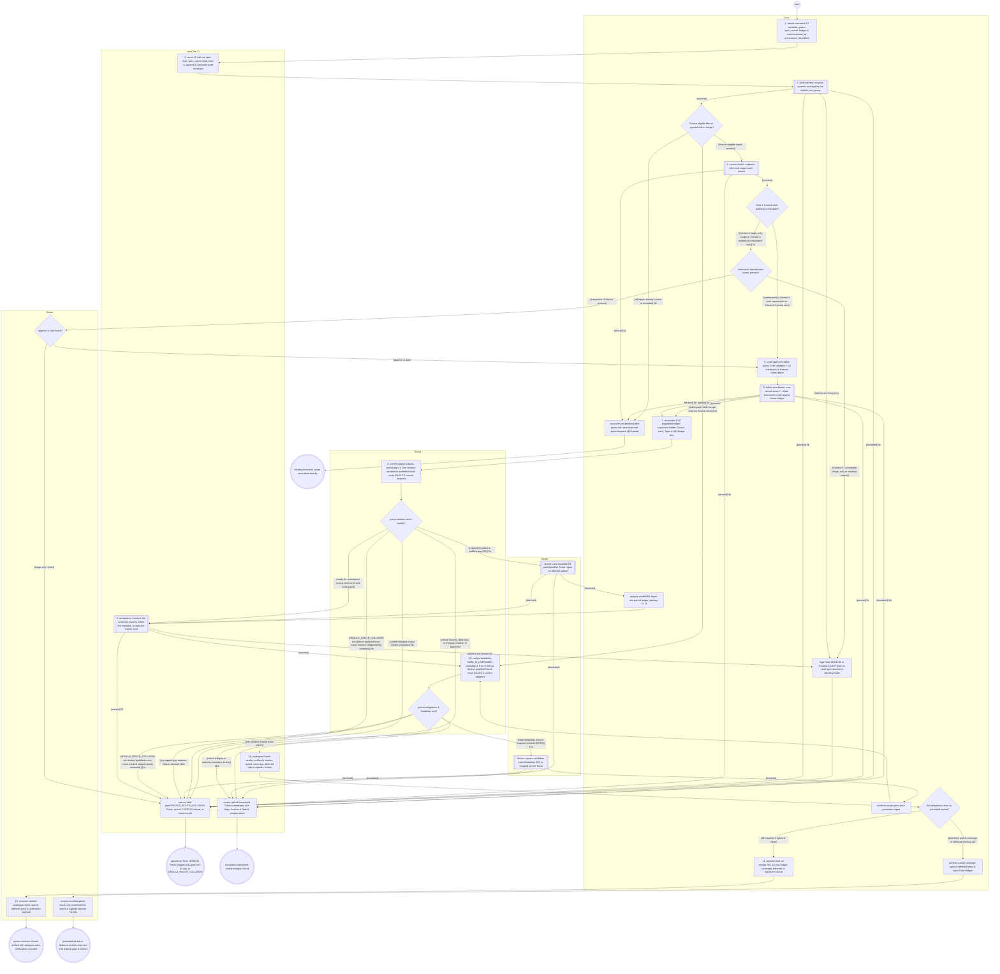

<!-- generated by render_pack.py from ingestion.spec.yaml sha256=7388329cc20cd7815897e7908429be10437ea5473a1047da5893fa15d5a427f4; edit the spec, not this file -->
# Librarian Shared L2 Ingestion & Governance Pipeline (Proposed To-Be)

**UC1 · to-be · `PROPOSED_UNACCEPTED`** · spec [ingestion.spec.yaml](../ingestion.spec.yaml)
Supersedes: `reports/2026-11-24-librarian-reconstruction-and-offering/diagrams/librarian-ingestion-tobe.spec.yaml`, `reports/2026-11-20-workflow-map/examples/ingestion/ingestion-tobe.spec.yaml`, `reports/2026-11-23-proposed-process-family/proposed-ingestion.spec.yaml`

| Problem | |
|---|---|
| symptom | Prior draft hid distinct Context 1/2/3 entry callers inside one trigger switch, overloaded Owner with 7 main-path steps & 3 serial Gate-2 prompts, risked blocking external Tier 0 on curate, and skipped final Oracle on code-only roots. |
| root | Accept narrowed parent mandates from Context 1/2/3 or scheduler (never widening parent scope), delegate routine screening & acceptance via Lead + Oracle (GLM-5.3) + 4-point Doctor, consolidate Gate 2, and emit canonical 5-outcome receipts + tickets. |

## Written use case

| Field | Content |
|---|---|
| **Use case name** | Make a folder of documents into Source notes |
| **Brief description** | One parent owns the folder from survey to judged notes: it applies the folder's own group, stages, enriches, screens, accepts within its mandate and verifies. |
| **Primary actor** | Owner, or tier 0 under a commission |
| **Supporting actors** | Lead, Clerk, Oracle, Doctor, Core, Geo-Grapher |
| **Preconditions** | A mandate naming the roots, exclusions, budget and reserved decisions |
| **Trigger** | A commission, or the Owner's request |
| **Success guarantee** | Every document is a judged, findable note, or an explicit gap with a ticket |
| **Minimal guarantee** | The ledger reconciles every input to one outcome |
| **Open questions** | OP2 in Geo-Grapher: incremental group application |

**Main success scenario** (generated: the guard-true path, in step order)

1. The Core admits narrowed L2 mandate, parent spec_owner, budget & commissioned_by provenance (no widen).
2. The Lead (tier 1) owns L2 sub-run spec (sub_spec_owner=lead_tier1 <= parent) & narrowed grant envelope.
3. The Core surveys, screens and applies the folder's own group.
4. The Core captures, titles and stages each source.
5. The Core Lead approves within grant; Core validates F-02 checkpoint & freezes mixed batch.
6. The Core runs mixed source + folder enrichment child against frozen ledger.
7. The Core reconciles F-01 paginated ledger; separates Folder, Source, Lens, Topic & W5 Bridge lists.
8. The Oracle screens batch outputs, partial gaps & Geo receipts via distinct qualified Oracle route (GLM-5.3 current adapter).
9. The Lead (tier 1) accepts the screened sources within the mandate, or asks the Owner once.
10. The Oracle verifies findability, DATA_IS_UNFRAMED neutrality & F-01..F-03 via distinct qualified Oracle route (GLM-5.3 current adapter).
11. The Lead (tier 1) packages Oracle verdict, evidence hashes, spend, coverage, deferred tabs & Agenda Tickets.
12. The Core persists final run receipt, MC-10 cost ledger, coverage, deferrals & handover record.
13. The Owner receives verified catalogue result, spend, deferred work & notification payload.

**Extensions** (generated: one per non-happy guard; numbered by the step it leaves)

- **4a** (from: Source-eligible files or queued refs in scope?) *anticipated*
  - `4a1` Code/graph folder scope only (no Source notes).
  - `4a2` Rejoin at 10.
- **4b** (from: Source-eligible files or queued refs in scope?) *anticipated*
  - `4b1` All inputs already current or excluded.
  - `4b2` The Core reconciles reused/excluded inputs with zero duplicate batch dispatch ($0 spend).
  - `4b3` The use case ends: existing/excluded scope reconciled cleanly.
- **5a** (from: Gate 1 & batch-start authority in mandate?) *anticipated*
  - `5a1` Context-2 stage_only scope or Context-3 awaiting human batch start.
  - `5a2` The Core decides: interactive Specification owner present?
  - `5a2a` If Context-2 / scheduled (stage_only or awaiting curate): logs Rule-16/OD-05 or Context-2 hold Ticket on vault Agenda without blocking caller.
  - `5a3` If interactive UI/Owner present:
  - `5a4` The Owner decides: approve & start batch?
  - `5a4a` If stage only / defer: returns held gate/ORACLE_ROUTE_COLLISION Ticket, spend, F-02/F-03 refusal, or resume path.
  - `5a5` If approve & start:
  - `5a6` Rejoin at 5.
- **6a** (from: runs mixed source + folder enrichment child against frozen ledger) *anticipated*
  - `6a1` Partial.
  - `6a2` Rejoin at 7.
- **6b** (from: runs mixed source + folder enrichment child against frozen ledger) *anticipated*
  - `6b1` Reused.
  - `6b2` The Core reconciles reused/excluded inputs with zero duplicate batch dispatch ($0 spend).
  - `6b3` The use case ends: existing/excluded scope reconciled cleanly.
- **6c** (from: runs mixed source + folder enrichment child against frozen ledger) *anticipated*
  - `6c1` Paused.
  - `6c2` The Lead (tier 1) returns held gate/ORACLE_ROUTE_COLLISION Ticket, spend, F-02/F-03 refusal, or resume path.
  - `6c3` The use case ends: paused on Rule-16/OD-05 Ticket, staged-only gate, MC-10 cap, or ORACLE_ROUTE_COLLISION.
- **6d** (from: runs mixed source + folder enrichment child against frozen ledger) *anticipated*
  - `6d1` Escalated.
  - `6d2` The Lead (tier 1) routes critical/unresolved Ticket immediately with flags, hashes & Rule-8 compensation.
  - `6d3` The use case ends: escalated unresolved critical integrity Ticket.
- **9a** (from: pre-promotion batch quality?) *anticipated*
  - `9a1` Repairable partial or publish gap (R4).
  - `9a2` The Doctor runs bounded R4 partial/publish Ticket repair on affected subset (continues in doctor).
  - `9a2a` If declined: rejoin at 9.
  - `9a2a` If escalated: routes critical/unresolved Ticket immediately with flags, hashes & Rule-8 compensation.
  - `9a3` If resolved:
  - `9a4` The Core merges verified R4 repair into parent ledger (attempt <= 1).
  - `9a5` Rejoin at 9.
- **9b** (from: pre-promotion batch quality?) *anticipated*
  - `9b1` Unmet required output blocks promotion.
  - `9b2` The Lead (tier 1) returns held gate/ORACLE_ROUTE_COLLISION Ticket, spend, F-02/F-03 refusal, or resume path.
  - `9b3` The use case ends: paused on Rule-16/OD-05 Ticket, staged-only gate, MC-10 cap, or ORACLE_ROUTE_COLLISION.
- **9c** (from: pre-promotion batch quality?) *anticipated*
  - `9c1` ORACLE_ROUTE_COLLISION (no distinct qualified route; never marked independently reviewed).
  - `9c2` The Lead (tier 1) returns held gate/ORACLE_ROUTE_COLLISION Ticket, spend, F-02/F-03 refusal, or resume path.
  - `9c3` The use case ends: paused on Rule-16/OD-05 Ticket, staged-only gate, MC-10 cap, or ORACLE_ROUTE_COLLISION.
- **9d** (from: pre-promotion batch quality?) *anticipated*
  - `9d1` Critical security, data-loss, or integrity violation in batch.
  - `9d2` The Lead (tier 1) routes critical/unresolved Ticket immediately with flags, hashes & Rule-8 compensation.
  - `9d3` The use case ends: escalated unresolved critical integrity Ticket.
- **11a** (from: parent obligations & findability met?) *anticipated*
  - `11a1` Index/findability miss or mapped shortfall (R5/R6).
  - `11a2` The Doctor repairs candidate index/findability (R5) or mapped parent Ticket (continues in doctor).
  - `11a2a` If declined: returns held gate/ORACLE_ROUTE_COLLISION Ticket, spend, F-02/F-03 refusal, or resume path.
  - `11a2a` If escalated: routes critical/unresolved Ticket immediately with flags, hashes & Rule-8 compensation.
  - `11a3` If resolved:
  - `11a4` The Core confirms single-pass post-promotion repair.
  - `11a5` Rejoin at 10.
- **11b** (from: parent obligations & findability met?) *anticipated*
  - `11b1` Unmapped gap requires Owner decision.
  - `11b2` The Lead (tier 1) returns held gate/ORACLE_ROUTE_COLLISION Ticket, spend, F-02/F-03 refusal, or resume path.
  - `11b3` The use case ends: paused on Rule-16/OD-05 Ticket, staged-only gate, MC-10 cap, or ORACLE_ROUTE_COLLISION.
- **11c** (from: parent obligations & findability met?) *anticipated*
  - `11c1` ORACLE_ROUTE_COLLISION (no distinct qualified route; never marked independently reviewed).
  - `11c2` The Lead (tier 1) returns held gate/ORACLE_ROUTE_COLLISION Ticket, spend, F-02/F-03 refusal, or resume path.
  - `11c3` The use case ends: paused on Rule-16/OD-05 Ticket, staged-only gate, MC-10 cap, or ORACLE_ROUTE_COLLISION.
- **11d** (from: parent obligations & findability met?) *anticipated*
  - `11d1` Critical integrity or authority-boundary finding.
  - `11d2` The Lead (tier 1) routes critical/unresolved Ticket immediately with flags, hashes & Rule-8 compensation.
  - `11d3` The use case ends: escalated unresolved critical integrity Ticket.
- **12a** (from: full obligations clean vs permitted partial?) *anticipated*
  - `12a1` Permitted partial coverage or deferred lenses.
  - `12a2` The Core persists partial coverage, spend, deferred items & open Ticket ledger.
  - `12a3` The Owner receives truthful partial result, not_examined list, spend & Agenda resume Tickets.
  - `12a4` The use case ends: permitted partial or deferred worklist returned with explicit gaps & Tickets.
- **3a** (from: surveys, screens and applies the folder's own group) *anticipated*
  - `3a1` Held for the Owner.
  - `3a2` The Core logs Rule-16/OD-05 or Context-2 hold Ticket on vault Agenda without blocking caller.
  - `3a3` The Lead (tier 1) returns held gate/ORACLE_ROUTE_COLLISION Ticket, spend, F-02/F-03 refusal, or resume path.
  - `3a4` The use case ends: paused on Rule-16/OD-05 Ticket, staged-only gate, MC-10 cap, or ORACLE_ROUTE_COLLISION.
- **3b** (from: surveys, screens and applies the folder's own group) *anticipated*
  - `3b1` Paused.
  - `3b2` The Lead (tier 1) returns held gate/ORACLE_ROUTE_COLLISION Ticket, spend, F-02/F-03 refusal, or resume path.
  - `3b3` The use case ends: paused on Rule-16/OD-05 Ticket, staged-only gate, MC-10 cap, or ORACLE_ROUTE_COLLISION.
- **3c** (from: surveys, screens and applies the folder's own group) *anticipated*
  - `3c1` Escalated.
  - `3c2` The Lead (tier 1) routes critical/unresolved Ticket immediately with flags, hashes & Rule-8 compensation.
  - `3c3` The use case ends: escalated unresolved critical integrity Ticket.
- **4c** (from: captures, titles and stages each source) *anticipated*
  - `4c1` Reused.
  - `4c2` The Core reconciles reused/excluded inputs with zero duplicate batch dispatch ($0 spend).
  - `4c3` The use case ends: existing/excluded scope reconciled cleanly.
- **4d** (from: captures, titles and stages each source) *anticipated*
  - `4d1` Paused.
  - `4d2` The Lead (tier 1) returns held gate/ORACLE_ROUTE_COLLISION Ticket, spend, F-02/F-03 refusal, or resume path.
  - `4d3` The use case ends: paused on Rule-16/OD-05 Ticket, staged-only gate, MC-10 cap, or ORACLE_ROUTE_COLLISION.
- **9e** (from: accepts the screened sources within the mandate, or asks the Owner once) *anticipated*
  - `9e1` Held for the Owner.
  - `9e2` The Core logs Rule-16/OD-05 or Context-2 hold Ticket on vault Agenda without blocking caller.
  - `9e3` The Lead (tier 1) returns held gate/ORACLE_ROUTE_COLLISION Ticket, spend, F-02/F-03 refusal, or resume path.
  - `9e4` The use case ends: paused on Rule-16/OD-05 Ticket, staged-only gate, MC-10 cap, or ORACLE_ROUTE_COLLISION.
- **9f** (from: accepts the screened sources within the mandate, or asks the Owner once) *anticipated*
  - `9f1` Paused.
  - `9f2` The Lead (tier 1) returns held gate/ORACLE_ROUTE_COLLISION Ticket, spend, F-02/F-03 refusal, or resume path.
  - `9f3` The use case ends: paused on Rule-16/OD-05 Ticket, staged-only gate, MC-10 cap, or ORACLE_ROUTE_COLLISION.

## Activity diagram



## Lane load

| Lane | On the main success scenario | Anywhere in the diagram |
|---|---|---|
| Owner | 1 | 3 |
| Lead (tier 1) | 3 | 5 |
| Doctor | 0 | 2 |
| Oracle | 4 | 4 |
| Core | 10 | 16 |

Paths by how they end: **escalated** 6, **partial** 1, **paused** 13, **reused** 3, **success** 1. Every *escalated* path is a failure of this use case: the work went back to tier 0.

## Decision tree

```text
start: Librarian Shared L2 Ingestion & Governance Pipeline (Proposed To-Be)
                  └─ T1: success / Source-eligible inputs present / success / authorized by Context-1 task commission or Context-3 curate start / success / ready for acceptance routing (distinct Oracle route pass) / success / met (distinct Oracle route pass) / all required & optional clean  ⇒ parent receives Oracle-verified full catalogue state; notification recorded
  └─ T2: held for the Owner  ⇒ paused on Rule-16/OD-05 Ticket, staged-only gate, MC-10 cap, or ORACLE_ROUTE_COLLISION
  └─ T3: paused  ⇒ paused on Rule-16/OD-05 Ticket, staged-only gate, MC-10 cap, or ORACLE_ROUTE_COLLISION
  └─ T4: escalated  ⇒ escalated unresolved critical integrity Ticket
    └─ T5: success / code/graph folder scope only (no Source notes)  ⇒ rejoins at step 10
    └─ T6: success / all inputs already current or excluded  ⇒ existing/excluded scope reconciled cleanly
      └─ T7: success / Source-eligible inputs present / reused  ⇒ existing/excluded scope reconciled cleanly
      └─ T8: success / Source-eligible inputs present / paused  ⇒ paused on Rule-16/OD-05 Ticket, staged-only gate, MC-10 cap, or ORACLE_ROUTE_COLLISION
          └─ T9: success / Source-eligible inputs present / success / Context-2 stage_only scope or Context-3 awaiting human batch start / Context-2 / scheduled (stage_only or awaiting curate)  ⇒ paused on Rule-16/OD-05 Ticket, staged-only gate, MC-10 cap, or ORACLE_ROUTE_COLLISION
            └─ T10: success / Source-eligible inputs present / success / Context-2 stage_only scope or Context-3 awaiting human batch start / interactive UI/Owner present / stage only / defer  ⇒ paused on Rule-16/OD-05 Ticket, staged-only gate, MC-10 cap, or ORACLE_ROUTE_COLLISION
            └─ T11: success / Source-eligible inputs present / success / Context-2 stage_only scope or Context-3 awaiting human batch start / interactive UI/Owner present / approve & start  ⇒ rejoins at step 5
          └─ T12: success / Source-eligible inputs present / success / authorized by Context-1 task commission or Context-3 curate start / partial  ⇒ rejoins at step 7
          └─ T13: success / Source-eligible inputs present / success / authorized by Context-1 task commission or Context-3 curate start / reused  ⇒ existing/excluded scope reconciled cleanly
          └─ T14: success / Source-eligible inputs present / success / authorized by Context-1 task commission or Context-3 curate start / paused  ⇒ paused on Rule-16/OD-05 Ticket, staged-only gate, MC-10 cap, or ORACLE_ROUTE_COLLISION
          └─ T15: success / Source-eligible inputs present / success / authorized by Context-1 task commission or Context-3 curate start / escalated  ⇒ escalated unresolved critical integrity Ticket
              └─ T16: success / Source-eligible inputs present / success / authorized by Context-1 task commission or Context-3 curate start / success / repairable partial or publish gap (R4) / declined  ⇒ rejoins at step 9
              └─ T17: success / Source-eligible inputs present / success / authorized by Context-1 task commission or Context-3 curate start / success / repairable partial or publish gap (R4) / escalated  ⇒ escalated unresolved critical integrity Ticket
              └─ T18: success / Source-eligible inputs present / success / authorized by Context-1 task commission or Context-3 curate start / success / repairable partial or publish gap (R4) / resolved  ⇒ rejoins at step 9
            └─ T19: success / Source-eligible inputs present / success / authorized by Context-1 task commission or Context-3 curate start / success / unmet required output blocks promotion  ⇒ paused on Rule-16/OD-05 Ticket, staged-only gate, MC-10 cap, or ORACLE_ROUTE_COLLISION
            └─ T20: success / Source-eligible inputs present / success / authorized by Context-1 task commission or Context-3 curate start / success / ORACLE_ROUTE_COLLISION (no distinct qualified route; never marked independently reviewed)  ⇒ paused on Rule-16/OD-05 Ticket, staged-only gate, MC-10 cap, or ORACLE_ROUTE_COLLISION
            └─ T21: success / Source-eligible inputs present / success / authorized by Context-1 task commission or Context-3 curate start / success / critical security, data-loss, or integrity violation in batch  ⇒ escalated unresolved critical integrity Ticket
              └─ T22: success / Source-eligible inputs present / success / authorized by Context-1 task commission or Context-3 curate start / success / ready for acceptance routing (distinct Oracle route pass) / held for the Owner  ⇒ paused on Rule-16/OD-05 Ticket, staged-only gate, MC-10 cap, or ORACLE_ROUTE_COLLISION
              └─ T23: success / Source-eligible inputs present / success / authorized by Context-1 task commission or Context-3 curate start / success / ready for acceptance routing (distinct Oracle route pass) / paused  ⇒ paused on Rule-16/OD-05 Ticket, staged-only gate, MC-10 cap, or ORACLE_ROUTE_COLLISION
                  └─ T24: success / Source-eligible inputs present / success / authorized by Context-1 task commission or Context-3 curate start / success / ready for acceptance routing (distinct Oracle route pass) / success / index/findability miss or mapped shortfall (R5/R6) / declined  ⇒ paused on Rule-16/OD-05 Ticket, staged-only gate, MC-10 cap, or ORACLE_ROUTE_COLLISION
                  └─ T25: success / Source-eligible inputs present / success / authorized by Context-1 task commission or Context-3 curate start / success / ready for acceptance routing (distinct Oracle route pass) / success / index/findability miss or mapped shortfall (R5/R6) / escalated  ⇒ escalated unresolved critical integrity Ticket
                  └─ T26: success / Source-eligible inputs present / success / authorized by Context-1 task commission or Context-3 curate start / success / ready for acceptance routing (distinct Oracle route pass) / success / index/findability miss or mapped shortfall (R5/R6) / resolved  ⇒ rejoins at step 10
                └─ T27: success / Source-eligible inputs present / success / authorized by Context-1 task commission or Context-3 curate start / success / ready for acceptance routing (distinct Oracle route pass) / success / unmapped gap requires Owner decision  ⇒ paused on Rule-16/OD-05 Ticket, staged-only gate, MC-10 cap, or ORACLE_ROUTE_COLLISION
                └─ T28: success / Source-eligible inputs present / success / authorized by Context-1 task commission or Context-3 curate start / success / ready for acceptance routing (distinct Oracle route pass) / success / ORACLE_ROUTE_COLLISION (no distinct qualified route; never marked independently reviewed)  ⇒ paused on Rule-16/OD-05 Ticket, staged-only gate, MC-10 cap, or ORACLE_ROUTE_COLLISION
                └─ T29: success / Source-eligible inputs present / success / authorized by Context-1 task commission or Context-3 curate start / success / ready for acceptance routing (distinct Oracle route pass) / success / critical integrity or authority-boundary finding  ⇒ escalated unresolved critical integrity Ticket
                  └─ T30: success / Source-eligible inputs present / success / authorized by Context-1 task commission or Context-3 curate start / success / ready for acceptance routing (distinct Oracle route pass) / success / met (distinct Oracle route pass) / permitted partial coverage or deferred lenses  ⇒ permitted partial or deferred worklist returned with explicit gaps & Tickets
```

## Test cases

One test per path: the main success scenario, then each extension.

| Test | Path (guards taken) | Extension | Expected outcome |
|---|---|---|---|
| T1 | surveys, screens and applies the folder's own group → success; Source-eligible files or queued refs in scope? → Source-eligible inputs present; captures, titles and stages each source → success; Gate 1 & batch-start authority in mandate? → authorized by Context-1 task commission or Context-3 curate start; runs mixed source + folder enrichment child against frozen ledger → success; pre-promotion batch quality? → ready for acceptance routing (distinct Oracle route pass); accepts the screened sources within the mandate, or asks the Owner once → success; parent obligations & findability met? → met (distinct Oracle route pass); full obligations clean vs permitted partial? → all required & optional clean | MSS | parent receives Oracle-verified full catalogue state; notification recorded |
| T2 | surveys, screens and applies the folder's own group → held for the Owner | 3a | paused on Rule-16/OD-05 Ticket, staged-only gate, MC-10 cap, or ORACLE_ROUTE_COLLISION |
| T3 | surveys, screens and applies the folder's own group → paused | 3b | paused on Rule-16/OD-05 Ticket, staged-only gate, MC-10 cap, or ORACLE_ROUTE_COLLISION |
| T4 | surveys, screens and applies the folder's own group → escalated | 3c | escalated unresolved critical integrity Ticket |
| T5 | surveys, screens and applies the folder's own group → success; Source-eligible files or queued refs in scope? → code/graph folder scope only (no Source notes) | 4a | rejoins at step 10 |
| T6 | surveys, screens and applies the folder's own group → success; Source-eligible files or queued refs in scope? → all inputs already current or excluded | 4b | existing/excluded scope reconciled cleanly |
| T7 | surveys, screens and applies the folder's own group → success; Source-eligible files or queued refs in scope? → Source-eligible inputs present; captures, titles and stages each source → reused | 4c | existing/excluded scope reconciled cleanly |
| T8 | surveys, screens and applies the folder's own group → success; Source-eligible files or queued refs in scope? → Source-eligible inputs present; captures, titles and stages each source → paused | 4d | paused on Rule-16/OD-05 Ticket, staged-only gate, MC-10 cap, or ORACLE_ROUTE_COLLISION |
| T9 | surveys, screens and applies the folder's own group → success; Source-eligible files or queued refs in scope? → Source-eligible inputs present; captures, titles and stages each source → success; Gate 1 & batch-start authority in mandate? → Context-2 stage_only scope or Context-3 awaiting human batch start; interactive Specification owner present? → Context-2 / scheduled (stage_only or awaiting curate) | 5a | paused on Rule-16/OD-05 Ticket, staged-only gate, MC-10 cap, or ORACLE_ROUTE_COLLISION |
| T10 | surveys, screens and applies the folder's own group → success; Source-eligible files or queued refs in scope? → Source-eligible inputs present; captures, titles and stages each source → success; Gate 1 & batch-start authority in mandate? → Context-2 stage_only scope or Context-3 awaiting human batch start; interactive Specification owner present? → interactive UI/Owner present; approve & start batch? → stage only / defer | 5a | paused on Rule-16/OD-05 Ticket, staged-only gate, MC-10 cap, or ORACLE_ROUTE_COLLISION |
| T11 | surveys, screens and applies the folder's own group → success; Source-eligible files or queued refs in scope? → Source-eligible inputs present; captures, titles and stages each source → success; Gate 1 & batch-start authority in mandate? → Context-2 stage_only scope or Context-3 awaiting human batch start; interactive Specification owner present? → interactive UI/Owner present; approve & start batch? → approve & start | 5a | rejoins at step 5 |
| T12 | surveys, screens and applies the folder's own group → success; Source-eligible files or queued refs in scope? → Source-eligible inputs present; captures, titles and stages each source → success; Gate 1 & batch-start authority in mandate? → authorized by Context-1 task commission or Context-3 curate start; runs mixed source + folder enrichment child against frozen ledger → partial | 6a | rejoins at step 7 |
| T13 | surveys, screens and applies the folder's own group → success; Source-eligible files or queued refs in scope? → Source-eligible inputs present; captures, titles and stages each source → success; Gate 1 & batch-start authority in mandate? → authorized by Context-1 task commission or Context-3 curate start; runs mixed source + folder enrichment child against frozen ledger → reused | 6b | existing/excluded scope reconciled cleanly |
| T14 | surveys, screens and applies the folder's own group → success; Source-eligible files or queued refs in scope? → Source-eligible inputs present; captures, titles and stages each source → success; Gate 1 & batch-start authority in mandate? → authorized by Context-1 task commission or Context-3 curate start; runs mixed source + folder enrichment child against frozen ledger → paused | 6c | paused on Rule-16/OD-05 Ticket, staged-only gate, MC-10 cap, or ORACLE_ROUTE_COLLISION |
| T15 | surveys, screens and applies the folder's own group → success; Source-eligible files or queued refs in scope? → Source-eligible inputs present; captures, titles and stages each source → success; Gate 1 & batch-start authority in mandate? → authorized by Context-1 task commission or Context-3 curate start; runs mixed source + folder enrichment child against frozen ledger → escalated | 6d | escalated unresolved critical integrity Ticket |
| T16 | surveys, screens and applies the folder's own group → success; Source-eligible files or queued refs in scope? → Source-eligible inputs present; captures, titles and stages each source → success; Gate 1 & batch-start authority in mandate? → authorized by Context-1 task commission or Context-3 curate start; runs mixed source + folder enrichment child against frozen ledger → success; pre-promotion batch quality? → repairable partial or publish gap (R4); runs bounded R4 partial/publish Ticket repair on affected subset → declined | 9a | rejoins at step 9 |
| T17 | surveys, screens and applies the folder's own group → success; Source-eligible files or queued refs in scope? → Source-eligible inputs present; captures, titles and stages each source → success; Gate 1 & batch-start authority in mandate? → authorized by Context-1 task commission or Context-3 curate start; runs mixed source + folder enrichment child against frozen ledger → success; pre-promotion batch quality? → repairable partial or publish gap (R4); runs bounded R4 partial/publish Ticket repair on affected subset → escalated | 9a | escalated unresolved critical integrity Ticket |
| T18 | surveys, screens and applies the folder's own group → success; Source-eligible files or queued refs in scope? → Source-eligible inputs present; captures, titles and stages each source → success; Gate 1 & batch-start authority in mandate? → authorized by Context-1 task commission or Context-3 curate start; runs mixed source + folder enrichment child against frozen ledger → success; pre-promotion batch quality? → repairable partial or publish gap (R4); runs bounded R4 partial/publish Ticket repair on affected subset → resolved | 9a | rejoins at step 9 |
| T19 | surveys, screens and applies the folder's own group → success; Source-eligible files or queued refs in scope? → Source-eligible inputs present; captures, titles and stages each source → success; Gate 1 & batch-start authority in mandate? → authorized by Context-1 task commission or Context-3 curate start; runs mixed source + folder enrichment child against frozen ledger → success; pre-promotion batch quality? → unmet required output blocks promotion | 9b | paused on Rule-16/OD-05 Ticket, staged-only gate, MC-10 cap, or ORACLE_ROUTE_COLLISION |
| T20 | surveys, screens and applies the folder's own group → success; Source-eligible files or queued refs in scope? → Source-eligible inputs present; captures, titles and stages each source → success; Gate 1 & batch-start authority in mandate? → authorized by Context-1 task commission or Context-3 curate start; runs mixed source + folder enrichment child against frozen ledger → success; pre-promotion batch quality? → ORACLE_ROUTE_COLLISION (no distinct qualified route; never marked independently reviewed) | 9c | paused on Rule-16/OD-05 Ticket, staged-only gate, MC-10 cap, or ORACLE_ROUTE_COLLISION |
| T21 | surveys, screens and applies the folder's own group → success; Source-eligible files or queued refs in scope? → Source-eligible inputs present; captures, titles and stages each source → success; Gate 1 & batch-start authority in mandate? → authorized by Context-1 task commission or Context-3 curate start; runs mixed source + folder enrichment child against frozen ledger → success; pre-promotion batch quality? → critical security, data-loss, or integrity violation in batch | 9d | escalated unresolved critical integrity Ticket |
| T22 | surveys, screens and applies the folder's own group → success; Source-eligible files or queued refs in scope? → Source-eligible inputs present; captures, titles and stages each source → success; Gate 1 & batch-start authority in mandate? → authorized by Context-1 task commission or Context-3 curate start; runs mixed source + folder enrichment child against frozen ledger → success; pre-promotion batch quality? → ready for acceptance routing (distinct Oracle route pass); accepts the screened sources within the mandate, or asks the Owner once → held for the Owner | 9e | paused on Rule-16/OD-05 Ticket, staged-only gate, MC-10 cap, or ORACLE_ROUTE_COLLISION |
| T23 | surveys, screens and applies the folder's own group → success; Source-eligible files or queued refs in scope? → Source-eligible inputs present; captures, titles and stages each source → success; Gate 1 & batch-start authority in mandate? → authorized by Context-1 task commission or Context-3 curate start; runs mixed source + folder enrichment child against frozen ledger → success; pre-promotion batch quality? → ready for acceptance routing (distinct Oracle route pass); accepts the screened sources within the mandate, or asks the Owner once → paused | 9f | paused on Rule-16/OD-05 Ticket, staged-only gate, MC-10 cap, or ORACLE_ROUTE_COLLISION |
| T24 | surveys, screens and applies the folder's own group → success; Source-eligible files or queued refs in scope? → Source-eligible inputs present; captures, titles and stages each source → success; Gate 1 & batch-start authority in mandate? → authorized by Context-1 task commission or Context-3 curate start; runs mixed source + folder enrichment child against frozen ledger → success; pre-promotion batch quality? → ready for acceptance routing (distinct Oracle route pass); accepts the screened sources within the mandate, or asks the Owner once → success; parent obligations & findability met? → index/findability miss or mapped shortfall (R5/R6); repairs candidate index/findability (R5) or mapped parent Ticket → declined | 11a | paused on Rule-16/OD-05 Ticket, staged-only gate, MC-10 cap, or ORACLE_ROUTE_COLLISION |
| T25 | surveys, screens and applies the folder's own group → success; Source-eligible files or queued refs in scope? → Source-eligible inputs present; captures, titles and stages each source → success; Gate 1 & batch-start authority in mandate? → authorized by Context-1 task commission or Context-3 curate start; runs mixed source + folder enrichment child against frozen ledger → success; pre-promotion batch quality? → ready for acceptance routing (distinct Oracle route pass); accepts the screened sources within the mandate, or asks the Owner once → success; parent obligations & findability met? → index/findability miss or mapped shortfall (R5/R6); repairs candidate index/findability (R5) or mapped parent Ticket → escalated | 11a | escalated unresolved critical integrity Ticket |
| T26 | surveys, screens and applies the folder's own group → success; Source-eligible files or queued refs in scope? → Source-eligible inputs present; captures, titles and stages each source → success; Gate 1 & batch-start authority in mandate? → authorized by Context-1 task commission or Context-3 curate start; runs mixed source + folder enrichment child against frozen ledger → success; pre-promotion batch quality? → ready for acceptance routing (distinct Oracle route pass); accepts the screened sources within the mandate, or asks the Owner once → success; parent obligations & findability met? → index/findability miss or mapped shortfall (R5/R6); repairs candidate index/findability (R5) or mapped parent Ticket → resolved | 11a | rejoins at step 10 |
| T27 | surveys, screens and applies the folder's own group → success; Source-eligible files or queued refs in scope? → Source-eligible inputs present; captures, titles and stages each source → success; Gate 1 & batch-start authority in mandate? → authorized by Context-1 task commission or Context-3 curate start; runs mixed source + folder enrichment child against frozen ledger → success; pre-promotion batch quality? → ready for acceptance routing (distinct Oracle route pass); accepts the screened sources within the mandate, or asks the Owner once → success; parent obligations & findability met? → unmapped gap requires Owner decision | 11b | paused on Rule-16/OD-05 Ticket, staged-only gate, MC-10 cap, or ORACLE_ROUTE_COLLISION |
| T28 | surveys, screens and applies the folder's own group → success; Source-eligible files or queued refs in scope? → Source-eligible inputs present; captures, titles and stages each source → success; Gate 1 & batch-start authority in mandate? → authorized by Context-1 task commission or Context-3 curate start; runs mixed source + folder enrichment child against frozen ledger → success; pre-promotion batch quality? → ready for acceptance routing (distinct Oracle route pass); accepts the screened sources within the mandate, or asks the Owner once → success; parent obligations & findability met? → ORACLE_ROUTE_COLLISION (no distinct qualified route; never marked independently reviewed) | 11c | paused on Rule-16/OD-05 Ticket, staged-only gate, MC-10 cap, or ORACLE_ROUTE_COLLISION |
| T29 | surveys, screens and applies the folder's own group → success; Source-eligible files or queued refs in scope? → Source-eligible inputs present; captures, titles and stages each source → success; Gate 1 & batch-start authority in mandate? → authorized by Context-1 task commission or Context-3 curate start; runs mixed source + folder enrichment child against frozen ledger → success; pre-promotion batch quality? → ready for acceptance routing (distinct Oracle route pass); accepts the screened sources within the mandate, or asks the Owner once → success; parent obligations & findability met? → critical integrity or authority-boundary finding | 11d | escalated unresolved critical integrity Ticket |
| T30 | surveys, screens and applies the folder's own group → success; Source-eligible files or queued refs in scope? → Source-eligible inputs present; captures, titles and stages each source → success; Gate 1 & batch-start authority in mandate? → authorized by Context-1 task commission or Context-3 curate start; runs mixed source + folder enrichment child against frozen ledger → success; pre-promotion batch quality? → ready for acceptance routing (distinct Oracle route pass); accepts the screened sources within the mandate, or asks the Owner once → success; parent obligations & findability met? → met (distinct Oracle route pass); full obligations clean vs permitted partial? → permitted partial coverage or deferred lenses | 12a | permitted partial or deferred worklist returned with explicit gaps & Tickets |

### Boundary values

_None declared._

## As-is weaknesses this handles

| As-is weakness | Where here | How it is handled |
|---|---|---|
| W-ING-01 (ingestion): Nothing reconciles a folder's counts (surveyed, queued, staged, enriched, accepted); the person or tier 0 does it by hand. | ledger | The parent reconciles one paginated ledger for the folder and separates the folder, source, lens and topic lists. |
| W-ING-02 (ingestion): Queued documents wait until someone runs the queue, and a queue nobody drains says nothing. | ref_source_intake | The parent starts intake itself once the folder's inputs are known; no queue waits for a click. |
| W-ING-04 (ingestion): A partial item is re-run only by a fresh approval and start; resuming an unfinished run is a different path. | doctorbatch | A repairable partial is repaired on the affected subset through a ticket (R4) and merged back into the ledger. |
| W-FOL-04 (folder-review): Accepting a folder does not start its intake: queueing its documents is a separate click or API call. | dinput | An accepted folder's Source-eligible inputs flow straight into intake in the same parent. |
| W-ING-03 (ingestion): Tier 0 cannot approve or start a batch, so an orchestrated ingestion always hands Gate 1 back to the person. | dgate1 | Gate 1 and the batch start are in the mandate; the Owner is asked only when they are not. |
| W-ACC-03 (acceptance): The only check of an enriched source is a person reading its summary; nothing compares the note with its evidence first. | oraclefinal | The Oracle verifies findability and neutrality of the committed notes before the handover. |
| W-BAT-02 (batch-enrichment): A finished batch is not acceptance, yet nothing assigns the decisions it leaves; W7 now counts them (awaiting_acceptance) but does not route them. | ledger | The ledger separates each kind of decision the batch leaves, and the acceptance child assigns them. |
| W-ACC-02 (acceptance): A note written but not findable needs a manual Rewrite indexes; nothing re-checks findability by itself. | doctorphase | An unfindable note is repaired through a ticket (R5) and re-checked by the Oracle. |

## Checks

Errors: none

Warnings: none
