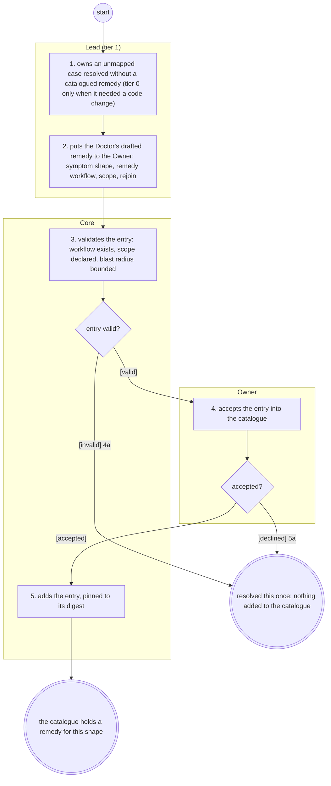

<!-- generated by render_pack.py from learn.spec.yaml sha256=cac55504d9eb3dae41fd5aaf70f2e629d365670f85240a471f59ad60978a8836; edit the spec, not this file -->
# Learn a remedy from an escalated case

**UC-L · to-be · `PROPOSED_UNACCEPTED`** · spec [learn.spec.yaml](../learn.spec.yaml)
Supersedes: `reports/2026-11-20-workflow-map/examples/ingestion/learn.spec.yaml`

| Problem | |
|---|---|
| symptom | A failure the doctor could not match went back to tier 0. |
| why | The catalogue had no remedy for its shape. |
| root | The catalogue only grows when a resolved case is written back into it. |

## Written use case

| Field | Content |
|---|---|
| **Use case name** | Learn a remedy |
| **Brief description** | A remedy the Doctor drafted for an unmapped case is put to the Owner by the Lead, and kept only if accepted. |
| **Primary actor** | Owner |
| **Supporting actors** | Lead, Doctor, Core |
| **Preconditions** | A resolved case with no remedy |
| **Trigger** | The Lead proposes the Doctor's draft |
| **Success guarantee** | An accepted catalogue entry |
| **Minimal guarantee** | Nothing is installed without acceptance |
| **Open questions** | — |

**Main success scenario** (generated: the guard-true path, in step order)

1. The Lead (tier 1) owns an unmapped case resolved without a catalogued remedy (tier 0 only when it needed a code change).
2. The Lead (tier 1) puts the Doctor's drafted remedy to the Owner: symptom shape, remedy workflow, scope, rejoin.
3. The Core validates the entry: workflow exists, scope declared, blast radius bounded.
4. The Owner accepts the entry into the catalogue.
5. The Core adds the entry, pinned to its digest.

**Extensions** (generated: one per non-happy guard; numbered by the step it leaves)

- **4a** (from: entry valid?) *anticipated*
  - `4a1` Invalid.
  - `4a2` The use case ends: resolved this once; nothing added to the catalogue.
- **5a** (from: accepted?) *anticipated*
  - `5a1` Declined.
  - `5a2` The use case ends: resolved this once; nothing added to the catalogue.

## Activity diagram



## Lane load

| Lane | On the main success scenario | Anywhere in the diagram |
|---|---|---|
| Lead (tier 1) | 2 | 2 |
| Owner | 2 | 2 |
| Core | 3 | 3 |

Paths by how they end: **learned** 1, **not learned** 2.

## Decision tree

```text
start: Learn a remedy from an escalated case
    └─ T1: valid / accepted  ⇒ the catalogue holds a remedy for this shape
  └─ T2: invalid  ⇒ resolved this once; nothing added to the catalogue
    └─ T3: valid / declined  ⇒ resolved this once; nothing added to the catalogue
```

## Test cases

One test per path: the main success scenario, then each extension.

| Test | Path (guards taken) | Extension | Expected outcome |
|---|---|---|---|
| T1 | entry valid? → valid; accepted? → accepted | MSS | the catalogue holds a remedy for this shape |
| T2 | entry valid? → invalid | 4a | resolved this once; nothing added to the catalogue |
| T3 | entry valid? → valid; accepted? → declined | 5a | resolved this once; nothing added to the catalogue |

### Boundary values

_None declared._

## As-is weaknesses this handles

_None recorded._

## Checks

Errors: none

Warnings: none
