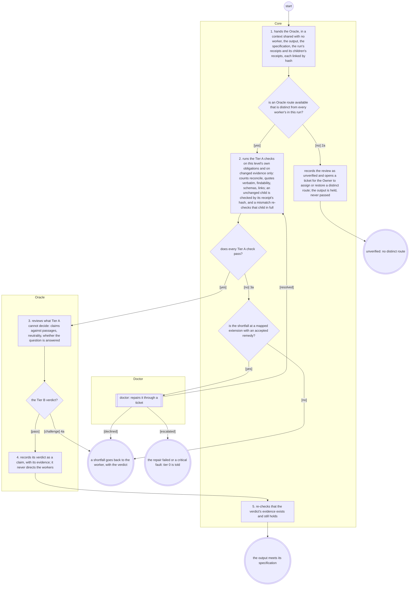

<!-- generated by render_pack.py from oracle.spec.yaml sha256=12add467f3214e228ccb9a1f1f5a9dcb1d26b5a21b20a85f284674790a16694f; edit the spec, not this file -->
# Judge a process's output against its specification (proposed)

**UC-O · to-be · `PROPOSED_UNACCEPTED`** · spec [oracle.spec.yaml](../oracle.spec.yaml)

| Problem | |
|---|---|
| symptom | As-is: only audited sessions are judged; everything else is judged by whoever ran it. |
| root | Every parent process ends its run with the Oracle's verdict, which is itself a checked claim. |

## Written use case

| Field | Content |
|---|---|
| **Use case name** | Judge a process's output |
| **Brief description** | Tier A checks, then Tier B review, on a route distinct from every worker; the verdict is a checked claim. |
| **Primary actor** | Oracle |
| **Supporting actors** | Core, Doctor |
| **Preconditions** | A process with a specification |
| **Trigger** | The parent's check step |
| **Success guarantee** | A verdict with evidence, re-checked |
| **Minimal guarantee** | No distinct route: unverified, never a pass |
| **Open questions** | Which model is assigned to the Oracle (revisable) |

**Main success scenario** (generated: the guard-true path, in step order)

1. The Core hands the Oracle, in a context shared with no worker, the output, the specification, the run's receipts and its children's receipts, each linked by hash.
2. The Core runs the Tier A checks on this level's own obligations and on changed evidence only: counts reconcile, quotes verbatim, findability, schemas, links; an unchanged child is checked by its receipt's hash, and a mismatch re-checks that child in full.
3. The Oracle reviews what Tier A cannot decide: claims against passages, neutrality, whether the question is answered.
4. The Oracle records its verdict as a claim, with its evidence; it never directs the workers.
5. The Core re-checks that the verdict's evidence exists and still holds.

**Extensions** (generated: one per non-happy guard; numbered by the step it leaves)

- **2a** (from: is an Oracle route available that is distinct from every worker's in this run?) *anticipated*
  - `2a1` No.
  - `2a2` The Core records the review as unverified and opens a ticket for the Owner to assign or restore a distinct route; the output is held, never passed.
  - `2a3` The use case ends: unverified: no distinct route.
- **3a** (from: does every Tier A check pass?) *anticipated*
  - `3a1` No.
  - `3a2` The Core decides: is the shortfall at a mapped extension with an accepted remedy?
  - `3a2a` If no: the use case ends: a shortfall goes back to the worker, with the verdict.
  - `3a3` If yes:
  - `3a4` The Doctor repairs it through a ticket (continues in doctor).
  - `3a4a` If declined: the use case ends: a shortfall goes back to the worker, with the verdict.
  - `3a4a` If escalated: the use case ends: the repair failed or a critical fault: tier 0 is told.
  - `3a5` If resolved:
  - `3a6` Rejoin at 2.
- **4a** (from: the Tier B verdict?) *anticipated*
  - `4a1` Challenge.
  - `4a2` The use case ends: a shortfall goes back to the worker, with the verdict.

## Activity diagram



## Lane load

| Lane | On the main success scenario | Anywhere in the diagram |
|---|---|---|
| Core | 5 | 7 |
| Oracle | 3 | 3 |
| Doctor | 0 | 1 |

Paths by how they end: **escalated** 1, **paused** 1, **shortfall** 3, **success** 1. Every *escalated* path is a failure of this use case: the work went back to tier 0.

## Decision tree

```text
start: Judge a process's output against its specification (proposed)
      └─ T1: yes / yes / pass  ⇒ the output meets its specification
  └─ T2: no  ⇒ unverified: no distinct route
      └─ T3: yes / no / no  ⇒ a shortfall goes back to the worker, with the verdict
        └─ T4: yes / no / yes / declined  ⇒ a shortfall goes back to the worker, with the verdict
        └─ T5: yes / no / yes / escalated  ⇒ the repair failed or a critical fault: tier 0 is told
        └─ T6: yes / no / yes / resolved  ⇒ rejoins at step 2
      └─ T7: yes / yes / challenge  ⇒ a shortfall goes back to the worker, with the verdict
```

## Test cases

One test per path: the main success scenario, then each extension.

| Test | Path (guards taken) | Extension | Expected outcome |
|---|---|---|---|
| T1 | is an Oracle route available that is distinct from every worker's in this run? → yes; does every Tier A check pass? → yes; the Tier B verdict? → pass | MSS | the output meets its specification |
| T2 | is an Oracle route available that is distinct from every worker's in this run? → no | 2a | unverified: no distinct route |
| T3 | is an Oracle route available that is distinct from every worker's in this run? → yes; does every Tier A check pass? → no; is the shortfall at a mapped extension with an accepted remedy? → no | 3a | a shortfall goes back to the worker, with the verdict |
| T4 | is an Oracle route available that is distinct from every worker's in this run? → yes; does every Tier A check pass? → no; is the shortfall at a mapped extension with an accepted remedy? → yes; repairs it through a ticket → declined | 3a | a shortfall goes back to the worker, with the verdict |
| T5 | is an Oracle route available that is distinct from every worker's in this run? → yes; does every Tier A check pass? → no; is the shortfall at a mapped extension with an accepted remedy? → yes; repairs it through a ticket → escalated | 3a | the repair failed or a critical fault: tier 0 is told |
| T6 | is an Oracle route available that is distinct from every worker's in this run? → yes; does every Tier A check pass? → no; is the shortfall at a mapped extension with an accepted remedy? → yes; repairs it through a ticket → resolved | 3a | rejoins at step 2 |
| T7 | is an Oracle route available that is distinct from every worker's in this run? → yes; does every Tier A check pass? → yes; the Tier B verdict? → challenge | 4a | a shortfall goes back to the worker, with the verdict |

### Boundary values

_None declared._

## As-is weaknesses this handles

| As-is weakness | Where here | How it is handled |
|---|---|---|
| W-ORA-01 (oracle): Admitted contracts and Tier A checks exist only in audited sessions; ingestion, research and workflows are judged by whoever ran them. | handin | Every process's output is judged against its specification, not only audited sessions. |

## Evidence

- As-is oracle (audited session): phases.yaml audited; research_grains.py; closure_audit.py.
- docs/terminology.md: Oracle, Verdict; docs/proposals/diagram-workflows.md section 10.

## Checks

Errors: none

Warnings: none
