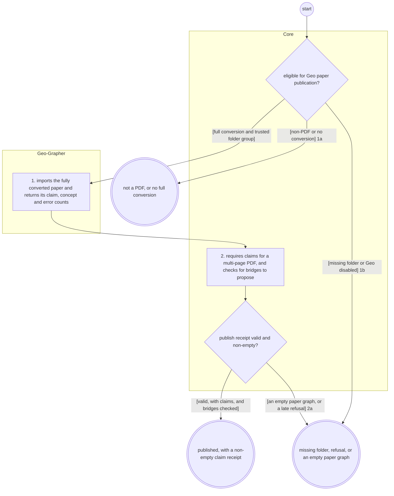

<!-- generated by render_pack.py from paper-publication.spec.yaml sha256=77f1a610b75119f463d1c5d3341ddf1669e7a244641637eb0fe6c02922ad2fd7; edit the spec, not this file -->
# Publish a read paper to Geo-Grapher (proposed)

**UC1c.3 · to-be · `PROPOSED_UNACCEPTED`** · spec [paper-publication.spec.yaml](../paper-publication.spec.yaml)

## Written use case

| Field | Content |
|---|---|
| **Use case name** | Publish a paper to the paper graph |
| **Brief description** | A fully converted paper is published, and an empty claim receipt is refused. |
| **Primary actor** | Core |
| **Supporting actors** | Geo-Grapher |
| **Preconditions** | Full reading and conversion |
| **Trigger** | Stage 9 |
| **Success guarantee** | Published with a non-empty receipt and its stored link |
| **Minimal guarantee** | A gap is recorded with its reason |
| **Open questions** | W-PUB-02: the folder prerequisite (Geo-Grapher pack) |

**Main success scenario** (generated: the guard-true path, in step order)

1. The Geo-Grapher imports the fully converted paper and returns its claim, concept and error counts.
2. The Core requires claims for a multi-page PDF, and checks for bridges to propose.

**Extensions** (generated: one per non-happy guard; numbered by the step it leaves)

- **1a** (from: eligible for Geo paper publication?) *anticipated*
  - `1a1` Non-PDF or no conversion.
  - `1a2` The use case ends: not a PDF, or no full conversion.
- **1b** (from: eligible for Geo paper publication?) *anticipated*
  - `1b1` Missing folder or Geo disabled.
  - `1b2` The use case ends: missing folder, refusal, or an empty paper graph.
- **2a** (from: publish receipt valid and non-empty?) *anticipated*
  - `2a1` An empty paper graph, or a late refusal.
  - `2a2` The use case ends: missing folder, refusal, or an empty paper graph.

## Activity diagram



## Lane load

| Lane | On the main success scenario | Anywhere in the diagram |
|---|---|---|
| Core | 3 | 3 |
| Geo-Grapher | 1 | 1 |

Paths by how they end: **gap** 2, **not applicable** 1, **success** 1.

## Decision tree

```text
start: Publish a read paper to Geo-Grapher (proposed)
    └─ T1: full conversion and trusted folder group / valid, with claims, and bridges checked  ⇒ published, with a non-empty claim receipt
  └─ T2: non-PDF or no conversion  ⇒ not a PDF, or no full conversion
  └─ T3: missing folder or Geo disabled  ⇒ missing folder, refusal, or an empty paper graph
    └─ T4: full conversion and trusted folder group / an empty paper graph, or a late refusal  ⇒ missing folder, refusal, or an empty paper graph
```

## Test cases

One test per path: the main success scenario, then each extension.

| Test | Path (guards taken) | Extension | Expected outcome |
|---|---|---|---|
| T1 | eligible for Geo paper publication? → full conversion and trusted folder group; publish receipt valid and non-empty? → valid, with claims, and bridges checked | MSS | published, with a non-empty claim receipt |
| T2 | eligible for Geo paper publication? → non-PDF or no conversion | 1a | not a PDF, or no full conversion |
| T3 | eligible for Geo paper publication? → missing folder or Geo disabled | 1b | missing folder, refusal, or an empty paper graph |
| T4 | eligible for Geo paper publication? → full conversion and trusted folder group; publish receipt valid and non-empty? → an empty paper graph, or a late refusal | 2a | missing folder, refusal, or an empty paper graph |

### Boundary values

_None declared._

## As-is weaknesses this handles

_None recorded._

## Checks

Errors: none

Warnings: none
