<!-- generated by render_pack.py from research.spec.yaml sha256=880324add6ed2e22835517648a980e8ceda8050bf9404f0bb9cabb29babcae6e; edit the spec, not this file -->
# Research a brief across a corpus (proposed)

**UC2 · to-be · `PROPOSED_UNACCEPTED`** · spec [research.spec.yaml](../research.spec.yaml)

| Problem | |
|---|---|
| symptom | As-is: the whole library as the pool, budgets that halve on return, one synthesis for every question, unchecked code placement, a broken disqualifier nobody caught. |
| root | The brief is scoped to its corpus, sized once, synthesised per question and judged against itself before it is handed over. |

## Written use case

| Field | Content |
|---|---|
| **Use case name** | Research a brief across a corpus |
| **Brief description** | A brief over a named corpus, sized once, synthesised per question and judged against itself before the handover. |
| **Primary actor** | Owner (the Lead does the work) |
| **Supporting actors** | Clerk, Scribe, Oracle, Core, Geo-Grapher |
| **Preconditions** | The corpus and disqualifiers named |
| **Trigger** | The Owner states the brief |
| **Success guarantee** | One judged, staged report per question |
| **Minimal guarantee** | Extra work is judged in scope or asked once |
| **Open questions** | OP4 answered: the pool is the corpus |

**Main success scenario** (generated: the guard-true path, in step order)

1. The Owner states the brief once: its questions, its corpus, its disqualifiers and a budget.
2. The Core compiles the brief's manifest, sizes its budget from it and grants the envelope once.
3. The Lead (tier 1) opens one brief per question, each scoped to the named corpus.
4. The Scribe (tier 3) runs bounded research rounds for each brief.
5. The Core adds finds from the corpus only, read but unaccepted sources included and labelled.
6. The Clerk (tier 2) proposes a decision for each run of candidates, with its reason.
7. The Lead (tier 1) decides the candidates, each decision with its source and reason, or it is refused as incomplete.
8. The Lead (tier 1) reads and cites the kept papers.
9. The Lead (tier 1) records one synthesis per brief.
10. The Lead (tier 1) places each finding in our code: a code-graph query finds the entity it cites (UC-G3).
11. The Lead (tier 1) drafts one report per brief.
12. The Core verifies and reviews every claim, code placements included.
13. The Oracle judges each report against its brief: question answered, corpus kept, disqualifiers held, gaps stated.
14. The Core writes the run's result record: answers, gaps, spend and allowances.
15. The Lead (tier 1) hands over the staged reports and the result record.

**Extensions** (generated: one per non-happy guard; numbered by the step it leaves)

- **2a** (from: are the corpus and the disqualifiers named?) *anticipated*
  - `2a1` No.
  - `2a2` The Core refuses to start and names the missing field.
  - `2a3` Rejoin at 1.
- **8a** (from: is the work inside the envelope?) *anticipated*
  - `8a1` More is needed.
  - `8a2` The Oracle judges whether the extra work serves the brief (an in-scope verdict allows only what the mandate permits).
  - `8a3` The Oracle decides: in scope?
  - `8a3a` If no: answers one consolidated question on the agenda: extend, narrow or stop; until then the session is parked at its resume point.
  - `8a4` If yes:
  - `8a5` The Core records the allowance for the end-of-run report.
  - `8a6` The Core decides: does the brief compare projects?
  - `8a6a` If yes: two or more projects' graphs: searches the projects' graphs side by side, related only through accepted bridges (UC-G4).
  - `8a7` If no:
  - `8a8` Rejoin at 8.
- **8b** (from: reads and cites the kept papers) *anticipated*
  - `8b1` Unavailable.
  - `8b2` The use case ends: the graph is unavailable, or the Oracle escalates: the Owner is told, and tier 0 when it oversees the run.
- **12a** (from: verifies and reviews every claim, code placements included) *anticipated*
  - `12a1` Challenged.
  - `12a2` The Lead (tier 1) decides: within two redrafts of this claim?
  - `12a2a` If no: drops the claim from the report as a stated gap, with its ticket, and goes on with the rest.
  - `12a3` If yes:
  - `12a4` Rejoin at 11.
- **12b** (from: verifies and reviews every claim, code placements included) *anticipated*
  - `12b1` Refused.
  - `12b2` The Lead (tier 1) decides: within two redrafts of this claim?
  - `12b2a` If no: drops the claim from the report as a stated gap, with its ticket, and goes on with the rest.
  - `12b3` If yes:
  - `12b4` Rejoin at 11.
- **12c** (from: verifies and reviews every claim, code placements included) *anticipated*
  - `12c1` Held.
  - `12c2` The Lead (tier 1) drops the claim from the report as a stated gap, with its ticket, and goes on with the rest.
  - `12c3` Rejoin at 13.
- **13a** (from: judges each report against its brief: question answered, corpus kept, disqualifiers held, gaps stated) *anticipated*
  - `13a1` Shortfall.
  - `13a2` The Lead (tier 1) decides: is this the brief's first shortfall?
  - `13a2a` If again: escalate: the use case ends: the graph is unavailable, or the Oracle escalates: the Owner is told, and tier 0 when it oversees the run.
  - `13a3` If first: one bounded revision:
  - `13a4` Rejoin at 4.
- **13b** (from: judges each report against its brief: question answered, corpus kept, disqualifiers held, gaps stated) *anticipated*
  - `13b1` Paused.
  - `13b2` The use case ends: stopped by the Owner, or paused by the Oracle.
- **13c** (from: judges each report against its brief: question answered, corpus kept, disqualifiers held, gaps stated) *anticipated*
  - `13c1` Escalated.
  - `13c2` The use case ends: the graph is unavailable, or the Oracle escalates: the Owner is told, and tier 0 when it oversees the run.
- **10a** (from: places each finding in our code: a code-graph query finds the entity it cites (UC-G3)) *anticipated*
  - `10a1` Refused.
  - `10a2` The Lead (tier 1) states the finding as unplaced, a gap in the report, when no code graph is readable.
  - `10a3` Rejoin at 11.
- **8c** (from: does the brief compare projects?) *anticipated*
  - `8c1` Yes: two or more projects' graphs.
  - `8c2` The Lead (tier 1) searches the projects' graphs side by side, related only through accepted bridges (UC-G4) (continues in geo-grapher/to-be/federated-search).
  - `8c2a` If refused: states the comparison as a gap (the graphs were out of bounds) and reads the papers without it.
  - `8c3` If success:
  - `8c4` Rejoin at 8.

## Activity diagram

```mermaid
flowchart TD
  subgraph Owner["Owner"]
    brief["1. states the brief once: its questions, its corpus, its disqualifiers and a budget"]
    askonce["answers one consolidated question on the agenda: extend, narrow or stop; until then the session is parked at its resume point"]
    downer{"extends or narrows?"}
  end
  subgraph Lead_tier_1_["Lead (tier 1)"]
    open["3. opens one brief per question, each scoped to the named corpus"]
    decide["7. decides the candidates, each decision with its source and reason, or it is refused as incomplete"]
    ref_fed[["geo-grapher/to-be/federated-search: searches the projects' graphs side by side, related only through accepted bridges (UC-G4)"]]
    nocompare["states the comparison as a gap (the graphs were out of bounds) and reads the papers without it"]
    ref_cite[["8. cite-graph: reads and cites the kept papers"]]
    synth["9. records one synthesis per brief"]
    place[["10. geo-grapher/to-be/query-graph: places each finding in our code: a code-graph query finds the entity it cites (UC-G3)"]]
    noplace["states the finding as unplaced, a gap in the report, when no code graph is readable"]
    draft["11. drafts one report per brief"]
    dredraft{"within two redrafts of this claim?"}
    dropclaim["drops the claim from the report as a stated gap, with its ticket, and goes on with the rest"]
    dshort{"is this the brief's first shortfall?"}
    handover["15. hands over the staged reports and the result record"]
  end
  subgraph Clerk_tier_2_["Clerk (tier 2)"]
    propose["6. proposes a decision for each run of candidates, with its reason"]
  end
  subgraph Scribe_tier_3_["Scribe (tier 3)"]
    rounds["4. runs bounded research rounds for each brief"]
  end
  subgraph Oracle["Oracle"]
    scope["judges whether the extra work serves the brief (an in-scope verdict allows only what the mandate permits)"]
    dscope{"in scope?"}
    ref_oracle[["13. oracle: judges each report against its brief: question answered, corpus kept, disqualifiers held, gaps stated"]]
  end
  subgraph Core["Core"]
    dbrief{"are the corpus and the disqualifiers named?"}
    missing["refuses to start and names the missing field"]
    manifest["2. compiles the brief's manifest, sizes its budget from it and grants the envelope once"]
    candidates["5. adds finds from the corpus only, read but unaccepted sources included and labelled"]
    dbudget{"is the work inside the envelope?"}
    allow["records the allowance for the end-of-run report"]
    dcompare{"does the brief compare projects?"}
    ref_verify[["12. verify-claims: verifies and reviews every claim, code placements included"]]
    record["14. writes the run's result record: answers, gaps, spend and allowances"]
  end
  subgraph Geo_Grapher["Geo-Grapher"]
  end
  s(("start"))
  e1((("one judged, staged report per question")))
  e_paused((("stopped by the Owner, or paused by the Oracle")))
  e_escalated((("the graph is unavailable, or the Oracle escalates: the Owner is told, and tier 0 when it oversees the run")))
  s --> brief
  brief --> dbrief
  dbrief -->|"[yes]"| manifest
  dbrief -->|"[no] 2a"| missing
  missing --> brief
  manifest --> open
  open --> rounds
  rounds --> candidates
  candidates --> propose
  propose --> decide
  decide --> dbudget
  dbudget -->|"[inside]"| dcompare
  dbudget -->|"[more is needed] 8a"| scope
  scope --> dscope
  dscope -->|"[yes]"| allow
  dscope -->|"[no]"| askonce
  allow --> dcompare
  askonce --> downer
  downer -->|"[extended or narrowed]"| dcompare
  downer -->|"[stop]"| e_paused
  ref_cite -->|"[success]"| synth
  ref_cite -->|"[unavailable] 8b"| e_escalated
  synth --> place
  draft --> ref_verify
  ref_verify -->|"[success]"| ref_oracle
  ref_verify -->|"[challenged] 12a"| dredraft
  ref_verify -->|"[refused] 12b"| dredraft
  ref_verify -->|"[held] 12c"| dropclaim
  ref_oracle -->|"[success]"| record
  ref_oracle -->|"[shortfall] 13a"| dshort
  ref_oracle -->|"[paused] 13b"| e_paused
  ref_oracle -->|"[escalated] 13c"| e_escalated
  record --> handover
  handover --> e1
  dshort -->|"[first: one bounded revision]"| rounds
  dshort -->|"[again: escalate]"| e_escalated
  dredraft -->|"[yes]"| draft
  dredraft -->|"[no]"| dropclaim
  dropclaim --> ref_oracle
  place -->|"[success]"| draft
  place -->|"[refused] 10a"| noplace
  noplace --> draft
  dcompare -->|"[no]"| ref_cite
  dcompare -->|"[yes: two or more projects' graphs] 8c"| ref_fed
  ref_fed -->|"[success]"| ref_cite
  ref_fed -->|"[refused]"| nocompare
  nocompare --> ref_cite
  classDef ext stroke:#d9534f,stroke-width:2px
```



## Lane load

| Lane | On the main success scenario | Anywhere in the diagram |
|---|---|---|
| Owner | 1 | 3 |
| Lead (tier 1) | 7 | 13 |
| Clerk (tier 2) | 1 | 1 |
| Scribe (tier 3) | 1 | 1 |
| Oracle | 1 | 3 |
| Core | 7 | 9 |
| Geo-Grapher | 0 | 0 |

Paths by how they end: **escalated** 3, **paused** 2, **success** 1. Every *escalated* path is a failure of this use case: the work went back to tier 0.

## Decision tree

```text
start: Research a brief across a corpus (proposed)
              └─ T1: yes / inside / no / success / success / success / success  ⇒ one judged, staged report per question
  └─ T2: no  ⇒ rejoins at step 1
        └─ T3: yes / more is needed / no / stop  ⇒ stopped by the Owner, or paused by the Oracle
        └─ T4: yes / more is needed / no / extended or narrowed  ⇒ rejoins at 'does the brief compare projects?' (before step 8)
      └─ T5: yes / more is needed / yes  ⇒ rejoins at 'does the brief compare projects?' (before step 8)
        └─ T6: yes / inside / yes: two or more projects' graphs / refused  ⇒ rejoins at step 8
        └─ T7: yes / inside / yes: two or more projects' graphs / success  ⇒ rejoins at step 8
        └─ T8: yes / inside / no / unavailable  ⇒ the graph is unavailable, or the Oracle escalates: the Owner is told, and tier 0 when it oversees the run
          └─ T9: yes / inside / no / success / refused  ⇒ rejoins at step 11
              └─ T10: yes / inside / no / success / success / challenged / no  ⇒ rejoins at step 13
              └─ T11: yes / inside / no / success / success / challenged / yes  ⇒ rejoins at step 11
              └─ T12: yes / inside / no / success / success / refused / no  ⇒ rejoins at step 13
              └─ T13: yes / inside / no / success / success / refused / yes  ⇒ rejoins at step 11
            └─ T14: yes / inside / no / success / success / held  ⇒ rejoins at step 13
                └─ T15: yes / inside / no / success / success / success / shortfall / again: escalate  ⇒ the graph is unavailable, or the Oracle escalates: the Owner is told, and tier 0 when it oversees the run
                └─ T16: yes / inside / no / success / success / success / shortfall / first: one bounded revision  ⇒ rejoins at step 4
              └─ T17: yes / inside / no / success / success / success / paused  ⇒ stopped by the Owner, or paused by the Oracle
              └─ T18: yes / inside / no / success / success / success / escalated  ⇒ the graph is unavailable, or the Oracle escalates: the Owner is told, and tier 0 when it oversees the run
```

## Test cases

One test per path: the main success scenario, then each extension.

| Test | Path (guards taken) | Extension | Expected outcome |
|---|---|---|---|
| T1 | are the corpus and the disqualifiers named? → yes; is the work inside the envelope? → inside; does the brief compare projects? → no; reads and cites the kept papers → success; places each finding in our code: a code-graph query finds the entity it cites (UC-G3) → success; verifies and reviews every claim, code placements included → success; judges each report against its brief: question answered, corpus kept, disqualifiers held, gaps stated → success | MSS | one judged, staged report per question |
| T2 | are the corpus and the disqualifiers named? → no | 2a | rejoins at step 1 |
| T3 | are the corpus and the disqualifiers named? → yes; is the work inside the envelope? → more is needed; in scope? → no; extends or narrows? → stop | 8a | stopped by the Owner, or paused by the Oracle |
| T4 | are the corpus and the disqualifiers named? → yes; is the work inside the envelope? → more is needed; in scope? → no; extends or narrows? → extended or narrowed | 8a | rejoins at 'does the brief compare projects?' (before step 8) |
| T5 | are the corpus and the disqualifiers named? → yes; is the work inside the envelope? → more is needed; in scope? → yes | 8a | rejoins at 'does the brief compare projects?' (before step 8) |
| T6 | are the corpus and the disqualifiers named? → yes; is the work inside the envelope? → inside; does the brief compare projects? → yes: two or more projects' graphs; searches the projects' graphs side by side, related only through accepted bridges (UC-G4) → refused | 8c | rejoins at step 8 |
| T7 | are the corpus and the disqualifiers named? → yes; is the work inside the envelope? → inside; does the brief compare projects? → yes: two or more projects' graphs; searches the projects' graphs side by side, related only through accepted bridges (UC-G4) → success | 8c | rejoins at step 8 |
| T8 | are the corpus and the disqualifiers named? → yes; is the work inside the envelope? → inside; does the brief compare projects? → no; reads and cites the kept papers → unavailable | 8b | the graph is unavailable, or the Oracle escalates: the Owner is told, and tier 0 when it oversees the run |
| T9 | are the corpus and the disqualifiers named? → yes; is the work inside the envelope? → inside; does the brief compare projects? → no; reads and cites the kept papers → success; places each finding in our code: a code-graph query finds the entity it cites (UC-G3) → refused | 10a | rejoins at step 11 |
| T10 | are the corpus and the disqualifiers named? → yes; is the work inside the envelope? → inside; does the brief compare projects? → no; reads and cites the kept papers → success; places each finding in our code: a code-graph query finds the entity it cites (UC-G3) → success; verifies and reviews every claim, code placements included → challenged; within two redrafts of this claim? → no | 12a | rejoins at step 13 |
| T11 | are the corpus and the disqualifiers named? → yes; is the work inside the envelope? → inside; does the brief compare projects? → no; reads and cites the kept papers → success; places each finding in our code: a code-graph query finds the entity it cites (UC-G3) → success; verifies and reviews every claim, code placements included → challenged; within two redrafts of this claim? → yes | 12a | rejoins at step 11 |
| T12 | are the corpus and the disqualifiers named? → yes; is the work inside the envelope? → inside; does the brief compare projects? → no; reads and cites the kept papers → success; places each finding in our code: a code-graph query finds the entity it cites (UC-G3) → success; verifies and reviews every claim, code placements included → refused; within two redrafts of this claim? → no | 12b | rejoins at step 13 |
| T13 | are the corpus and the disqualifiers named? → yes; is the work inside the envelope? → inside; does the brief compare projects? → no; reads and cites the kept papers → success; places each finding in our code: a code-graph query finds the entity it cites (UC-G3) → success; verifies and reviews every claim, code placements included → refused; within two redrafts of this claim? → yes | 12b | rejoins at step 11 |
| T14 | are the corpus and the disqualifiers named? → yes; is the work inside the envelope? → inside; does the brief compare projects? → no; reads and cites the kept papers → success; places each finding in our code: a code-graph query finds the entity it cites (UC-G3) → success; verifies and reviews every claim, code placements included → held | 12c | rejoins at step 13 |
| T15 | are the corpus and the disqualifiers named? → yes; is the work inside the envelope? → inside; does the brief compare projects? → no; reads and cites the kept papers → success; places each finding in our code: a code-graph query finds the entity it cites (UC-G3) → success; verifies and reviews every claim, code placements included → success; judges each report against its brief: question answered, corpus kept, disqualifiers held, gaps stated → shortfall; is this the brief's first shortfall? → again: escalate | 13a | the graph is unavailable, or the Oracle escalates: the Owner is told, and tier 0 when it oversees the run |
| T16 | are the corpus and the disqualifiers named? → yes; is the work inside the envelope? → inside; does the brief compare projects? → no; reads and cites the kept papers → success; places each finding in our code: a code-graph query finds the entity it cites (UC-G3) → success; verifies and reviews every claim, code placements included → success; judges each report against its brief: question answered, corpus kept, disqualifiers held, gaps stated → shortfall; is this the brief's first shortfall? → first: one bounded revision | 13a | rejoins at step 4 |
| T17 | are the corpus and the disqualifiers named? → yes; is the work inside the envelope? → inside; does the brief compare projects? → no; reads and cites the kept papers → success; places each finding in our code: a code-graph query finds the entity it cites (UC-G3) → success; verifies and reviews every claim, code placements included → success; judges each report against its brief: question answered, corpus kept, disqualifiers held, gaps stated → paused | 13b | stopped by the Owner, or paused by the Oracle |
| T18 | are the corpus and the disqualifiers named? → yes; is the work inside the envelope? → inside; does the brief compare projects? → no; reads and cites the kept papers → success; places each finding in our code: a code-graph query finds the entity it cites (UC-G3) → success; verifies and reviews every claim, code placements included → success; judges each report against its brief: question answered, corpus kept, disqualifiers held, gaps stated → escalated | 13c | the graph is unavailable, or the Oracle escalates: the Owner is told, and tier 0 when it oversees the run |

### Boundary values

| Decision | Values to test | Expected |
|---|---|---|
| within two redrafts of this claim? | first redraft of a claim; second; a third would be needed | after two redrafts the claim is dropped as a stated gap, with its ticket |

## As-is weaknesses this handles

| As-is weakness | Where here | How it is handled |
|---|---|---|
| W-RES-06 (research): A report quoting only a paper's card broke the project's disqualifier, and nothing caught it. | ref_oracle | The Oracle judges each report against its brief, the disqualifiers included. |
| W-RES-05 (research): Read papers that were never accepted are not candidates; the Lead has to find them again by graph citation. | candidates | Read but unaccepted sources of the corpus are candidates, labelled. |
| W-RES-01 (research): The candidate pool is the whole library: 82 of its own notes and folder cards had to be decided in the 20 November run (OP4). | candidates | Candidates come from the named corpus only. |
| W-RES-02 (research): A phase's budget is per visit and halves on every return (20, 10, 5, 2, 1, then nothing): the run needed four extensions, and Synthesise reopened with one call left (OP5). | manifest | The budget is sized once from the brief's manifest, and extra work goes to the Oracle's scope judgment. |
| W-RES-03 (research): A session holds one synthesis, so every report shares one Together and one Unknowns, which go stale after a redraft (OP3). | synth | One synthesis per brief. |
| W-RES-04 (research): Where a finding lands in our code stays prose: it is not a claim, and nothing checks it (OP10). | place | A code placement is a claim citing a code entity, verified with the others. |

## Evidence

- AS-IS-FINDINGS.md rules T3 (Oracle), T8 (stored links), T9 (brief scoped, budget from the envelope).
- docs/proposals/plan-forward-2026-11.md W1b item 5 (permission envelope) and W9 (the Oracle's scope judgments, Rule 17).

## Checks

Errors: none

Warnings: none
