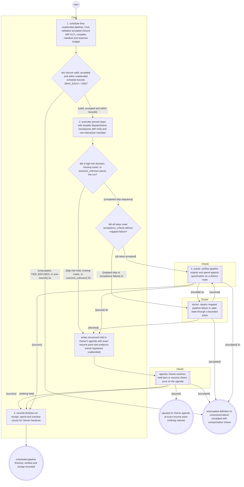

<!-- generated by render_pack.py from scheduled-pipeline.spec.yaml sha256=a00a7e49d6d2eada03292290be66714e6b334091b5051fc75a67edad3ae09607; edit the spec, not this file -->
# Run a scheduled pipeline (proposed)

**UC16 · to-be · `PROPOSED_UNACCEPTED`** · spec [scheduled-pipeline.spec.yaml](../scheduled-pipeline.spec.yaml)
Supersedes: `reports/2026-11-25-systems-analysis-finalisation/librarian/as-is/scheduled-pipeline.spec.yaml`

| Problem | |
|---|---|
| symptom | As-is: unattended schedules lack a pre-compiled mandate, Oracle verification, and agenda routing for high-risk holds or paused steps. |
| root | Compile manifest and bounded reserve before start; run within MAX_EACH = 200 with no tier 0; route high-risk choices, missing routers or outcome_unknown cleanly onto the Owner's agenda at exact resume points; repair mapped shortfalls via Doctor; verify via Oracle. |

## Written use case

| Field | Content |
|---|---|
| **Use case name** | Run a scheduled pipeline |
| **Brief description** | Unattended scheduled pipelines run with pre-compiled manifests, reserved budgets, MF-017/MF-018 pinning and checkpoints within MAX_EACH = 200; high-risk holds, missing routers or outcome_unknown pause onto the Owner's agenda at exact resume points; mapped failures route to Doctor; Oracle verifies outputs. |
| **Primary actor** | Core |
| **Supporting actors** | Owner, Oracle, Doctor |
| **Preconditions** | Accepted pipeline closure pinned and budget reserved for unattended schedule |
| **Trigger** | Schedule triggers weekly-review or clear-enrichment-backlog |
| **Success guarantee** | Pipeline completes, passes Oracle verification and records spend/receipt for Owner handover |
| **Minimal guarantee** | No high-risk decision proceeds without the Owner; held runs resume from their recorded point with nothing redone |
| **Open questions** | — |

**Main success scenario** (generated: the guard-true path, in step order)

1. The Core schedule fires unattended pipeline; Core validates accepted closure (MF-017), compiles manifest and reserves budget.
2. The Core executes pinned steps with durable dispatch/done checkpoints (MF-018) and non-interactive mandate.
3. The Oracle verifies pipeline outputs and spend against specification on a distinct route.
4. The Core records finished run receipt, spend and overdue counts for Owner handover.

**Extensions** (generated: one per non-happy guard; numbered by the step it leaves)

- **2a** (from: are closure valid, accepted and within unattended schedule bounds (MAX_EACH = 200)?) *anticipated*
  - `2a1` Unaccepted, TIER_REFUSED, or over bounds.
  - `2a2` The use case ends: unaccepted definition or unresolved failure escalated with compensation shown.
- **2b** (from: did a high-risk decision, missing router, or outcome_unknown pause the run?) *anticipated*
  - `2b1` High-risk hold, missing router, or outcome_unknown.
  - `2b2` The Core writes structured hold to Owner's agenda with exact resume point and evidence (never bypassed unattended).
  - `2b3` The Owner Owner resolves held item or resume choice once on the agenda (continues in agenda).
  - `2b3a` If nothing held: rejoin at 4.
  - `2b3a` If paused: the use case ends: paused on Owner agenda at exact resume point (nothing redone).
  - `2b3a` If escalated: the use case ends: unaccepted definition or unresolved failure escalated with compensation shown.
  - `2b4` If success:
  - `2b5` Rejoin at 4.
- **2c** (from: did all steps meet acceptance_criteria without mapped failure?) *anticipated*
  - `2c1` Mapped step or acceptance failure.
  - `2c2` The Doctor repairs mapped pipeline failure or stale state through a bounded ticket (continues in doctor).
  - `2c2a` If declined: writes structured hold to Owner's agenda with exact resume point and evidence (never bypassed unattended).
  - `2c2a` If escalated: the use case ends: unaccepted definition or unresolved failure escalated with compensation shown.
  - `2c3` If resolved:
  - `2c4` Rejoin at 3.
- **3a** (from: verifies pipeline outputs and spend against specification on a distinct route) *anticipated*
  - `3a1` Shortfall.
  - `3a2` The Doctor repairs mapped pipeline failure or stale state through a bounded ticket (continues in doctor).
  - `3a2a` If declined: writes structured hold to Owner's agenda with exact resume point and evidence (never bypassed unattended).
  - `3a2a` If escalated: the use case ends: unaccepted definition or unresolved failure escalated with compensation shown.
  - `3a3` If resolved:
  - `3a4` Rejoin at 3.
- **3b** (from: verifies pipeline outputs and spend against specification on a distinct route) *anticipated*
  - `3b1` Paused.
  - `3b2` The Core writes structured hold to Owner's agenda with exact resume point and evidence (never bypassed unattended).
  - `3b3` The Owner Owner resolves held item or resume choice once on the agenda (continues in agenda).
  - `3b3a` If nothing held: rejoin at 4.
  - `3b3a` If paused: the use case ends: paused on Owner agenda at exact resume point (nothing redone).
  - `3b3a` If escalated: the use case ends: unaccepted definition or unresolved failure escalated with compensation shown.
  - `3b4` If success:
  - `3b5` Rejoin at 4.
- **3c** (from: verifies pipeline outputs and spend against specification on a distinct route) *anticipated*
  - `3c1` Escalated.
  - `3c2` The use case ends: unaccepted definition or unresolved failure escalated with compensation shown.

## Activity diagram



## Lane load

| Lane | On the main success scenario | Anywhere in the diagram |
|---|---|---|
| Owner | 0 | 1 |
| Core | 6 | 7 |
| Oracle | 1 | 1 |
| Doctor | 0 | 1 |

Paths by how they end: **escalated** 8, **paused** 4, **success** 1. Every *escalated* path is a failure of this use case: the work went back to tier 0.

## Decision tree

```text
start: Run a scheduled pipeline (proposed)
        └─ T1: valid, accepted and within bounds / completed step sequence / all steps accepted / success  ⇒ scheduled pipeline finished, verified and receipt recorded
  └─ T2: unaccepted, TIER_REFUSED, or over bounds  ⇒ unaccepted definition or unresolved failure escalated with compensation shown
      └─ T3: valid, accepted and within bounds / high-risk hold, missing router, or outcome_unknown / nothing held  ⇒ rejoins at step 4
      └─ T4: valid, accepted and within bounds / high-risk hold, missing router, or outcome_unknown / paused  ⇒ paused on Owner agenda at exact resume point (nothing redone)
      └─ T5: valid, accepted and within bounds / high-risk hold, missing router, or outcome_unknown / escalated  ⇒ unaccepted definition or unresolved failure escalated with compensation shown
      └─ T6: valid, accepted and within bounds / high-risk hold, missing router, or outcome_unknown / success  ⇒ rejoins at step 4
          └─ T7: valid, accepted and within bounds / completed step sequence / mapped step or acceptance failure / declined / nothing held  ⇒ rejoins at step 4
          └─ T8: valid, accepted and within bounds / completed step sequence / mapped step or acceptance failure / declined / paused  ⇒ paused on Owner agenda at exact resume point (nothing redone)
          └─ T9: valid, accepted and within bounds / completed step sequence / mapped step or acceptance failure / declined / escalated  ⇒ unaccepted definition or unresolved failure escalated with compensation shown
          └─ T10: valid, accepted and within bounds / completed step sequence / mapped step or acceptance failure / declined / success  ⇒ rejoins at step 4
        └─ T11: valid, accepted and within bounds / completed step sequence / mapped step or acceptance failure / escalated  ⇒ unaccepted definition or unresolved failure escalated with compensation shown
        └─ T12: valid, accepted and within bounds / completed step sequence / mapped step or acceptance failure / resolved  ⇒ rejoins at step 3
            └─ T13: valid, accepted and within bounds / completed step sequence / all steps accepted / shortfall / declined / nothing held  ⇒ rejoins at step 4
            └─ T14: valid, accepted and within bounds / completed step sequence / all steps accepted / shortfall / declined / paused  ⇒ paused on Owner agenda at exact resume point (nothing redone)
            └─ T15: valid, accepted and within bounds / completed step sequence / all steps accepted / shortfall / declined / escalated  ⇒ unaccepted definition or unresolved failure escalated with compensation shown
            └─ T16: valid, accepted and within bounds / completed step sequence / all steps accepted / shortfall / declined / success  ⇒ rejoins at step 4
          └─ T17: valid, accepted and within bounds / completed step sequence / all steps accepted / shortfall / escalated  ⇒ unaccepted definition or unresolved failure escalated with compensation shown
          └─ T18: valid, accepted and within bounds / completed step sequence / all steps accepted / shortfall / resolved  ⇒ rejoins at step 3
          └─ T19: valid, accepted and within bounds / completed step sequence / all steps accepted / paused / nothing held  ⇒ rejoins at step 4
          └─ T20: valid, accepted and within bounds / completed step sequence / all steps accepted / paused / paused  ⇒ paused on Owner agenda at exact resume point (nothing redone)
          └─ T21: valid, accepted and within bounds / completed step sequence / all steps accepted / paused / escalated  ⇒ unaccepted definition or unresolved failure escalated with compensation shown
          └─ T22: valid, accepted and within bounds / completed step sequence / all steps accepted / paused / success  ⇒ rejoins at step 4
        └─ T23: valid, accepted and within bounds / completed step sequence / all steps accepted / escalated  ⇒ unaccepted definition or unresolved failure escalated with compensation shown
```

## Test cases

One test per path: the main success scenario, then each extension.

| Test | Path (guards taken) | Extension | Expected outcome |
|---|---|---|---|
| T1 | are closure valid, accepted and within unattended schedule bounds (MAX_EACH = 200)? → valid, accepted and within bounds; did a high-risk decision, missing router, or outcome_unknown pause the run? → completed step sequence; did all steps meet acceptance_criteria without mapped failure? → all steps accepted; verifies pipeline outputs and spend against specification on a distinct route → success | MSS | scheduled pipeline finished, verified and receipt recorded |
| T2 | are closure valid, accepted and within unattended schedule bounds (MAX_EACH = 200)? → unaccepted, TIER_REFUSED, or over bounds | 2a | unaccepted definition or unresolved failure escalated with compensation shown |
| T3 | are closure valid, accepted and within unattended schedule bounds (MAX_EACH = 200)? → valid, accepted and within bounds; did a high-risk decision, missing router, or outcome_unknown pause the run? → high-risk hold, missing router, or outcome_unknown; Owner resolves held item or resume choice once on the agenda → nothing held | 2b | rejoins at step 4 |
| T4 | are closure valid, accepted and within unattended schedule bounds (MAX_EACH = 200)? → valid, accepted and within bounds; did a high-risk decision, missing router, or outcome_unknown pause the run? → high-risk hold, missing router, or outcome_unknown; Owner resolves held item or resume choice once on the agenda → paused | 2b | paused on Owner agenda at exact resume point (nothing redone) |
| T5 | are closure valid, accepted and within unattended schedule bounds (MAX_EACH = 200)? → valid, accepted and within bounds; did a high-risk decision, missing router, or outcome_unknown pause the run? → high-risk hold, missing router, or outcome_unknown; Owner resolves held item or resume choice once on the agenda → escalated | 2b | unaccepted definition or unresolved failure escalated with compensation shown |
| T6 | are closure valid, accepted and within unattended schedule bounds (MAX_EACH = 200)? → valid, accepted and within bounds; did a high-risk decision, missing router, or outcome_unknown pause the run? → high-risk hold, missing router, or outcome_unknown; Owner resolves held item or resume choice once on the agenda → success | 2b | rejoins at step 4 |
| T7 | are closure valid, accepted and within unattended schedule bounds (MAX_EACH = 200)? → valid, accepted and within bounds; did a high-risk decision, missing router, or outcome_unknown pause the run? → completed step sequence; did all steps meet acceptance_criteria without mapped failure? → mapped step or acceptance failure; repairs mapped pipeline failure or stale state through a bounded ticket → declined; Owner resolves held item or resume choice once on the agenda → nothing held | 2c | rejoins at step 4 |
| T8 | are closure valid, accepted and within unattended schedule bounds (MAX_EACH = 200)? → valid, accepted and within bounds; did a high-risk decision, missing router, or outcome_unknown pause the run? → completed step sequence; did all steps meet acceptance_criteria without mapped failure? → mapped step or acceptance failure; repairs mapped pipeline failure or stale state through a bounded ticket → declined; Owner resolves held item or resume choice once on the agenda → paused | 2c | paused on Owner agenda at exact resume point (nothing redone) |
| T9 | are closure valid, accepted and within unattended schedule bounds (MAX_EACH = 200)? → valid, accepted and within bounds; did a high-risk decision, missing router, or outcome_unknown pause the run? → completed step sequence; did all steps meet acceptance_criteria without mapped failure? → mapped step or acceptance failure; repairs mapped pipeline failure or stale state through a bounded ticket → declined; Owner resolves held item or resume choice once on the agenda → escalated | 2c | unaccepted definition or unresolved failure escalated with compensation shown |
| T10 | are closure valid, accepted and within unattended schedule bounds (MAX_EACH = 200)? → valid, accepted and within bounds; did a high-risk decision, missing router, or outcome_unknown pause the run? → completed step sequence; did all steps meet acceptance_criteria without mapped failure? → mapped step or acceptance failure; repairs mapped pipeline failure or stale state through a bounded ticket → declined; Owner resolves held item or resume choice once on the agenda → success | 2c | rejoins at step 4 |
| T11 | are closure valid, accepted and within unattended schedule bounds (MAX_EACH = 200)? → valid, accepted and within bounds; did a high-risk decision, missing router, or outcome_unknown pause the run? → completed step sequence; did all steps meet acceptance_criteria without mapped failure? → mapped step or acceptance failure; repairs mapped pipeline failure or stale state through a bounded ticket → escalated | 2c | unaccepted definition or unresolved failure escalated with compensation shown |
| T12 | are closure valid, accepted and within unattended schedule bounds (MAX_EACH = 200)? → valid, accepted and within bounds; did a high-risk decision, missing router, or outcome_unknown pause the run? → completed step sequence; did all steps meet acceptance_criteria without mapped failure? → mapped step or acceptance failure; repairs mapped pipeline failure or stale state through a bounded ticket → resolved | 2c | rejoins at step 3 |
| T13 | are closure valid, accepted and within unattended schedule bounds (MAX_EACH = 200)? → valid, accepted and within bounds; did a high-risk decision, missing router, or outcome_unknown pause the run? → completed step sequence; did all steps meet acceptance_criteria without mapped failure? → all steps accepted; verifies pipeline outputs and spend against specification on a distinct route → shortfall; repairs mapped pipeline failure or stale state through a bounded ticket → declined; Owner resolves held item or resume choice once on the agenda → nothing held | 3a | rejoins at step 4 |
| T14 | are closure valid, accepted and within unattended schedule bounds (MAX_EACH = 200)? → valid, accepted and within bounds; did a high-risk decision, missing router, or outcome_unknown pause the run? → completed step sequence; did all steps meet acceptance_criteria without mapped failure? → all steps accepted; verifies pipeline outputs and spend against specification on a distinct route → shortfall; repairs mapped pipeline failure or stale state through a bounded ticket → declined; Owner resolves held item or resume choice once on the agenda → paused | 3a | paused on Owner agenda at exact resume point (nothing redone) |
| T15 | are closure valid, accepted and within unattended schedule bounds (MAX_EACH = 200)? → valid, accepted and within bounds; did a high-risk decision, missing router, or outcome_unknown pause the run? → completed step sequence; did all steps meet acceptance_criteria without mapped failure? → all steps accepted; verifies pipeline outputs and spend against specification on a distinct route → shortfall; repairs mapped pipeline failure or stale state through a bounded ticket → declined; Owner resolves held item or resume choice once on the agenda → escalated | 3a | unaccepted definition or unresolved failure escalated with compensation shown |
| T16 | are closure valid, accepted and within unattended schedule bounds (MAX_EACH = 200)? → valid, accepted and within bounds; did a high-risk decision, missing router, or outcome_unknown pause the run? → completed step sequence; did all steps meet acceptance_criteria without mapped failure? → all steps accepted; verifies pipeline outputs and spend against specification on a distinct route → shortfall; repairs mapped pipeline failure or stale state through a bounded ticket → declined; Owner resolves held item or resume choice once on the agenda → success | 3a | rejoins at step 4 |
| T17 | are closure valid, accepted and within unattended schedule bounds (MAX_EACH = 200)? → valid, accepted and within bounds; did a high-risk decision, missing router, or outcome_unknown pause the run? → completed step sequence; did all steps meet acceptance_criteria without mapped failure? → all steps accepted; verifies pipeline outputs and spend against specification on a distinct route → shortfall; repairs mapped pipeline failure or stale state through a bounded ticket → escalated | 3a | unaccepted definition or unresolved failure escalated with compensation shown |
| T18 | are closure valid, accepted and within unattended schedule bounds (MAX_EACH = 200)? → valid, accepted and within bounds; did a high-risk decision, missing router, or outcome_unknown pause the run? → completed step sequence; did all steps meet acceptance_criteria without mapped failure? → all steps accepted; verifies pipeline outputs and spend against specification on a distinct route → shortfall; repairs mapped pipeline failure or stale state through a bounded ticket → resolved | 3a | rejoins at step 3 |
| T19 | are closure valid, accepted and within unattended schedule bounds (MAX_EACH = 200)? → valid, accepted and within bounds; did a high-risk decision, missing router, or outcome_unknown pause the run? → completed step sequence; did all steps meet acceptance_criteria without mapped failure? → all steps accepted; verifies pipeline outputs and spend against specification on a distinct route → paused; Owner resolves held item or resume choice once on the agenda → nothing held | 3b | rejoins at step 4 |
| T20 | are closure valid, accepted and within unattended schedule bounds (MAX_EACH = 200)? → valid, accepted and within bounds; did a high-risk decision, missing router, or outcome_unknown pause the run? → completed step sequence; did all steps meet acceptance_criteria without mapped failure? → all steps accepted; verifies pipeline outputs and spend against specification on a distinct route → paused; Owner resolves held item or resume choice once on the agenda → paused | 3b | paused on Owner agenda at exact resume point (nothing redone) |
| T21 | are closure valid, accepted and within unattended schedule bounds (MAX_EACH = 200)? → valid, accepted and within bounds; did a high-risk decision, missing router, or outcome_unknown pause the run? → completed step sequence; did all steps meet acceptance_criteria without mapped failure? → all steps accepted; verifies pipeline outputs and spend against specification on a distinct route → paused; Owner resolves held item or resume choice once on the agenda → escalated | 3b | unaccepted definition or unresolved failure escalated with compensation shown |
| T22 | are closure valid, accepted and within unattended schedule bounds (MAX_EACH = 200)? → valid, accepted and within bounds; did a high-risk decision, missing router, or outcome_unknown pause the run? → completed step sequence; did all steps meet acceptance_criteria without mapped failure? → all steps accepted; verifies pipeline outputs and spend against specification on a distinct route → paused; Owner resolves held item or resume choice once on the agenda → success | 3b | rejoins at step 4 |
| T23 | are closure valid, accepted and within unattended schedule bounds (MAX_EACH = 200)? → valid, accepted and within bounds; did a high-risk decision, missing router, or outcome_unknown pause the run? → completed step sequence; did all steps meet acceptance_criteria without mapped failure? → all steps accepted; verifies pipeline outputs and spend against specification on a distinct route → escalated | 3c | unaccepted definition or unresolved failure escalated with compensation shown |

### Boundary values

| Decision | Values to test | Expected |
|---|---|---|
| are closure valid, accepted and within unattended schedule bounds (MAX_EACH = 200)? | <= 200 items within mandate; 201 items or unaccepted closure | loops cap at MAX_EACH = 200; invalid/unaccepted definitions refuse before mutation |

## As-is weaknesses this handles

_None recorded._

## Evidence

- builds-on.md (agenda, tickets, Doctor, Oracle); workflows.py; initiators.table.yaml UC16.

## Checks

Errors: none

Warnings: none
