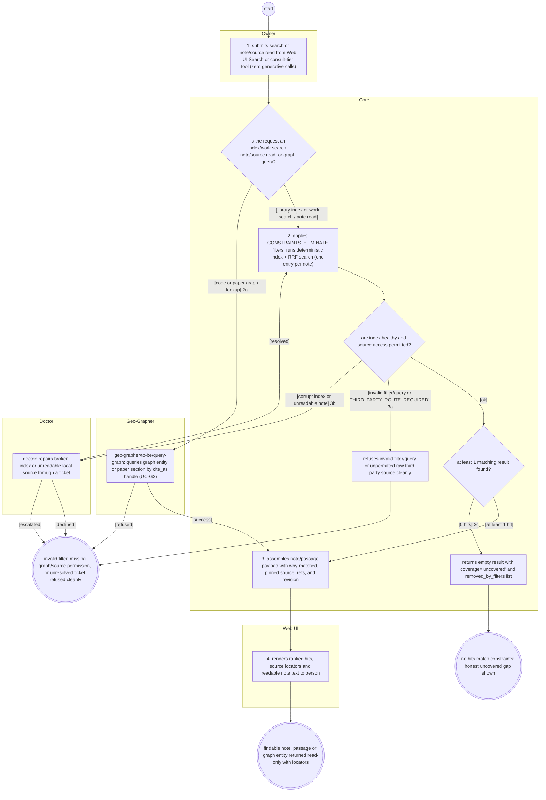

<!-- generated by render_pack.py from search-and-read.spec.yaml sha256=87ae2acd4a4916fb55dd493679dd4489cd93ff88062b81eff5bbed6bae04d99a; edit the spec, not this file -->
# Search and read the library (proposed)

**UC10 · to-be · `PROPOSED_UNACCEPTED`** · spec [search-and-read.spec.yaml](../search-and-read.spec.yaml)
Supersedes: `reports/2026-11-25-systems-analysis-finalisation/librarian/as-is/search-and-read.spec.yaml`

| Problem | |
|---|---|
| symptom | As-is: works read-only on Search, but code/paper lookups and index/unreadable-source failures are separate paths with no doctor repair. |
| root | Keep searches zero-generation and read-only under Core, return exact source_refs and locators, delegate graph reads cleanly via UC-G3, and route broken index/source reads to Doctor tickets. |

## Written use case

| Field | Content |
|---|---|
| **Use case name** | Search and read the library |
| **Brief description** | Read-only search and retrieval under Core with zero generative calls, exact source_refs and locators, optional Geo-Grapher lookup (UC-G3), and Doctor repair on corrupt index or unreadable local sources. |
| **Primary actor** | Owner |
| **Supporting actors** | Web UI, Core, Geo-Grapher, Doctor |
| **Preconditions** | Core running with healthy index (or repairable via ticket) |
| **Trigger** | The Owner queries Search or reads a note, source passage or graph entity |
| **Success guarantee** | Findable note, source passage or graph handle returned read-only with pinned source_refs |
| **Minimal guarantee** | Invalid constraints or unpermitted third-party reads refuse cleanly; zero hits return honest uncovered status |
| **Open questions** | — |

**Main success scenario** (generated: the guard-true path, in step order)

1. The Owner submits search or note/source read from Web UI Search or consult-tier tool (zero generative calls).
2. The Core applies CONSTRAINTS_ELIMINATE filters, runs deterministic index + RRF search (one entry per note).
3. The Core assembles note/passage payload with why-matched, pinned source_refs, and revision.
4. The Web UI renders ranked hits, source locators and readable note text to person.

**Extensions** (generated: one per non-happy guard; numbered by the step it leaves)

- **2a** (from: is the request an index/work search, note/source read, or graph query?) *anticipated*
  - `2a1` Code or paper graph lookup.
  - `2a2` The Geo-Grapher queries graph entity or paper section by cite_as handle (UC-G3) (continues in geo-grapher/to-be/query-graph).
  - `2a2a` If refused: the use case ends: invalid filter, missing graph/source permission, or unresolved ticket refused cleanly.
  - `2a3` If success:
  - `2a4` Rejoin at 3.
- **3a** (from: are index healthy and source access permitted?) *anticipated*
  - `3a1` Invalid filter/query or THIRD_PARTY_ROUTE_REQUIRED.
  - `3a2` The Core refuses invalid filter/query or unpermitted raw third-party source cleanly.
  - `3a3` The use case ends: invalid filter, missing graph/source permission, or unresolved ticket refused cleanly.
- **3b** (from: are index healthy and source access permitted?) *anticipated*
  - `3b1` Corrupt index or unreadable note.
  - `3b2` The Doctor repairs broken index or unreadable local source through a ticket (continues in doctor).
  - `3b2a` If declined: the use case ends: invalid filter, missing graph/source permission, or unresolved ticket refused cleanly.
  - `3b2a` If escalated: the use case ends: invalid filter, missing graph/source permission, or unresolved ticket refused cleanly.
  - `3b3` If resolved:
  - `3b4` Rejoin at 2.
- **3c** (from: at least 1 matching result found?) *anticipated*
  - `3c1` 0 hits.
  - `3c2` The Core returns empty result with coverage='uncovered' and removed_by_filters list.
  - `3c3` The use case ends: no hits match constraints; honest uncovered gap shown.

## Activity diagram



## Lane load

| Lane | On the main success scenario | Anywhere in the diagram |
|---|---|---|
| Owner | 1 | 1 |
| Web UI | 1 | 1 |
| Core | 5 | 7 |
| Geo-Grapher | 0 | 1 |
| Doctor | 0 | 1 |

Paths by how they end: **partial** 1, **refused** 4, **success** 1.

## Decision tree

```text
start: Search and read the library (proposed)
      └─ T1: library index or work search / note read / ok / at least 1 hit  ⇒ findable note, passage or graph entity returned read-only with locators
    └─ T2: code or paper graph lookup / refused  ⇒ invalid filter, missing graph/source permission, or unresolved ticket refused cleanly
    └─ T3: code or paper graph lookup / success  ⇒ rejoins at step 3
    └─ T4: library index or work search / note read / invalid filter/query or THIRD_PARTY_ROUTE_REQUIRED  ⇒ invalid filter, missing graph/source permission, or unresolved ticket refused cleanly
      └─ T5: library index or work search / note read / corrupt index or unreadable note / declined  ⇒ invalid filter, missing graph/source permission, or unresolved ticket refused cleanly
      └─ T6: library index or work search / note read / corrupt index or unreadable note / escalated  ⇒ invalid filter, missing graph/source permission, or unresolved ticket refused cleanly
      └─ T7: library index or work search / note read / corrupt index or unreadable note / resolved  ⇒ rejoins at step 2
      └─ T8: library index or work search / note read / ok / 0 hits  ⇒ no hits match constraints; honest uncovered gap shown
```

## Test cases

One test per path: the main success scenario, then each extension.

| Test | Path (guards taken) | Extension | Expected outcome |
|---|---|---|---|
| T1 | is the request an index/work search, note/source read, or graph query? → library index or work search / note read; are index healthy and source access permitted? → ok; at least 1 matching result found? → at least 1 hit | MSS | findable note, passage or graph entity returned read-only with locators |
| T2 | is the request an index/work search, note/source read, or graph query? → code or paper graph lookup; queries graph entity or paper section by cite_as handle (UC-G3) → refused | 2a | invalid filter, missing graph/source permission, or unresolved ticket refused cleanly |
| T3 | is the request an index/work search, note/source read, or graph query? → code or paper graph lookup; queries graph entity or paper section by cite_as handle (UC-G3) → success | 2a | rejoins at step 3 |
| T4 | is the request an index/work search, note/source read, or graph query? → library index or work search / note read; are index healthy and source access permitted? → invalid filter/query or THIRD_PARTY_ROUTE_REQUIRED | 3a | invalid filter, missing graph/source permission, or unresolved ticket refused cleanly |
| T5 | is the request an index/work search, note/source read, or graph query? → library index or work search / note read; are index healthy and source access permitted? → corrupt index or unreadable note; repairs broken index or unreadable local source through a ticket → declined | 3b | invalid filter, missing graph/source permission, or unresolved ticket refused cleanly |
| T6 | is the request an index/work search, note/source read, or graph query? → library index or work search / note read; are index healthy and source access permitted? → corrupt index or unreadable note; repairs broken index or unreadable local source through a ticket → escalated | 3b | invalid filter, missing graph/source permission, or unresolved ticket refused cleanly |
| T7 | is the request an index/work search, note/source read, or graph query? → library index or work search / note read; are index healthy and source access permitted? → corrupt index or unreadable note; repairs broken index or unreadable local source through a ticket → resolved | 3b | rejoins at step 2 |
| T8 | is the request an index/work search, note/source read, or graph query? → library index or work search / note read; are index healthy and source access permitted? → ok; at least 1 matching result found? → 0 hits | 3c | no hits match constraints; honest uncovered gap shown |

### Boundary values

| Decision | Values to test | Expected |
|---|---|---|
| at least 1 matching result found? | 0 hits; 1 hit; multiple hits | 0 hits return partial/uncovered with removed_by_filters; >= 1 returns ranked results with source_refs |

## As-is weaknesses this handles

_None recorded._

## Evidence

- builds-on.md (agenda, tickets, Doctor); src/resource_librarian/search.py; reports/2026-11-26-delegation-briefs.md §5.

## Checks

Errors: none

Warnings: none
