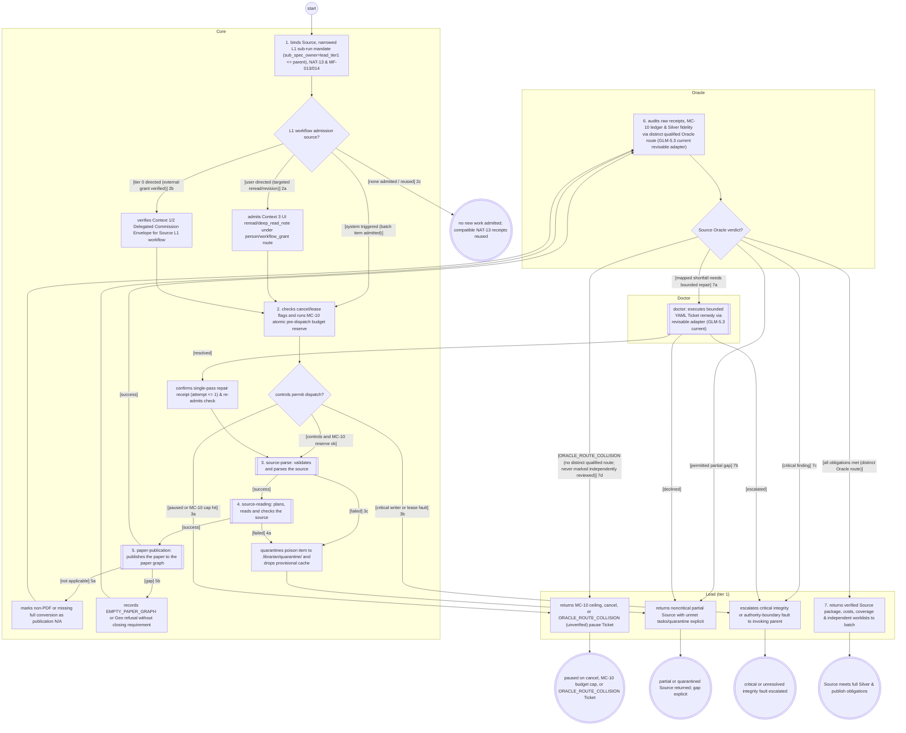

<!-- generated by render_pack.py from source-enrichment.spec.yaml sha256=21ff8d435c2e4752dcff1ce2ab3775217a76f9e0660bedfbcf6cb9486d09088f; edit the spec, not this file -->
# Librarian Source Enrichment L1 Workflow (Proposed To-Be)

**UC1c · to-be · `PROPOSED_UNACCEPTED`** · spec [source-enrichment.spec.yaml](../source-enrichment.spec.yaml)
Supersedes: `reports/2026-11-24-librarian-reconstruction-and-offering/diagrams/librarian-source-enrichment-tobe.spec.yaml`, `reports/2026-11-21-enrichment-baseline/enrichment-cycle.spec.yaml`, `reports/2026-11-22-proposed-tobe-enrichment/proposed-tobe-enrichment.spec.yaml`, `reports/2026-11-23-proposed-process-family/proposed-source-enrichment.spec.yaml`

| Problem | |
|---|---|
| symptom | Part-count masked failed _document_pass/relate_chapters, before-item-only budget checks leaked inner calls, and 0-claim Geo paper DBs silently passed. |
| root | Record activation trigger, enforce NAT-13 keys + MC-10 reserve, whole-source derivation checks, poison quarantine, Geo non-zero verification, and zero mid-loop Owner blocks. |

## Written use case

| Field | Content |
|---|---|
| **Use case name** | Enrich one source |
| **Brief description** | Parse, read and publish one source, then the Oracle audits its receipts. |
| **Primary actor** | Core |
| **Supporting actors** | Clerk, Scribe, Model host, Oracle, Doctor, Geo-Grapher |
| **Preconditions** | Admitted by the batch, a reread or a commission |
| **Trigger** | The item's turn |
| **Success guarantee** | Read, checked, published where eligible, and judged |
| **Minimal guarantee** | A partial or quarantined source returns its gaps explicitly |
| **Open questions** | — |

**Main success scenario** (generated: the guard-true path, in step order)

1. The Core binds Source, narrowed L1 sub-run mandate (sub_spec_owner=lead_tier1 <= parent), NAT-13 & MF-013/014.
2. The Core checks cancel/lease flags and runs MC-10 atomic pre-dispatch budget reserve.
3. The Core validates and parses the source.
4. The Core plans, reads and checks the source.
5. The Core publishes the paper to the paper graph.
6. The Oracle audits raw receipts, MC-10 ledger & Silver fidelity via distinct qualified Oracle route (GLM-5.3 current revisable adapter).
7. The Lead (tier 1) returns verified Source package, costs, coverage & independent worklists to batch.

**Extensions** (generated: one per non-happy guard; numbered by the step it leaves)

- **2a** (from: L1 workflow admission source?) *anticipated*
  - `2a1` User directed (targeted reread/revision).
  - `2a2` The Core admits Context 3 UI reread/deep_read_note under person/workflow_grant route.
  - `2a3` Rejoin at 2.
- **2b** (from: L1 workflow admission source?) *anticipated*
  - `2b1` Tier 0 directed (external grant verified).
  - `2b2` The Core verifies Context 1/2 Delegated Commission Envelope for Source L1 workflow.
  - `2b3` Rejoin at 2.
- **2c** (from: L1 workflow admission source?) *anticipated*
  - `2c1` None admitted / reused.
  - `2c2` The use case ends: no new work admitted; compatible NAT-13 receipts reused.
- **3a** (from: controls permit dispatch?) *anticipated*
  - `3a1` Paused or MC-10 cap hit.
  - `3a2` The Lead (tier 1) returns MC-10 ceiling, cancel, or ORACLE_ROUTE_COLLISION (unverified) pause Ticket.
  - `3a3` The use case ends: paused on cancel, MC-10 budget cap, or ORACLE_ROUTE_COLLISION Ticket.
- **3b** (from: controls permit dispatch?) *anticipated*
  - `3b1` Critical writer or lease fault.
  - `3b2` The Lead (tier 1) escalates critical integrity or authority-boundary fault to invoking parent.
  - `3b3` The use case ends: critical or unresolved integrity fault escalated.
- **7a** (from: Source Oracle verdict?) *anticipated*
  - `7a1` Mapped shortfall needs bounded repair.
  - `7a2` The Doctor executes bounded YAML Ticket remedy via revisable adapter (GLM-5.3 current) (continues in doctor).
  - `7a2a` If declined: returns noncritical partial Source with unmet tasks/quarantine explicit.
  - `7a2a` If escalated: escalates critical integrity or authority-boundary fault to invoking parent.
  - `7a3` If resolved:
  - `7a4` The Core confirms single-pass repair receipt (attempt <= 1) & re-admits check.
  - `7a5` Rejoin at 3.
- **7b** (from: Source Oracle verdict?) *anticipated*
  - `7b1` Permitted partial gap.
  - `7b2` The Lead (tier 1) returns noncritical partial Source with unmet tasks/quarantine explicit.
  - `7b3` The use case ends: partial or quarantined Source returned; gap explicit.
- **7c** (from: Source Oracle verdict?) *anticipated*
  - `7c1` Critical finding.
  - `7c2` The Lead (tier 1) escalates critical integrity or authority-boundary fault to invoking parent.
  - `7c3` The use case ends: critical or unresolved integrity fault escalated.
- **7d** (from: Source Oracle verdict?) *anticipated*
  - `7d1` ORACLE_ROUTE_COLLISION (no distinct qualified route; never marked independently reviewed).
  - `7d2` The Lead (tier 1) returns MC-10 ceiling, cancel, or ORACLE_ROUTE_COLLISION (unverified) pause Ticket.
  - `7d3` The use case ends: paused on cancel, MC-10 budget cap, or ORACLE_ROUTE_COLLISION Ticket.
- **3c** (from: validates and parses the source) *anticipated*
  - `3c1` Failed.
  - `3c2` The Core quarantines poison item to .librarian/quarantine/ and drops provisional cache.
  - `3c3` The Lead (tier 1) returns noncritical partial Source with unmet tasks/quarantine explicit.
  - `3c4` The use case ends: partial or quarantined Source returned; gap explicit.
- **4a** (from: plans, reads and checks the source) *anticipated*
  - `4a1` Failed.
  - `4a2` The Core quarantines poison item to .librarian/quarantine/ and drops provisional cache.
  - `4a3` The Lead (tier 1) returns noncritical partial Source with unmet tasks/quarantine explicit.
  - `4a4` The use case ends: partial or quarantined Source returned; gap explicit.
- **5a** (from: publishes the paper to the paper graph) *anticipated*
  - `5a1` Not applicable.
  - `5a2` The Core marks non-PDF or missing full conversion as publication N/A.
  - `5a3` Rejoin at 6.
- **5b** (from: publishes the paper to the paper graph) *anticipated*
  - `5b1` Gap.
  - `5b2` The Core records EMPTY_PAPER_GRAPH or Geo refusal without closing requirement.
  - `5b3` Rejoin at 6.

## Activity diagram



## Lane load

| Lane | On the main success scenario | Anywhere in the diagram |
|---|---|---|
| Oracle | 2 | 2 |
| Lead (tier 1) | 1 | 4 |
| Doctor | 0 | 1 |
| Core | 7 | 13 |

Paths by how they end: **escalated** 3, **partial** 4, **paused** 2, **reused** 1, **success** 1. Every *escalated* path is a failure of this use case: the work went back to tier 0.

## Decision tree

```text
start: Librarian Source Enrichment L1 Workflow (Proposed To-Be)
            └─ T1: system triggered (batch item admitted) / controls and MC-10 reserve ok / success / success / success / all obligations met (distinct Oracle route)  ⇒ Source meets full Silver & publish obligations
  └─ T2: user directed (targeted reread/revision)  ⇒ rejoins at step 2
  └─ T3: tier 0 directed (external grant verified)  ⇒ rejoins at step 2
  └─ T4: none admitted / reused  ⇒ no new work admitted; compatible NAT-13 receipts reused
    └─ T5: system triggered (batch item admitted) / paused or MC-10 cap hit  ⇒ paused on cancel, MC-10 budget cap, or ORACLE_ROUTE_COLLISION Ticket
    └─ T6: system triggered (batch item admitted) / critical writer or lease fault  ⇒ critical or unresolved integrity fault escalated
      └─ T7: system triggered (batch item admitted) / controls and MC-10 reserve ok / failed  ⇒ partial or quarantined Source returned; gap explicit
        └─ T8: system triggered (batch item admitted) / controls and MC-10 reserve ok / success / failed  ⇒ partial or quarantined Source returned; gap explicit
          └─ T9: system triggered (batch item admitted) / controls and MC-10 reserve ok / success / success / not applicable  ⇒ rejoins at step 6
          └─ T10: system triggered (batch item admitted) / controls and MC-10 reserve ok / success / success / gap  ⇒ rejoins at step 6
              └─ T11: system triggered (batch item admitted) / controls and MC-10 reserve ok / success / success / success / mapped shortfall needs bounded repair / declined  ⇒ partial or quarantined Source returned; gap explicit
              └─ T12: system triggered (batch item admitted) / controls and MC-10 reserve ok / success / success / success / mapped shortfall needs bounded repair / escalated  ⇒ critical or unresolved integrity fault escalated
              └─ T13: system triggered (batch item admitted) / controls and MC-10 reserve ok / success / success / success / mapped shortfall needs bounded repair / resolved  ⇒ rejoins at step 3
            └─ T14: system triggered (batch item admitted) / controls and MC-10 reserve ok / success / success / success / permitted partial gap  ⇒ partial or quarantined Source returned; gap explicit
            └─ T15: system triggered (batch item admitted) / controls and MC-10 reserve ok / success / success / success / critical finding  ⇒ critical or unresolved integrity fault escalated
            └─ T16: system triggered (batch item admitted) / controls and MC-10 reserve ok / success / success / success / ORACLE_ROUTE_COLLISION (no distinct qualified route; never marked independently reviewed)  ⇒ paused on cancel, MC-10 budget cap, or ORACLE_ROUTE_COLLISION Ticket
```

## Test cases

One test per path: the main success scenario, then each extension.

| Test | Path (guards taken) | Extension | Expected outcome |
|---|---|---|---|
| T1 | L1 workflow admission source? → system triggered (batch item admitted); controls permit dispatch? → controls and MC-10 reserve ok; validates and parses the source → success; plans, reads and checks the source → success; publishes the paper to the paper graph → success; Source Oracle verdict? → all obligations met (distinct Oracle route) | MSS | Source meets full Silver & publish obligations |
| T2 | L1 workflow admission source? → user directed (targeted reread/revision) | 2a | rejoins at step 2 |
| T3 | L1 workflow admission source? → tier 0 directed (external grant verified) | 2b | rejoins at step 2 |
| T4 | L1 workflow admission source? → none admitted / reused | 2c | no new work admitted; compatible NAT-13 receipts reused |
| T5 | L1 workflow admission source? → system triggered (batch item admitted); controls permit dispatch? → paused or MC-10 cap hit | 3a | paused on cancel, MC-10 budget cap, or ORACLE_ROUTE_COLLISION Ticket |
| T6 | L1 workflow admission source? → system triggered (batch item admitted); controls permit dispatch? → critical writer or lease fault | 3b | critical or unresolved integrity fault escalated |
| T7 | L1 workflow admission source? → system triggered (batch item admitted); controls permit dispatch? → controls and MC-10 reserve ok; validates and parses the source → failed | 3c | partial or quarantined Source returned; gap explicit |
| T8 | L1 workflow admission source? → system triggered (batch item admitted); controls permit dispatch? → controls and MC-10 reserve ok; validates and parses the source → success; plans, reads and checks the source → failed | 4a | partial or quarantined Source returned; gap explicit |
| T9 | L1 workflow admission source? → system triggered (batch item admitted); controls permit dispatch? → controls and MC-10 reserve ok; validates and parses the source → success; plans, reads and checks the source → success; publishes the paper to the paper graph → not applicable | 5a | rejoins at step 6 |
| T10 | L1 workflow admission source? → system triggered (batch item admitted); controls permit dispatch? → controls and MC-10 reserve ok; validates and parses the source → success; plans, reads and checks the source → success; publishes the paper to the paper graph → gap | 5b | rejoins at step 6 |
| T11 | L1 workflow admission source? → system triggered (batch item admitted); controls permit dispatch? → controls and MC-10 reserve ok; validates and parses the source → success; plans, reads and checks the source → success; publishes the paper to the paper graph → success; Source Oracle verdict? → mapped shortfall needs bounded repair; executes bounded YAML Ticket remedy via revisable adapter (GLM-5.3 current) → declined | 7a | partial or quarantined Source returned; gap explicit |
| T12 | L1 workflow admission source? → system triggered (batch item admitted); controls permit dispatch? → controls and MC-10 reserve ok; validates and parses the source → success; plans, reads and checks the source → success; publishes the paper to the paper graph → success; Source Oracle verdict? → mapped shortfall needs bounded repair; executes bounded YAML Ticket remedy via revisable adapter (GLM-5.3 current) → escalated | 7a | critical or unresolved integrity fault escalated |
| T13 | L1 workflow admission source? → system triggered (batch item admitted); controls permit dispatch? → controls and MC-10 reserve ok; validates and parses the source → success; plans, reads and checks the source → success; publishes the paper to the paper graph → success; Source Oracle verdict? → mapped shortfall needs bounded repair; executes bounded YAML Ticket remedy via revisable adapter (GLM-5.3 current) → resolved | 7a | rejoins at step 3 |
| T14 | L1 workflow admission source? → system triggered (batch item admitted); controls permit dispatch? → controls and MC-10 reserve ok; validates and parses the source → success; plans, reads and checks the source → success; publishes the paper to the paper graph → success; Source Oracle verdict? → permitted partial gap | 7b | partial or quarantined Source returned; gap explicit |
| T15 | L1 workflow admission source? → system triggered (batch item admitted); controls permit dispatch? → controls and MC-10 reserve ok; validates and parses the source → success; plans, reads and checks the source → success; publishes the paper to the paper graph → success; Source Oracle verdict? → critical finding | 7c | critical or unresolved integrity fault escalated |
| T16 | L1 workflow admission source? → system triggered (batch item admitted); controls permit dispatch? → controls and MC-10 reserve ok; validates and parses the source → success; plans, reads and checks the source → success; publishes the paper to the paper graph → success; Source Oracle verdict? → ORACLE_ROUTE_COLLISION (no distinct qualified route; never marked independently reviewed) | 7d | paused on cancel, MC-10 budget cap, or ORACLE_ROUTE_COLLISION Ticket |

### Boundary values

_None declared._

## As-is weaknesses this handles

| As-is weakness | Where here | How it is handled |
|---|---|---|
| W-SRC-01 (source-enrichment): A completed model call is counted as a stage done; nothing judges whether the answer is a valid answer to the task. | oracle | A distinct Oracle audits each source's raw receipts and the fidelity of what was read. |
| W-WFR-03 (workflow-run): deep-read-staged reads each staged source but leaves its status unchanged, so nothing records that it was read. | userread | A reread from the Web UI runs through source enrichment, which records each stage's status. |

## Checks

Errors: none

Warnings: none
