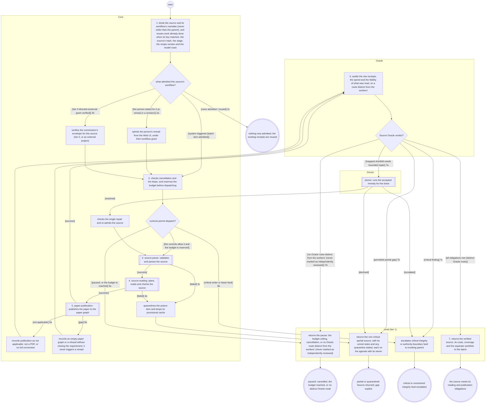

<!-- generated by render_pack.py from source-enrichment.spec.yaml sha256=3cbc81f712f75aa785563dde1cdd48deaeb423f61e2fe00f47a39bfecf4ad1c3; edit the spec, not this file -->
# Enrich one source (proposed)

**UC1c · to-be · `PROPOSED_UNACCEPTED`** · spec [source-enrichment.spec.yaml](../source-enrichment.spec.yaml)
Supersedes: `reports/2026-11-24-librarian-reconstruction-and-offering/diagrams/librarian-source-enrichment-tobe.spec.yaml`, `reports/2026-11-21-enrichment-baseline/enrichment-cycle.spec.yaml`, `reports/2026-11-22-proposed-tobe-enrichment/proposed-tobe-enrichment.spec.yaml`, `reports/2026-11-23-proposed-process-family/proposed-source-enrichment.spec.yaml`

| Problem | |
|---|---|
| symptom | As-is: part counts hid failed whole-source passes, budget checks only before each item let inner calls leak, and papers with no claims passed silently. |
| root | Record what started the work, reuse what is already done, reserve the budget before each dispatch, check the whole-source derivations, quarantine poison text, require claims from Geo-Grapher, and never block mid-loop on the Owner. |

## Written use case

| Field | Content |
|---|---|
| **Use case name** | Enrich one source |
| **Brief description** | Parse, read and publish one source, then the Oracle audits its receipts. |
| **Primary actor** | Core |
| **Supporting actors** | Clerk, Scribe, Model host, Oracle, Doctor, Geo-Grapher |
| **Preconditions** | Admitted by the batch, a reread or a commission |
| **Trigger** | The item's turn |
| **Success guarantee** | Read, checked, published where eligible, and judged |
| **Minimal guarantee** | A partial or quarantined source returns its gaps explicitly |
| **Open questions** | — |

**Main success scenario** (generated: the guard-true path, in step order)

1. The Core binds the source and its workflow's mandate (never wider than the parent), and reuses work already done when its key matches: the source's hash, the stage, the recipe version and the model route.
2. The Core checks cancellation and the lease, and reserves the budget before dispatching.
3. The Core validates and parses the source.
4. The Core plans, reads and checks the source.
5. The Core publishes the paper to the paper graph.
6. The Oracle audits the raw receipts, the spend and the fidelity of what was read, on a route distinct from the workers'.
7. The Lead (tier 1) returns the verified source, its costs, coverage and the separate worklists to the batch.

**Extensions** (generated: one per non-happy guard; numbered by the step it leaves)

- **2a** (from: what admitted this source's workflow?) *anticipated*
  - `2a1` The person asked for it (a reread or a revision).
  - `2a2` The Core admits the person's reread from the Web UI, under their workflow grant.
  - `2a3` Rejoin at 2.
- **2b** (from: what admitted this source's workflow?) *anticipated*
  - `2b1` Tier 0 directed (external grant verified).
  - `2b2` The Core verifies the commission's envelope for this source (tier 0, or an external project).
  - `2b3` Rejoin at 2.
- **2c** (from: what admitted this source's workflow?) *anticipated*
  - `2c1` None admitted / reused.
  - `2c2` The use case ends: nothing new admitted; the existing receipts are reused.
- **3a** (from: controls permit dispatch?) *anticipated*
  - `3a1` Paused, or the budget is reached.
  - `3a2` The Lead (tier 1) returns the pause: the budget ceiling, cancellation, or no Oracle route distinct from the workers' (never marked as independently reviewed).
  - `3a3` The use case ends: paused: cancelled, the budget reached, or no distinct Oracle route.
- **3b** (from: controls permit dispatch?) *anticipated*
  - `3b1` Critical writer or lease fault.
  - `3b2` The Lead (tier 1) escalates critical integrity or authority-boundary fault to invoking parent.
  - `3b3` The use case ends: critical or unresolved integrity fault escalated.
- **7a** (from: Source Oracle verdict?) *anticipated*
  - `7a1` Mapped shortfall needs bounded repair.
  - `7a2` The Doctor runs the accepted remedy for the ticket (continues in doctor).
  - `7a2a` If declined: returns the non-critical partial source, with its unmet tasks and any quarantine stated, each on the agenda with its owner.
  - `7a2a` If escalated: escalates critical integrity or authority-boundary fault to invoking parent.
  - `7a3` If resolved:
  - `7a4` The Core checks the single repair and re-admits the source.
  - `7a5` Rejoin at 3.
- **7b** (from: Source Oracle verdict?) *anticipated*
  - `7b1` Permitted partial gap.
  - `7b2` The Lead (tier 1) returns the non-critical partial source, with its unmet tasks and any quarantine stated, each on the agenda with its owner.
  - `7b3` The use case ends: partial or quarantined Source returned; gap explicit.
- **7c** (from: Source Oracle verdict?) *anticipated*
  - `7c1` Critical finding.
  - `7c2` The Lead (tier 1) escalates critical integrity or authority-boundary fault to invoking parent.
  - `7c3` The use case ends: critical or unresolved integrity fault escalated.
- **7d** (from: Source Oracle verdict?) *anticipated*
  - `7d1` No Oracle route distinct from the workers' (never marked as independently reviewed).
  - `7d2` The Lead (tier 1) returns the pause: the budget ceiling, cancellation, or no Oracle route distinct from the workers' (never marked as independently reviewed).
  - `7d3` The use case ends: paused: cancelled, the budget reached, or no distinct Oracle route.
- **3c** (from: validates and parses the source) *anticipated*
  - `3c1` Failed.
  - `3c2` The Core quarantines the poison item and drops its provisional cache.
  - `3c3` The Lead (tier 1) returns the non-critical partial source, with its unmet tasks and any quarantine stated, each on the agenda with its owner.
  - `3c4` The use case ends: partial or quarantined Source returned; gap explicit.
- **4a** (from: plans, reads and checks the source) *anticipated*
  - `4a1` Failed.
  - `4a2` The Core quarantines the poison item and drops its provisional cache.
  - `4a3` The Lead (tier 1) returns the non-critical partial source, with its unmet tasks and any quarantine stated, each on the agenda with its owner.
  - `4a4` The use case ends: partial or quarantined Source returned; gap explicit.
- **5a** (from: publishes the paper to the paper graph) *anticipated*
  - `5a1` Not applicable.
  - `5a2` The Core records publication as not applicable: not a PDF, or no full conversion.
  - `5a3` Rejoin at 6.
- **5b** (from: publishes the paper to the paper graph) *anticipated*
  - `5b1` Gap.
  - `5b2` The Core records an empty paper graph or a refusal without closing the requirement; it never triggers a reread.
  - `5b3` Rejoin at 6.

## Activity diagram



## Lane load

| Lane | On the main success scenario | Anywhere in the diagram |
|---|---|---|
| Oracle | 2 | 2 |
| Lead (tier 1) | 1 | 4 |
| Doctor | 0 | 1 |
| Core | 7 | 13 |

Paths by how they end: **escalated** 3, **partial** 4, **paused** 2, **reused** 1, **success** 1. Every *escalated* path is a failure of this use case: the work went back to tier 0.

## Decision tree

```text
start: Enrich one source (proposed)
            └─ T1: system triggered (batch item admitted) / the controls allow it and the budget is reserved / success / success / success / all obligations met (distinct Oracle route)  ⇒ the source meets its reading and publication obligations
  └─ T2: the person asked for it (a reread or a revision)  ⇒ rejoins at step 2
  └─ T3: tier 0 directed (external grant verified)  ⇒ rejoins at step 2
  └─ T4: none admitted / reused  ⇒ nothing new admitted; the existing receipts are reused
    └─ T5: system triggered (batch item admitted) / paused, or the budget is reached  ⇒ paused: cancelled, the budget reached, or no distinct Oracle route
    └─ T6: system triggered (batch item admitted) / critical writer or lease fault  ⇒ critical or unresolved integrity fault escalated
      └─ T7: system triggered (batch item admitted) / the controls allow it and the budget is reserved / failed  ⇒ partial or quarantined Source returned; gap explicit
        └─ T8: system triggered (batch item admitted) / the controls allow it and the budget is reserved / success / failed  ⇒ partial or quarantined Source returned; gap explicit
          └─ T9: system triggered (batch item admitted) / the controls allow it and the budget is reserved / success / success / not applicable  ⇒ rejoins at step 6
          └─ T10: system triggered (batch item admitted) / the controls allow it and the budget is reserved / success / success / gap  ⇒ rejoins at step 6
              └─ T11: system triggered (batch item admitted) / the controls allow it and the budget is reserved / success / success / success / mapped shortfall needs bounded repair / declined  ⇒ partial or quarantined Source returned; gap explicit
              └─ T12: system triggered (batch item admitted) / the controls allow it and the budget is reserved / success / success / success / mapped shortfall needs bounded repair / escalated  ⇒ critical or unresolved integrity fault escalated
              └─ T13: system triggered (batch item admitted) / the controls allow it and the budget is reserved / success / success / success / mapped shortfall needs bounded repair / resolved  ⇒ rejoins at step 3
            └─ T14: system triggered (batch item admitted) / the controls allow it and the budget is reserved / success / success / success / permitted partial gap  ⇒ partial or quarantined Source returned; gap explicit
            └─ T15: system triggered (batch item admitted) / the controls allow it and the budget is reserved / success / success / success / critical finding  ⇒ critical or unresolved integrity fault escalated
            └─ T16: system triggered (batch item admitted) / the controls allow it and the budget is reserved / success / success / success / no Oracle route distinct from the workers' (never marked as independently reviewed)  ⇒ paused: cancelled, the budget reached, or no distinct Oracle route
```

## Test cases

One test per path: the main success scenario, then each extension.

| Test | Path (guards taken) | Extension | Expected outcome |
|---|---|---|---|
| T1 | what admitted this source's workflow? → system triggered (batch item admitted); controls permit dispatch? → the controls allow it and the budget is reserved; validates and parses the source → success; plans, reads and checks the source → success; publishes the paper to the paper graph → success; Source Oracle verdict? → all obligations met (distinct Oracle route) | MSS | the source meets its reading and publication obligations |
| T2 | what admitted this source's workflow? → the person asked for it (a reread or a revision) | 2a | rejoins at step 2 |
| T3 | what admitted this source's workflow? → tier 0 directed (external grant verified) | 2b | rejoins at step 2 |
| T4 | what admitted this source's workflow? → none admitted / reused | 2c | nothing new admitted; the existing receipts are reused |
| T5 | what admitted this source's workflow? → system triggered (batch item admitted); controls permit dispatch? → paused, or the budget is reached | 3a | paused: cancelled, the budget reached, or no distinct Oracle route |
| T6 | what admitted this source's workflow? → system triggered (batch item admitted); controls permit dispatch? → critical writer or lease fault | 3b | critical or unresolved integrity fault escalated |
| T7 | what admitted this source's workflow? → system triggered (batch item admitted); controls permit dispatch? → the controls allow it and the budget is reserved; validates and parses the source → failed | 3c | partial or quarantined Source returned; gap explicit |
| T8 | what admitted this source's workflow? → system triggered (batch item admitted); controls permit dispatch? → the controls allow it and the budget is reserved; validates and parses the source → success; plans, reads and checks the source → failed | 4a | partial or quarantined Source returned; gap explicit |
| T9 | what admitted this source's workflow? → system triggered (batch item admitted); controls permit dispatch? → the controls allow it and the budget is reserved; validates and parses the source → success; plans, reads and checks the source → success; publishes the paper to the paper graph → not applicable | 5a | rejoins at step 6 |
| T10 | what admitted this source's workflow? → system triggered (batch item admitted); controls permit dispatch? → the controls allow it and the budget is reserved; validates and parses the source → success; plans, reads and checks the source → success; publishes the paper to the paper graph → gap | 5b | rejoins at step 6 |
| T11 | what admitted this source's workflow? → system triggered (batch item admitted); controls permit dispatch? → the controls allow it and the budget is reserved; validates and parses the source → success; plans, reads and checks the source → success; publishes the paper to the paper graph → success; Source Oracle verdict? → mapped shortfall needs bounded repair; runs the accepted remedy for the ticket → declined | 7a | partial or quarantined Source returned; gap explicit |
| T12 | what admitted this source's workflow? → system triggered (batch item admitted); controls permit dispatch? → the controls allow it and the budget is reserved; validates and parses the source → success; plans, reads and checks the source → success; publishes the paper to the paper graph → success; Source Oracle verdict? → mapped shortfall needs bounded repair; runs the accepted remedy for the ticket → escalated | 7a | critical or unresolved integrity fault escalated |
| T13 | what admitted this source's workflow? → system triggered (batch item admitted); controls permit dispatch? → the controls allow it and the budget is reserved; validates and parses the source → success; plans, reads and checks the source → success; publishes the paper to the paper graph → success; Source Oracle verdict? → mapped shortfall needs bounded repair; runs the accepted remedy for the ticket → resolved | 7a | rejoins at step 3 |
| T14 | what admitted this source's workflow? → system triggered (batch item admitted); controls permit dispatch? → the controls allow it and the budget is reserved; validates and parses the source → success; plans, reads and checks the source → success; publishes the paper to the paper graph → success; Source Oracle verdict? → permitted partial gap | 7b | partial or quarantined Source returned; gap explicit |
| T15 | what admitted this source's workflow? → system triggered (batch item admitted); controls permit dispatch? → the controls allow it and the budget is reserved; validates and parses the source → success; plans, reads and checks the source → success; publishes the paper to the paper graph → success; Source Oracle verdict? → critical finding | 7c | critical or unresolved integrity fault escalated |
| T16 | what admitted this source's workflow? → system triggered (batch item admitted); controls permit dispatch? → the controls allow it and the budget is reserved; validates and parses the source → success; plans, reads and checks the source → success; publishes the paper to the paper graph → success; Source Oracle verdict? → no Oracle route distinct from the workers' (never marked as independently reviewed) | 7d | paused: cancelled, the budget reached, or no distinct Oracle route |

### Boundary values

| Decision | Values to test | Expected |
|---|---|---|
| controls permit dispatch? | reserve fits exactly; short by one call; cancelled between stages | a stage is dispatched only with its budget reserved |

## As-is weaknesses this handles

| As-is weakness | Where here | How it is handled |
|---|---|---|
| W-SRC-01 (source-enrichment): A completed model call is counted as a stage done; nothing judges whether the answer is a valid answer to the task. | oracle | A distinct Oracle audits each source's raw receipts and the fidelity of what was read. |
| W-WFR-03 (workflow-run): deep-read-staged reads each staged source but leaves its status unchanged, so nothing records that it was read. | userread | A reread from the Web UI runs through source enrichment, which records each stage's status. |

## Checks

Errors: none

Warnings: none
