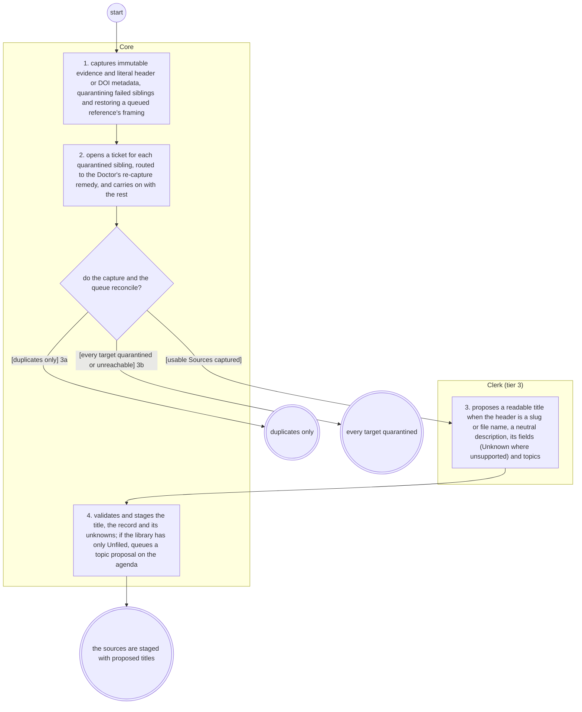

<!-- generated by render_pack.py from source-intake.spec.yaml sha256=6cff9aa629aab40210f53e0beef4cee4c33e7c5185856613b27256d6efbbd0ee; edit the spec, not this file -->
# Capture, title and stage each source (proposed)

**UC1.2 · to-be · `PROPOSED_UNACCEPTED`** · spec [source-intake.spec.yaml](../source-intake.spec.yaml)

## Written use case

| Field | Content |
|---|---|
| **Use case name** | Capture, title and stage each source |
| **Brief description** | Immutable evidence, literal metadata, a proposed readable title and staging. |
| **Primary actor** | Core |
| **Supporting actors** | Clerk |
| **Preconditions** | Source-eligible inputs |
| **Trigger** | The parent's intake step |
| **Success guarantee** | Staged with a readable title and its unknowns explicit |
| **Minimal guarantee** | Duplicates reconciled; failures quarantined |
| **Open questions** | W-INT-02: a ticket for each quarantined sibling |

**Main success scenario** (generated: the guard-true path, in step order)

1. The Core captures immutable evidence and literal header or DOI metadata, quarantining failed siblings and restoring a queued reference's framing.
2. The Core opens a ticket for each quarantined sibling, routed to the Doctor's re-capture remedy, and carries on with the rest.
3. The Clerk (tier 3) proposes a readable title when the header is a slug or file name, a neutral description, its fields (Unknown where unsupported) and topics.
4. The Core validates and stages the title, the record and its unknowns; if the library has only Unfiled, queues a topic proposal on the agenda.

**Extensions** (generated: one per non-happy guard; numbered by the step it leaves)

- **3a** (from: do the capture and the queue reconcile?) *anticipated*
  - `3a1` Duplicates only.
  - `3a2` The use case ends: duplicates only.
- **3b** (from: do the capture and the queue reconcile?) *anticipated*
  - `3b1` Every target quarantined or unreachable.
  - `3b2` The use case ends: every target quarantined.

## Activity diagram



## Lane load

| Lane | On the main success scenario | Anywhere in the diagram |
|---|---|---|
| Clerk (tier 3) | 1 | 1 |
| Core | 4 | 4 |

Paths by how they end: **paused** 1, **reused** 1, **success** 1.

## Decision tree

```text
start: Capture, title and stage each source (proposed)
  └─ T1: usable Sources captured  ⇒ the sources are staged with proposed titles
  └─ T2: duplicates only  ⇒ duplicates only
  └─ T3: every target quarantined or unreachable  ⇒ every target quarantined
```

## Test cases

One test per path: the main success scenario, then each extension.

| Test | Path (guards taken) | Extension | Expected outcome |
|---|---|---|---|
| T1 | do the capture and the queue reconcile? → usable Sources captured | MSS | the sources are staged with proposed titles |
| T2 | do the capture and the queue reconcile? → duplicates only | 3a | duplicates only |
| T3 | do the capture and the queue reconcile? → every target quarantined or unreachable | 3b | every target quarantined |

### Boundary values

_None declared._

## As-is weaknesses this handles

| As-is weakness | Where here | How it is handled |
|---|---|---|
| W-INT-02 (source-intake): A quarantined capture waits for someone to retry it, and nobody is told. | qticket | Each quarantined sibling gets a ticket, routed to the Doctor's re-capture remedy; the rest carry on. |
| W-INT-01 (source-intake): Titles fall back to slugs or file names, and the topic to Unfiled; nothing schedules the fix. | describe | A Clerk proposes a readable title when the header is a slug or file name, with its topics. |

## Checks

Errors: none

Warnings: none
