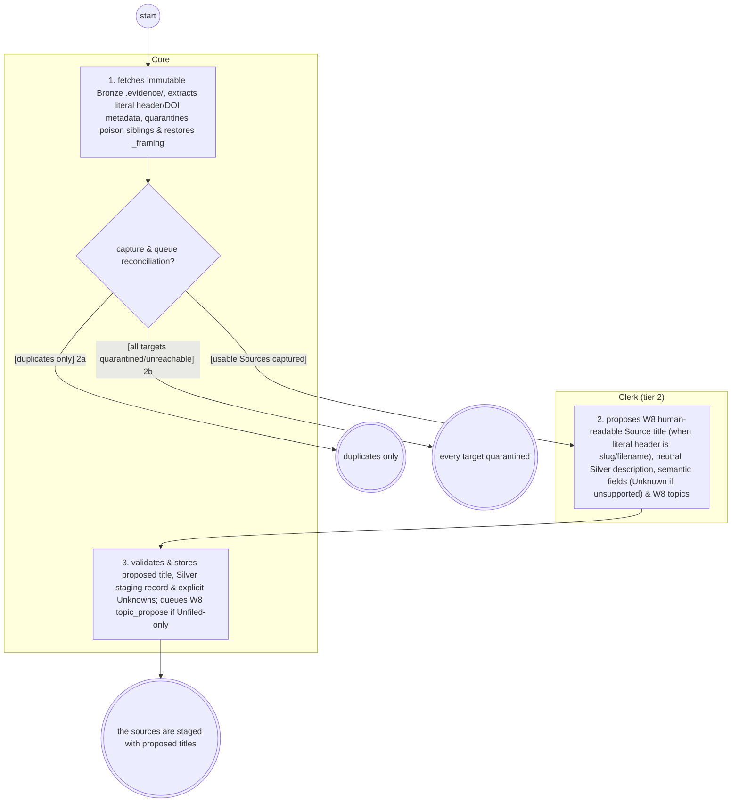

<!-- generated by render_pack.py from source-intake.spec.yaml sha256=429a3137cd60caf0dca74db0499225a126ac4cee029d95d4bab2e6d2d1ed8540; edit the spec, not this file -->
# Capture, title and stage each source (proposed)

**UC1.2 · to-be · `PROPOSED_UNACCEPTED`** · spec [source-intake.spec.yaml](../source-intake.spec.yaml)

## Written use case

| Field | Content |
|---|---|
| **Use case name** | Capture, title and stage each source (proposed) |
| **Brief description** | — |
| **Primary actor** | — |
| **Supporting actors** | — |
| **Preconditions** | — |
| **Trigger** | — |
| **Success guarantee** | — |
| **Minimal guarantee** | — |
| **Open questions** | — |

**Main success scenario** (generated: the guard-true path, in step order)

1. The Core fetches immutable Bronze .evidence/, extracts literal header/DOI metadata, quarantines poison siblings & restores _framing.
2. The Clerk (tier 2) proposes W8 human-readable Source title (when literal header is slug/filename), neutral Silver description, semantic fields (Unknown if unsupported) & W8 topics.
3. The Core validates & stores proposed title, Silver staging record & explicit Unknowns; queues W8 topic_propose if Unfiled-only.

**Extensions** (generated: one per non-happy guard; numbered by the step it leaves)

- **2a** (from: capture & queue reconciliation?) *anticipated*
  - `2a1` Duplicates only.
  - `2a2` The use case ends: duplicates only.
- **2b** (from: capture & queue reconciliation?) *anticipated*
  - `2b1` All targets quarantined/unreachable.
  - `2b2` The use case ends: every target quarantined.

## Activity diagram



## Lane load

| Lane | On the main success scenario | Anywhere in the diagram |
|---|---|---|
| Clerk (tier 2) | 1 | 1 |
| Core | 3 | 3 |

Paths by how they end: **paused** 1, **reused** 1, **success** 1.

## Decision tree

```text
start: Capture, title and stage each source (proposed)
  └─ T1: usable Sources captured  ⇒ the sources are staged with proposed titles
  └─ T2: duplicates only  ⇒ duplicates only
  └─ T3: all targets quarantined/unreachable  ⇒ every target quarantined
```

## Test cases

One test per path: the main success scenario, then each extension.

| Test | Path (guards taken) | Extension | Expected outcome |
|---|---|---|---|
| T1 | capture & queue reconciliation? → usable Sources captured | MSS | the sources are staged with proposed titles |
| T2 | capture & queue reconciliation? → duplicates only | 2a | duplicates only |
| T3 | capture & queue reconciliation? → all targets quarantined/unreachable | 2b | every target quarantined |

### Boundary values

_None declared._

## As-is weaknesses this handles

_None recorded._

## Checks

Errors: none

Warnings: 
- written use case lacks: Use case name, Brief description, Primary actor, Supporting actors, Preconditions, Trigger, Success guarantee, Minimal guarantee, Open questions
