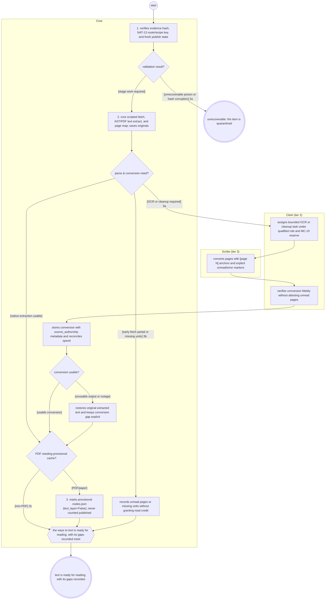

<!-- generated by render_pack.py from source-parse.spec.yaml sha256=22da98f660549b9ed639460c13bd1d2ef6bdcc2241de3da6bbc8c49da80070ed; edit the spec, not this file -->
# Validate and parse one source (proposed)

**UC1c.1 · to-be · `PROPOSED_UNACCEPTED`** · spec [source-parse.spec.yaml](../source-parse.spec.yaml)

## Written use case

| Field | Content |
|---|---|
| **Use case name** | Validate and parse a source |
| **Brief description** | Validate, extract, convert with a Clerk-assigned and Clerk-reviewed Scribe task, and mark the provisional projection. |
| **Primary actor** | Core |
| **Supporting actors** | Clerk, Scribe |
| **Preconditions** | Captured evidence |
| **Trigger** | Stage 1 |
| **Success guarantee** | Text ready with its gaps recorded |
| **Minimal guarantee** | Unrecoverable items quarantined |
| **Open questions** | — |

**Main success scenario** (generated: the guard-true path, in step order)

1. The Core verifies evidence hash, NAT-13 route/recipe key, and fresh publish state.
2. The Core runs scripted fetch, AST/PDF text extract, and page map; saves originals.
3. The Core marks provisional .nodes.json (text_layer=False); never counted published.

**Extensions** (generated: one per non-happy guard; numbered by the step it leaves)

- **2a** (from: validation result?) *anticipated*
  - `2a1` Unrecoverable poison or hash corruption.
  - `2a2` The use case ends: unrecoverable: the item is quarantined.
- **3a** (from: parse & conversion need?) *anticipated*
  - `3a1` OCR or cleanup required.
  - `3a2` The Clerk (tier 2) assigns bounded OCR or cleanup task under qualified role and MC-10 reserve.
  - `3a3` The Scribe (tier 3) converts pages with [page N] anchors and explicit unread/error markers.
  - `3a4` The Clerk (tier 2) verifies conversion fidelity without attesting unread pages.
  - `3a5` The Core stores conversion with source_authorship metadata and reconciles spend.
  - `3a6` The Core decides: conversion usable?
  - `3a6a` If unusable output or outage: restores original extracted text and keeps conversion gap explicit.
  - `3a7` If usable conversion:
  - `3a8` The Core decides: PDF needing provisional cache?
  - `3a8a` If non-PDF: the ways to text is ready for reading, with its gaps recorded meet.
  - `3a9` If PDF/paper:
  - `3a10` Rejoin at 3.
- **3b** (from: parse & conversion need?) *anticipated*
  - `3b1` Early fetch partial or missing units.
  - `3b2` The Core records unread pages or missing units without granting read credit.
  - `3b3` Rejoin at 'the ways to text is ready for reading, with its gaps recorded meet'.
- **3c** (from: PDF needing provisional cache?) *anticipated*
  - `3c1` Non-PDF.
  - `3c2` Rejoin at 'the ways to text is ready for reading, with its gaps recorded meet'.

## Activity diagram



## Lane load

| Lane | On the main success scenario | Anywhere in the diagram |
|---|---|---|
| Clerk (tier 2) | 0 | 2 |
| Scribe (tier 3) | 0 | 1 |
| Core | 6 | 10 |

Paths by how they end: **failed** 1, **success** 1.

## Decision tree

```text
start: Validate and parse one source (proposed)
      └─ T1: stage work required / native extraction usable / PDF/paper  ⇒ text is ready for reading, with its gaps recorded
  └─ T2: unrecoverable poison or hash corruption  ⇒ unrecoverable: the item is quarantined
      └─ T3: stage work required / OCR or cleanup required / unusable output or outage  ⇒ rejoins at 'PDF needing provisional cache?' (before step 3)
      └─ T4: stage work required / OCR or cleanup required / usable conversion  ⇒ rejoins at 'PDF needing provisional cache?' (before step 3)
    └─ T5: stage work required / early fetch partial or missing units  ⇒ rejoins at 'the ways to text is ready for reading, with its gaps recorded meet' (before step None)
      └─ T6: stage work required / native extraction usable / non-PDF  ⇒ rejoins at 'the ways to text is ready for reading, with its gaps recorded meet' (before step None)
```

## Test cases

One test per path: the main success scenario, then each extension.

| Test | Path (guards taken) | Extension | Expected outcome |
|---|---|---|---|
| T1 | validation result? → stage work required; parse & conversion need? → native extraction usable; PDF needing provisional cache? → PDF/paper | MSS | text is ready for reading, with its gaps recorded |
| T2 | validation result? → unrecoverable poison or hash corruption | 2a | unrecoverable: the item is quarantined |
| T3 | validation result? → stage work required; parse & conversion need? → OCR or cleanup required; conversion usable? → unusable output or outage | 3a | rejoins at 'PDF needing provisional cache?' (before step 3) |
| T4 | validation result? → stage work required; parse & conversion need? → OCR or cleanup required; conversion usable? → usable conversion | 3a | rejoins at 'PDF needing provisional cache?' (before step 3) |
| T5 | validation result? → stage work required; parse & conversion need? → early fetch partial or missing units | 3b | rejoins at 'the ways to text is ready for reading, with its gaps recorded meet' (before step None) |
| T6 | validation result? → stage work required; parse & conversion need? → native extraction usable; PDF needing provisional cache? → non-PDF | 3c | rejoins at 'the ways to text is ready for reading, with its gaps recorded meet' (before step None) |

### Boundary values

_None declared._

## As-is weaknesses this handles

| As-is weakness | Where here | How it is handled |
|---|---|---|
| W-PAR-01 (source-parse): A provisional paper projection is written before reading; if reading then fails, a catalogue-only projection remains. | preproj | The provisional projection is marked provisional and never counted as published. |

## Checks

Errors: none

Warnings: none
