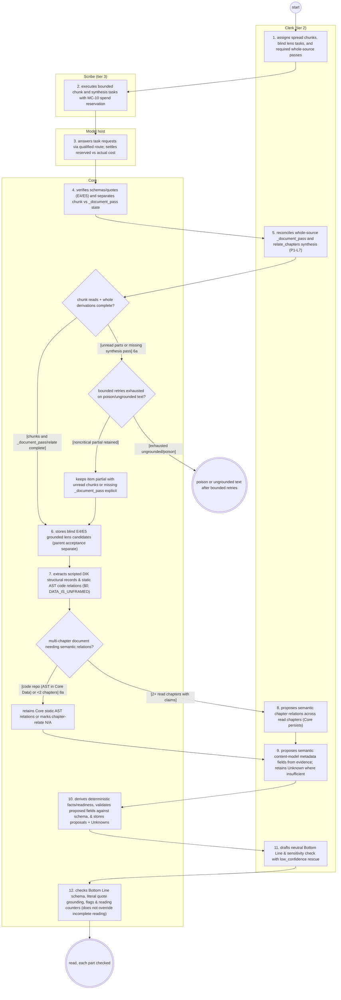

<!-- generated by render_pack.py from source-reading.spec.yaml sha256=a7b1cc26e924d604e3e2e5a25977824aa00536cc7ddb4d313fddbcfe35123ec8; edit the spec, not this file -->
# Read one source (proposed)

**UC1c.2 · to-be · `PROPOSED_UNACCEPTED`** · spec [source-reading.spec.yaml](../source-reading.spec.yaml)

## Written use case

| Field | Content |
|---|---|
| **Use case name** | Read one source (proposed) |
| **Brief description** | — |
| **Primary actor** | — |
| **Supporting actors** | — |
| **Preconditions** | — |
| **Trigger** | — |
| **Success guarantee** | — |
| **Minimal guarantee** | — |
| **Open questions** | — |

**Main success scenario** (generated: the guard-true path, in step order)

1. The Clerk (tier 2) assigns spread chunks, blind lens tasks, and required whole-source passes.
2. The Scribe (tier 3) executes bounded chunk and synthesis tasks with MC-10 spend reservation.
3. The Model host answers task requests via qualified route; settles reserved vs actual cost.
4. The Core verifies schemas/quotes (E4/E5) and separates chunk vs _document_pass state.
5. The Clerk (tier 2) reconciles whole-source _document_pass and relate_chapters synthesis (P1-L7).
6. The Core stores blind E4/E5 grounded lens candidates (parent acceptance separate).
7. The Core extracts scripted DIK structural records & static AST code relations ($0; DATA_IS_UNFRAMED).
8. The Clerk (tier 2) proposes semantic chapter relations across read chapters (Core persists).
9. The Clerk (tier 2) proposes semantic content-model metadata fields from evidence; retains Unknown where insufficient.
10. The Core derives deterministic facts/readiness, validates proposed fields against schema, & stores proposals + Unknowns.
11. The Clerk (tier 2) drafts neutral Bottom Line & sensitivity check with low_confidence rescue.
12. The Core checks Bottom Line schema, literal quote grounding, flags & reading counters (does not override incomplete reading).

**Extensions** (generated: one per non-happy guard; numbered by the step it leaves)

- **6a** (from: chunk reads + whole derivations complete?) *anticipated*
  - `6a1` Unread parts or missing synthesis pass.
  - `6a2` The Core decides: bounded retries exhausted on poison/ungrounded text?
  - `6a2a` If noncritical partial retained: keeps item partial with unread chunks or missing _document_pass explicit.
  - `6a3` If exhausted ungrounded/poison:
  - `6a4` The use case ends: poison or ungrounded text after bounded retries.
- **8a** (from: multi-chapter document needing semantic relations?) *anticipated*
  - `8a1` Code repo (AST in Core Data) or <2 chapters.
  - `8a2` The Core retains Core static AST relations or marks chapter-relate N/A.
  - `8a3` Rejoin at 9.

## Activity diagram



## Lane load

| Lane | On the main success scenario | Anywhere in the diagram |
|---|---|---|
| Clerk (tier 2) | 5 | 5 |
| Scribe (tier 3) | 1 | 1 |
| Core | 7 | 10 |
| Model host | 1 | 1 |

Paths by how they end: **failed** 1, **success** 1.

## Decision tree

```text
start: Read one source (proposed)
    └─ T1: chunks and _document_pass/relate complete / 2+ read chapters with claims  ⇒ read, each part checked
    └─ T2: unread parts or missing synthesis pass / noncritical partial retained  ⇒ rejoins at step 6
    └─ T3: unread parts or missing synthesis pass / exhausted ungrounded/poison  ⇒ poison or ungrounded text after bounded retries
    └─ T4: chunks and _document_pass/relate complete / code repo (AST in Core Data) or <2 chapters  ⇒ rejoins at step 9
```

## Test cases

One test per path: the main success scenario, then each extension.

| Test | Path (guards taken) | Extension | Expected outcome |
|---|---|---|---|
| T1 | chunk reads + whole derivations complete? → chunks and _document_pass/relate complete; multi-chapter document needing semantic relations? → 2+ read chapters with claims | MSS | read, each part checked |
| T2 | chunk reads + whole derivations complete? → unread parts or missing synthesis pass; bounded retries exhausted on poison/ungrounded text? → noncritical partial retained | 6a | rejoins at step 6 |
| T3 | chunk reads + whole derivations complete? → unread parts or missing synthesis pass; bounded retries exhausted on poison/ungrounded text? → exhausted ungrounded/poison | 6a | poison or ungrounded text after bounded retries |
| T4 | chunk reads + whole derivations complete? → chunks and _document_pass/relate complete; multi-chapter document needing semantic relations? → code repo (AST in Core Data) or <2 chapters | 8a | rejoins at step 9 |

### Boundary values

_None declared._

## As-is weaknesses this handles

_None recorded._

## Checks

Errors: none

Warnings: 
- written use case lacks: Use case name, Brief description, Primary actor, Supporting actors, Preconditions, Trigger, Success guarantee, Minimal guarantee, Open questions
- decision drelate ('multi-chapter document needing semantic relations?') tests a quantity but declares no boundary values
