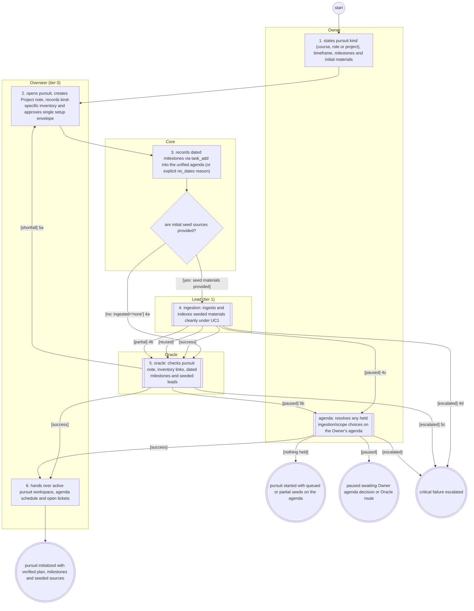

<!-- generated by render_pack.py from start-pursuit.spec.yaml sha256=7ffd5eb9fafa1bc2331fdca67c4781f44114a87f20a0a655521fb13f53d74d4e; edit the spec, not this file -->
# Start a pursuit (a course, a role or a project) (proposed)

**UC13 · to-be · `PROPOSED_UNACCEPTED`** · spec [start-pursuit.spec.yaml](../start-pursuit.spec.yaml)
Supersedes: `reports/2026-11-25-systems-analysis-finalisation/librarian/as-is/start-pursuit.spec.yaml`

| Problem | |
|---|---|
| symptom | As-is: five rigid phase gates where seed ingestion can stall on 150s Broker asks or uncurated source additions. |
| root | Approve the setup envelope once, capture inventory and dated milestones into the unified agenda, delegate seeded sources through UC1 ingestion, verify completeness via Oracle, and hold unresolved items on the agenda. |

## Written use case

| Field | Content |
|---|---|
| **Use case name** | Start a pursuit (a course, a role or a project) |
| **Brief description** | Tier 0 captures pursuit kind, inventory and single setup envelope; Core records dated milestones into the unified agenda, routes initial seed sources through UC1 ingestion, and has Oracle verify plan and milestone completeness. |
| **Primary actor** | Overseer (tier 0) |
| **Supporting actors** | Owner, Lead (tier 1), Core, Oracle |
| **Preconditions** | Pursuit kind and timeframe named |
| **Trigger** | The Owner starts a course, role or project pursuit |
| **Success guarantee** | Pursuit Project note, inventory, unified agenda milestones and indexed seeds verified by Oracle |
| **Minimal guarantee** | Held or partial seed sources stay on the Owner's agenda without blocking pursuit creation |
| **Open questions** | — |

**Main success scenario** (generated: the guard-true path, in step order)

1. The Owner states pursuit kind (course, role or project), timeframe, milestones and initial materials.
2. The Overseer (tier 0) opens pursuit, creates Project note, records kind-specific inventory and approves single setup envelope.
3. The Core records dated milestones via task_add into the unified agenda (or explicit no_dates reason).
4. The Lead (tier 1) ingests and indexes seeded materials cleanly under UC1.
5. The Oracle checks pursuit note, inventory links, dated milestones and seeded leads.
6. The Overseer (tier 0) hands over active pursuit workspace, agenda schedule and open tickets.

**Extensions** (generated: one per non-happy guard; numbered by the step it leaves)

- **4a** (from: are initial seed sources provided?) *anticipated*
  - `4a1` No: ingested='none'.
  - `4a2` Rejoin at 5.
- **4b** (from: ingests and indexes seeded materials cleanly under UC1) *anticipated*
  - `4b1` Partial.
  - `4b2` Rejoin at 5.
- **4c** (from: ingests and indexes seeded materials cleanly under UC1) *anticipated*
  - `4c1` Paused.
  - `4c2` The Owner resolves any held ingestion/scope choices on the Owner's agenda (continues in agenda).
  - `4c2a` If nothing held: the use case ends: pursuit started with queued or partial seeds on the agenda.
  - `4c2a` If paused: the use case ends: paused awaiting Owner agenda decision or Oracle route.
  - `4c2a` If escalated: the use case ends: critical failure escalated.
  - `4c3` If success:
  - `4c4` Rejoin at 6.
- **4d** (from: ingests and indexes seeded materials cleanly under UC1) *anticipated*
  - `4d1` Escalated.
  - `4d2` The use case ends: critical failure escalated.
- **5a** (from: checks pursuit note, inventory links, dated milestones and seeded leads) *anticipated*
  - `5a1` Shortfall.
  - `5a2` Rejoin at 2.
- **5b** (from: checks pursuit note, inventory links, dated milestones and seeded leads) *anticipated*
  - `5b1` Paused.
  - `5b2` The Owner resolves any held ingestion/scope choices on the Owner's agenda (continues in agenda).
  - `5b2a` If nothing held: the use case ends: pursuit started with queued or partial seeds on the agenda.
  - `5b2a` If paused: the use case ends: paused awaiting Owner agenda decision or Oracle route.
  - `5b2a` If escalated: the use case ends: critical failure escalated.
  - `5b3` If success:
  - `5b4` Rejoin at 6.
- **5c** (from: checks pursuit note, inventory links, dated milestones and seeded leads) *anticipated*
  - `5c1` Escalated.
  - `5c2` The use case ends: critical failure escalated.

## Activity diagram



## Lane load

| Lane | On the main success scenario | Anywhere in the diagram |
|---|---|---|
| Owner | 1 | 2 |
| Overseer (tier 0) | 2 | 2 |
| Lead (tier 1) | 1 | 1 |
| Oracle | 1 | 1 |
| Core | 2 | 2 |

**Tier-0 turns** (each return of control to tier 0; owner's scale: 2 ideal, 3 expected, 4 rusty, 5–10 bad, more: might as well have done it themselves). Main success scenario: **2 (ideal)**. Worst path: T10, **3 (expected)**. Paths by grade: ideal 10, expected 1; escalated 4 (failures, not graded).

Paths by how they end: **escalated** 4, **partial** 2, **paused** 2, **success** 1. Every *escalated* path is a failure of this use case: the work went back to tier 0.

## Decision tree

```text
start: Start a pursuit (a course, a role or a project) (proposed)
      └─ T1: yes: seed materials provided / success / success  ⇒ pursuit initialized with verified plan, milestones and seeded sources
  └─ T2: no: ingested='none'  ⇒ rejoins at step 5
    └─ T3: yes: seed materials provided / reused  ⇒ rejoins at step 5
    └─ T4: yes: seed materials provided / partial  ⇒ rejoins at step 5
      └─ T5: yes: seed materials provided / paused / nothing held  ⇒ pursuit started with queued or partial seeds on the agenda
      └─ T6: yes: seed materials provided / paused / paused  ⇒ paused awaiting Owner agenda decision or Oracle route
      └─ T7: yes: seed materials provided / paused / escalated  ⇒ critical failure escalated
      └─ T8: yes: seed materials provided / paused / success  ⇒ rejoins at step 6
    └─ T9: yes: seed materials provided / escalated  ⇒ critical failure escalated
      └─ T10: yes: seed materials provided / success / shortfall  ⇒ rejoins at step 2
        └─ T11: yes: seed materials provided / success / paused / nothing held  ⇒ pursuit started with queued or partial seeds on the agenda
        └─ T12: yes: seed materials provided / success / paused / paused  ⇒ paused awaiting Owner agenda decision or Oracle route
        └─ T13: yes: seed materials provided / success / paused / escalated  ⇒ critical failure escalated
        └─ T14: yes: seed materials provided / success / paused / success  ⇒ rejoins at step 6
      └─ T15: yes: seed materials provided / success / escalated  ⇒ critical failure escalated
```

## Test cases

One test per path: the main success scenario, then each extension.

| Test | Path (guards taken) | Extension | Expected outcome | Tier-0 turns |
|---|---|---|---|---|
| T1 | are initial seed sources provided? → yes: seed materials provided; ingests and indexes seeded materials cleanly under UC1 → success; checks pursuit note, inventory links, dated milestones and seeded leads → success | MSS | pursuit initialized with verified plan, milestones and seeded sources | 2 (ideal) |
| T2 | are initial seed sources provided? → no: ingested='none' | 4a | rejoins at step 5 | 2 (ideal) |
| T3 | are initial seed sources provided? → yes: seed materials provided; ingests and indexes seeded materials cleanly under UC1 → reused | MSS | rejoins at step 5 | 2 (ideal) |
| T4 | are initial seed sources provided? → yes: seed materials provided; ingests and indexes seeded materials cleanly under UC1 → partial | 4b | rejoins at step 5 | 2 (ideal) |
| T5 | are initial seed sources provided? → yes: seed materials provided; ingests and indexes seeded materials cleanly under UC1 → paused; resolves any held ingestion/scope choices on the Owner's agenda → nothing held | 4c | pursuit started with queued or partial seeds on the agenda | 1 (ideal) |
| T6 | are initial seed sources provided? → yes: seed materials provided; ingests and indexes seeded materials cleanly under UC1 → paused; resolves any held ingestion/scope choices on the Owner's agenda → paused | 4c | paused awaiting Owner agenda decision or Oracle route | 1 (ideal) |
| T7 | are initial seed sources provided? → yes: seed materials provided; ingests and indexes seeded materials cleanly under UC1 → paused; resolves any held ingestion/scope choices on the Owner's agenda → escalated | 4c | critical failure escalated | 1 (escalated: a failure) |
| T8 | are initial seed sources provided? → yes: seed materials provided; ingests and indexes seeded materials cleanly under UC1 → paused; resolves any held ingestion/scope choices on the Owner's agenda → success | 4c | rejoins at step 6 | 2 (ideal) |
| T9 | are initial seed sources provided? → yes: seed materials provided; ingests and indexes seeded materials cleanly under UC1 → escalated | 4d | critical failure escalated | 1 (escalated: a failure) |
| T10 | are initial seed sources provided? → yes: seed materials provided; ingests and indexes seeded materials cleanly under UC1 → success; checks pursuit note, inventory links, dated milestones and seeded leads → shortfall | 5a | rejoins at step 2 | 3 (expected) |
| T11 | are initial seed sources provided? → yes: seed materials provided; ingests and indexes seeded materials cleanly under UC1 → success; checks pursuit note, inventory links, dated milestones and seeded leads → paused; resolves any held ingestion/scope choices on the Owner's agenda → nothing held | 5b | pursuit started with queued or partial seeds on the agenda | 1 (ideal) |
| T12 | are initial seed sources provided? → yes: seed materials provided; ingests and indexes seeded materials cleanly under UC1 → success; checks pursuit note, inventory links, dated milestones and seeded leads → paused; resolves any held ingestion/scope choices on the Owner's agenda → paused | 5b | paused awaiting Owner agenda decision or Oracle route | 1 (ideal) |
| T13 | are initial seed sources provided? → yes: seed materials provided; ingests and indexes seeded materials cleanly under UC1 → success; checks pursuit note, inventory links, dated milestones and seeded leads → paused; resolves any held ingestion/scope choices on the Owner's agenda → escalated | 5b | critical failure escalated | 1 (escalated: a failure) |
| T14 | are initial seed sources provided? → yes: seed materials provided; ingests and indexes seeded materials cleanly under UC1 → success; checks pursuit note, inventory links, dated milestones and seeded leads → paused; resolves any held ingestion/scope choices on the Owner's agenda → success | 5b | rejoins at step 6 | 2 (ideal) |
| T15 | are initial seed sources provided? → yes: seed materials provided; ingests and indexes seeded materials cleanly under UC1 → success; checks pursuit note, inventory links, dated milestones and seeded leads → escalated | 5c | critical failure escalated | 1 (escalated: a failure) |

### Boundary values

_None declared._

## As-is weaknesses this handles

_None recorded._

## Evidence

- builds-on.md (agenda, ingestion, oracle); phases.yaml start_pursuit; initiators.table.yaml UC13.

## Checks

Errors: none

Warnings: none
