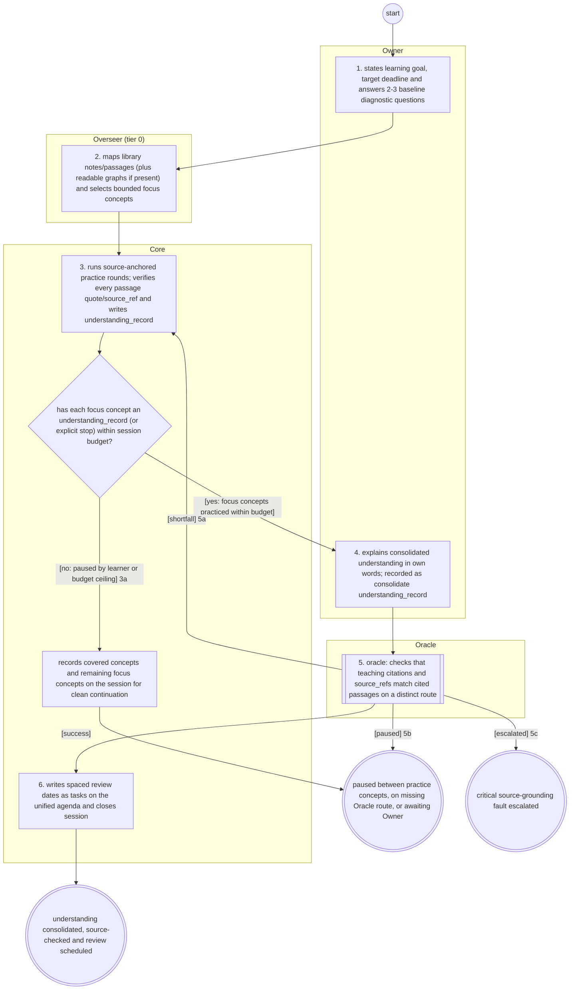

<!-- generated by render_pack.py from study-topic.spec.yaml sha256=80926a851766af7b37649537d6e23dde527ede183959f40665101989e9773b2b; edit the spec, not this file -->
# Study a topic with the library (proposed)

**UC14 · to-be · `PROPOSED_UNACCEPTED`** · spec [study-topic.spec.yaml](../study-topic.spec.yaml)
Supersedes: `reports/2026-11-25-systems-analysis-finalisation/librarian/as-is/study-topic.spec.yaml`

| Problem | |
|---|---|
| symptom | As-is: tutoring accuracy relies solely on tier 0 without checking source quotes, and spent practice budgets stall phase transitions. |
| root | Anchor diagnostic baseline, source-grounded practice and consolidation in verified library passages/refs, validate factual grounding via Oracle, and schedule spaced review tasks directly onto the agenda. |

## Written use case

| Field | Content |
|---|---|
| **Use case name** | Study a topic with the library |
| **Brief description** | Tier 0 tutors the person through goal, diagnostic baseline, bounded focus concepts, source-anchored practice and consolidation, with Oracle verifying passage citations on a distinct route and Core scheduling spaced review tasks on the agenda. |
| **Primary actor** | Overseer (tier 0) |
| **Supporting actors** | Owner, Oracle, Core |
| **Preconditions** | Library notes exist for the topic |
| **Trigger** | The Owner starts a study-topic (learn) session |
| **Success guarantee** | Focus concepts practised, consolidated, citation-checked by Oracle and review dates added to the agenda |
| **Minimal guarantee** | Paused practice preserves completed understanding_records and remaining focus concepts cleanly |
| **Open questions** | — |

**Main success scenario** (generated: the guard-true path, in step order)

1. The Owner states learning goal, target deadline and answers 2-3 baseline diagnostic questions.
2. The Overseer (tier 0) maps library notes/passages (plus readable graphs if present) and selects bounded focus concepts.
3. The Core runs source-anchored practice rounds; verifies every passage quote/source_ref and writes understanding_record.
4. The Owner explains consolidated understanding in own words; recorded as consolidate understanding_record.
5. The Oracle checks that teaching citations and source_refs match cited passages on a distinct route.
6. The Core writes spaced review dates as tasks on the unified agenda and closes session.

**Extensions** (generated: one per non-happy guard; numbered by the step it leaves)

- **3a** (from: has each focus concept an understanding_record (or explicit stop) within session budget?) *anticipated*
  - `3a1` No: paused by learner or budget ceiling.
  - `3a2` The Core records covered concepts and remaining focus concepts on the session for clean continuation.
  - `3a3` The use case ends: paused between practice concepts, on missing Oracle route, or awaiting Owner.
- **5a** (from: checks that teaching citations and source_refs match cited passages on a distinct route) *anticipated*
  - `5a1` Shortfall.
  - `5a2` Rejoin at 3.
- **5b** (from: checks that teaching citations and source_refs match cited passages on a distinct route) *anticipated*
  - `5b1` Paused.
  - `5b2` The use case ends: paused between practice concepts, on missing Oracle route, or awaiting Owner.
- **5c** (from: checks that teaching citations and source_refs match cited passages on a distinct route) *anticipated*
  - `5c1` Escalated.
  - `5c2` The use case ends: critical source-grounding fault escalated.

## Activity diagram



## Lane load

| Lane | On the main success scenario | Anywhere in the diagram |
|---|---|---|
| Owner | 2 | 2 |
| Overseer (tier 0) | 1 | 1 |
| Oracle | 1 | 1 |
| Core | 3 | 4 |

**Tier-0 turns** (each return of control to tier 0; owner's scale: 2 ideal, 3 expected, 4 rusty, 5–10 bad, more: might as well have done it themselves). Main success scenario: **1 (ideal)**. Worst path: T4, **1 (ideal)**. Paths by grade: ideal 4; escalated 1 (failures, not graded).

Paths by how they end: **escalated** 1, **paused** 2, **success** 1. Every *escalated* path is a failure of this use case: the work went back to tier 0.

## Decision tree

```text
start: Study a topic with the library (proposed)
    └─ T1: yes: focus concepts practiced within budget / success  ⇒ understanding consolidated, source-checked and review scheduled
  └─ T2: no: paused by learner or budget ceiling  ⇒ paused between practice concepts, on missing Oracle route, or awaiting Owner
    └─ T3: yes: focus concepts practiced within budget / shortfall  ⇒ rejoins at step 3
    └─ T4: yes: focus concepts practiced within budget / paused  ⇒ paused between practice concepts, on missing Oracle route, or awaiting Owner
    └─ T5: yes: focus concepts practiced within budget / escalated  ⇒ critical source-grounding fault escalated
```

## Test cases

One test per path: the main success scenario, then each extension.

| Test | Path (guards taken) | Extension | Expected outcome | Tier-0 turns |
|---|---|---|---|---|
| T1 | has each focus concept an understanding_record (or explicit stop) within session budget? → yes: focus concepts practiced within budget; checks that teaching citations and source_refs match cited passages on a distinct route → success | MSS | understanding consolidated, source-checked and review scheduled | 1 (ideal) |
| T2 | has each focus concept an understanding_record (or explicit stop) within session budget? → no: paused by learner or budget ceiling | 3a | paused between practice concepts, on missing Oracle route, or awaiting Owner | 1 (ideal) |
| T3 | has each focus concept an understanding_record (or explicit stop) within session budget? → yes: focus concepts practiced within budget; checks that teaching citations and source_refs match cited passages on a distinct route → shortfall | 5a | rejoins at step 3 | 1 (ideal) |
| T4 | has each focus concept an understanding_record (or explicit stop) within session budget? → yes: focus concepts practiced within budget; checks that teaching citations and source_refs match cited passages on a distinct route → paused | 5b | paused between practice concepts, on missing Oracle route, or awaiting Owner | 1 (ideal) |
| T5 | has each focus concept an understanding_record (or explicit stop) within session budget? → yes: focus concepts practiced within budget; checks that teaching citations and source_refs match cited passages on a distinct route → escalated | 5c | critical source-grounding fault escalated | 1 (escalated: a failure) |

### Boundary values

| Decision | Values to test | Expected |
|---|---|---|
| has each focus concept an understanding_record (or explicit stop) within session budget? | all focus concepts recorded within budget; remaining concepts when budget ceiling reached | session pauses cleanly preserving completed records and remaining focus concepts |

## As-is weaknesses this handles

_None recorded._

## Evidence

- builds-on.md (agenda, oracle); phases.yaml learn; initiators.table.yaml UC14 (named Study a topic to distinguish from UC-L).

## Checks

Errors: none

Warnings: none
