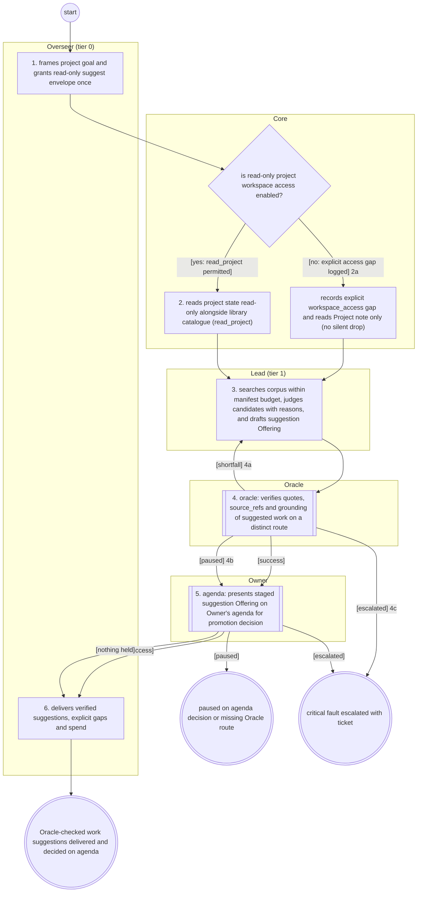

<!-- generated by render_pack.py from suggest.spec.yaml sha256=a04a82f7454369da4a2565a1f5a0316d8f5e1ff6866d03aa2bc3b25f68e39b45; edit the spec, not this file -->
# Suggest work for the vault (proposed)

**UC12 · to-be · `PROPOSED_UNACCEPTED`** · spec [suggest.spec.yaml](../suggest.spec.yaml)
Supersedes: `reports/2026-11-25-systems-analysis-finalisation/librarian/as-is/suggest.spec.yaml`

| Problem | |
|---|---|
| symptom | As-is: silent fallback if read_project fails, halving phase budgets, and blocking on Owner promotion. |
| root | Compile a single envelope, read project files strictly read-only with explicit gap if unavailable, research and verify suggestions through the Oracle, and land promotion on the Owner's agenda. |

## Written use case

| Field | Content |
|---|---|
| **Use case name** | Suggest work for the vault |
| **Brief description** | Tier 0 opens a single-envelope suggest run; Core reads project files strictly read-only (logging an explicit gap if access is off), Lead searches the scoped corpus and drafts suggestions, Oracle verifies grounding, and promotion goes to the Owner's agenda. |
| **Primary actor** | Overseer (tier 0) |
| **Supporting actors** | Lead (tier 1), Core, Oracle, Owner |
| **Preconditions** | Project note exists in the vault |
| **Trigger** | The Owner asks for suggested next work for a project |
| **Success guarantee** | Oracle-verified suggestion Offering decided on agenda and delivered with explicit gaps and spend |
| **Minimal guarantee** | Disabled workspace access is recorded as an explicit gap; no unverified suggestion is promoted |
| **Open questions** | — |

**Main success scenario** (generated: the guard-true path, in step order)

1. The Overseer (tier 0) frames project goal and grants read-only suggest envelope once.
2. The Core reads project state read-only alongside library catalogue (read_project).
3. The Lead (tier 1) searches corpus within manifest budget, judges candidates with reasons, and drafts suggestion Offering.
4. The Oracle verifies quotes, source_refs and grounding of suggested work on a distinct route.
5. The Owner presents staged suggestion Offering on Owner's agenda for promotion decision.
6. The Overseer (tier 0) delivers verified suggestions, explicit gaps and spend.

**Extensions** (generated: one per non-happy guard; numbered by the step it leaves)

- **2a** (from: is read-only project workspace access enabled?) *anticipated*
  - `2a1` No: explicit access gap logged.
  - `2a2` The Core records explicit workspace_access gap and reads Project note only (no silent drop).
  - `2a3` Rejoin at 3.
- **4a** (from: verifies quotes, source_refs and grounding of suggested work on a distinct route) *anticipated*
  - `4a1` Shortfall.
  - `4a2` Rejoin at 3.
- **4b** (from: verifies quotes, source_refs and grounding of suggested work on a distinct route) *anticipated*
  - `4b1` Paused.
  - `4b2` Rejoin at 5.
- **4c** (from: verifies quotes, source_refs and grounding of suggested work on a distinct route) *anticipated*
  - `4c1` Escalated.
  - `4c2` The use case ends: critical fault escalated with ticket.

## Activity diagram



## Lane load

| Lane | On the main success scenario | Anywhere in the diagram |
|---|---|---|
| Owner | 1 | 1 |
| Overseer (tier 0) | 2 | 2 |
| Lead (tier 1) | 1 | 1 |
| Oracle | 1 | 1 |
| Core | 2 | 3 |

**Tier-0 turns** (each return of control to tier 0; owner's scale: 2 ideal, 3 expected, 4 rusty, 5–10 bad, more: might as well have done it themselves). Main success scenario: **2 (ideal)**. Worst path: T6, **2 (ideal)**. Paths by grade: ideal 6; escalated 2 (failures, not graded).

Paths by how they end: **escalated** 2, **paused** 1, **success** 1. Every *escalated* path is a failure of this use case: the work went back to tier 0.

## Decision tree

```text
start: Suggest work for the vault (proposed)
      └─ T1: yes: read_project permitted / success / success  ⇒ Oracle-checked work suggestions delivered and decided on agenda
  └─ T2: no: explicit access gap logged  ⇒ rejoins at step 3
    └─ T3: yes: read_project permitted / shortfall  ⇒ rejoins at step 3
    └─ T4: yes: read_project permitted / paused  ⇒ rejoins at step 5
    └─ T5: yes: read_project permitted / escalated  ⇒ critical fault escalated with ticket
      └─ T6: yes: read_project permitted / success / nothing held  ⇒ rejoins at step 6
      └─ T7: yes: read_project permitted / success / paused  ⇒ paused on agenda decision or missing Oracle route
      └─ T8: yes: read_project permitted / success / escalated  ⇒ critical fault escalated with ticket
```

## Test cases

One test per path: the main success scenario, then each extension.

| Test | Path (guards taken) | Extension | Expected outcome | Tier-0 turns |
|---|---|---|---|---|
| T1 | is read-only project workspace access enabled? → yes: read_project permitted; verifies quotes, source_refs and grounding of suggested work on a distinct route → success; presents staged suggestion Offering on Owner's agenda for promotion decision → success | MSS | Oracle-checked work suggestions delivered and decided on agenda | 2 (ideal) |
| T2 | is read-only project workspace access enabled? → no: explicit access gap logged | 2a | rejoins at step 3 | 2 (ideal) |
| T3 | is read-only project workspace access enabled? → yes: read_project permitted; verifies quotes, source_refs and grounding of suggested work on a distinct route → shortfall | 4a | rejoins at step 3 | 2 (ideal) |
| T4 | is read-only project workspace access enabled? → yes: read_project permitted; verifies quotes, source_refs and grounding of suggested work on a distinct route → paused | 4b | rejoins at step 5 | 2 (ideal) |
| T5 | is read-only project workspace access enabled? → yes: read_project permitted; verifies quotes, source_refs and grounding of suggested work on a distinct route → escalated | 4c | critical fault escalated with ticket | 1 (escalated: a failure) |
| T6 | is read-only project workspace access enabled? → yes: read_project permitted; verifies quotes, source_refs and grounding of suggested work on a distinct route → success; presents staged suggestion Offering on Owner's agenda for promotion decision → nothing held | MSS | rejoins at step 6 | 2 (ideal) |
| T7 | is read-only project workspace access enabled? → yes: read_project permitted; verifies quotes, source_refs and grounding of suggested work on a distinct route → success; presents staged suggestion Offering on Owner's agenda for promotion decision → paused | MSS | paused on agenda decision or missing Oracle route | 1 (ideal) |
| T8 | is read-only project workspace access enabled? → yes: read_project permitted; verifies quotes, source_refs and grounding of suggested work on a distinct route → success; presents staged suggestion Offering on Owner's agenda for promotion decision → escalated | MSS | critical fault escalated with ticket | 1 (escalated: a failure) |

### Boundary values

_None declared._

## As-is weaknesses this handles

_None recorded._

## Evidence

- builds-on.md; phases.yaml suggest; initiators.table.yaml UC12; oracle & agenda specs.

## Checks

Errors: none

Warnings: none
